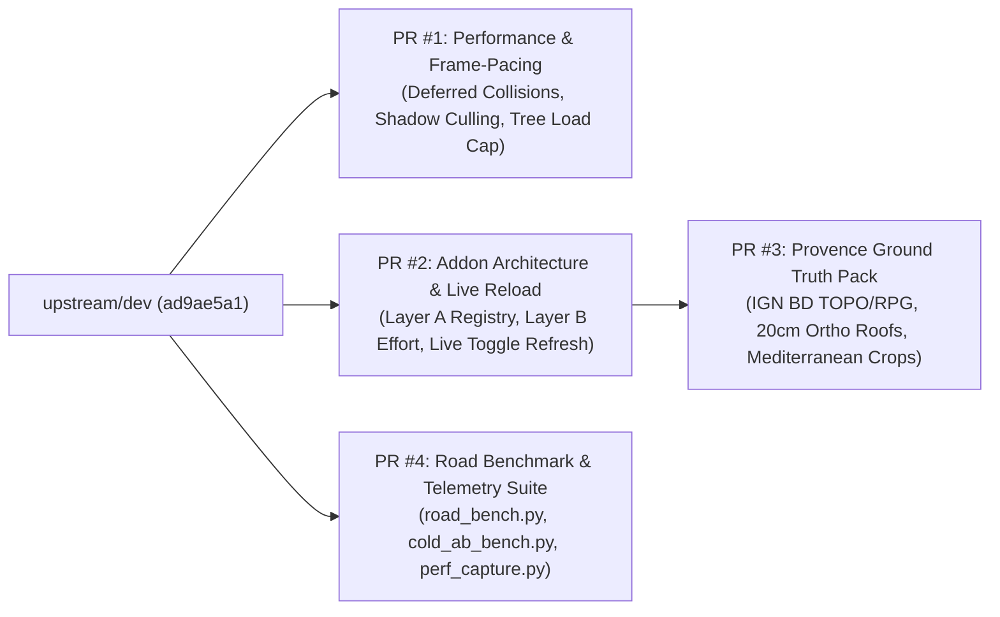

# Modular Upstream PR Packages & Addon Architecture Guide

This document explains how `dev-experimental-branch` (`1.7.3-dev-experimental`) is split into **4 independent, self-contained PR packages** against `TecnaGamer/BeamNG.Earth` `upstream/dev` (`ad9ae5a1`), and details the engineering rationale behind the **Declarative Addon Refactor** and **Live World Toggle Reload**.

---

## 1. Why Split Into 4 Modular PR Packages?

Maintainers of large simulation projects prefer small, focused PRs where **performance optimizations**, **core plugin infrastructure**, **regional content packs**, and **benchmarking tools** do not depend on each other:

| PR Package | Branch Name | Category | Coupling to Other PRs | Key Files |
| :--- | :--- | :--- | :--- | :--- |
| **PR #1** | `pr/perf-frame-pacing-and-shadows` | **Performance Only** (Zero terrain-gen changes) | **Standalone** (merges directly into `upstream/dev`) | `roads.lua`, `trees.lua`, `shadowctl.lua`, `buildings.materials.json`, `tunnel.materials.json`, `pools.py`, `test_roads.lua`, `test_trees.lua`, `test_shadowctl.lua` |
| **PR #2** | `pr/addon-architecture-and-effort-governor` | **Addon Infrastructure & Live World Reload** | **Standalone** (merges directly into `upstream/dev`) | `server/addons.py`, `server/effort.py`, `server/earthd.py`, `server/blockworker.py`, `server/revisit.py`, `mod/.../addons.lua`, `earthAddonsWindow.js`, `earthSettingsStore.js`, `test_addons.py`, `test_effort.py` |
| **PR #3** | `pr/addon-provence-ground-truth` | **Regional Terrain & Biome Pack (`provence`)** | Depends on **PR #2** (`addons.py` / `effort.py` hooks) | `addons/beamng_earth_provence/*`, `server/ign_fr.py`, `server/vegetation.py`, `server/buildings.py`, `server/mapdata.py`, `bne_lavender_row.dae`, `test_buildings.py`, `test_vegetation.py` |
| **PR #4** | `pr/benchmark-and-telemetry-suite` | **Developer Benchmark & Telemetry Harness** | **Standalone** (merges directly into `upstream/dev`) | `tools/road_bench.py`, `tools/cold_ab_bench.py`, `tools/perf_capture.py`, `tools/drive_driver.lua`, `tools/mcp.py` |

---

## 2. Interest & Value of the Addon Architecture Refactor (Layer A vs. Layer B)

### 2.1 Zero-Rebuild Regional Extensibility (Native BeamNG Mod Zips)
Previously, adding a regional dataset (such as French IGN BD TOPO 3D buildings, IGN RPG crop parcels, Swiss/German forestry data, or state-level LiDAR/orthophotos) required modifying core server files (`vegetation.py`, `buildings.py`, `mapdata.py`) and maintaining a separate fork of the server.

With the **Declarative Addon Architecture (`server/addons.py` + `lua/ge/extensions/beamngEarth/addons.lua`)**:
- Community modders ship a standard BeamNG mod zip (`mods/beamng_earth_<region>.zip`) containing declarative JSON manifests (`addon.json`, `data_sources.json`, `biomes.json`) and custom 3D `.dae` / `.png` assets.
- **Strict Version & Integrity Gate**: Every addon declares `requires_beamng_earth` (e.g. `>=1.7.0 <1.8.0`) and is verified against `APPROVED_MANIFEST_HASHES` (SHA-256) before activation. Unapproved or incompatible mods are cleanly rejected without crashing or polluting the server.

### 2.2 Decoupling "Ground Truth" (Layer A) from "Performance Effort" (Layer B)
In traditional world generators, turning down graphics settings deletes whole feature types or changes what is generated in the world. Our two-layer split keeps **what exists** separate from **how hard the hardware works**:
- **Layer A — Ground Truth (`addons.py`)**: Defines *what* exists at `(lat, lon)` and *which data sources* are queried (e.g. "Parcel `#4812` is a vineyard oriented at `114°` azimuth; Building `#902` has a terracotta tile roof").
- **Layer B — Effort & Tradeoff Governor (`effort.py`)**: Controls *how densely* Layer A is synthesized based on the user's hardware or target frame rate (`low`, `balanced`, `high`, `ultra`, `auto_fps`):
  - `veg_density_scale` (`0.35x` on Steam Deck / `low` up to `1.50x` on `ultra`)
  - `crop_row_step_scale` (wider row spacing on weak CPUs/GPUs while preserving the exact parcel boundaries and row orientation!)
  - `max_items_per_cell` (`2,500` on `low` vs `12,000` on `ultra`)
  - `ortho_tint_sample_budget` (caps per-tile HTTP/orthophoto roof color samples)

---

## 3. Interest & Value of Live Toggle Reload for Terrain & World Generation

### 3.1 The Problem Before Live Toggle Reload
Previously, toggling a world-generation setting in-game had **no visible effect** on already-visited areas because of three caching layers:
1. **Disk Cache Collisions (`vegetation/v20/<release>/<x>/<y>.npz` and `revisit/`)**: Once a cell was generated with an addon off, its `.npz` vegetation array and revisit `.cdae`/`.json` tiles were written to disk under a static path. Enabling the addon later still read the old un-enriched `.npz` file from disk.
2. **Multi-Process Worker Isolation (`blockworker.py`)**: `earthd.py` offloads `veg_geo`, `roads_geo`, and `far_geo` to persistent `ProcessPoolExecutor` worker processes (`road_pool`, `far_bld_pool`). Changing a setting in `earthd.py`'s parent process left worker subprocesses running with stale addon/effort state and stale `_s.veg._mem` / `_s.md._mem` caches.
3. **Server Stream Tracker State (`Connection.veg`, `Connection.roads`, `Connection.bldfar`)**: Even if the client cleared its trees (`trees.clear()`), the server's `vegetation.Tracker` still marked those geotiles as "already sent" to this client and never re-streamed them until the player teleported kilometres away.

### 3.2 How the Live Toggle Reload Solves All Three
1. **Fingerprint-Keyed Disk & Memory Caches (`vegetation.py`, `revisit.py`)**:
   - Every vegetation cell (`Vegetation._path`) and revisit tile (`revisit.key`) is now tagged with `f"{addons.cache_fingerprint()}_{effort.effort_cache_tag()}"`.
   - Switching `provence` OFF → ON (or `balanced` → `ultra`) switches instantly to the corresponding cache namespace—preserving both versions on disk so toggling back and forth is instantaneous on warm cache!
2. **Zero-IPC Worker Subprocess Synchronization (`runtime_addon_effort.json`)**:
   - Whenever an addon or effort setting changes, `earthd.py` atomically writes `cache_dir/runtime_addon_effort.json`.
   - Before each tile job (`veg_geo`, `roads_geo`, `far_geo`, `build`), `blockworker.py` checks `st_mtime_ns` of `runtime_addon_effort.json` (~10 µs stat call) and, when changed, imports the updated `AddonRegistry` and `EffortController` state and flushes its in-memory cell caches.
3. **Instant Client + Server Tracker Reset (`Connection.reset_world_trackers()` & `Refresh World`)**:
   - When `cache_invalidated` is true (or when the user clicks **`Refresh World Around You`**), `core.lua` clears active vegetation and building sessions (`trees.clear()`, `roads.newSession()`, `roads.incrementBldGen()`) while `earthd.py` resets `self.veg`, `self.roads`, `self.signs`, and `self.bldfar`/`bldsky`/`brfar`.
   - On the very next `pose` tick (~100 ms later), the server immediately re-streams all surrounding tiles using the newly selected addons and effort profile—allowing players and modders to compare Ground Truth packs and Effort levels live in 1–4 seconds without moving or restarting!
