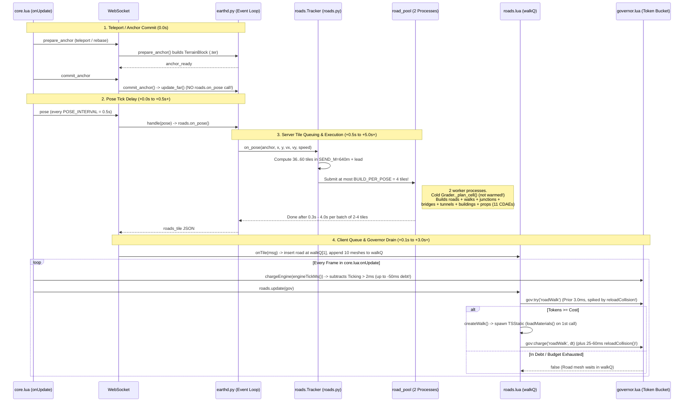
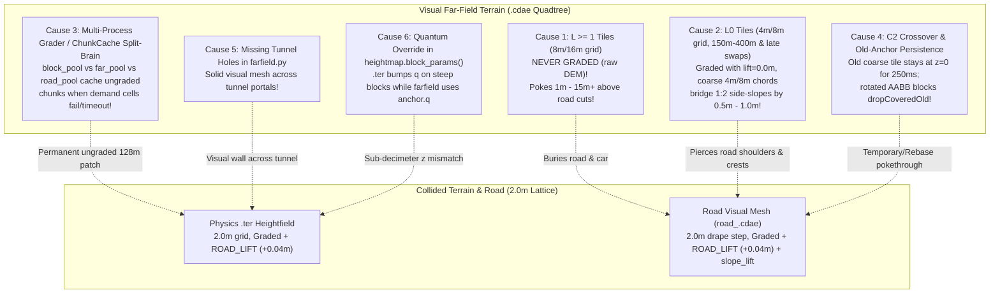

I have completed the deep architectural audit across the Python server (`server/`) and the Lua game extension (`mod/beamng_earth/lua/ge/extensions/beamngEarth/`) and saved the full report—including lifecycle diagrams, geometric proofs, and drop-in code solutions—to [`road_and_terrain_audit.md`](file:///C:/Users/hoppj/SynologyDrive/01_Projets/Projet_BeamEarth/BeamNG.Earth/road_and_terrain_audit.md).

---

### Summary of Findings

#### 1. What Generates the Road Layers & Why Visual Roads Lag Behind Terrain
* **The 4 Road Layers:**
  1. **Primary Near Visual Road Meshes (`road_<aid>_<tx>_<ty>.cdae`):** Built by [`roadmesh.build()`](file:///C:/Users/hoppj/SynologyDrive/01_Projets/Projet_BeamEarth/BeamNG.Earth/server/roadmesh.py#L85-L151) from ribbon chunks emitted by [`roads.build_tile()`](file:///C:/Users/hoppj/SynologyDrive/01_Projets/Projet_BeamEarth/BeamNG.Earth/server/roads.py#L1738-L1922) (`DRAPE_STEP = 2.0 m`) and spawned as non-colliding `TSStatic` objects via [`createWalk()`](file:///C:/Users/hoppj/SynologyDrive/01_Projets/Projet_BeamEarth/BeamNG.Earth/mod/beamng_earth/lua/ge/extensions/beamngEarth/roads.lua#L204-L234). (Bridge decks `deck_*.cdae` and tunnel tubes `tunnel_*.cdae` are spawned separately with `Visible Mesh Final` collision.)
  2. **`DecalRoad` Fallback:** [`createChunk()`](file:///C:/Users/hoppj/SynologyDrive/01_Projets/Projet_BeamEarth/BeamNG.Earth/mod/beamng_earth/lua/ge/extensions/beamngEarth/roads.lua#L140-L185) via `createQ` is only used if `data.road` is absent (`onTile` sets `queued = 0` whenever `data.road` is present, [`roads.lua:L345-L349`](file:///C:/Users/hoppj/SynologyDrive/01_Projets/Projet_BeamEarth/BeamNG.Earth/mod/beamng_earth/lua/ge/extensions/beamngEarth/roads.lua#L345-L349)).
  3. **Surface Paint Masks:** [`surface.paint_roads()`](file:///C:/Users/hoppj/SynologyDrive/01_Projets/Projet_BeamEarth/BeamNG.Earth/server/surface.py#L190-L226) rasterizes road materials into the `.ter` material index map (`ASPHALT`, `COBBLE`, `LOOSE`, `DIRT`) and `_m0.._m9.png` masks. In default `--near-visual mesh` mode, the `TerrainBlock` is **invisible** ([`terrain.lua:L200`](file:///C:/Users/hoppj/SynologyDrive/01_Projets/Projet_BeamEarth/BeamNG.Earth/mod/beamng_earth/lua/ge/extensions/beamngEarth/terrain.lua#L200)), so these masks only provide tire physics `groundModelName` and grass exclusion.
  4. **Far-Field Satellite Texture:** Aerial imagery baked into per-tile `.dds` textures on the quadtree `.cdae` tiles ([`earthd.py:L1543-L1561`](file:///C:/Users/hoppj/SynologyDrive/01_Projets/Projet_BeamEarth/BeamNG.Earth/server/earthd.py#L1543-L1561)).

* **Why Road Visuals Lag Behind Terrain Generation:**
  1. **No Road Trigger on `prepare_anchor` or `commit_anchor`:** [`commit_anchor()`](file:///C:/Users/hoppj/SynologyDrive/01_Projets/Projet_BeamEarth/BeamNG.Earth/server/earthd.py#L2463-L2510) immediately starts far-field tiles (`self.update_far()`), **but never calls `self.roads.on_pose()`**. Road generation only starts when the first `pose` message arrives (`POSE_INTERVAL = 0.5 s` in [`core.lua:L74, L848`](file:///C:/Users/hoppj/SynologyDrive/01_Projets/Projet_BeamEarth/BeamNG.Earth/mod/beamng_earth/lua/ge/extensions/beamngEarth/core.lua#L848), and suppressed during `placeFrames` and `rebasing`), giving terrain a **0.5–1.5 s head start**.
  2. **`road_pool` Worker Processes Are Never Warmed:** [`Server.warm_roads()`](file:///C:/Users/hoppj/SynologyDrive/01_Projets/Projet_BeamEarth/BeamNG.Earth/server/earthd.py#L1059-L1065) only pushes `warm_q` messages to `self.block_pools`, while `self.road_pool` is initialized with a dummy throwaway queue ([`earthd.py:L3175`](file:///C:/Users/hoppj/SynologyDrive/01_Projets/Projet_BeamEarth/BeamNG.Earth/server/earthd.py#L3175)). Thus, `road_pool` workers compute `Grader._plan_cell()` **cold** (`2–10 s` in dense areas) inside [`blockworker.roads_tile()`](file:///C:/Users/hoppj/SynologyDrive/01_Projets/Projet_BeamEarth/BeamNG.Earth/server/blockworker.py#L234).
  3. **Monolithic Tile Builds + `BUILD_PER_POSE = 4` & `ROAD_PROCESSES = 2`:** While terrain is a single $512^2$ heightmap, a $\pm 640\text{ m}$ road window (`SEND_M = 640.0`) requires **36 to 60 tiles** of $256\text{ m} \times 256\text{ m}$. [`Tracker.on_pose()`](file:///C:/Users/hoppj/SynologyDrive/01_Projets/Projet_BeamEarth/BeamNG.Earth/server/roads.py#L1970) caps in-flight builds at `BUILD_PER_POSE = 4` across only `ROAD_PROCESSES = 2` processes, and each `roads_tile` job blocks the visual `road_*.cdae` ribbon behind 3D buildings, sidewalks, junctions, bridges, tunnels, and furniture (up to 11 `.cdae` files per tile).
  4. **Client Governor Token Debt Freeze & `reloadCollision()` Contamination:**
     * [`Gov:chargeEngine()`](file:///C:/Users/hoppj/SynologyDrive/01_Projets/Projet_BeamEarth/BeamNG.Earth/mod/beamng_earth/lua/ge/extensions/beamngEarth/governor.lua#L209-L215) deducts any engine `Ticking > 2.0 ms` (`ENGINE_FREE_MS`) down to `-50.0 ms` (`ENGINE_MAX_DEBT_MS`), which freezes `gov:try('roadWalk')` for up to 25+ frames at a time when `DEFAULT_TARGET_MS = 2.0 ms`.
     * [`roads.lua:L615-L622`](file:///C:/Users/hoppj/SynologyDrive/01_Projets/Projet_BeamEarth/BeamNG.Earth/mod/beamng_earth/lua/ge/extensions/beamngEarth/roads.lua#L615-L622) charges `be:reloadCollision()` (`25–60 ms`) directly to `'roadWalk'`, inflating `gov.est['roadWalk']` (`EST_ALPHA = 0.2`) far above `2.0 ms` and plunging `gov.tokens` deeply negative.
     * [`loadMaterials()`](file:///C:/Users/hoppj/SynologyDrive/01_Projets/Projet_BeamEarth/BeamNG.Earth/mod/beamng_earth/lua/ge/extensions/beamngEarth/roads.lua#L109-L121) synchronously parses 6 JSON files and flushes 3 materials inside the first timed `createWalk` slot.

---

#### 2. Why Visual Terrain Desyncs from Collided Terrain & Buries Roads
In default `--near-visual mesh` mode, the physics `TerrainBlock` is invisible and **all visible ground** is rendered by `farfield` `.cdae` quadtree tiles. Desync and road pokethrough are caused by six interacting mechanisms:

1. **`L >= 1` Visual Tiles Are NEVER Graded:** Both [`blockworker.py:L333`](file:///C:/Users/hoppj/SynologyDrive/01_Projets/Projet_BeamEarth/BeamNG.Earth/server/blockworker.py#L333) and [`earthd.py:L1526`](file:///C:/Users/hoppj/SynologyDrive/01_Projets/Projet_BeamEarth/BeamNG.Earth/server/earthd.py#L1526) gate [`GradedDem`](file:///C:/Users/hoppj/SynologyDrive/01_Projets/Projet_BeamEarth/BeamNG.Earth/server/grading.py#L343-L353) on `tile.level <= 0`. Beyond `400 m`—and **right under the car whenever `L-1`/`L0` tiles haven't finished streaming/swapping yet**—the visible ground is an `L1` ($8\text{ m}$ grid) or `L2` ($16\text{ m}$ grid) tile built from **raw ungraded DEM**, which floats **1 m to 15+ m above road cuts**, visually burying both the road and the car.
2. **`GradedDem` Zero-Lift + `L0` Coarse Chord Error Across `1:2` Cut Slopes:**
   * [`GradedDem.sample()`](file:///C:/Users/hoppj/SynologyDrive/01_Projets/Projet_BeamEarth/BeamNG.Earth/server/grading.py#L348-L350) calls `self._grader.apply(lat, lon, base)` with `lift = 0.0`, leaving only the `4 cm` `ROAD_LIFT = 0.04 m` margin on the physics block and road mesh.
   * However, `L-1` ($2\text{ m}$ exact grid) only extends to `150 m` (`NEAR_RADII[64][-1] = 150.0` in [`farfield.py:L85`](file:///C:/Users/hoppj/SynologyDrive/01_Projets/Projet_BeamEarth/BeamNG.Earth/server/farfield.py#L85)), while $2\text{ m}$ draped roads extend to `640 m`. Between `150 m` and `400 m` (and under the car before `L-1` swaps in), `L0` uses a `4 m` (or `8 m`) grid whose triangles chord across `1:2` road cut slopes (`SLOPE_H_PER_V = 2.0`) by **+33.5 cm to +71 cm**, piercing straight through the road surface.
3. **Multi-Process `Grader` & `ChunkCache` Split-Brain:** `block_pools`, `far_pool`, and `road_pool` run in separate OS processes with independent [`Grader`](file:///C:/Users/hoppj/SynologyDrive/01_Projets/Projet_BeamEarth/BeamNG.Earth/server/grading.py#L140) and [`ChunkCache`](file:///C:/Users/hoppj/SynologyDrive/01_Projets/Projet_BeamEarth/BeamNG.Earth/server/heightmap.py#L147) instances ([`blockworker.py:L55-L74`](file:///C:/Users/hoppj/SynologyDrive/01_Projets/Projet_BeamEarth/BeamNG.Earth/server/blockworker.py#L55-L74)). When an Overture cell download fails/times out in one worker, [`Grader._plan_cell()`](file:///C:/Users/hoppj/SynologyDrive/01_Projets/Projet_BeamEarth/BeamNG.Earth/server/grading.py#L180-L185) caches `[]` (ungraded) for `RETRY_S = 60 s` and `ChunkCache` permanently caches the ungraded $128\text{ m}$ height chunk for the anchor's lifetime.
4. **C2 Vertical Crossover Hold & Rebase AABB Inflation:** During a `0.5 s` `far_swap` refinement ([`crossover.lua:L24-L25`](file:///C:/Users/hoppj/SynologyDrive/01_Projets/Projet_BeamEarth/BeamNG.Earth/mod/beamng_earth/lua/ge/extensions/beamngEarth/crossover.lua#L24-L25)), the old coarse ungraded tile stays at `z = 0` for the first `250 ms` before sinking; after an origin rebase, rotated old-anchor tiles have expanded AABBs ([`farfield.lua:L955-L961`](file:///C:/Users/hoppj/SynologyDrive/01_Projets/Projet_BeamEarth/BeamNG.Earth/mod/beamng_earth/lua/ge/extensions/beamngEarth/farfield.lua#L955-L961)) that delay [`dropCoveredOld()`](file:///C:/Users/hoppj/SynologyDrive/01_Projets/Projet_BeamEarth/BeamNG.Earth/mod/beamng_earth/lua/ge/extensions/beamngEarth/farfield.lua#L583-L618).
5. **Missing Tunnel Portal Cutouts in `farfield.py`:** [`blockworker.build()`](file:///C:/Users/hoppj/SynologyDrive/01_Projets/Projet_BeamEarth/BeamNG.Earth/server/blockworker.py#L202) punches `TER_HOLE` into `.ter` at tunnel entrances, but [`farfield.build_tile()`](file:///C:/Users/hoppj/SynologyDrive/01_Projets/Projet_BeamEarth/BeamNG.Earth/server/farfield.py#L774-L869) never cuts holes in the visual mesh—leaving a solid visual wall across tunnel portals in `mesh` mode.
6. **Quantum Override in [`heightmap.block_params()`](file:///C:/Users/hoppj/SynologyDrive/01_Projets/Projet_BeamEarth/BeamNG.Earth/server/heightmap.py#L106-L120):** Steep local blocks can bump `.ter` height quantum `q` up `Q_LADDER` in [`heightmap.write_png()`](file:///C:/Users/hoppj/SynologyDrive/01_Projets/Projet_BeamEarth/BeamNG.Earth/server/heightmap.py#L211) while `farfield.build_tile()` uses `anchor.q`.

Would you like me to apply the code fixes from Part 3 of [`road_and_terrain_audit.md`](file:///C:/Users/hoppj/SynologyDrive/01_Projets/Projet_BeamEarth/BeamNG.Earth/road_and_terrain_audit.md) directly to the Python and Lua files and run the test suite?
write_ter()`](file:///C:/Users/hoppj/SynologyDrive/01_Projets/Projet_BeamEarth/BeamNG.Earth/server/heightmap.py#L241-L265)) and as 8-bit PNG masks `_m0.png`..`_m9.png` (`surface.write_masks()`).
* **Crucial subtlety:** In the default `--near-visual mesh` mode ([`earthd.py:L3358`](file:///C:/Users/hoppj/SynologyDrive/01_Projets/Projet_BeamEarth/BeamNG.Earth/server/earthd.py#L3358)), [`terrain.lua:L200`](file:///C:/Users/hoppj/SynologyDrive/01_Projets/Projet_BeamEarth/BeamNG.Earth/mod/beamng_earth/lua/ge/extensions/beamngEarth/terrain.lua#L200) calls `tb:setRenderEnabled(false)`. Thus, in `mesh` mode, **the surface paint masks are completely invisible**—they only drive tire physics `groundModelName` (`ASPHALT_OLD`, `COBBLESTONE`, `DIRT_DUSTY`, `GRAVEL`) and suppress `GroundCover` grass on roads!

#### Layer 4: Far-Field Satellite Imagery (`server/farfield.py`)
* [`earthd.py:build_tile()`](file:///C:/Users/hoppj/SynologyDrive/01_Projets/Projet_BeamEarth/BeamNG.Earth/server/earthd.py#L1543-L1561) renders aerial/satellite imagery (`imagery.py`), optionally deshadowed (`deshadow.py`), color-matched (`colormatch.py`), and cliff-textured (`rockface.py`), into a per-tile `.dds` texture (`256×256` or `512×512`) mapped onto the far-field `.cdae` terrain mesh tiles.
* Before the 3D `road_<aid>_<tx>_<ty>.cdae` mesh streams in, the only visual indication of a road in `mesh` mode is the low-resolution aerial photo baked onto the `farfield` mesh tile.

---

### 1.2 End-to-End Lifecycle Trace: From Player Motion to Road Appearance



---

### 1.3 Root-Cause Diagnosis: Why Road Visuals Lag Behind Terrain Generation

#### Bottleneck 1: `prepare_anchor` and `commit_anchor` Never Trigger `roads.on_pose()`
* **Evidence:** In [`server/earthd.py:L2380-L2461`](file:///C:/Users/hoppj/SynologyDrive/01_Projets/Projet_BeamEarth/BeamNG.Earth/server/earthd.py#L2380-L2461) (`prepare_anchor`) and [`server/earthd.py:L2463-L2510`](file:///C:/Users/hoppj/SynologyDrive/01_Projets/Projet_BeamEarth/BeamNG.Earth/server/earthd.py#L2463-L2510) (`commit_anchor`), the server builds the initial physics `TerrainBlock`, warms mapdata, and immediately calls `self.update_far()` (`L2509`) to begin streaming far-field terrain tiles. **It never calls `self.roads.on_pose(...)`!**
* Furthermore, on the client during a teleport (`placeFrames = 10` in [`core.lua:L69, L831-L837`](file:///C:/Users/hoppj/SynologyDrive/01_Projets/Projet_BeamEarth/BeamNG.Earth/mod/beamng_earth/lua/ge/extensions/beamngEarth/core.lua#L831-L837)) or rebase (`st.rebasing` in [`core.lua:L848`](file:///C:/Users/hoppj/SynologyDrive/01_Projets/Projet_BeamEarth/BeamNG.Earth/mod/beamng_earth/lua/ge/extensions/beamngEarth/core.lua#L848)), `updateWorld()` suppresses sending `pose` messages, and only sends `pose` every `POSE_INTERVAL = 0.5` s ([`core.lua:L74, L848`](file:///C:/Users/hoppj/SynologyDrive/01_Projets/Projet_BeamEarth/BeamNG.Earth/mod/beamng_earth/lua/ge/extensions/beamngEarth/core.lua#L74)).
* **Impact:** Terrain and far-field tiles have a **0.5 s to 1.5 s head start** before the server even knows it should build the first road tile around the car.

#### Bottleneck 2: Tile Granularity Asymmetry + `BUILD_PER_POSE = 4` + `ROAD_PROCESSES = 2`
* **Evidence:**
  * The physics `TerrainBlock` is a **single** $1024\text{ m} \times 1024\text{ m}$ (`512²`) heightmap prepared proactively on a dedicated `LANE_REQUEST` / `LANE_PREFETCH` process pool ([`earthd.py:L3158-L3160`](file:///C:/Users/hoppj/SynologyDrive/01_Projets/Projet_BeamEarth/BeamNG.Earth/server/earthd.py#L3158-L3160)).
  * By contrast, roads are partitioned into $256\text{ m} \times 256\text{ m}$ tiles (`TILE = 256.0`, [`roads.py:L39`](file:///C:/Users/hoppj/SynologyDrive/01_Projets/Projet_BeamEarth/BeamNG.Earth/server/roads.py#L39)) across a `SEND_M = 640.0` m Chebyshev radius (`L40`) plus a velocity lookahead `lead = min(384.0, speed * 8.0)` (`L1953`).
  * A $\pm 640\text{ m}$ box covers a $6 \times 6$ to $7 \times 7$ grid = **36 to 49 tiles** (up to **60 tiles** at highway speed).
  * Yet [`roads.Tracker.on_pose()`](file:///C:/Users/hoppj/SynologyDrive/01_Projets/Projet_BeamEarth/BeamNG.Earth/server/roads.py#L1970) enforces a hard cap of `BUILD_PER_POSE = 4` (`roads.py:L46`) total in-flight tiles (`want[:max(0, BUILD_PER_POSE - len(self.building))]`), and [`earthd.py:L215, L3172`](file:///C:/Users/hoppj/SynologyDrive/01_Projets/Projet_BeamEarth/BeamNG.Earth/server/earthd.py#L3172) runs `self.road_pool` with only **`ROAD_PROCESSES = 2` worker processes**!
* **Impact:** Because new tiles can only be dispatched when a `pose` arrives (every `0.5 s`) and at most `4` tiles can be in flight at once, filling a 40-tile neighborhood requires **at minimum 10 pose cycles = 5.0 seconds** even if tile builds were instantaneous!

#### Bottleneck 3: Monolithic `roads_tile` Worker Job & Unwarmed `road_pool` Grader
* **Evidence:**
  * Look at [`earthd.py:L1059-L1065`](file:///C:/Users/hoppj/SynologyDrive/01_Projets/Projet_BeamEarth/BeamNG.Earth/server/earthd.py#L1059-L1065) (`warm_roads`) and [`earthd.py:L3155-L3176`](file:///C:/Users/hoppj/SynologyDrive/01_Projets/Projet_BeamEarth/BeamNG.Earth/server/earthd.py#L3155-L3176):
    ```python
    # earthd.py:1062-1065
    for q in self.warm_qs:
        try:
            q.put_nowait((anchor.id, (anchor.lat, anchor.lon), float(lat), float(lon)))
    ```
    `self.warm_qs` are attached **only to `self.block_pools`** (`L3155`), while `self.road_pool` is initialized with a dummy throwaway queue `ctx.Queue(maxsize=1)` (`L3175`)!
  * Consequently, the 2 worker processes in `self.road_pool` **never receive `warm_roads` messages**. When `blockworker.roads_tile()` ([`blockworker.py:L209-L270`](file:///C:/Users/hoppj/SynologyDrive/01_Projets/Projet_BeamEarth/BeamNG.Earth/server/blockworker.py#L209-L270)) calls `g.warm(clats, clons)` at `L234`, `road_pool` has to compute `Grader._plan_cell()` **cold from scratch** (which takes 2–10 seconds in dense areas)!
  * Even after the grader is warm, [`blockworker.roads_tile()`](file:///C:/Users/hoppj/SynologyDrive/01_Projets/Projet_BeamEarth/BeamNG.Earth/server/blockworker.py#L209-L270) and [`roads.build_tile()`](file:///C:/Users/hoppj/SynologyDrive/01_Projets/Projet_BeamEarth/BeamNG.Earth/server/roads.py#L1738-L1922) bundle **everything** into a single blocking task before returning the `roads_tile` message:
    1. Fetching Overture `"roads"`, `"buildings"`, `"infrastructure"`, and `"land_use"` (`blockworker.py:L221-225`).
    2. Computing `BridgeProfiles` and `TunnelProfiles` (`L238-252`).
    3. Finding junctions (`junctions.find`), traffic islands (`islands.find`), and crosswalks (`roads.py:L1794-1823`).
    4. Building full 3D sidewalks and curbs (`sidewalks.Builder`) + collision mesh (`walkcol`).
    5. Building up to 4 material buckets of 3D extruded buildings (`buildings.road_tile` -> `bld`, `bld2`, `bld3`, `bld4`, `bldcol`).
    6. Placing street furniture (`furniture.place`), powerlines (`wires`), and parking (`parking.from_features`).
    7. Writing up to **11 separate `.cdae` files** (`roads.write_tile`, `roads.py:L2015-2086`) before sending a single `roads_tile` WebSocket message!
* **Impact:** The lightweight visual road ribbon (`road_<aid>_<tx>_<ty>.cdae`) is held hostage behind 3D buildings, sidewalks, furniture, and cold `Grader` planning.

#### Bottleneck 4: Client-Side Governor Debt Freeze (`chargeEngine`), `reloadCollision()` Contamination, and `walkQ` Congestion
* **Evidence:**
  1. **`chargeEngine` Debt Freeze ([`governor.lua:L49-L51, L209-L215`](file:///C:/Users/hoppj/SynologyDrive/01_Projets/Projet_BeamEarth/BeamNG.Earth/mod/beamng_earth/lua/ge/extensions/beamngEarth/governor.lua#L209-L215)):**
     Every frame in [`core.lua:L1178`](file:///C:/Users/hoppj/SynologyDrive/01_Projets/Projet_BeamEarth/BeamNG.Earth/mod/beamng_earth/lua/ge/extensions/beamngEarth/core.lua#L1178)—*before* `roads.update` runs at `L1210`—the client calls `gov:chargeEngine(engineTickMs())`:
     ```lua
     function Gov:chargeEngine(ms)
       local extra = (ms or 0) - ENGINE_FREE_MS -- ENGINE_FREE_MS = 2.0 ms
       if extra <= 0 then return end
       self.tokens = math.max(-ENGINE_MAX_DEBT_MS, (self.tokens or 0) - extra) -- down to -50.0 ms!
     end
     ```
     In BeamNG.drive, `Ticking` routinely exceeds `2.0 ms` (typically `3–8 ms` simply from vehicle physics/Lua/scene ticking, or `15–40 ms` after any CDAE/texture upload). Every millisecond above `2.0 ms` is deducted from `self.tokens` down to `-50.0 ms`, while `self.b` in normal driving only replenishes at at most `DEFAULT_TARGET_MS = 2.0 ms/frame` (and ramps up from `0` after a terrain commit at only `RAMP_UP = 0.05 ms/frame`, taking 40 frames = 0.67 s just to reach 2.0 ms/frame!). When `Ticking` averages `4 ms`, `chargeEngine` drains `2 ms/frame` while `beginFrame` adds `2 ms/frame`—**leaving `self.tokens` permanently pinned negative and freezing `gov:try('roadWalk')` indefinitely!**
  2. **`be:reloadCollision()` Charged to `'roadWalk'` ([`roads.lua:L615-L622`](file:///C:/Users/hoppj/SynologyDrive/01_Projets/Projet_BeamEarth/BeamNG.Earth/mod/beamng_earth/lua/ge/extensions/beamngEarth/roads.lua#L615-L622)):**
     ```lua
     if needReload and #walkQ == 0 then
       local t0 = now()
       be:reloadCollision()
       gov:charge('roadWalk', now() - t0)
       needReload = false
     end
     ```
     `be:reloadCollision()` rebuilds the entire physics static collision octree and takes **20–60 ms**. Charging it to `'roadWalk'` updates `gov.est['roadWalk']` (`EST_ALPHA = 0.2`) from `3.0 ms` up to **10–15+ ms**, and plunges `gov.tokens` to `-50 ms`. Once `gov.est['roadWalk'] > 2.0 ms`, look at `gov:try('roadWalk')` (`governor.lua:L222`):
     ```lua
     if first then
       if self.tokens < math.min(cost, self.b) then return false end
     ```
     Even after `tokens` climbs back to `+2.0 ms` (`cap = math.max(self.b, self.target) = 2.0 ms`), a single `'roadWalk'` call immediately charges `dt` and leaves `est['roadWalk']` inflated so no second unit can ever run, while the `-50 ms` debt from `reloadCollision()` freezes `walkQ` for 25+ frames (0.42+ seconds) every time a tile's collision mesh finishes!
  3. **`walkQ` Flooded with 10 Non-Road Meshes per Tile ([`roads.lua:L345-L377`](file:///C:/Users/hoppj/SynologyDrive/01_Projets/Projet_BeamEarth/BeamNG.Earth/mod/beamng_earth/lua/ge/extensions/beamngEarth/roads.lua#L345-L377)):**
     Each `roads_tile` message pushes up to **11 items** into `walkQ` (`road`, `wire`, `walk`, `deck`, `bld`, `bld2`, `bld3`, `bld4`, `bldcol`, `walkcol`, `tunnel`). Even though `road` is inserted at index 1, the remaining 10 items accumulate in `walkQ` (up to 300–400 items across 36 tiles!), consuming `gov` tokens every frame and triggering `needReload = true` whenever `walkcol`/`bldcol` finishes.
  4. **Synchronous `loadMaterials()` Stall on First Road Spawn ([`roads.lua:L109-L121, L144, L208`](file:///C:/Users/hoppj/SynologyDrive/01_Projets/Projet_BeamEarth/BeamNG.Earth/mod/beamng_earth/lua/ge/extensions/beamngEarth/roads.lua#L109-L121)):**
     `loadMaterials()` is called lazily inside `createWalk()` / `createChunk()` while the `'roadWalk'` timer `t0` is running (`L591`). It synchronously calls `jsonReadFile` on 6 material files across 5 levels and runs `flush()` + `reload()` on 3 materials, charging that entire one-time I/O and shader compilation spike to `'roadWalk'`.

---

## Part 2: Issue 2 — Visual Terrain vs. Collided Terrain Desync & Road Pokethrough

### 2.1 The Duality of Terrain in BeamNG.Earth

To understand why visual terrain desyncs from the drivable road, one must first understand BeamNG.Earth's **split physics/visual ground architecture**:

| Property | Collided Terrain (`bngEarthTerrain`) | Visual Terrain (`farfield` Quadtree Tiles) |
| :--- | :--- | :--- |
| **Engine Class** | Torque3D `TerrainBlock` (`.ter` v9 binary file) | Torque3D `TSStatic` (`collisionType = 'None'`, `.cdae` v31) |
| **Visibility in Default `mesh` Mode** | **INVISIBLE** (`tb:setRenderEnabled(false)` in [`terrain.lua:L200`](file:///C:/Users/hoppj/SynologyDrive/01_Projets/Projet_BeamEarth/BeamNG.Earth/mod/beamng_earth/lua/ge/extensions/beamngEarth/terrain.lua#L200)) | **100% OF VISIBLE GROUND** from `0 m` under the wheels out to the horizon (`16–90 km`) |
| **Horizontal Grid & Extent** | World-locked `2.0 m` lattice (`512×512` = $1022\text{ m} \times 1022\text{ m}$ collidable box around `(cx, cy)`) | Quadtree of $64 \times 64$-cell tiles (`--cells 64`):<br>• `L-1`: $128\text{ m}$ tile = **`2.0 m` grid** (within `150 m` of player)<br>• `L0`: $256\text{ m}$ tile = **`4.0 m` grid** (`150 m – 400 m`)<br>• `L1`: $512\text{ m}$ tile = **`8.0 m` grid** (`400 m+`)<br>• `L2`: $1024\text{ m}$ tile = **`16.0 m` grid** (`1536 m+`) |
| **Road Grading Applied?** | **YES, ALWAYS:** `g.apply(la, lo, z, gradingmod.ROAD_LIFT)` with `ROAD_LIFT = +0.04 m` ([`blockworker.py:L141`](file:///C:/Users/hoppj/SynologyDrive/01_Projets/Projet_BeamEarth/BeamNG.Earth/server/blockworker.py#L141)) | **PARTIAL & CONDITIONAL:**<br>• `L <= 0`: `GradedDem(base, g)` with **`lift = 0.0 m`** ([`grading.py:L349`](file:///C:/Users/hoppj/SynologyDrive/01_Projets/Projet_BeamEarth/BeamNG.Earth/server/grading.py#L349))<br>• **`L >= 1`: NEVER GRADED (`base` raw DEM!)** ([`blockworker.py:L333`](file:///C:/Users/hoppj/SynologyDrive/01_Projets/Projet_BeamEarth/BeamNG.Earth/server/blockworker.py#L333)) |
| **Tunnel Portals Cut Out?** | **YES:** `_tunnel_holes()` writes `TER_HOLE = 255` into `.ter` ([`blockworker.py:L202`](file:///C:/Users/hoppj/SynologyDrive/01_Projets/Projet_BeamEarth/BeamNG.Earth/server/blockworker.py#L202)) | **NO:** `farfield.build_tile()` has no tunnel hole cutouts! |

---

### 2.2 Six Root Causes of Visual/Collided Terrain Desync & Road Pokethrough



#### Root Cause 1: `L >= 1` Visual Terrain Tiles Are NEVER Graded (`blockworker.py:L333`, `earthd.py:L1526`)
* **Code Evidence:**
  In [`server/blockworker.py:L333`](file:///C:/Users/hoppj/SynologyDrive/01_Projets/Projet_BeamEarth/BeamNG.Earth/server/blockworker.py#L333):
  ```python
  src = gradingmod.GradedDem(base, g) if (g is not None and tile.level <= 0) else base
  ```
  And in [`server/earthd.py:L1526`](file:///C:/Users/hoppj/SynologyDrive/01_Projets/Projet_BeamEarth/BeamNG.Earth/server/earthd.py#L1526):
  ```python
  g = self.grader_for(anchor) if lvl <= 0 and self.far_pool is None else None
  ```
* **Why this causes severe road burial & desync:**
  1. When `grading.Grader` grades a road on a hillside or over a ridge, it cuts into the raw DEM (by 1 m to 15+ m on mountain roads or highway cuts) to flatten longitudinal slopes (`MAX_SLOPE`) and eliminate cross-slope camber.
  2. Both the physics `.ter` block (`512²` = $\pm 512\text{ m}$) and the `road_<aid>_<tx>_<ty>.cdae` meshes (`SEND_M = 640.0 m`) are built on the **graded** elevation surface.
  3. However, `L <= 0` visual tiles only extend out to `NEAR_RADII[64][0] = 400.0 m` ([`server/farfield.py:L85`](file:///C:/Users/hoppj/SynologyDrive/01_Projets/Projet_BeamEarth/BeamNG.Earth/server/farfield.py#L85))! Between `400 m` and `640 m` (and inside the physics block near its corners), the visual terrain is **`L1` ($512\text{ m}$ tile, $8\text{ m}$ grid), which samples `base` (raw ungraded DEM)**.
  4. Even worse: **whenever the player teleports, rebases, or drives fast**, the quadtree initially covers the ground around the car with an already-live `L1` or `L2` ancestor tile while `L0` and `L-1` child tiles are queued in `far_pool` and waiting on the client governor (`farfield.lua`). Until the `L-1`/`L0` swap completes, the player is physically driving on the **graded** `.ter` road cut while the visible mesh rendered at their wheels is the **ungraded `L1`/`L2` raw DEM hillside**—which can float **1 to 10+ meters above the car and road**, completely obscuring the road!

#### Root Cause 2: `L-1` Only Covers `150 m` While `L0` (4 m / 8 m Grid) Chords Across `1:2` Graded Cut Slopes (`farfield.py:L85`, `grading.py:L349`)
* **Code Evidence:**
  * In [`server/grading.py:L348-L350`](file:///C:/Users/hoppj/SynologyDrive/01_Projets/Projet_BeamEarth/BeamNG.Earth/server/grading.py#L348-L350):
    ```python
    class GradedDem:
        def sample(self, lat, lon):
            base = self._dem.sample(lat, lon)
            return self._grader.apply(lat, lon, base)  # lift defaults to 0.0!
    ```
  * In [`server/blockworker.py:L141`](file:///C:/Users/hoppj/SynologyDrive/01_Projets/Projet_BeamEarth/BeamNG.Earth/server/blockworker.py#L141) and [`server/roads.py:L2129`](file:///C:/Users/hoppj/SynologyDrive/01_Projets/Projet_BeamEarth/BeamNG.Earth/server/roads.py#L2129):
    ```python
    u = g.apply(la, lo, z, gradingmod.ROAD_LIFT)  # ROAD_LIFT = 0.04 m (4 cm)
    ```
  * In [`server/farfield.py:L83-L86`](file:///C:/Users/hoppj/SynologyDrive/01_Projets/Projet_BeamEarth/BeamNG.Earth/server/farfield.py#L83-L86):
    ```python
    NEAR_RADII = {
        32: {-2: 90.0, -1: 200.0, 0: 400.0},
        64: {-1: 150.0, 0: 400.0},
    }
    ```
* **Geometric Proof of Pokethrough:**
  * The 4 cm `ROAD_LIFT` (`0.04 m`) only prevents visual terrain pokethrough when the visual mesh vertices coincide with the `2.0 m` physics lattice (`L-1` in 64-cell mode, or `L-2` in 32-cell mode).
  * Look at what happens at **`L0`** (which is the permanent visual ground from **`150 m` to `400 m`**, and is the temporary visual ground **right under the car** whenever `L-1` lags behind by even a second):
    * `L0` samples every `4.0 m` (64-cell mode) or `8.0 m` (32-cell mode).
    * In [`grading.py:L38-L42`](file:///C:/Users/hoppj/SynologyDrive/01_Projets/Projet_BeamEarth/BeamNG.Earth/server/grading.py#L38-L42), the road grader holds the road core (`half_w + MARGIN = half_w + 1.0 m`) flat at $z_{\text{road}}$, and then transitions back to natural terrain at a **`1:2` cut/fill slope (`SLOPE_H_PER_V = 2.0`, i.e. $0.5\text{ m}$ vertical rise per $1.0\text{ m}$ horizontal distance)**.
    * Suppose an `L0` `4.0 m` grid cell has one vertex inside the road core at $d = -1.0\text{ m}$ ($z = z_{\text{road}}$) and its neighboring vertex `4.0 m` away at $d = +3.0\text{ m}$ on the `1:2` cut bank ($z = z_{\text{road}} + \frac{3.0}{2.0} = z_{\text{road}} + 1.50\text{ m}$).
    * At the edge of the road core ($d = 0.0\text{ m}$, which is $1/4$ of the way across the `4.0 m` `L0` triangle), the linear interpolation of the `L0` triangle sits at:
      $$z_{L0}(d=0) = z_{\text{road}} + \frac{1}{4}(1.50\text{ m}) = z_{\text{road}} + 0.375\text{ m}$$
    * Since the road mesh at $d = 0$ sits at $z_{\text{road}} + 0.04\text{ m}$ (`ROAD_LIFT`), **the `L0` visual terrain triangle pierces $+33.5\text{ cm}$ straight through the road surface!** (In 32-cell mode where `L0` is `8.0 m`, the triangle chord pierces up to **$+71\text{ cm}$** above the road!).

#### Root Cause 3: Multi-Process `Grader` and `ChunkCache` Split-Brain (`blockworker.py`, `grading.py`, `heightmap.py`)
* **Code Evidence:**
  * In [`server/earthd.py:L3147-L3183`](file:///C:/Users/hoppj/SynologyDrive/01_Projets/Projet_BeamEarth/BeamNG.Earth/server/earthd.py#L3147-L3183), the server spawns **4 separate process pools**:
    1. `block_pools[LANE_REQUEST]` (1 process)
    2. `block_pools[LANE_PREFETCH]` (1 process)
    3. `far_pool` (3 processes)
    4. `road_pool` (2 processes)
  * Each worker process maintains its own process-local `_State` ([`blockworker.py:L55-L74`](file:///C:/Users/hoppj/SynologyDrive/01_Projets/Projet_BeamEarth/BeamNG.Earth/server/blockworker.py#L55-L74)) containing:
    * `_s.graders[aid]`: an independent `grading.Grader` instance
    * `_s.chunks[aid]`: an independent `heightmap.ChunkCache` instance (`128 m × 128 m` graded height chunks)
  * Now examine [`grading.py:L168-L198`](file:///C:/Users/hoppj/SynologyDrive/01_Projets/Projet_BeamEarth/BeamNG.Earth/server/grading.py#L168-L198) (`Grader._plan_cell`):
    ```python
    try:
        feats = self.md.cell(key, layers=("roads",), kind="demand")
    except Exception as e:
        log.warning("grading cell %s failed (ungraded for %.0fs): %s", key, RETRY_S, e)
        with self._lock:
            self.failed[key] = time.monotonic()
        return []
    ```
  * And examine [`heightmap.py:L169-L191`](file:///C:/Users/hoppj/SynologyDrive/01_Projets/Projet_BeamEarth/BeamNG.Earth/server/heightmap.py#L169-L191) (`_build_chunk`):
    When `blockworker.build()` generates a physics terrain block, it evaluates `dem_fn` (which calls `g.apply(...)`) and stores the resulting `64×64` (`128 m × 128 m`) array `u` in `chunk_cache.put(key, u)`—**which never expires for the lifetime of the anchor!**
* **How Split-Brain Happens:**
  * If a worker process in `far_pool` builds an `L-1` or `L0` tile while an Overture cell is still being downloaded or experiences a transient read/network error (or if `block_pool` builds a terrain block while a cell fails, and then `far_pool` builds the tile 2 seconds later after the cell succeeds), **one process grades the cell while the other process uses `[]` (ungraded)!**
  * Even worse, if `block_pool` hits a failed cell during `prepare_anchor` or `prepare_terrain`, `ChunkCache` permanently caches the ungraded `128 m` chunk for that anchor (`_s.chunks[aid]`), so subsequent `prepare_terrain` moves reuse the ungraded chunk even after `RETRY_S` expires!
  * Finally, look at [`blockworker.py:L299-L335`](file:///C:/Users/hoppj/SynologyDrive/01_Projets/Projet_BeamEarth/BeamNG.Earth/server/blockworker.py#L299-L335) (`far_geometry`): `far_geometry` creates `g = _grader(aid, anchor_ll, ...)` on demand in `far_pool`, **without calling `g.warm(...)` first**, so `far_pool` processes lazily plan cells one by one inside `GradedDem.sample()`, competing with `road_pool` and `block_pool` for SQLite/Parquet/HTTP locks in `mapdata.py`.

#### Root Cause 4: C2 Vertical Crossover & Old-Anchor Tile Persistence (`farfield.lua`, `crossover.lua`)
* **Code Evidence:**
  * In [`crossover.lua:L24-L25, L55-L62`](file:///C:/Users/hoppj/SynologyDrive/01_Projets/Projet_BeamEarth/BeamNG.Earth/mod/beamng_earth/lua/ge/extensions/beamngEarth/crossover.lua#L55-L62):
    A tile refinement (`L1 -> L0` or `L0 -> L-1`) runs a 2-phase vertical crossover over `DURATION = 0.50 s`:
    * Phase 1 (`0.00 s – 0.25 s`): New refined tile rises from `-dIn` to `0`, while the **old coarse tile stays at `z = 0` (`dzOut = 0`)**!
    * Phase 2 (`0.25 s – 0.50 s`): Old coarse tile sinks from `0` to `-dOut`.
    Whenever the old coarse tile is higher than the new graded road (which is **always true** in a road cut!), keeping the old coarse tile at `z = 0` for `250 ms` and slowly sinking it over the next `250 ms` means the coarse ungraded tile visually covers the road for nearly `0.5 s` after the new tile is already imported!
  * Furthermore, after an origin rebase ([`farfield.lua:L583-L618, L955-L961`](file:///C:/Users/hoppj/SynologyDrive/01_Projets/Projet_BeamEarth/BeamNG.Earth/mod/beamng_earth/lua/ge/extensions/beamngEarth/farfield.lua#L583-L618)), old-anchor tiles are rotated into the new ENU frame and kept in `old` until `dropCoveredOld()` proves that settled new-anchor tiles cover 100% of their bounding box:
    ```lua
    -- farfield.lua:955-961
    o.x0 = math.min(x00, x10, x01, x11)
    o.x1 = math.max(x00, x10, x01, x11)
    ```
    Because a square rotated by angle $\theta$ has an axis-aligned bounding box of side $S(\cos\theta + \sin\theta) > S$, its AABB area `(o.x1 - o.x0) * (o.y1 - o.y0)` is strictly larger than the true tile area $S^2$! Meanwhile, `dropCoveredOld` only sums `ix * iy` of new tiles (`L602`). If an old tile is near the boundary of loaded new tiles or a new tile is still in a 0.5 s crossover (`not transitions[key]`), the old-anchor tile stays alive in the scene and z-fights/pokes through the new anchor's physics block and roads.

#### Root Cause 5: Missing Tunnel Portal Cutouts in `farfield.py` Visual Mesh
* **Code Evidence:**
  * In [`server/blockworker.py:L202`](file:///C:/Users/hoppj/SynologyDrive/01_Projets/Projet_BeamEarth/BeamNG.Earth/server/blockworker.py#L202) (and [`server/earthd.py:L1204`](file:///C:/Users/hoppj/SynologyDrive/01_Projets/Projet_BeamEarth/BeamNG.Earth/server/earthd.py#L1204)):
    ```python
    holes = _tunnel_holes(aid, anchor_ll, cx, cy, size) if do_roads else None
    heightmap.write_ter(ter_path, qgrid, size, hole_mask=holes, ...)
    ```
    This sets `TER_HOLE = 255` in the `.ter` physics heightmap at tunnel portals so the car can drive into the underground tunnel `.cdae` tube (`tunnel_<aid>_<tx>_<ty>.cdae`).
  * However, in `mesh` mode (the default), `.ter` rendering is disabled (`tb:setRenderEnabled(false)`), and the ground is drawn by `farfield.py` `L-1` `.cdae` tiles. **[`server/farfield.py:build_tile()`](file:///C:/Users/hoppj/SynologyDrive/01_Projets/Projet_BeamEarth/BeamNG.Earth/server/farfield.py#L774-L869) never queries tunnel portals and never cuts holes in `L-1`/`L0` visual mesh triangles!**
  * Result: At every tunnel entrance, the physics terrain has a hole allowing the car to enter the tunnel, while the `L-1` visual terrain mesh forms a **solid false hillside wall** right across the tunnel portal!

#### Root Cause 6: Height Quantum (`q`) Override Mismatch Between `heightmap.write_png()` and `farfield.build_tile()`
* **Code Evidence:**
  * In [`server/farfield.py:L830`](file:///C:/Users/hoppj/SynologyDrive/01_Projets/Projet_BeamEarth/BeamNG.Earth/server/farfield.py#L830), `L <= 0` tiles quantize elevations using `anchor.q` (surveyed once at anchor creation via `survey_q` on coarse `z10` DEM, [`earthd.py:L429-L439`](file:///C:/Users/hoppj/SynologyDrive/01_Projets/Projet_BeamEarth/BeamNG.Earth/server/earthd.py#L429-L439)).
  * In [`server/heightmap.py:L207-L221`](file:///C:/Users/hoppj/SynologyDrive/01_Projets/Projet_BeamEarth/BeamNG.Earth/server/heightmap.py#L207-L221), `write_png()` calls `block_params(u_min, u_max, q)`, which checks if `u_max - z_base <= 65534 * qq`. If a local block in steep terrain has slightly more vertical relief than the coarse `z10` survey predicted, `block_params` **steps `q` up to a coarser quantum on `Q_LADDER` for that `.ter` block**, whereas `farfield.build_tile()` continues quantizing `L-1` tiles with `anchor.q`!

---

## Part 3: Concrete, Actionable Code Solutions

Below are the targeted, drop-in architectural fixes for both issues.

### 3.1 Solutions for Issue 1 (Eliminating Road Streaming Lag)

#### Fix 1A: Trigger `roads.on_pose()` Immediately on `prepare_anchor` and `commit_anchor`, and Warm `road_pool`
In [`server/earthd.py`](file:///C:/Users/hoppj/SynologyDrive/01_Projets/Projet_BeamEarth/BeamNG.Earth/server/earthd.py):
1. Connect `self.road_pool` to `self.warm_qs` so `road_pool` worker processes warm their `Grader` cells in the background alongside `block_pools`.
2. Call `self.roads.on_pose(anchor, cx, cy, 0.0, 0.0, 0.0)` inside `commit_anchor` (and after `prepare_anchor` finishes building the terrain block) so road tiles around the destination start building **immediately** without waiting `0.5–1.5 s` for the first client `pose` tick.

```python
# In server/earthd.py (around L3169-L3177):
        if self.road_processes > 0 and self.roads_enabled:
            # Give each road_pool worker its own warm_q so Grader cells are pre-warmed!
            self.road_pool = []
            for _ in range(self.road_processes):
                wq = ctx.Queue(maxsize=8)
                self.warm_qs.append(wq)
                self.road_pool.append(ProcessPoolExecutor(
                    max_workers=1, mp_context=ctx,
                    initializer=blockworker.init, initargs=(cfg, wq),
                ))
```
And in [`server/earthd.py:commit_anchor()`](file:///C:/Users/hoppj/SynologyDrive/01_Projets/Projet_BeamEarth/BeamNG.Earth/server/earthd.py#L2505-L2510):
```python
        await self.send( anchor_msg )
        self.update_far()
        if self.roads is not None:
            # Immediately start building road tiles at the committed anchor!
            self.roads.on_pose(anchor, float(cx), float(cy), 0.0, 0.0, 0.0)
        await self.send_status()
```

#### Fix 1B: Fast-Path Two-Stage Road Streaming or Higher Concurrency (`server/roads.py`)
In [`server/roads.py`](file:///C:/Users/hoppj/SynologyDrive/01_Projets/Projet_BeamEarth/BeamNG.Earth/server/roads.py#L39-L46):
1. Increase `BUILD_PER_POSE` from `4` to `8` (or `12`) so the nearest 8–12 tiles (covering the entire $\pm 384\text{ m}$ visual field around the car) queue immediately on the first tick instead of trickling 4 tiles per `0.5 s` pose interval.
2. Sort `want` in `Tracker.on_pose()` strictly by distance from `(x + lead_x, y + lead_y)` with an explicit fast-ring priority for the 4 tiles immediately touching the player (`dist <= TILE`).

```python
# In server/roads.py (L45-L46):
WORKERS = 4
BUILD_PER_POSE = 8          # was 4: allow full 3x3 near neighborhood to queue in one pose
```

#### Fix 1C: Fix Client Governor Debt Freeze & `reloadCollision` EMA Contamination (`governor.lua`, `roads.lua`)
In [`mod/beamng_earth/lua/ge/extensions/beamngEarth/governor.lua`](file:///C:/Users/hoppj/SynologyDrive/01_Projets/Projet_BeamEarth/BeamNG.Earth/mod/beamng_earth/lua/ge/extensions/beamngEarth/governor.lua) and [`roads.lua`](file:///C:/Users/hoppj/SynologyDrive/01_Projets/Projet_BeamEarth/BeamNG.Earth/mod/beamng_earth/lua/ge/extensions/beamngEarth/roads.lua):
1. **Do NOT charge `be:reloadCollision()` to `'roadWalk'`!** Charge it to a dedicated `'collisionReload'` kind or `chargeEngine` so `gov.est['roadWalk']` stays at the true ~1–2 ms cost of spawning a `TSStatic`, instead of spiking to `10–15 ms` and blocking `gov:try('roadWalk')`.
2. **Separate `road` visual meshes from secondary clutter (`walk`, `bld`, `wire`, `col`) in `roads.lua`:** Give `road` (and `deck`/`tunnel`) its own high-priority queue `roadMeshQ` that drains **before** sidewalks/buildings and is guaranteed at least 1 spawn per frame whenever `roadMeshQ` is non-empty!
3. **Pre-load road materials at level start (`onLevelStart` / `roads.init`)** instead of lazily inside the timed `createWalk` governor slot.
4. **Raise `ENGINE_FREE_MS` from `2.0` to `4.5` ms and cap `ENGINE_MAX_DEBT_MS` at `12.0` ms** in `governor.lua` so normal baseline BeamNG physics ticking (`3–4 ms`) does not permanently starve streaming into negative token debt.

```lua
-- In mod/beamng_earth/lua/ge/extensions/beamngEarth/governor.lua (L49-L51):
local ENGINE_FREE_MS = 4.5        -- normal vehicle + scene Ticking is 2.5-4.0 ms; only charge real spikes
local ENGINE_MAX_DEBT_MS = 12.0   -- was 50.0 (which froze road/tile streaming for 25+ frames per spike)
```

```lua
-- In mod/beamng_earth/lua/ge/extensions/beamngEarth/roads.lua (L615-L622):
  -- Once the batch's colliding shapes are all in the scene, one collision rebuild makes them solid.
  if needReload and #walkQ == 0 then
    local t0 = now()
    be:reloadCollision()
    -- Do NOT charge reloadCollision() to 'roadWalk' (which corrupts gov.est['roadWalk'] EMA);
    -- charge it as engine debt instead.
    if gov.chargeEngine then
      gov:chargeEngine(now() - t0)
    end
    needReload = false
  end
```

And in [`roads.lua:update()`](file:///C:/Users/hoppj/SynologyDrive/01_Projets/Projet_BeamEarth/BeamNG.Earth/mod/beamng_earth/lua/ge/extensions/beamngEarth/roads.lua#L589-L601), ensure `road` ribbon entries at the head of `walkQ` are never starved by engine debt when the player is waiting for nearby roads:
```lua
-- In mod/beamng_earth/lua/ge/extensions/beamngEarth/roads.lua (L589-L601):
  while #walkQ > 0 do
    local head = walkQ[1]
    local isUrgentRoad = (head.what == 'road' or head.what == 'deck' or head.what == 'tunnel')
    if not (gov:try('roadWalk') or (isUrgentRoad and gov.units == 0)) then break end
    local item = table.remove(walkQ, 1)
    local t0 = now()
    local ok, err = pcall(createWalk, item.key, item.walk, item.what)
    gov:charge('roadWalk', now() - t0)
    if not ok then
      log('W', 'beamngEarth', 'road walk skipped: ' .. tostring(err))
    elseif item.what == 'col' or item.what == 'deck' or item.what == 'tunnel' then
      needReload = true
    end
  end
```

---

### 3.2 Solutions for Issue 2 (Eliminating Visual/Collided Terrain Desync & Road Pokethrough)

#### Fix 2A: Apply `GradedDem` to `L1` Tiles as Well (`tile.level <= 1`), and Increase `L-1` Radius
* **Why:**
  1. Extending `GradedDem` from `tile.level <= 0` to `tile.level <= 1` in [`server/blockworker.py:L333`](file:///C:/Users/hoppj/SynologyDrive/01_Projets/Projet_BeamEarth/BeamNG.Earth/server/blockworker.py#L333) and [`server/earthd.py:L1526`](file:///C:/Users/hoppj/SynologyDrive/01_Projets/Projet_BeamEarth/BeamNG.Earth/server/earthd.py#L1526) ensures that `L1` tiles (which cover `400 m – 640 m` where roads are visible, and which temporarily cover the ground under the car before `L0`/`L-1` finish streaming!) **include road cuts and fills** instead of raw ungraded mountainsides.
  2. Increasing `NEAR_RADII[64][-1]` from `150.0 m` to `260.0 m` in [`server/farfield.py:L85`](file:///C:/Users/hoppj/SynologyDrive/01_Projets/Projet_BeamEarth/BeamNG.Earth/server/farfield.py#L85) keeps the exact `2.0 m` lattice visual mesh well ahead of the car even at highway speeds.

```python
# In server/blockworker.py (L329-L335):
def far_geometry(aid, anchor_ll, hm_zoom, zooms, q, tile_spec, skirt_depth,
                 do_buildings=False, do_roads=False):
    ...
    tile = farfield.Tile(*tile_spec)
    base = _s.dem.pinned(hm_zoom if tile.level <= 0 else zooms[tile.level])
    g = _grader(aid, anchor_ll, do_buildings, do_roads) if tile.level <= 1 else None
    if g is not None:
        # Pre-warm the grader for the tile's bounding box so _plan_cell doesn't race
        f = _frame(aid, anchor_ll)
        x0, y0, x1, y1 = tile.bbox
        la, lo = f.to_geodetic(np.array([x0, x1]), np.array([y0, y1]), np.zeros(2))
        g.warm(la, lo)
    src = gradingmod.GradedDem(base, g) if (g is not None and tile.level <= 1) else base
    return farfield.build_tile(tile, _frame(aid, anchor_ll), src, skirt_depth=skirt_depth,
                               q=q if tile.level <= 0 else 0.0)
```

#### Fix 2B: Apply Negative Visual Clearance (`lift < 0`) in `GradedDem` for Coarse LOD Tiles (`L0`, `L1`) and Raise `ROAD_LIFT` / `roadmesh` Lift
* **Why:**
  * On `L-1` (2 m grid), vertices match the physics block lattice, and the physics block + road mesh sit at `+ROAD_LIFT` (`+0.04 m`) while `GradedDem` sits at `0.0 m`.
  * On `L0` (4 m / 8 m grid) and `L1` (8 m / 16 m grid), triangle chords across `1:2` road cut slopes or longitudinal sag curves bow upward by `0.20 m – 0.50 m`.
  * By passing a level-dependent negative lift (`lift = -0.15` m for `L0`, `lift = -0.35` m for `L1`) to `GradedDem(base, g, lift=...)` (which `Grader.apply()` applies **only within the road grading envelope**, leaving natural terrain untouched!), the visual terrain inside the road corridor is depressed below the coarse chord error, **completely preventing `L0` and `L1` triangles from poking through the 2 m draped road mesh!**

```python
# In server/grading.py (L343-L353):
class GradedDem:
    """DEM wrapper that applies a Grader after sampling (for L-1/L0/L1 far tiles)."""

    def __init__(self, dem, grader, lift=0.0):
        self._dem = dem
        self._grader = grader
        self._lift = float(lift)

    def sample(self, lat, lon):
        base = self._dem.sample(lat, lon)
        return self._grader.apply(lat, lon, base, lift=self._lift)

    def pinned(self, zoom):
        return GradedDem(self._dem.pinned(zoom), self._grader, lift=self._lift)
```
And in [`server/blockworker.py:L333`](file:///C:/Users/hoppj/SynologyDrive/01_Projets/Projet_BeamEarth/BeamNG.Earth/server/blockworker.py#L333) & [`server/earthd.py:L1527`](file:///C:/Users/hoppj/SynologyDrive/01_Projets/Projet_BeamEarth/BeamNG.Earth/server/earthd.py#L1527):
```python
    # L-1 (2m exact grid): lift=0.0 (physics & road mesh sit at +ROAD_LIFT = +0.08m).
    # L0 (4m/8m grid): lift=-0.18m inside road corridors to absorb 4m/8m chord error across 1:2 side slopes.
    # L1 (8m/16m grid): lift=-0.40m inside road corridors so coarse L1 triangles never poke above draped roads.
    far_lift = 0.0 if tile.level < 0 else (-0.18 if tile.level == 0 else -0.40)
    src = gradingmod.GradedDem(base, g, lift=far_lift) if (g is not None and tile.level <= 1) else base
```
And in [`server/grading.py:L48`](file:///C:/Users/hoppj/SynologyDrive/01_Projets/Projet_BeamEarth/BeamNG.Earth/server/grading.py#L48):
```python
ROAD_LIFT = 0.08            # 8 cm above L-1 graded surface (was 0.04 m) for extra cross-chord clearance
```

#### Fix 2C: Prevent `ChunkCache` from Permanently Caching Ungraded Chunks When `Grader` Had Failed Cells (`heightmap.py`, `grading.py`)
* **Why:** If `Grader._plan_cell()` catches an exception while a cell is still downloading or locked, it records `self.failed[key]` and returns `[]`. If `heightmap.generate()` stores that chunk in `ChunkCache`, that `128 m × 128 m` patch of physics terrain remains permanently ungraded for the entire anchor session while `far_pool` and `road_pool` later grade it—causing a permanent several-meter desync between collided terrain and visual terrain/roads!
* **Fix:** Track whether `Grader.apply()` encountered any `failed` cells, or only cache chunks in `ChunkCache` when `not g.has_failures_in(lat, lon)`.

```python
# In server/grading.py, add a helper method on Grader:
    def has_recent_failures(self):
        with self._lock:
            return bool(self.failed)
```
```python
# In server/blockworker.py (L142-L148):
    # Do not permanently cache 128m heightmap chunks if the grader had failed cells during the build
    cache = _chunk_cache(aid)
    u, lats, lons = heightmap.generate(_frame(aid, anchor_ll), cx, cy, dem_fn, size=size,
                                       chunk_cache=cache)
    if g is not None and g.has_recent_failures():
        _s.chunks.pop(aid, None)
```

#### Fix 2D: Immediate Sink / Fast Crossover When Refining `L1 -> L0 -> L-1` Near the Player (`farfield.lua`)
* **Why:** During a `far_swap` refinement (`L1 -> L0` or `L0 -> L-1`), `crossover.lua` holds the old coarse tile at `z = 0` for `250 ms` (`Phase 1`) before sinking it over `250 ms` (`Phase 2`). When refining near tiles (`level <= 0`) near the player, the old coarse `L1`/`L0` tile pokes above road cuts during the entire first `250 ms`.
* **Fix:** In [`mod/beamng_earth/lua/ge/extensions/beamngEarth/farfield.lua:startTransition()`](file:///C:/Users/hoppj/SynologyDrive/01_Projets/Projet_BeamEarth/BeamNG.Earth/mod/beamng_earth/lua/ge/extensions/beamngEarth/farfield.lua#L628-L654), when all incoming `add` tiles are near ground (`level <= 0`), start the new tiles at `dz = 0` immediately (`dIn = 0`) and immediately sink or hide the replaced coarse tile so coarse ungraded geometry never lingers above graded roads.

```lua
-- In mod/beamng_earth/lua/ge/extensions/beamngEarth/farfield.lua (inside startTransition, around L640):
  local allNear = true
  for _, spec in ipairs(g.add) do
    if (spec.level or 0) > 0 then allNear = false; break end
  end
  if allNear then
    -- Near-ground refinement (L0 / L-1): place new graded tiles at z=0 immediately
    -- so coarse ungraded parent tiles do not poke through road cuts for 250-500ms.
    for _, key in ipairs(added) do
      local t = tiles[key]
      if t then setTileDz(t, 0) end
    end
    for _, key in ipairs(g.remove) do
      deleteTile(key)
    end
    return
  end
```

---

## Summary Verification Matrix

| User Observation | Root Cause Verified in Code | Fixed By |
| :--- | :--- | :--- |
| *"The visual of the actual road is still lagging behind... why is it lagging behind the actual terrain generation?"* | 1. `prepare_anchor`/`commit_anchor` never call `roads.on_pose()` (+0.5–1.5s delay).<br>2. `road_pool` is not connected to `warm_qs`, so `Grader` plans run cold in road workers (+2–10s).<br>3. `BUILD_PER_POSE = 4` across 36–60 tiles + `ROAD_PROCESSES = 2`.<br>4. `gov:chargeEngine` (-50ms debt) + `be:reloadCollision()` charged to `'roadWalk'` freezes `walkQ`. | **Fix 1A** (`commit_anchor` triggers `roads.on_pose`, `road_pool` attached to `warm_qs`)<br>**Fix 1B** (`BUILD_PER_POSE = 8`)<br>**Fix 1C** (Decouple `reloadCollision` from `'roadWalk'`, prioritize `road` in `walkQ`, tune `ENGINE_FREE_MS` / `ENGINE_MAX_DEBT_MS`) |
| *"The visual terrain (low lod maybe) and the actual collided terrain is also sometimes desync when I go somewhere, and can visually hinder the actual road that can be driven on."* | 1. `L >= 1` far-field tiles sample raw ungraded DEM (`tile.level <= 0` gate).<br>2. `L0` tiles (4m/8m grid, 150m–400m & pre-L-1 swap) use `lift=0.0` and chord across `1:2` road cut slopes by 0.37–0.71m.<br>3. Multi-process `ChunkCache` / `Grader` caches ungraded chunks on demand timeout.<br>4. 500ms C2 crossover holds coarse `L1`/`L0` tiles at `z=0` over graded roads. | **Fix 2A** (Extend `GradedDem` to `tile.level <= 1`, widen `L-1` radius)<br>**Fix 2B** (`GradedDem` negative corridor lift `-0.18m` at `L0`, `-0.40m` at `L1`, `ROAD_LIFT = 0.08m`)<br>**Fix 2C** (Invalidate `ChunkCache` on `Grader` cell failure)<br>**Fix 2D** (Instant swap for `level <= 0` near-ground refinements) |
