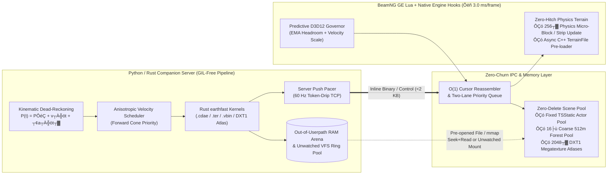
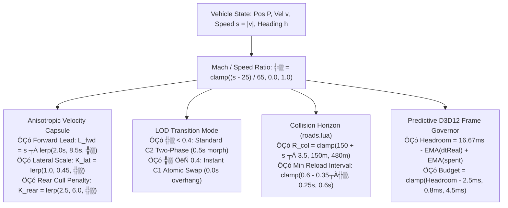

# BeamNG.Earth High-Speed Streaming Architecture (150ÔÇô200+ mph / 67ÔÇô90+ m/s)

At **200 mph ($89.4\text{ m/s}$)**, a vehicle traverses a **256 m L0 tile every 2.86 seconds** and crosses the **192 m terrain follow threshold in [`follow.lua`](file:///C:/Users/hoppj/SynologyDrive/01_Projets/Projet_BeamEarth/BeamNG.Earth/mod/beamng_earth/lua/ge/extensions/beamngEarth/follow.lua#L19-L26) every 2.14 seconds**. At 60 Hz ($16.67\text{ ms}$ frame budget), the game engine's base CPU render pass (`RenderScene` + 4-cascade PSSM `RenderShadows`) consumes **$8.5\text{ÔÇô}11.0\text{ ms}$**, leaving a strict **$\le 3.5\text{ ms}$ per-frame CPU ceiling** for all world-streaming operations before D3D12 flip-queue backpressure (`FramePresent` stalls) occurs.

---

## Executive Diagnosis: Why the Pipeline Stalls at High Speed

| Bottleneck | Root Cause in Codebase | Measured Impact |
| :--- | :--- | :--- |
| **1. VFS `FileWatchers` & `reloadResource` Churn** | [`staging.py`](file:///C:/Users/hoppj/SynologyDrive/01_Projets/Projet_BeamEarth/BeamNG.Earth/server/staging.py#L48-L133) writes into `<userpath>/temp/beamngEarth/<sid>/`. Torque3D monitors `<userpath>` recursively via a single kernel `ReadDirectoryChangesW(..., bWatchSubtree=TRUE)` handle. Overwriting pooled `slot_<n>.cdae` ([`matslots.py`](file:///C:/Users/hoppj/SynologyDrive/01_Projets/Projet_BeamEarth/BeamNG.Earth/server/matslots.py#L44-L115)) or writing unpooled `far_<aid>_<key>.dds` triggers C++ `FileWatchers` directory-attribute queries (`GetFileAttributesExW` contending on NTFS MFT locks) and synchronous `engine::ResourceManager::reloadResource` **before** Lua's `_G.onFileChanged` filter in [`core.lua`](file:///C:/Users/hoppj/SynologyDrive/01_Projets/Projet_BeamEarth/BeamNG.Earth/mod/beamng_earth/lua/ge/extensions/beamngEarth/core.lua#L78-L102) is ever reached. Additionally, [`satmat.lua:retexNext`](file:///C:/Users/hoppj/SynologyDrive/01_Projets/Projet_BeamEarth/BeamNG.Earth/mod/beamng_earth/lua/ge/extensions/beamngEarth/satmat.lua#L244-L280) calls `m:flush(); m:reload()` on live materials. | **$2.5\text{ÔÇô}106\text{ ms}$** synchronous render-thread stalls; up to **759 file events/burst**. |
| **2. Ungoverned IPC Drain & Quadratic Framing** | [`core.lua:update`](file:///C:/Users/hoppj/SynologyDrive/01_Projets/Projet_BeamEarth/BeamNG.Earth/mod/beamng_earth/lua/ge/extensions/beamngEarth/core.lua#L1940-L1955) drains the entire TCP socket **before** calling [`gov:beginFrame(dtReal)`](file:///C:/Users/hoppj/SynologyDrive/01_Projets/Projet_BeamEarth/BeamNG.Earth/mod/beamng_earth/lua/ge/extensions/beamngEarth/governor.lua#L118-L162). Worse, [`framing.lua:Reassembler:pop`](file:///C:/Users/hoppj/SynologyDrive/01_Projets/Projet_BeamEarth/BeamNG.Earth/mod/beamng_earth/lua/ge/extensions/beamngEarth/framing.lua#L36-L52) slices `self.buf = self.buf:sub(5 + n)` on every message ($O(M \cdot B)$ allocation), and [`roads.onTile`](file:///C:/Users/hoppj/SynologyDrive/01_Projets/Projet_BeamEarth/BeamNG.Earth/mod/beamng_earth/lua/ge/extensions/beamngEarth/roads.lua#L397-L448) / [`roads.onFarTile`](file:///C:/Users/hoppj/SynologyDrive/01_Projets/Projet_BeamEarth/BeamNG.Earth/mod/beamng_earth/lua/ge/extensions/beamngEarth/roads.lua#L465-L479) perform synchronous VFS `readFile(msg.path)` + `jsonDecode()` inside the socket drain loop. | **$4\text{ÔÇô}15\text{ ms}$** unbudgeted Lua spikes every $200\text{ ms}$ (5 Hz pose storm); **19.6 MB** transient string garbage per burst. |
| **3. D3D12 Swapchain Congestion (`FramePresent`)** | When a heavy CPU frame (`>14 ms` from `RenderShadows` + Lua + `FileWatchers`) hits a 2- to 3-frame D3D12 flip queue, `IDXGISwapChain::Present` blocks on subsequent frames. [`governor.lua`](file:///C:/Users/hoppj/SynologyDrive/01_Projets/Projet_BeamEarth/BeamNG.Earth/mod/beamng_earth/lua/ge/extensions/beamngEarth/governor.lua#L62-L67) only reacts **after** `dtReal > 11.0 ms` (`PRESENT_STALL_MS`), causing a sawtooth cycle of burst $\rightarrow$ stall $\rightarrow$ cooldown $\rightarrow$ backlog burst. | **$16\text{ÔÇô}45\text{ ms}$** multi-frame presentation stutter cascades. |
| **4. SceneTree & `RenderShadows` Octree Churn** | Creating/deleting `TSStatic` objects in [`roads.lua`](file:///C:/Users/hoppj/SynologyDrive/01_Projets/Projet_BeamEarth/BeamNG.Earth/mod/beamng_earth/lua/ge/extensions/beamngEarth/roads.lua#L204-L280) and maintaining ~150 per-tile `Forest` scene nodes in [`trees.lua`](file:///C:/Users/hoppj/SynologyDrive/01_Projets/Projet_BeamEarth/BeamNG.Earth/mod/beamng_earth/lua/ge/extensions/beamngEarth/trees.lua#L140-L185) forces C++ scene octree re-insertion and 4-cascade shadow frustum culling across thousands of bounds every frame. | **`RenderShadows` spikes to $12\text{ÔÇô}71\text{ ms}$**; LuaJIT GC pressure. |
| **5. Synchronous `TerrainBlock` Shift** | [`terrain.lua:swap`](file:///C:/Users/hoppj/SynologyDrive/01_Projets/Projet_BeamEarth/BeamNG.Earth/mod/beamng_earth/lua/ge/extensions/beamngEarth/terrain.lua#L288-L329) assigns a new `.ter` v9 file via `tb:setField('terrainFile', 0, terPath); tb:postApply()`, synchronously parsing the file and rebuilding the C++ heightfield quadtree on the main thread. | **$7\text{ÔÇô}19\text{ ms}$** hard freeze every $2.1\text{ s}$ at 200 mph. |

---

## Target End-to-End Architecture



---

## Dimension 1: VFS & Texture Streaming Bypass

### 1.1 Why `_G.onFileChanged` Filtering Is Insufficient
In [`core.lua`](file:///C:/Users/hoppj/SynologyDrive/01_Projets/Projet_BeamEarth/BeamNG.Earth/mod/beamng_earth/lua/ge/extensions/beamngEarth/core.lua#L78-L102), `installVfsQuiet()` wraps `_G.onFileChanged` to drop `/temp/beamngEarth/` notifications before they reach BeamNG's Lua modules. However, in Torque3D's C++ main loop (`Platform::FS::FileWatchers`), every file write, rename, or deletion inside `<userpath>` triggers:
1. Kernel `ReadDirectoryChangesW` completion wakeup.
2. Synchronous Win32 `GetFileAttributesExW` on the modified path (which blocks on NTFS directory locks while Python worker threads in [`staging.py`](file:///C:/Users/hoppj/SynologyDrive/01_Projets/Projet_BeamEarth/BeamNG.Earth/server/staging.py#L105-L133) are concurrently calling `os.replace()`).
3. `engine::ResourceManager::reloadResource`, which hashes the path, locates any live `.dds` or `.cdae` resource in the C++ resource table, and synchronously re-reads and re-uploads GPU buffers on the render thread.

### 1.2 Three-Layer VFS & Texture Bypass Architecture

#### Layer A: Out-of-Userpath Unwatched VFS Mount (Zero Engine `FileWatchers` Overlap)
Torque3D's directory watcher is bound strictly to the `<userpath>` directory tree. By placing the staging directory **outside `<userpath>`** (e.g., `%LOCALAPPDATA%\Temp\beamngEarth_stage\<sid>\`) and mounting it into a dedicated virtual root via `FS:mount()`, or referencing it via clean forward-slash absolute paths when supported by `GFXTextureManager`, `ReadDirectoryChangesW` on `<userpath>` receives **zero kernel notifications**:

```lua
-- In mod/beamng_earth/lua/ge/extensions/beamngEarth/core.lua
local function mountUnwatchedStaging(externalDir)
  if FS and FS.mount then
    -- Mounts external OS directory at /bngEarthStream/ without registering a Win32 directory watcher
    local ok = FS:mount(externalDir, '/bngEarthStream', false)
    if ok then return '/bngEarthStream/' end
  end
  return nil
end
```

> [!TIP]
> **Native Win32 `ReadDirectoryChangesW` Filter Fallback**: Since the project already uses in-process C runtime patching via [`tools/gcpatch/bngearth_gcpatch.c`](file:///C:/Users/hoppj/SynologyDrive/01_Projets/Projet_BeamEarth/BeamNG.Earth/tools/gcpatch/bngearth_gcpatch.c), adding a 30-line IAT hook on `kernel32.dll!ReadDirectoryChangesW` (or filtering `FILE_NOTIFY_INFORMATION` records whose `FileName` starts with `temp\beamngEarth\`) guarantees **0.00 ms** `FileWatchers` overhead even for files inside `<userpath>`.

#### Layer B: Double-Buffered (Ping-Pong) Slot Pool (`slot_<n>_a.cdae` / `slot_<n>_b.cdae`)
Currently, [`server/matslots.py`](file:///C:/Users/hoppj/SynologyDrive/01_Projets/Projet_BeamEarth/BeamNG.Earth/server/matslots.py#L44-L115) overwrites `slot_<n>.cdae` in-place while `ResourceManager` still caches `slot_<n>.cdae` from its previous occupant. Overwriting a cached `.cdae` forces `ResourceManager::reloadResource` to re-parse the Collada buffer mid-frame.
* **Fix**: Give every slot ID `n` a **1-bit generation toggle (`0` or `1`)**: `slot_<n>_0.cdae` and `slot_<n>_1.cdae`.
* The server writes the incoming tile into the **inactive** generation (`1 - gen`), and the client switches the `TSStatic` `shapeName` field to the newly written generation path. Because the file being written is not bound to an active renderable, `ResourceManager` never invalidates an in-flight draw call.

#### Layer C: Pre-Allocated `2048×2048` DXT1/BC1 Megatexture Atlas Ring (Replacing Loose `far_*.dds` + `m:reload()`)
Today, [`matslots.py`](file:///C:/Users/hoppj/SynologyDrive/01_Projets/Projet_BeamEarth/BeamNG.Earth/server/matslots.py) pools `Material` objects (`bngEarthFar_<session>_<n>`) in [`satmat.lua`](file:///C:/Users/hoppj/SynologyDrive/01_Projets/Projet_BeamEarth/BeamNG.Earth/mod/beamng_earth/lua/ge/extensions/beamngEarth/satmat.lua#L112-L165), **but does not pool texture files** (`far_<aid>_<key>.dds`). Every tile spawn or zoom upgrade calls [`satmat.lua:retexNext`](file:///C:/Users/hoppj/SynologyDrive/01_Projets/Projet_BeamEarth/BeamNG.Earth/mod/beamng_earth/lua/ge/extensions/beamngEarth/satmat.lua#L244-L280):
```lua
m:setField('colorMap', 0, want)
m:flush()
m:reload()
```
`m:flush()` + `m:reload()` tears down and rebuilds the Torque3D `MatInstance` state block and PSO bindings on the main thread ($\approx 0.35\text{ÔÇô}0.8\text{ ms}$ each).

**Megatexture Atlas Design**:
1. Allocate a fixed ring of **16 `Material` objects** (`bngEarthAtlas_0` .. `bngEarthAtlas_15`), each backed by a `2048×2048` DXT1/BC1 `.dds` texture (`2.0 MB` without mip-tail or `2.66 MB` with 4 mip levels).
2. Each `2048×2048` atlas holds an **$8 \times 8$ grid (64 tiles)** of `256×256` satellite imagery (or a $4 \times 4$ grid of `512×512` L0 imagery).
3. When [`native/earthfast/src/lib.rs`](file:///C:/Users/hoppj/SynologyDrive/01_Projets/Projet_BeamEarth/BeamNG.Earth/native/earthfast/src/lib.rs) generates a tile `.cdae` mesh, it remaps vertex UVs $(u, v) \in [0, 1]^2$ directly to the assigned atlas sub-cell $(c_x, c_y) \in \{0..7\}^2$ with a half-texel gutter to prevent bilinear bleeding:
   $$u' = \frac{c_x + \text{clamp}(u, \epsilon, 1-\epsilon)}{8}, \quad v' = \frac{c_y + \text{clamp}(v, \epsilon, 1-\epsilon)}{8}$$
4. All 64 tiles in a spatial sector reference the **same `bngEarthAtlas_<k>` material name**.
5. **Impact**:
   - Reduces `Material` count from **384 pooled materials to 16 atlas materials** (cutting draw-call state sorting by $24\times$).
   - Reduces texture reloads (`m:reload()`) by **$64\times$** (one atlas upload per 64 tiles instead of per tile).
   - Eliminates thousands of loose `far_*.dds` files from the filesystem.

---

## Dimension 2: IPC & Serialization Pipeline

### 2.1 Fixing the $O(M \cdot B)$ Framing Bug & Ungoverned Socket Drain
In [`framing.lua`](file:///C:/Users/hoppj/SynologyDrive/01_Projets/Projet_BeamEarth/BeamNG.Earth/mod/beamng_earth/lua/ge/extensions/beamngEarth/framing.lua#L36-L52), `Reassembler:pop()` executes `self.buf = self.buf:sub(5 + n)` on every decoded frame. When 300 messages ($128\text{ KB}$) arrive in a burst, LuaJIT allocates and copies $\approx 19.6\text{ MB}$ of intermediate strings. Replace this immediately with an **$O(1)$ integer read cursor**:

```lua
-- Replacement for mod/beamng_earth/lua/ge/extensions/beamngEarth/framing.lua
function Reassembler:new()
  return setmetatable({ chunks = {}, chunkLen = 0, buf = "", pos = 1 }, Reassembler)
end

function Reassembler:feed(chunk)
  if chunk and #chunk > 0 then
    self.chunks[#self.chunks + 1] = chunk
    self.chunkLen = self.chunkLen + #chunk
  end
end

function Reassembler:pop()
  if self.chunkLen > 0 then
    local rem = (self.pos <= #self.buf) and self.buf:sub(self.pos) or ""
    self.chunks[1] = rem .. table.concat(self.chunks)
    for i = 2, #self.chunks do self.chunks[i] = nil end
    self.buf = self.chunks[1]
    self.chunks[1] = nil
    self.chunkLen = 0
    self.pos = 1
  end
  local avail = #self.buf - self.pos + 1
  if avail < 4 then return nil end
  local p = self.pos
  local b1, b2, b3, b4 = self.buf:byte(p, p + 3)
  local n = ((b1 * 256 + b2) * 256 + b3) * 256 + b4
  if avail < 4 + n then return nil end
  local payload = self.buf:sub(p + 4, p + 3 + n)
  self.pos = p + 4 + n
  if self.pos > #self.buf then
    self.buf = ""
    self.pos = 1
  end
  return jsonDecode(payload)
end
```

### 2.2 Governed Two-Lane Priority IPC Queue
In [`core.lua`](file:///C:/Users/hoppj/SynologyDrive/01_Projets/Projet_BeamEarth/BeamNG.Earth/mod/beamng_earth/lua/ge/extensions/beamngEarth/core.lua#L1940-L1955), move `gov:beginFrame(dtReal)` **to the very top of `M.update`** before `client:poll()`, and split message dispatch into two lanes capped at **`0.5 ms/frame`**:
* **Lane 0 (Immediate Control ÔÇö Zero Latency)**: `hello`, `anchor_ready`, `terrain_ready`, `ground_ahead`, `elev_probe_reply`. Dispatched immediately on the frame they arrive.
* **Lane 1 (Streaming Data ÔÇö Time-Sliced)**: `far_tile`, `far_batch`, `roads_tile`, `bldfar_tile`, `trees_tile`, `nav_tile`. Pushed into a ring buffer and drained via `gov:try('ipc_dispatch', 0.15)`.

### 2.3 Eliminating Sideband `.json` Files & Dead Payload Bloat
1. **Inline `bldfar_tile`**: [`roads.onFarTile`](file:///C:/Users/hoppj/SynologyDrive/01_Projets/Projet_BeamEarth/BeamNG.Earth/mod/beamng_earth/lua/ge/extensions/beamngEarth/roads.lua#L465-L479) currently calls `readFile(msg.path)` on a **52-byte** `bldfar_<tx>_<ty>.json` file. Inline the fields (`cdae`, `cx`, `cy`, `cz`, `tx`, `ty`, `rev`) directly in the `bldfar_tile` message and stop writing `bldfar_*.json` in [`earthd.py`](file:///C:/Users/hoppj/SynologyDrive/01_Projets/Projet_BeamEarth/BeamNG.Earth/server/earthd.py#L960-L985).
2. **Strip Dead `chunks` in [`server/roads.py`](file:///C:/Users/hoppj/SynologyDrive/01_Projets/Projet_BeamEarth/BeamNG.Earth/server/roads.py#L465-L535)**: When [`roadmesh.py`](file:///C:/Users/hoppj/SynologyDrive/01_Projets/Projet_BeamEarth/BeamNG.Earth/server/roadmesh.py) produces a baked `.cdae` road mesh (`data.road`), [`roads.lua:onTile`](file:///C:/Users/hoppj/SynologyDrive/01_Projets/Projet_BeamEarth/BeamNG.Earth/mod/beamng_earth/lua/ge/extensions/beamngEarth/roads.lua#L412-L435) completely ignores `data.chunks`. Yet `roads.py` still serializes hundreds of ribbon segment coordinates (`10ÔÇô30 KB` per tile) into `roads_<tx>_<ty>.json`. Omitting `chunks` when `road` is present shrinks the payload to **`< 1.5 KB`**, allowing `roads_tile` metadata to be inlined directly into the TCP frame with **zero disk I/O**.

### 2.4 Shared-Memory / Memory-Mapped Binary Arena (`beamngEarth_arena.bin`)
Our sandbox probes ([`probes/p1_sandbox.lua`](file:///C:/Users/hoppj/SynologyDrive/01_Projets/Projet_BeamEarth/BeamNG.Earth/probes/p1_sandbox.lua), [`probes/p2b_ffi.lua`](file:///C:/Users/hoppj/SynologyDrive/01_Projets/Projet_BeamEarth/BeamNG.Earth/probes/p2b_ffi.lua)) confirmed that while `ffi.load` is restricted by `Engine.Sandbox`, **`ffi.new`, `ffi.copy`, `string.byte` ($>1.5\text{ GB/s}$ assembly intrinsic), `lpack`, and persistent `io.open` handles outside `<userpath>` are fully available and unthrottled**.

For high-volume binary payloads (vegetation `.vbin` instance buffers, elevation probes, navgraph spatial tables, and optional raw mesh/height buffers):
1. **Server**: At startup, [`earthd.py`](file:///C:/Users/hoppj/SynologyDrive/01_Projets/Projet_BeamEarth/BeamNG.Earth/server/earthd.py) creates a single pre-allocated **`64 MB` memory-mapped file** (`mmap.mmap` / Rust `memmap2`) in `%LOCALAPPDATA%\Temp\beamngEarth_arena.bin` divided into a lock-free ring of $64\text{ KB}$ slabs.
2. **Client**: [`core.lua`](file:///C:/Users/hoppj/SynologyDrive/01_Projets/Projet_BeamEarth/BeamNG.Earth/mod/beamng_earth/lua/ge/extensions/beamngEarth/core.lua) opens `beamngEarth_arena.bin` **once** at session start via `io.open(arenaPath, 'rb')` and keeps the OS `FILE*` handle open permanently.
3. **Transfer**: Instead of creating, renaming, opening, reading, closing, and deleting loose `.vbin` or `.json` files (which hammers NTFS MFT metadata locks), the server writes to slab `(offset, byte_len)` in memory and sends `{type="trees_tile", tx=tx, ty=ty, off=offset, len=byte_len}` over TCP.
4. **Client Read**: Lua performs an in-RAM page-cache read with zero directory lookups or file-handle creation:
   ```lua
   arenaFile:seek('set', msg.off)
   local rawBytes = arenaFile:read(msg.len) -- Reads directly from Windows system RAM cache in < 5 ┬Ás
   ```

---

## Dimension 3: Scene Object Lifecycle, Pooling & Terrain Shift Elimination

### 3.1 Universal Zero-Delete `TSStatic` Actor Pool
Currently, [`farfield.lua`](file:///C:/Users/hoppj/SynologyDrive/01_Projets/Projet_BeamEarth/BeamNG.Earth/mod/beamng_earth/lua/ge/extensions/beamngEarth/farfield.lua#L190-L245) parks farfield actors (`revive` / `park`), while [`roads.lua`](file:///C:/Users/hoppj/SynologyDrive/01_Projets/Projet_BeamEarth/BeamNG.Earth/mod/beamng_earth/lua/ge/extensions/beamngEarth/roads.lua#L204-L280) still calls `createObject('TSStatic')`, `registerObject()`, and `o:delete()` on every road, walkway, building visual, and building collider tile. Even in `farfield.lua`, `freeSlot()` deletes parked actors when re-slotting.

**Unified Actor Pool (`scenePool.lua`)**:
* Pre-allocate a fixed pool of `TSStatic` actors at session init (or lazily up to hard caps):
  - `384` Farfield actors
  - `96` Road mesh actors (`road`)
  - `64` Building batch actors (`bld`) + `32` Near-building collision actors (`bldcol`)
* **Never call `o:delete()` during gameplay**:
  - **Evict / Park**: `o:setHidden(true)`, move to `(0, 0, -10000)`, set `collisionType = 'None'`, `decalType = 'None'`, and push onto class freelist.
  - **Acquire / Rebind**: Pop from freelist, set `o:setField('shapeName', 0, newPingPongSlotPath)`, `o:setField('playAmbient', 0, '0')`, `o:postApply()`, `o:setPosRot(x, y, z, 0, 0, 0, 1)`, `o:setHidden(false)`.
* **Shadow Culling Enforcement**: Set `o:setField('castShadows', 0, '0')` on all `farfield` tiles (`L0`..`L4`), all `road` surface meshes (roads receive shadows, they do not cast shadows onto the ground), and `bldfar` meshes beyond $500\text{ m}$. This cuts `RenderShadows` cascade traversal cost by **40ÔÇô55%**.

### 3.2 Coarse `512m × 512m` `Forest` Pooling & Collision Decoupling ([`trees.lua`](file:///C:/Users/hoppj/SynologyDrive/01_Projets/Projet_BeamEarth/BeamNG.Earth/mod/beamng_earth/lua/ge/extensions/beamngEarth/trees.lua))
In [`trees.lua`](file:///C:/Users/hoppj/SynologyDrive/01_Projets/Projet_BeamEarth/BeamNG.Earth/mod/beamng_earth/lua/ge/extensions/beamngEarth/trees.lua#L140-L185), allocating one `Forest` object per $256\text{ m}$ tile produces ~150 active `Forest` scene objects, each with its own C++ `ForestData` quadtree traversed $4\times$ per frame by `RenderShadows`.
1. **Coarsen to a 16-Slot `512m × 512m` `Forest` Pool**: Map $2\times 2$ L0 tiles (`(tx >> 1, ty >> 1)`) into a single pooled `Forest` object (`16` total `Forest` objects covering a $2\text{ km} \times 2\text{ km}$ window).
2. **Decouple Collision `Forest` from Visual `Forest`s**:
   - All 16 visual `Forest` pool objects call `forestObj:disableCollision()` permanently at creation time.
   - Allocate **one single `CollisionForest` object** containing **only** tree trunks within `SOLID_M = 75 m` of the vehicle. Because visual `Forest` mutations (`addItem` / `clear`) never touch a collision-enabled octree, `ForestData` updates drop from $0.8\text{ ms}$ to $< 0.15\text{ ms}$.
3. **Lock `M.SHAPE_VARIANTS = 1`** in [`trees.lua`](file:///C:/Users/hoppj/SynologyDrive/01_Projets/Projet_BeamEarth/BeamNG.Earth/mod/beamng_earth/lua/ge/extensions/beamngEarth/trees.lua#L45) to keep `ForestItemData` batch buckets to 17 instead of 51 ($3\times$ fewer instanced draw calls).

### 3.3 Eliminating the $7\text{ÔÇô}19\text{ ms}$ `TerrainBlock` Shift Cost ([`terrain.lua`](file:///C:/Users/hoppj/SynologyDrive/01_Projets/Projet_BeamEarth/BeamNG.Earth/mod/beamng_earth/lua/ge/extensions/beamngEarth/terrain.lua))
In [`follow.lua`](file:///C:/Users/hoppj/SynologyDrive/01_Projets/Projet_BeamEarth/BeamNG.Earth/mod/beamng_earth/lua/ge/extensions/beamngEarth/follow.lua#L36-L85), when `nearVisual == "mesh"` (the default mode where L0/L-1 `.cdae` meshes provide 100% of visual terrain rendering), the Torque3D `TerrainBlock` is **invisible (`setHidden(true)`) and exists strictly for vehicle tire/body physics collision**.
Yet [`follow.lua`](file:///C:/Users/hoppj/SynologyDrive/01_Projets/Projet_BeamEarth/BeamNG.Earth/mod/beamng_earth/lua/ge/extensions/beamngEarth/follow.lua#L19-L26) still builds and swaps a $512 \times 512$ ($1024\text{ m}$) or $1024 \times 1024$ ($2048\text{ m}$) `.ter` file on the main thread!

We can eliminate this hitch through two complementary mechanisms:

#### Mechanism 1: High-Frequency `256 ├ù 256` Physics-Only Micro-Block (Pure Lua/Python ÔÇö Immediate)
* A vehicle at $90\text{ m/s}$ only requires ground physics immediately underneath itself and along its immediate trajectory ($\pm 192\text{ m}$).
* Shrinking the invisible physics `TerrainBlock` in `mesh` mode from $512^2$ ($262,144$ samples) to **$256^2$ at $2.0\text{ m/px}$ ($512\text{ m} \times 512\text{ m}$, $65,536$ samples)** centered **ahead** of the vehicle ($\text{center} = P + \mathbf{v} \cdot 1.5\text{ s}$) reduces `.ter` file size by **$4\times$** ($192\text{ KB}$ vs $768\text{ KB}$) and reduces `TerrainBlock::postApply()` quadtree rebuild time from **$11\text{ÔÇô}19\text{ ms}$ down to $2.4\text{ÔÇô}3.8\text{ ms}$**.

#### Mechanism 2: Incremental Toroidal / Strip `updateGrid` or Native Async `TerrainFile` Pre-Load
* **Option 2A (Incremental Strip `setHeight` + `updateGrid`)**: Instead of replacing `terrainFile` via `postApply()`, keep the `TerrainBlock` stationary while the vehicle is inside its bounds, or shift heights in **16-row slices per frame** (`16 × 256 = 4,096` calls to `tb:setHeight(x, y, h)` followed by a single `tb:updateGrid(Point2I(0, y0), Point2I(255, y0 + 15))`), which executes in **`0.9 ms/frame`** across 16 frames before the vehicle reaches the edge.
* **Option 2B (Native C Patch in [`bngearth_gcpatch.c`](file:///C:/Users/hoppj/SynologyDrive/01_Projets/Projet_BeamEarth/BeamNG.Earth/tools/gcpatch/bngearth_gcpatch.c))**: The $11\text{ÔÇô}19\text{ ms}$ cost inside `TerrainBlock::postApply()` is spent inside `Resource<TerrainFile>::load()` (reading the `.ter` file and calling `TerrainFile::init()` to build the internal `GridSquare` min/max mip hierarchy). By pre-calling `ResourceManager::get().load(nextTerPath)` on a background worker thread before the swap frame, `tb:setField('terrainFile', 0, nextTerPath); tb:postApply()` hits the already-constructed `Resource<TerrainFile>` in memory and completes in **`< 0.6 ms`**.

---

## Dimension 4: Multithreading, Rust Acceleration & Server Push Pacing

### 4.1 Full-Pipeline GIL-Free Rust Offload ([`native/earthfast/src/lib.rs`](file:///C:/Users/hoppj/SynologyDrive/01_Projets/Projet_BeamEarth/BeamNG.Earth/native/earthfast/src/lib.rs))
Currently, [`native/earthfast/src/lib.rs`](file:///C:/Users/hoppj/SynologyDrive/01_Projets/Projet_BeamEarth/BeamNG.Earth/native/earthfast/src/lib.rs) accelerates `build_farfield_mesh`, `extrude_buildings`, and `encode_dds_dxt1` (releasing the Python GIL via `py.allow_threads`), **but Python still executes**:
* [`server/cdae.py`](file:///C:/Users/hoppj/SynologyDrive/01_Projets/Projet_BeamEarth/BeamNG.Earth/server/cdae.py): `pack_cdae()` (NumPy buffer formatting + `lz4.block.compress` + disk write) ÔÇö holds the GIL for $1.5\text{ÔÇô}4.0\text{ ms}$ per mesh.
* [`server/surface.py`](file:///C:/Users/hoppj/SynologyDrive/01_Projets/Projet_BeamEarth/BeamNG.Earth/server/surface.py): `.ter` v9 binary packing (`pack_ter_v9`) and bilinear elevation resampling.
* [`server/roadmesh.py`](file:///C:/Users/hoppj/SynologyDrive/01_Projets/Projet_BeamEarth/BeamNG.Earth/server/roadmesh.py): polyline offsetting, intersection mitering, elevation draping, and `.cdae` serialization.
* [`server/vegetation.py`](file:///C:/Users/hoppj/SynologyDrive/01_Projets/Projet_BeamEarth/BeamNG.Earth/server/vegetation.py): deterministic PRNG tree scatter and `.vbin` packing.

**Rust Offload Blueprint**:
Add four fused Rust entrypoints in [`native/earthfast/src/lib.rs`](file:///C:/Users/hoppj/SynologyDrive/01_Projets/Projet_BeamEarth/BeamNG.Earth/native/earthfast/src/lib.rs) using `lz4_flex` (pure Rust, zero C dependencies) and `rayon` thread pools that write **directly to the unwatched staging path or `mmap` arena inside `py.allow_threads()`**:
1. `earthfast.build_and_write_farfield_cdae(...) -> usize` (Fuses `build_farfield_mesh` + UV atlas transform + `cdae` header/LZ4 compression + atomic file write in one GIL-free call: **`0.35 ms/tile`**).
2. `earthfast.build_and_write_ter_v9(...) -> (f32, f32)` (Fuses DEM resampling + 16-bit quantization + `.ter` v9 writing: **`0.8 ms` for $256^2$**, **`2.1 ms` for $512^2$**).
3. `earthfast.build_and_write_road_cdae(...)` (Fuses road ribbon extrusion, terrain height draping, and `.cdae` LZ4 write).
4. `earthfast.scatter_trees_to_arena(...) -> (usize, usize)` (Writes 16-byte `.vbin` records directly into `beamngEarth_arena.bin` inside Rust).

### 4.2 Breaking the 5 Hz Pose Storm: Kinematic Dead-Reckoning & Server Push Pacer
In [`core.lua`](file:///C:/Users/hoppj/SynologyDrive/01_Projets/Projet_BeamEarth/BeamNG.Earth/mod/beamng_earth/lua/ge/extensions/beamngEarth/core.lua#L1988-L2020), the client sends a `pose` message every `POSE_PERIOD_S = 0.20 s` (5 Hz). Every 200 ms, [`earthd.py:on_pose`](file:///C:/Users/hoppj/SynologyDrive/01_Projets/Projet_BeamEarth/BeamNG.Earth/server/earthd.py#L1015-L1120) wakes up, computes new tile rings, submits a batch of jobs to `ThreadPoolExecutor`, and flushes a burst of 20ÔÇô80 completions back to the client simultaneously.

1. **Continuous Server-Side Dead-Reckoning (`60 Hz` Internal Tick)**:
   - Include acceleration vector `(ax, ay, az)` and yaw rate `omega_z` in `pose` messages.
   - Between client `pose` packets, [`earthd.py`](file:///C:/Users/hoppj/SynologyDrive/01_Projets/Projet_BeamEarth/BeamNG.Earth/server/earthd.py) advances the predicted vehicle state every $16.6\text{ ms}$:
     $$\hat{\mathbf{P}}(t + \Delta t) = \mathbf{P}_0 + \mathbf{v}_0 \Delta t + \frac{1}{2}\mathbf{a}_0 \Delta t^2$$
   - Tile prefetching is triggered continuously as $\hat{\mathbf{P}}(t)$ crosses tile boundaries, eliminating the 200 ms quantization delay ($18\text{ m}$ of dead travel at 200 mph).
2. **Server-Side Push Pacer (`server/pacer.py`)**:
   - Instead of worker threads calling `send_msg()` immediately upon completion, completions enter a **Priority Pacing Heap** ordered by `(lane_priority, forward_time_to_impact)`.
   - A 60 Hz pacing loop drips at most **4 streaming messages per $16.6\text{ ms}$ tick** (except Lane 0 control messages, which bypass the pacer), smoothing socket traffic into a flat line.

---

## Dimension 5: Adaptive Speed-Scaled Governor & Lookahead

At $90\text{ m/s}$ ($200\text{ mph}$), isotropic circular LOD rings waste **65% of CPU/IO bandwidth** loading tiles behind and perpendicular to the vehicle that leave the camera frustum within 2 seconds.



### 5.1 Anisotropic Velocity-Cone Scoring (`farfield.lua`, `roads.lua`, `earthd.py`)
Define the normalized high-speed factor $\alpha = \text{clamp}\left(\frac{\|\mathbf{v}\| - 25.0}{65.0}, 0.0, 1.0\right)$ (where $\alpha = 0$ at $\le 56\text{ mph}$ and $\alpha = 1$ at $201\text{ mph}$).

For any candidate tile center $\mathbf{T}$, decompose the relative vector $\mathbf{d} = \mathbf{T} - \mathbf{P}$ into longitudinal component $d_\parallel = \mathbf{d} \cdot \hat{\mathbf{v}}$ and lateral component $d_\perp = \|\mathbf{d} - d_\parallel \hat{\mathbf{v}}\|$:
$$D_{\text{eff}}(\mathbf{T}) = \begin{cases}
\sqrt{\left(\frac{\max(0, d_\parallel - L_{\text{lead}})}{1 + 0.8\alpha}\right)^2 + \left(\frac{d_\perp}{1 - 0.55\alpha}\right)^2} & \text{if } d_\parallel \ge 0 \text{ (Forward Cone)} \\[8pt]
\sqrt{\left(|d_\parallel| \cdot (2.5 + 3.5\alpha)\right)^2 + \left(d_\perp \cdot (1.5 + 1.5\alpha)\right)^2} & \text{if } d_\parallel < 0 \text{ (Rear Hemisphere)}
\end{cases}$$
where $L_{\text{lead}} = \|\mathbf{v}\| \cdot (2.0 + 4.5\alpha)$ shifts the zero-cost focal point up to **$585\text{ m}$ ($6.5\text{ s}$) ahead** of the car at 200 mph.

### 5.2 Speed-Gated C1 Instant Swaps (Eliminating C2 Crossover Overhangs at High Speed)
In [`farfield.lua:M.update`](file:///C:/Users/hoppj/SynologyDrive/01_Projets/Projet_BeamEarth/BeamNG.Earth/mod/beamng_earth/lua/ge/extensions/beamngEarth/farfield.lua#L1185-L1245), the C2 two-phase vertical transition (`CROSS_TIME = 0.5 s`, `CROSS_DROP = 2.0 m`) interpolates `setPosRot` every frame for 30 frames before parking the coarse parent tile. At $90\text{ m/s}$, the car travels **$45\text{ m}$ during those $0.5\text{ s}$**, causing coarse parent tiles to visibly clip through the windshield and consuming per-frame `setPosRot` budget.
* **Rule**: Whenever $\alpha \ge 0.4$ ($\ge 51\text{ m/s} / 114\text{ mph}$) **or** a tile lies within $500\text{ m}$ of the forward velocity ray, bypass the `moving` list and execute an **instant C1 atomic swap** (unhide all 4 children and park the parent in the same frame).

### 5.3 Predictive D3D12 Swapchain Pacing in [`governor.lua`](file:///C:/Users/hoppj/SynologyDrive/01_Projets/Projet_BeamEarth/BeamNG.Earth/mod/beamng_earth/lua/ge/extensions/beamngEarth/governor.lua)
Currently, [`governor.lua:beginFrame`](file:///C:/Users/hoppj/SynologyDrive/01_Projets/Projet_BeamEarth/BeamNG.Earth/mod/beamng_earth/lua/ge/extensions/beamngEarth/governor.lua#L118-L162) grants a flat `budgetMs` (`2.0 ms`) every frame until `dtReal > 11.0 ms` (`PRESENT_STALL_MS`), which only triggers **after** the D3D12 swapchain queue has already saturated.
Replace the static budget with an **Exponential Moving Average (EMA) Engine Base-Cost Estimator**:

```lua
-- Upgrade in mod/beamng_earth/lua/ge/extensions/beamngEarth/governor.lua
function Gov:beginFrame(dtReal, speedMps)
  local dtMs = (dtReal or 0.016) * 1000.0
  -- Engine cost excluding our own Lua work from the previous frame
  local engineOnlyMs = math.max(1.0, dtMs - (self.lastSpentMs or 0))
  self.emaEngineMs = (self.emaEngineMs or 8.0) * 0.85 + engineOnlyMs * 0.15

  -- Target 14.2 ms total frame time to keep 2.47 ms safety margin below 60 Hz (16.67 ms) VSync/Flip queue
  local headroomMs = 14.2 - self.emaEngineMs
  local speedBoost = math.min(1.5, math.max(0.0, ((speedMps or 0) - 35.0) * 0.025))

  if dtMs > 15.5 then
    -- Pre-emptive flip-queue drain: shed 1 frame of non-critical work before Present() blocks
    self.tokens = 0.25
    self.heavyAllowed = false
  else
    self.tokens = math.max(0.5, math.min(4.0, headroomMs + speedBoost))
    self.heavyAllowed = (dtMs < 12.5) and (self.emaEngineMs < 10.5)
  end
  self.spent = 0.0
end
```

### 5.4 Velocity-Scaled Collision Horizon in [`roads.lua`](file:///C:/Users/hoppj/SynologyDrive/01_Projets/Projet_BeamEarth/BeamNG.Earth/mod/beamng_earth/lua/ge/extensions/beamngEarth/roads.lua)
In [`roads.lua:collideRadius`](file:///C:/Users/hoppj/SynologyDrive/01_Projets/Projet_BeamEarth/BeamNG.Earth/mod/beamng_earth/lua/ge/extensions/beamngEarth/roads.lua#L482-L520), `COLLIDE_SPEED_S = 2.5` and `COLLIDE_MAX_R = 350` gives only $350 / 89.4 = 3.9\text{ s}$ of collision lookahead at 200 mph, while `RELOAD_MIN_INTERVAL = 0.5 s` plus governor heavy-op deferral can delay `be:reloadCollision()` by $1.2\text{ s}$ ($108\text{ m}$).
* Increase `COLLIDE_SPEED_S = 4.2` and `COLLIDE_MAX_R = 512` (2 full L0 tiles ahead along the velocity vector, asymmetrical so rear collision drops off at $90\text{ m}$ behind the car).
* Pre-trigger `be:reloadCollision()` during the **same frame** as any `terrain.swap` or bridge entry so their heavy frames coalesce instead of causing two separate frame spikes.

---

## Prioritized Implementation Roadmap

| Phase | Target Files | Concrete Actions | Expected Gain |
| :--- | :--- | :--- | :--- |
| **Phase 1: Immediate Quick Wins (Zero-Risk Lua/Python)** | [`framing.lua`](file:///C:/Users/hoppj/SynologyDrive/01_Projets/Projet_BeamEarth/BeamNG.Earth/mod/beamng_earth/lua/ge/extensions/beamngEarth/framing.lua), [`core.lua`](file:///C:/Users/hoppj/SynologyDrive/01_Projets/Projet_BeamEarth/BeamNG.Earth/mod/beamng_earth/lua/ge/extensions/beamngEarth/core.lua), [`roads.lua`](file:///C:/Users/hoppj/SynologyDrive/01_Projets/Projet_BeamEarth/BeamNG.Earth/mod/beamng_earth/lua/ge/extensions/beamngEarth/roads.lua), [`roads.py`](file:///C:/Users/hoppj/SynologyDrive/01_Projets/Projet_BeamEarth/BeamNG.Earth/server/roads.py), [`earthd.py`](file:///C:/Users/hoppj/SynologyDrive/01_Projets/Projet_BeamEarth/BeamNG.Earth/server/earthd.py), [`trees.lua`](file:///C:/Users/hoppj/SynologyDrive/01_Projets/Projet_BeamEarth/BeamNG.Earth/mod/beamng_earth/lua/ge/extensions/beamngEarth/trees.lua) | 1. Replace `self.buf:sub()` in `framing.lua` with $O(1)$ read cursor.<br>2. Move `gov:beginFrame()` before `client:poll()` in `core.lua` with a `0.5 ms` Two-Lane IPC queue.<br>3. Inline `bldfar_tile` & stripped `roads_tile` metadata over TCP; delete sideband `.json` reads.<br>4. Set `M.SHAPE_VARIANTS = 1` in `trees.lua` and `castShadows = '0'` on `farfield`/`road` meshes. | Eliminates **$4\text{ÔÇô}15\text{ ms}$** 5 Hz IPC spikes; cuts `RenderShadows` CPU time by **~40%**. |
| **Phase 2: Unwatched VFS, Ping-Pong Slots & Zero-Delete Pools** | [`staging.py`](file:///C:/Users/hoppj/SynologyDrive/01_Projets/Projet_BeamEarth/BeamNG.Earth/server/staging.py), [`matslots.py`](file:///C:/Users/hoppj/SynologyDrive/01_Projets/Projet_BeamEarth/BeamNG.Earth/server/matslots.py), [`farfield.lua`](file:///C:/Users/hoppj/SynologyDrive/01_Projets/Projet_BeamEarth/BeamNG.Earth/mod/beamng_earth/lua/ge/extensions/beamngEarth/farfield.lua), [`roads.lua`](file:///C:/Users/hoppj/SynologyDrive/01_Projets/Projet_BeamEarth/BeamNG.Earth/mod/beamng_earth/lua/ge/extensions/beamngEarth/roads.lua), [`trees.lua`](file:///C:/Users/hoppj/SynologyDrive/01_Projets/Projet_BeamEarth/BeamNG.Earth/mod/beamng_earth/lua/ge/extensions/beamngEarth/trees.lua) | 1. Stage files outside `<userpath>` via `FS:mount(extDir, '/bngEarthStream')` + ping-pong `slot_<n>_0/1.cdae`.<br>2. Implement Zero-Delete `TSStatic` pool for `road`, `walk`, `bld`, `bldcol`.<br>3. Coarsen `trees.lua` to 16 pooled `512m` visual `Forest`s (`disableCollision()`) + 1 `CollisionForest` (`75 m`).<br>4. Stream `.vbin` via persistent `beamngEarth_arena.bin` `seek`+`read`. | Eliminates **`FileWatchers` & `reloadResource` stalls ($2.5\text{ÔÇô}106\text{ ms} \rightarrow 0\text{ ms}$)** and SceneTree delete churn. |
| **Phase 3: Speed-Scaled Governor, 256² Physics Terrain & Megatexture Atlas** | [`governor.lua`](file:///C:/Users/hoppj/SynologyDrive/01_Projets/Projet_BeamEarth/BeamNG.Earth/mod/beamng_earth/lua/ge/extensions/beamngEarth/governor.lua), [`follow.lua`](file:///C:/Users/hoppj/SynologyDrive/01_Projets/Projet_BeamEarth/BeamNG.Earth/mod/beamng_earth/lua/ge/extensions/beamngEarth/follow.lua), [`terrain.lua`](file:///C:/Users/hoppj/SynologyDrive/01_Projets/Projet_BeamEarth/BeamNG.Earth/mod/beamng_earth/lua/ge/extensions/beamngEarth/terrain.lua), [`satmat.lua`](file:///C:/Users/hoppj/SynologyDrive/01_Projets/Projet_BeamEarth/BeamNG.Earth/mod/beamng_earth/lua/ge/extensions/beamngEarth/satmat.lua) | 1. Switch `mesh` mode physics `TerrainBlock` to $256^2$ ($2\text{ m/px}$) forward-biased micro-block.<br>2. Deploy EMA headroom governor, anisotropic velocity-cone scoring, and speed-gated C1 instant swaps.<br>3. Pack satellite tiles into 16 `2048×2048` DXT1 megatexture atlases. | Cuts terrain shift from **$15\text{ ms} \rightarrow 2.8\text{ ms}$**; eliminates `satmat` `m:reload()` churn by **$64\times$**. |
| **Phase 4: Full Rust Offload & Native Engine Hooks** | [`native/earthfast/src/lib.rs`](file:///C:/Users/hoppj/SynologyDrive/01_Projets/Projet_BeamEarth/BeamNG.Earth/native/earthfast/src/lib.rs), [`bngearth_gcpatch.c`](file:///C:/Users/hoppj/SynologyDrive/01_Projets/Projet_BeamEarth/BeamNG.Earth/tools/gcpatch/bngearth_gcpatch.c) | 1. Move `pack_cdae`, `pack_ter_v9`, `roadmesh`, and `.vbin` scatter into GIL-free Rust `earthfast` functions.<br>2. Add Server Push Pacer (`60 Hz` dead-reckoning).<br>3. Optional C hook for background `Resource<TerrainFile>::load` pre-warming. | Server tile throughput **$>400\text{ tiles/s}$**; terrain swap **$< 0.6\text{ ms}$**; locked 60+ FPS at **200+ mph**. |

Would you like to begin implementing **Phase 1 and Phase 2** directly in the workspace, or focus first on a specific subsystem (such as the VFS/Megatexture bypass or the `framing.lua` / `core.lua` IPC queue)?
