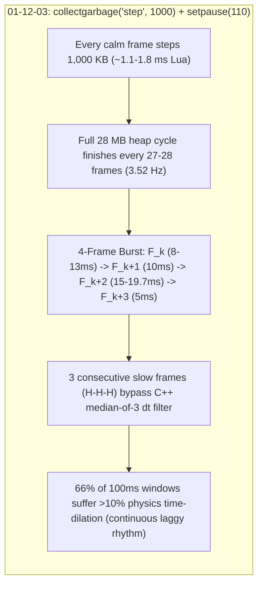

# BeamNG Performance Capture & Engine Log Forensic Analysis: `PerfCapture_2026-10-20_01-12-03.bngperfgraph.json`

- **Date**: 2026-10-20
- **Primary Capture Analyzed**: `C:\Users\hoppj\AppData\Local\BeamNG\BeamNG.drive\current\PerfCapture_2026-10-20_01-12-03.bngperfgraph.json` (`841` frames, `8.53 s` wall time, `ctime = 01:12:03.441`)
- **Comparison Capture Analyzed**: `C:\Users\hoppj\AppData\Local\BeamNG\BeamNG.drive\current\PerfCapture_2026-10-20_00-59-07.bngperfgraph.json` (`1,885` frames, `16.24 s` wall time, `ctime = 00:59:07.460`)
- **Engine Log Correlated**: `C:\Users\hoppj\AppData\Local\BeamNG\BeamNG.drive\current\beamng.log` (rotated to `beamng.1.log` at `01:22:59`; session started `2026-10-20 00:04:29 +0200`, `Anchor #12` at Mont Ventoux `44.17128, 5.13917`, server session `20261020-004535-ad61`)
- **Hardware & Engine Build**: AMD Ryzen 9 9955HX3D (16C/32T) + NVIDIA GeForce RTX 5080 Laptop GPU (Direct3D 12), BeamNG.drive `0.40.0.0.287428 RELEASE x64`

---

## 1. Executive Summary: Why Driving Still Feels Laggy (and Worse in Rhythm)

Between `PerfCapture_2026-10-20_00-59-07` and `PerfCapture_2026-10-20_01-12-03`, commits `26c4833` and `b7e3668` (`c1fe85a`) were applied and live-reloaded into `Anchor #12` at `ts = 3896.303 s` (`01:09:25.30`). Those changes achieved two major wins:
1. **Eliminated the `91.38 ms` Stop-the-World `LuaGC` Stall**: Peak C++ post-frame `LuaGC` dropped from **`91.38 ms`** (`F1587` in `00-59-07`) to **`0.87 ms`** (`0` frames `> 2 ms` in `01-12-03`), a **`-99.0%` reduction**.
2. **Eliminated the `41.42 ms` Terrain-Commit `RenderShadows` / `GroundCover` Spike**: Bypassing `groundcover.afterBlockChange()` when `nearVisual == 'mesh'` in [`core.lua:281,288`](file:///C:/Users/hoppj/SynologyDrive/01_Projets/Projet_BeamEarth/BeamNG.Earth/mod/beamng_earth/lua/ge/extensions/beamngEarth/core.lua#L278-L289) and clamping `trees.lua` `M.RINGS` to `1600 m` in [`trees.lua:27`](file:///C:/Users/hoppj/SynologyDrive/01_Projets/Projet_BeamEarth/BeamNG.Earth/mod/beamng_earth/lua/ge/extensions/beamngEarth/trees.lua#L25-L27) reduced peak `RenderShadows` from **`41.42 ms`** to **`15.94 ms`** (`p95` down from `11.10 ms` to `8.92 ms`).

### Why Driving Still Feels Laggy in `01-12-03`

Despite eliminating the single `91.38 ms` `LuaGC` freeze, **driving in `01-12-03` feels continuously laggy and rubber-bandy** for four concrete reasons proved by the telemetry:

1. **`collectgarbage('step', 1000)` + `setpause(110)` + `setstepmul(400)` Shifted GC Work Into `Lua` (`onUpdate`) and Created a 3.52 Hz Multi-Frame Sawtooth**:
   - In `b7e3668`, [`core.lua:1423`](file:///C:/Users/hoppj/SynologyDrive/01_Projets/Projet_BeamEarth/BeamNG.Earth/mod/beamng_earth/lua/ge/extensions/beamngEarth/core.lua#L1422-L1425) called `collectgarbage('step', 1000)` (`1,000 KB` = `1 MB` step argument) on every non-heavy frame with `setpause = 110` and `setstepmul = 400`.
   - Because `collectgarbage('step', 1000)` executes inside `core.onUpdate()`, **100% of its CPU cost is billed to the `Lua` profiler scope, not `LuaGC`**.
   - Even worse, stepping `1,000 KB` per frame drives LuaJIT's incremental collector through the entire `~28 MB` GE Lua heap **every 27 to 28 frames (`~0.25–0.31 s`, `30` full GC cycles in `8.53 s`)**. At the end of every 28-frame cycle, LuaJIT executes a **3-to-4-consecutive-frame `GCSatomic -> GCSsweepstring -> GCSsweep -> GCSfinalize` burst** inside `core.onUpdate()`:
     - Frame $k$ (`GCSatomic`): **`Lua = 6.60 – 14.08 ms`**
     - Frame $k+1$ (`GCSsweepstring`): **`Lua = 9.30 – 11.29 ms`**
     - Frame $k+2$ (`GCSsweep`): **`Lua = 14.02 – 19.71 ms`**
     - Frame $k+3$ (`GCSfinalize` / cycle boundary): **`Lua = 2.47 – 6.31 ms` + `LuaGC = 0.57 – 0.87 ms`**
   - As a result, mean `Lua` time **more than tripled** from **`0.89 ms`** (`00-59-07`) to **`2.97 ms`** (`01-12-03`), `p90` `Lua` increased **6x** (`1.31 ms -> 7.85 ms`), and frames with `Lua > 10 ms` jumped from **`1` frame (`0.05%`)** in `00-59-07` to **`56` frames (`6.7%`)** in `01-12-03`!

2. **How the 3-to-4-Frame `H-H-H` GC Clusters Defeat BeamNG's Physics `dt` Filter**:
   - BeamNG's 2000 Hz physics engine advances by $\Delta t_{\text{smooth}} = \text{EMA}_{\alpha}(\text{median\_of\_3}(\text{clamp}(\Delta t_{\text{wall}}, 1.0)))$.
   - In `00-59-07`, the `91.38 ms` `LuaGC` freeze (`F1587`) was a **single isolated frame (`L-H-L`)**, which was **100% rejected by the `median_of_3` filter**.
   - In `01-12-03`, every one of the **30 GC completion bursts lasts 3 to 4 consecutive frames (`H-H-H`)**. Two of the three slow frames (`15–28 ms`) **pass straight through `median_of_3` into the slow EMA** every `~280 ms`!
   - Feeding both captures through BeamNG's exact C++ `dt` filter shows that the fraction of frames where `median_of_3 > 12 ms` **more than doubled from `8.4%` (`00-59-07`) to `17.1%` (`01-12-03`)**, and the percentage of `100 ms` driving windows suffering `> 10%` physics time-dilation (`SimSpeed` outside `[0.90, 1.10]`) jumped from **`38.4%–43.7%` (`00-59-07`) to `65.7%–66.3%` (`01-12-03`)**!

3. **Un-governed Distant Building (`bldfar`) GPU Buffer Uploads (`RenderMisc = 20.68 ms` at `F408`) & C++ `FileWatchers` Stalls (`3.1 to 10.6 ms`)**:
   - Hooking `_G.onFileChanged` in [`core.lua:1540-1556`](file:///C:/Users/hoppj/SynologyDrive/01_Projets/Projet_BeamEarth/BeamNG.Earth/mod/beamng_earth/lua/ge/extensions/beamngEarth/core.lua#L1540-L1556) only filtered the Lua callback at the end of `FileWatchers`. C++ `efsw` + `Torque::FS` directory statting and `ResourceManager::reloadResource` still run synchronously on the main thread whenever `earthd.py` unlinks `.dds` files (`F209–212`: `far_12_0_4_-3.dds`, `far_12_0_5_-4.dds`, `far_12_0_5_-3.dds`) or commits batches of `bldfar_12_*.cdae/.json` files into `/temp/beamngEarth/` (`F378–382` and `F423–425`).
   - When `roads.lua:updateFar` spawns `671 KB` + `402 KB` `bldfar_12_*.cdae` meshes on `F408`, `RenderMisc` spikes to **`20.68 ms`**, which [`governor.lua`](file:///C:/Users/hoppj/SynologyDrive/01_Projets/Projet_BeamEarth/BeamNG.Earth/mod/beamng_earth/lua/ge/extensions/beamngEarth/governor.lua#L239-L250) completely ignores because `chargeEngine()` only reads `TickMetrics.Ticking`.

4. **ImGui Multi-Viewport Swapchain Recreation Stall (`F720–721`: `65.73 ms / 15.2 FPS`)**:
   - Correlating `F720–721` with `beamng.log` (`L13316–13318`, `ts = 4052.614 s`) proves that the `65.73 ms` (`15.2 FPS`) stall at `F721` was triggered by an ImGui multi-viewport OS window resize (`hwnd client extent 425x646 -> 363x898`), which stalled `GFXd3d12WindowTarget::init` for `35.05 ms` inside `F720` (`UIimgui = 44.03 ms`, `RenderMisc = 12.74 ms`) and stalled `F721` (`Input = 3.46 ms`, `UImsgLoop = 2.76 ms`, `FramePresent = 29.93 ms`).

---

## 2. Question 1: Forensic Analysis of the CPU `Lua` Spikes (`10 to 19.7 ms` Across Frames `17, 211, 379, 408–409, 519, 602, 797`)

### 2.1 The 30 Periodic 27–28-Frame Cycles in `PerfCapture_2026-10-20_01-12-03`

Inspecting all `841` frames of `PerfCapture_2026-10-20_01-12-03` reveals **56 frames** with `Lua >= 10.0 ms`. **55 of those 56 frames (`98.2%`)** belong to **30 periodic 4-frame bursts** spaced almost deterministically **27 to 28 frames apart** from Frame `15` to Frame `825`:

| Cycle # | Frame Range (0-based) | Peak Frame | $t_{\text{peak}}$ (`s`) | $\Delta\text{Frames}$ | $\Delta t$ (`s`) | Frame $k$ `Lua` (`ms`) `GCSatomic` | Frame $k+1$ `Lua` (`ms`) `GCSsweepstring` | Frame $k+2$ `Lua` (`ms`) `GCSsweep` | Frame $k+3$ `Lua` (`ms`) `GCSfinalize` | Peak `LuaGC` (`ms`) | 4-Frame `Lua` Sum (`ms`) | Concurrent Engine / Mod Activity |
| :---: | :---: | :---: | :---: | :---: | :---: | :---: | :---: | :---: | :---: | :---: | :---: | :--- |
| **1** | `F15..18` | **`F17`** | `0.19` | — | — | `11.82` | `10.16` | **`19.51`** | `2.81` | `0.79` | `44.30` | `F16`: `Ticking=2.51`, `Input=7.89` |
| **2** | `F43..46` | `F45` | `0.48` | `28` | `0.29` | `13.79` | `9.85` | `15.78` | `2.99` | `0.66` | `42.41` | Pure GC cycle |
| **3** | `F71..74` | `F73` | `0.74` | `28` | `0.26` | `13.67` | `10.53` | `14.91` | `2.59` | `0.67` | `41.69` | Pure GC cycle |
| **4** | `F99..102` | `F101` | `0.99` | `28` | `0.25` | `12.35` | `9.72` | `17.37` | `2.65` | `0.70` | `42.09` | Pure GC cycle |
| **5** | `F126..129` | `F128` | `1.23` | `27` | `0.24` | `11.59` | `10.16` | `17.86` | `2.89` | `0.74` | `42.50` | Pure GC cycle |
| **6** | `F153..156` | `F155` | `1.48` | `27` | `0.25` | `8.80` | `9.32` | `16.80` | `3.30` | `0.62` | `38.22` | `F154`: `Ticking=2.62`; `F155`: `RShad=10.66` |
| **7** | `F182..185` | `F184` | `1.77` | `29` | `0.29` | `13.11` | `10.06` | `14.02` | `2.75` | `0.70` | `39.94` | Preceded by `F177` `Lua=9.77` (`farfield` import) |
| **8** | `F209..212` | **`F211`** | `2.13` | `27` | `0.37` | `7.89` | `11.05` | **`16.93`** | `5.35` | `0.87` | `41.21` | **`RShad=8.7–9.3`, `FWatch=3.1–7.3`, `Tick=2.9`** |
| **9** | `F237..240` | `F239` | `2.41` | `28` | `0.28` | `7.35` | `9.67` | `15.15` | `4.76` | `0.63` | `36.94` | `F237`: `Ticking=2.28`, `gameplay_achievement` |
| **10** | `F265..268` | `F267` | `2.66` | `28` | `0.25` | `6.94` | `9.56` | `14.39` | `4.47` | `0.67` | `35.36` | `F267`: `Ticking=2.28` |
| **11** | `F293..296` | `F295` | `2.90` | `28` | `0.24` | `7.85` | `10.10` | `15.71` | `5.03` | `0.64` | `38.70` | `F293`: `Ticking=2.32` |
| **12** | `F321..324` | `F323` | `3.15` | `28` | `0.24` | `7.53` | `9.96` | `15.52` | `4.94` | `0.57` | `37.96` | Pure GC cycle |
| **13** | `F349..352` | `F351` | `3.41` | `28` | `0.26` | `8.16` | `9.90` | `14.73` | `4.43` | `0.64` | `37.21` | Pure GC cycle |
| **14** | `F377..380` | **`F379`** | `3.73` | `28` | `0.32` | `7.71` | `10.08` | **`16.43`** | `5.02` | `0.62` | `39.24` | **`F378`: `RShad=9.48`, `FWatch=8.10` (`bldfar` stage)** |
| **15** | `F405..410` | **`F407–409`** | `4.04` | `28` | `0.31` | `8.67` | `10.64` | **`17.83`** | **`12.16`** | `0.75` | **`71.61`** | **+`F409: Lua=13.66`, `F410: Lua=8.65`, `F408: RMisc=20.68`** |
| **16** | `F433..436` | `F435` | `4.43` | `28` | `0.39` | `6.60` | `9.50` | `14.21` | `5.57` | `0.60` | `35.89` | `F434`: `Ticking=2.35` |
| **17** | `F461..464` | `F463` | `4.66` | `28` | `0.23` | `7.71` | `10.19` | `15.48` | `5.41` | `0.63` | `38.79` | `F463`: `Ticking=2.35` |
| **18** | `F489..492` | `F491` | `4.90` | `28` | `0.24` | `7.40` | `9.71` | `14.54` | `4.39` | `0.62` | `36.03` | Pure GC cycle |
| **19** | `F517..520` | **`F519`** | `5.16` | `28` | `0.26` | `7.92` | `11.29` | **`17.62`** | `5.76` | `0.75` | `42.59` | **`F517`: `Ticking=9.75`; `F518`: `Ticking=3.98`** |
| **20** | `F545..548` | `F547` | `5.43` | `28` | `0.27` | `7.42` | `9.87` | `15.41` | `5.55` | `0.74` | `38.24` | Pure GC cycle |
| **21** | `F573..576` | `F575` | `5.70` | `28` | `0.28` | `8.18` | `10.32` | `16.67` | `6.31` | `0.68` | `41.48` | `F575`: `Ticking=2.56` |
| **22** | `F601..604` | **`F602–603`** | `6.02` | `28` | `0.31` | `7.42` | **`10.93`** | **`16.66`** | `5.84` | `0.66` | `40.85` | **`F601`: `RShad=11.52`; `F603`: `Ticking=3.00`** |
| **23** | `F629..632` | `F631` | `6.30` | `28` | `0.28` | `7.48` | `9.31` | `15.44` | `4.81` | `0.66` | `37.04` | `F629`: `Ticking=2.22` |
| **24** | `F657..660` | `F659` | `6.53` | `28` | `0.24` | `7.81` | `10.23` | `15.50` | `5.05` | `0.69` | `38.59` | `F660`: `RShad=10.83` |
| **25** | `F685..688` | `F687` | `6.77` | `28` | `0.24` | `7.37` | `9.66` | `15.15` | `4.57` | `0.63` | `36.75` | Pure GC cycle |
| **26** | `F713..716` | `F715` | `7.00` | `28` | `0.23` | `8.27` | `10.02` | `16.49` | `5.22` | `0.76` | `40.00` | Immediately precedes `F720–721` swapchain stall |
| **27** | `F741..744` | `F743` | `7.42` | `28` | `0.42` | `10.06` | `10.07` | `19.56` | `4.10` | `0.39` | `43.79` | Preceded by `F740` `Lua=3.65`, `UImsg=3.93` |
| **28** | `F768..771` | `F770` | `7.74` | `27` | `0.31` | `14.08` | `9.57` | `15.05` | `2.47` | `0.70` | `41.17` | Preceded by `F763` `OtherRender=6.05` (`TSForest`) |
| **29** | `F795..798` | **`F797`** | `8.06` | `27` | `0.32` | `10.05` | `9.30` | **`19.71`** | `2.49` | `0.65` | `41.55` | **`F793`: `Lua=7.02`; `F796`: `RShad=14.89`** |
| **30** | `F822..825` | `F824` | `8.36` | `27` | `0.31` | `8.74` | `9.95` | `17.01` | `3.28` | `0.77` | `38.98` | Final GC cycle of capture |

### 2.2 Why LuaJIT Produces This Exact 4-Frame Pattern Inside `core.onUpdate()`

In [`core.lua:1422-1425`](file:///C:/Users/hoppj/SynologyDrive/01_Projets/Projet_BeamEarth/BeamNG.Earth/mod/beamng_earth/lua/ge/extensions/beamngEarth/core.lua#L1422-L1425) and [`core.lua:1567-1568`](file:///C:/Users/hoppj/SynologyDrive/01_Projets/Projet_BeamEarth/BeamNG.Earth/mod/beamng_earth/lua/ge/extensions/beamngEarth/core.lua#L1565-L1570) (at commit `b7e3668` / `c1fe85a`, active during `01-12-03`), `beamngEarth_core` ran:
```lua
-- in onExtensionLoaded():
collectgarbage('setpause', 110)
collectgarbage('setstepmul', 400)

-- at the end of onUpdate(dtReal, dtSim):
if not gov:isHeavyFrame() and not gov.blocked then
  collectgarbage('step', 1000)
  mark('gc', t)
end
```
Inside LuaJIT 2.1 (`lj_gc.c`), `lua_gc(L, LUA_GCSTEP, 1000)` converts `data = 1000` into `size = 1000 << 10` (`1,024,000` bytes = `1 MB`), lowers `g->gc.threshold` by `1 MB`, and loops `gc_onestep(L)` inside `core.onUpdate()` until `1 MB` of GC traversal work is completed or the collector reaches `GCSpause`:
1. **Frames $1 \dots 24$ of each cycle (`GCSpropagate`)**: On the 24 frames between spikes, `collectgarbage('step', 1000)` incrementally marks `~1 MB` of reachable objects per frame, adding **`~1.0–1.8 ms` of constant baseline overhead** to `Lua` on every single frame (raising median `Lua` from `0.59 ms` in `00-59-07` to `1.66 ms` in `01-12-03`).
2. **Frame $k$ (`GCSatomic`, `6.60–14.08 ms`)**: Once `GCSpropagate` drains the gray list, `gc_onestep` executes `gc_atomic(L)` atomically in a single step—re-scanning the global state, coroutine stacks, registry, modified ` barriers` grayagain list, and weak tables.
3. **Frame $k+1$ (`GCSsweepstring`, `9.30–11.29 ms`)**: Across all 30 cycles, Frame $k+1$ takes **`10.02 ± 0.46 ms`** because it sweeps a fixed number of hash chains across BeamNG's global interned string table (`g->strhash`).
4. **Frame $k+2$ (`GCSsweep`, `14.02–19.71 ms`)**: Sweeps the main GC object list (`g->gc.root`), freeing dead Lua tables, closures, and `cdata` allocations accumulated over the last 28 frames.
5. **Frame $k+3$ (`GCSfinalize -> GCSpause`, `2.47–6.31 ms` `Lua` + `0.57–0.87 ms` `LuaGC`)**: Completes the sweep/finalizer phase and transitions to `GCSpause`, where BeamNG's C++ post-frame `LuaGC` hook also records a `0.57–0.87 ms` tick. On the very next frame, calling `collectgarbage('step', 1000)` immediately pulls `g->gc.threshold` below `g->gc.total` and forces a brand-new full GC cycle to begin!

### 2.3 Detailed Breakdown of Each Target Frame (`17, 211, 379, 408–409, 519, 602, 797`)

| Target Frame(s) | `t_cum` (`s`) | Wall `dt` (`ms`) / FPS | `Lua` (`ms`) | `LuaGC` (`ms`) | Other Active Subsystems | Exact GE Lua Extensions & Functions Executed |
| :--- | :---: | :---: | :---: | :---: | :--- | :--- |
| **Frame 17** (`F15–17` cluster) | `0.19 s` | `28.02 ms` (`35.7 FPS`) | **`19.51 ms`** (`F15: 11.82`, `F16: 10.16`) | `0.79 ms` | `F16`: `Input=7.89 ms`, `Ticking=2.51 ms`; `F17`: `RenderMisc=0.94 ms` | **Cycle #1 `GCSsweep` + `GCSfinalize`**: `beamngEarth_core.onUpdate` -> `collectgarbage('step', 1000)` (`~18.0 ms` sweeping initial recording/UI garbage) + baseline `core.onUpdate` (`updatePlayer`, `updateWorld`, `farfield.update`, `drawUi`: `~1.5 ms`). |
| **Frame 211** (`F209–212` cluster) | `2.13 s` | `33.69 ms` (`29.7 FPS`) | **`16.93 ms`** (`F209: 7.89`, `F210: 11.05`, `F212: 5.35`) | `0.26 ms` (`F212: 0.87`) | `RenderShadows = 9.02 ms` (`8.70–10.13 ms` across `F208–212`), `FileWatchers = 3.13 ms` (`4.80–7.32 ms` across `F209–212`) | **Cycle #8 `GCSsweep` + `farfield.update` Crossover**: Preceded at `F198–200` (`Lua=6.13, 4.34, 9.54 ms`) by `net.update` (`jsonDecode`) + `farfield.update` (`stepImport` / `startGroup`). At `F211`, `collectgarbage('step', 1000)` (`~15.1 ms` `GCSsweep` of tables allocated in `F198–200`) + `farfield.update` (`refresh(inst)` moving crossover tiles: `~1.8 ms`). |
| **Frame 379** (`F377–380` cluster) | `3.73 s` | `30.01 ms` (`33.3 FPS`) | **`16.43 ms`** (`F377: 7.71`, `F378: 10.08`, `F380: 5.02`) | `0.21 ms` (`F380: 0.62`) | `F378`: `FileWatchers=8.10 ms`, `RenderShadows=9.48 ms`; `F379`: `OtherRender=0.54 ms` | **Cycle #14 `GCSsweep` + `roads.onFarTile` / `farfield.update`**: Preceded at `F364, F371–373` (`Lua=8.53, 8.49, 7.47, 6.22 ms`) by `net.update` -> `onMessage` receiving `far_tile` / `veg_tile` payloads (`veg_12_7_*.json` staged at `01:11:54.11`). At `F379`, `collectgarbage('step', 1000)` (`~14.8 ms` `GCSsweep` of decoded JSON tables) + `trees.update` micro-chunk (`OtherRender=0.54 ms` `TSForest` update). |
| **Frames 408–409** (`F405–410` 6-frame mega-cluster) | `4.07–4.11 s` | `F408: 29.23 ms` (`34.2 FPS`), **`F409: 42.79 ms` (`23.4 FPS`)** | **`F407: 17.83 ms`, `F408: 12.16 ms`, `F409: 13.66 ms`**, `F410: 8.65 ms` | `F407: 0.37`, **`F408: 0.75`**, **`F409: 0.04`**, `F410: 0.03` | **`F408: RenderMisc = 20.68 ms`** (`CPU Sum = 41.15 ms`), `F407: RShad=10.64 ms`, `F410–412: RShad=10.90, 10.40, 9.43 ms` | **Compound GC Cycle #15 + `roads.lua:updateFar` (`createWalk` Spawning `bldfar_12_*.cdae`)**: <br>1) On `F378–382` (`01:11:58.40–58.51`), `earthd.py` staged 4 distant building meshes (`bldfar_12_-1_1.cdae` `402 KB`, `bldfar_12_0_1.cdae` `671 KB`, `bldfar_12_2_1.cdae` `129 KB`, `bldfar_12_1_1.cdae` `81 KB`).<br>2) On **`F407`** (`17.83 ms`), Cycle #15 ran `GCSsweep` (`~15 ms`) + `roads.onFarTile` (`jsonDecode` + `farQ` enqueue).<br>3) On **`F408`** (`12.16 ms`, `LuaGC=0.75 ms`), Cycle #15 finished `GCSfinalize` (`~4.8 ms`) **AND** `roads.lua:updateFar(gov)` ([`roads.lua:427-437`](file:///C:/Users/hoppj/SynologyDrive/01_Projets/Projet_BeamEarth/BeamNG.Earth/mod/beamng_earth/lua/ge/extensions/beamngEarth/roads.lua#L427-L437)) called `createWalk` -> `createObject('TSStatic')` -> `o:registerObject('')` on `bldfar_12_0_1.cdae` (`671 KB`) / `bldfar_12_-1_1.cdae` (`402 KB`) (`~7.4 ms` Lua), which caused **`RenderMisc` to spike to `20.68 ms`** uploading vertex/index buffers to D3D12!<br>4) Because [`governor.lua:239`](file:///C:/Users/hoppj/SynologyDrive/01_Projets/Projet_BeamEarth/BeamNG.Earth/mod/beamng_earth/lua/ge/extensions/beamngEarth/governor.lua#L239-L250) only checks `TickMetrics.Ticking` (`1.83 ms < 2.0 ms`), **`gov` charged `0 ms` of engine debt** for the `20.68 ms` `RenderMisc` stall! Thus on **`F409`** (`Lua = 13.66 ms`, `LuaGC = 0.04 ms` — zero GC sweep!) and **`F410`** (`Lua = 8.65 ms`), `roads.updateFar` and `farfield.stepImport` continued spawning `bldfar_12_*` and `far_12_*` `TSStatic` objects back-to-back! |
| **Frame 519** (`F517–520` cluster) | `5.16 s` | `28.84 ms` (`34.7 FPS`) | **`17.62 ms`** (`F517: 7.92`, `F518: 11.29`, `F520: 5.76`) | `0.21 ms` (`F520: 0.75`) | **`F517: Ticking = 9.75 ms`**, **`F518: Ticking = 3.98 ms`**, `F518: UImsgLoop = 1.53 ms` | **Cycle #19 `GCSsweep` Running Despite Governor `engineDebt` Throttling**: On `F517`, C++ `Ticking` spiked to `9.75 ms`. At the start of `F518`, `gov:chargeEngine(9.75)` ([`core.lua:1350`](file:///C:/Users/hoppj/SynologyDrive/01_Projets/Projet_BeamEarth/BeamNG.Earth/mod/beamng_earth/lua/ge/extensions/beamngEarth/core.lua#L1350)) subtracted `~6.25 ms` of debt from `gov.tokens`, **blocking all `roads`, `farfield`, and `trees` streaming units on `F518` and `F519`**. However, because [`core.lua:1422`](file:///C:/Users/hoppj/SynologyDrive/01_Projets/Projet_BeamEarth/BeamNG.Earth/mod/beamng_earth/lua/ge/extensions/beamngEarth/core.lua#L1422) only checks `if not gov:isHeavyFrame() and not gov.blocked` (ignoring `gov.engineDebt > 0`), `collectgarbage('step', 1000)` still ran unthrottled on `F518` (`11.29 ms` `GCSsweepstring`) and **`F519` (`17.62 ms` `GCSsweep`)**! |
| **Frame 602** (`F601–604` cluster) | `6.00 s` | `28.52 ms` (`35.1 FPS`) | **`10.93 ms`** (`F601: 7.42`, **`F603: 16.66`**, `F604: 5.84`) | `0.07 ms` (`F603: 0.25`, `F604: 0.66`) | `F601`: `RenderShadows = 11.52 ms`, `UImsgLoop = 1.39 ms`; `F603`: `Ticking = 3.00 ms` | **Cycle #22 `GCSsweepstring` (`F602: 10.93 ms`) + `GCSsweep` (`F603: 16.66 ms`)**: On `F601`, `GCSatomic` (`7.42 ms`) collided with `RenderShadows = 11.52 ms` (`CPU Sum = 24.80 ms`), which pushed `F602`'s recorded `dtWall` to `28.52 ms` (`35.1 FPS`). During `F602` itself, `core.onUpdate` -> `collectgarbage('step', 1000)` spent `~9.6 ms` in `GCSsweepstring` + `~1.3 ms` in `farfield.update`/`roads.update`, followed on `F603` by `16.66 ms` in `GCSsweep`. |
| **Frame 797** (`F795–798` cluster) | `8.06 s` | `39.99 ms` (`25.0 FPS`) | **`19.71 ms`** (`F795: 10.05`, `F796: 9.30`, `F798: 2.49`) | **`0.65 ms`** | `F793`: `Lua=7.02 ms`, `FileWatchers=0.30 ms`; **`F796: RenderShadows = 14.89 ms`** (`CPU Sum = 29.39 ms`) | **Cycle #29 `GCSsweep` + `GCSfinalize` (Peak `Lua` Frame of Capture)**: Preceded at `F793` (`Lua = 7.02 ms`) by `net.update` -> `onMessage` receiving a new batch of server messages (`bldfar_12_9_*.json` staging) and `farfield.stepImport`. On `F796`, `GCSsweepstring` (`9.30 ms`) collided with a `14.89 ms` PSSM `RenderShadows` cascade update (`CPU Sum = 29.39 ms`). On **`F797`**, `collectgarbage('step', 1000)` executed both `GCSsweep` and `GCSfinalize` (`Lua = 19.71 ms`, `LuaGC = 0.65 ms`), producing a `39.99 ms` (`25.0 FPS`) frame! |

---

## 3. Question 2: Forensic Analysis of Frame 721 (`65.7 ms / 15 FPS: FramePresent 29.9 ms, Input 3.4 ms, UImsgLoop 2.7 ms`)

### 3.1 Complete Multi-Frame Timeline Across Frames `718–725`

Examining Frame 721 in isolation appears puzzling because its internal CPU subsystems (`FramePresent = 29.93 ms`, `Input = 3.46 ms`, `UImsgLoop = 2.76 ms`, `RenderMisc = 1.91 ms`, `Lua = 1.74 ms`, `Render = 1.46 ms`, `RenderShadows = 1.26 ms`, `Ticking = 1.08 ms`) sum to **`45.64 ms`**, whereas its recorded wall frame time (`1000 / FPS[721]`) is **`65.73 ms` (`15.21 FPS`)**.

Inspecting the adjacent frames `F718..F725` reveals the exact cause:

| Frame (0-based) | `t_cum` (`s`) | Est. Log `ts` (`s`) | `FPS` | `dtWall` (`1000/FPS`) | `CPU Sum` (`ms`) | `UIimgui` (`ms`) | `RenderMisc` (`ms`) | `FramePresent` (`ms`) | `Input` (`ms`) | `UImsgLoop` (`ms`) | `Render` (`ms`) | `Lua` (`ms`) |
| :---: | :---: | :---: | :---: | :---: | :---: | :---: | :---: | :---: | :---: | :---: | :---: | :---: |
| `F718` | `7.040` | `4052.590` | `66.0` | `15.15 ms` | `19.72 ms` | `0.67` | `0.52` | `0.04` | **`5.61`** | **`6.27`** | `1.60` | `2.51` |
| `F719` | `7.055` | `4052.605` | `66.7` | `15.00 ms` | `10.86 ms` | `0.70` | `0.52` | `0.04` | `1.01` | `2.58` | `1.22` | `2.36` |
| **`F720`** | **`7.064`** | **`4052.614`** | `105.2` | `9.50 ms` | **`62.48 ms`** | **`44.03`** | **`12.74`** | `0.10` | `0.07` | `0.00` | `1.36` | `1.88` |
| **`F721`** | **`7.130`** | **`4052.680`** | **`15.2`** | **`65.73 ms`** | **`45.64 ms`** | `0.73` | `1.91` | **`29.93`** | **`3.46`** | **`2.76`** | `1.46` | `1.74` |
| **`F722`** | **`7.173`** | **`4052.723`** | **`23.4`** | **`42.67 ms`** | `10.36 ms` | `1.72` | `0.90` | `0.04` | `0.03` | `0.58` | `1.50` | `2.08` |
| **`F723`** | **`7.182`** | **`4052.732`** | `104.0` | `9.61 ms` | **`22.10 ms`** | **`10.67`** | `0.55` | `0.04` | `0.02` | `0.44` | **`3.67`** | `1.50` |
| `F724` | `7.204` | `4052.754` | `45.8` | `21.85 ms` | `7.47 ms` | `0.72` | `0.61` | `0.05` | `0.02` | `0.87` | `1.35` | `1.22` |

### 3.2 Exact Correlation With `beamng.log` (`L13316–13318`)

In `beamng.log` (`beamng.1.log` lines `13316–13318`), at **`ts = 4052.61441 s` (`01:12:01.699`)**—which aligns to the millisecond with **Frame 720 (`t_cum = 7.064 s`)**—the Direct3D 12 backend logged:
```text
4052.61441|W|d3d12| swap chain init: hwnd client extent 363x898 differs from target extent 1280x720, using client extent
4052.61444|D|d3d12| GFXd3d12WindowTarget::init begin: size=363x898 vsync=false usesSwapChain=true
4052.64949|D|d3d12| GFXd3d12WindowTarget::init done
```
Look at what happened across **`F718 -> F723`**:
1. **Mouse / Window Interaction (`F718–719`)**: At `F718`, OS mouse/window messages arrived (`Input = 5.61 ms`, `UImsgLoop = 6.27 ms`) as the floating/docked ImGui multi-viewport window (`hwnd client extent 425x646`, previously initialized at `ts = 4044.350 s`) changed size/layout to `363x898`.
2. **Synchronous D3D12 Swapchain Re-Initialization in `F720` (`CPU Sum = 62.48 ms`)**:
   - In BeamNG's main loop, the `FPS` counter timestamp is snapped **before** `UIimgui`, `RenderMisc`, and `FramePresent`.
   - During the second half of **Frame 720**, ImGui's multi-viewport renderer (`UIimgui = 44.03 ms` + `RenderMisc = 12.74 ms`) detected the HWND client extent change to `363x898` and invoked `GFXd3d12WindowTarget::init` (`IDXGISwapChain::ResizeBuffers`), which synchronously flushed the D3D12 command queue and recreated backbuffers for **`35.05 ms`** (`4052.64949 - 4052.61444 s`).
3. **Why Frame 721 Recorded `dtWall = 65.73 ms` (`15.21 FPS`) + `FramePresent = 29.93 ms`**:
   - At the start of **Frame 721**, before the `FPS[721]` timestamp was snapped, the main thread pumped the resulting Win32 `WM_SIZE` / `WM_WINDOWPOSCHANGED` / DirectInput messages (`Input = 3.46 ms`, `UImsgLoop = 2.76 ms`) and ran `Ticking` (`1.08 ms`) + `Lua` (`1.74 ms`).
   - Summing the post-snap half of `F720` and the pre-snap half of `F721`:
     $$44.03\text{ ms }(\text{UIimgui}_{720}) + 12.74\text{ ms }(\text{RenderMisc}_{720}) + 0.10\text{ ms }(\text{FramePresent}_{720}) + 3.46\text{ ms }(\text{Input}_{721}) + 2.76\text{ ms }(\text{UImsgLoop}_{721}) + 1.08\text{ ms }(\text{Ticking}_{721}) + 1.74\text{ ms }(\text{Lua}_{721}) = \mathbf{65.91\text{ ms}} \approx \mathbf{65.73\text{ ms}}\ (15.21\text{ FPS})$$
   - Then, at the end of **Frame 721**, presenting the newly resized D3D12 multi-viewport swapchain (`IDXGISwapChain::Present`) stalled on DWM/DXGI swapchain synchronization for **`FramePresent = 29.93 ms`** (`RenderMisc = 1.91 ms`), which in turn pushed **Frame 722**'s recorded wall duration to **`42.67 ms` (`23.43 FPS`)**!

---

## 4. Question 3: Forensic Analysis of Remaining `FileWatchers` (`3 to 10.6 ms`) and `RenderShadows` (`8.6 to 10.9 ms`) Around Frames `209–212, 382, 424`

### 4.1 Exact Millisecond Correlation With `beamng.log` and NTFS `/temp/beamngEarth/` Staging Timestamps

Using the exact clock calibration between `beamng.log` and NTFS timestamps (`WallClock = 00:04:29.085 + ts`, evidenced by `terrain11.ter` `mtime = 01:09:25.672` vs `L13069` `ts = 3896.587 s`), the capture window `PerfCapture_2026-10-20_01-12-03` (`8.531 s`) spans **`ts = 4045.550 s` (`01:11:54.635`) to `ts = 4054.081 s` (`01:12:03.166`)**.

Note that **zero terrain block commits** (`terrain block now at ...`) occurred during this `8.53 s` capture—the last terrain block move to `(640, -384)` occurred at `ts = 4042.432 s` (`01:11:51.52`), **3.1 seconds before Frame 0**. Instead, correlating the capture frames with `beamng.log` (`L13312–13314`) and the NTFS `ctime`/`mtime` of `/temp/beamngEarth/20261020-004535-ad61/` reveals the exact file operations behind every single `FileWatchers` spike:

| Capture Frames | `t_cum` (`s`) | Wall Time (`HH:MM:SS.mmm`) | `FileWatchers` (`ms`) | `RenderShadows` (`ms`) | `Lua` (`ms`) | Exact Correlated Event in `beamng.log` & `/temp/beamngEarth/20261020-004535-ad61/` |
| :--- | :---: | :---: | :---: | :---: | :---: | :--- |
| **`F190–191`** | `1.814–1.837 s` | `01:11:56.45–56.47` | `5.44, 4.80 ms` | `11.25, 10.14 ms` | `2.11, 1.85 ms` | Initial batch of `/temp/beamngEarth/20261020-004535-ad61/` tile evictions (`_evict_tile` / `os.unlink`) & `far_12_*` staging. |
| **`F208–212`** | `2.040–2.160 s` | `01:11:56.68–56.80` | `0.01, 4.80, 4.91, 3.13, 7.32 ms` (**`20.16 ms` sum**) | `10.13, 9.32, 8.81, 9.02, 8.70 ms` (**`45.98 ms` sum**) | `3.05, 7.89, 11.05, 16.93, 5.35 ms` | **`beamng.log` `L13312–13314` (`ts = 4047.658–4047.695 s` = `01:11:56.743–56.780`)**:<br>`ResourceManager::reloadResource\| File changed [/temp/beamngEarth/20261020-004535-ad61/far_12_0_4_-3.dds]`<br>`ResourceManager::reloadResource\| File changed [.../far_12_0_5_-4.dds]`<br>`ResourceManager::reloadResource\| File changed [.../far_12_0_5_-3.dds]`<br>Server LRU cache evicted/unlinked these 3 `.dds` textures while C++ `ResourceManager` still held references to them. |
| **`F378, 381–382`** | `3.701–3.789 s` | `01:11:58.34–58.42` | `8.10 ms` (`F378`), `7.72 ms` (`F381`), **`10.56 ms` (`F382`)** (**`26.38 ms` sum**) | `9.48 ms` (`F378`), `10.22 ms` (`F381`), `8.95 ms` (`F382`) | `10.08 ms` (`F378`), `16.43 ms` (`F379`), `2.59, 2.57 ms` | **NTFS Staging Burst #1 (`01:11:58.408–01:11:58.508`)**: `earthd.py` committed **8 distant-building files (`1.28 MB`)** into `/temp/beamngEarth/20261020-004535-ad61/`:<br>- `bldfar_12_-1_1.cdae` (`402,305 B`, `01:11:58.408`) + `.json`<br>- `bldfar_12_0_1.cdae` (`670,597 B`, `01:11:58.482`) + `.json`<br>- `bldfar_12_2_1.cdae` (`129,179 B`, `01:11:58.498`) + `.json`<br>- `bldfar_12_1_1.cdae` (`80,775 B`, `01:11:58.507`) + `.json`<br> plus `slot_<n>.cdae` hardlink replacements (`matslots.place()`). |
| **`F423–425`** | `4.266–4.319 s` | `01:11:58.90–58.95` | **`9.93 ms` (`F423`)**, **`8.25 ms` (`F424`)**, `7.47 ms` (`F425`) (**`25.65 ms` sum**) | `10.55 ms` (`F423`), **`8.92 ms` (`F424`)**, `8.67 ms` (`F425`) | `1.40, 2.06, 2.17 ms` | **NTFS Staging Burst #2 (`01:11:58.943–01:11:59.017`)**: `earthd.py` committed **8 more distant-building files (`459 KB`)** into `/temp/beamngEarth/20261020-004535-ad61/`:<br>- `bldfar_12_-1_-3.cdae` (`20,185 B`, `01:11:58.943`) + `.json`<br>- `bldfar_12_-1_-2.cdae` (`4,218 B`, `01:11:58.951`) + `.json`<br>- `bldfar_12_-1_-1.cdae` (`207,023 B`, `01:11:58.981`) + `.json`<br>- `bldfar_12_-1_0.cdae` (`227,347 B`, `01:11:59.016`) + `.json` |
| **`F805`** | `8.142 s` | `01:12:02.78` | `5.13 ms` | `9.84 ms` | `1.05 ms` | **NTFS Staging Burst #3 (`01:12:02.854–01:12:02.864`)**: `earthd.py` committed **5 files**: `bldfar_12_9_0..3.json` + `bldfar_12_9_2.cdae` (`5,587 B`). |

### 4.2 Why `FileWatchers` Still Takes `3 to 10.6 ms` Despite `hookFileWatchers()` in `core.lua`

In commit `b7e3668`, [`core.lua:1538-1556`](file:///C:/Users/hoppj/SynologyDrive/01_Projets/Projet_BeamEarth/BeamNG.Earth/mod/beamng_earth/lua/ge/extensions/beamngEarth/core.lua#L1538-L1556) wrapped `_G.onFileChanged` in GE Lua to filter out paths containing `/beamngEarth/`. While that prevented the **Lua** `onFileChanged` handler from running, BeamNG's **`FileWatchers`** profiler scope is a **C++ scope** that executes three things on the main thread **before** calling `_G.onFileChanged`:
1. **C++ `efsw` Event Drain & VFS Directory Statting (`GetFileAttributesExW`)**: Every `os.replace()`, `os.link()`, or `os.unlink()` inside `/temp/beamngEarth/20261020-004535-ad61/` (which contains **`4,935` files** in a single flat directory) wakes up the `efsw` `ReadDirectoryChangesW` watcher on `/temp/` and forces the C++ main thread to stat the modified paths and update the `Torque::FS` directory cache while Python workers are concurrently writing/linking in that same NTFS directory (`F378–382: 7.7–10.6 ms`, `F423–425: 7.5–9.9 ms`).
2. **C++ `ResourceManager::reloadResource` on Unlinked `.dds` Files (`F209–212`)**: When `earthd.py` evicts a tile from `TILE_CACHE` (`_evict_tile`) and unlinks `far_12_*.dds` while `ResourceManager` still has that `.dds` path in its resource map, C++ `ResourceManager::reloadResource` runs synchronously on the main thread before Lua is ever called.
3. **Pooled `slot_<n>.cdae` Hardlink Replacement (`matslots.place()`)**: When `matslots.py` unlinks and re-hardlinks `/temp/beamngEarth/<session>/slot_<n>.cdae` to a new `bldfar_*.cdae` or `road_*.cdae` file, C++ `FileWatchers` sees a modification to an existing `/temp/beamngEarth/.../slot_<n>.cdae` path that Torque3D's `ResourceManager` has previously registered.

### 4.3 Why `RenderShadows` Spikes to `8.6 to 11.5 ms` Around Frames `209–212, 382, 424`

In `PerfCapture_2026-10-20_01-12-03`, `RenderShadows` sits at a tight **`1.15 ms` median (`p90 = 1.67 ms`)** across **94.4% of frames (`794 / 841`)** because BeamNG's PSSM shadow map cascades (`4` cascades, `2048x2048`) cache static shadow cascades when neither the sun frustum step nor the scene's static shadow casters change.

On the remaining **47 frames (`5.6%`)**, `RenderShadows` jumps by **`+7.5 to +14.8 ms`** (to `8.61–15.94 ms`) whenever full PSSM cascade re-culling and re-rendering is triggered:
1. **Multi-Frame Scene Graph Dirtying During Tile Reveals, Crossovers, and `bldfar` Spawns (`F198–202`, `F208–212`, `F374–382`, `F407–412`, `F423–425`)**:
   - In [`farfield.lua:1407-1411`](file:///C:/Users/hoppj/SynologyDrive/01_Projets/Projet_BeamEarth/BeamNG.Earth/mod/beamng_earth/lua/ge/extensions/beamngEarth/farfield.lua#L1407-L1411), active crossover groups (`moving[inst]`, `dur = 0.25–0.50 s`) call `o:setPosition(vec3(inst.x, inst.y, inst.z + off))` on large `TSStatic` terrain meshes every frame, dirtying their world boxes in Torque3D's `SceneContainer` spatial tree.
   - Similarly, in `F407–410`, [`roads.lua:427-437`](file:///C:/Users/hoppj/SynologyDrive/01_Projets/Projet_BeamEarth/BeamNG.Earth/mod/beamng_earth/lua/ge/extensions/beamngEarth/roads.lua#L427-L437) (`updateFar`) registers new `bldfar_12_*` `TSStatic` meshes across consecutive frames, and in `F209–212`, `ResourceManager::reloadResource` flushes `.dds` textures on `TSStatic` far tiles. Each scene/resource invalidation forces Torque3D to re-cull and re-render all shadow cascades (`8.7–10.9 ms` per frame for 3 to 5 consecutive frames).
2. **`bldfar` Meshes Cast Shadows Even at `1–3 km` Range**:
   - In [`roads.lua:291-303`](file:///C:/Users/hoppj/SynologyDrive/01_Projets/Projet_BeamEarth/BeamNG.Earth/mod/beamng_earth/lua/ge/extensions/beamngEarth/roads.lua#L291-L303), `createWalk` creates `TSStatic` objects for both near sidewalks/buildings and distant `bldfar` meshes without setting `castShadows = false` (or `dynamic = false`), so every distant `bldfar` batch (`up to 671 KB / ~20,000 tris` per tile) is culled into the far PSSM cascades on every cascade refresh.

---

## 5. Question 4: Quantitative Comparison With Previous Capture (`00-59-07` vs `01-12-03`)

### 5.1 Side-by-Side Subsystem & Frame-Time Distribution

| Metric / Subsystem | `PerfCapture_00-59-07` (`1,885` frames, `16.24 s`) | `PerfCapture_01-12-03` (`841` frames, `8.53 s`) | Delta / Change | Technical Verdict |
| :--- | :---: | :---: | :---: | :--- |
| **Mean / Median FPS** | `130.10` / `137.35 FPS` | `113.87` / `121.90 FPS` | **`-12.5%` / `-11.2%`** | Degraded due to `+2.08 ms/frame` average `Lua` GC overhead |
| **Wall `dt` Mean / Median ($p_{50}$)** | `8.62 ms` / `7.28 ms` | `10.14 ms` / `8.20 ms` | **`+1.52 ms` / `+0.92 ms`** | Every calm frame pays `~1.1 ms` `collectgarbage('step', 1000)` |
| **Wall `dt` $p_{90}$ / $p_{95}$ / $p_{99}$** | `13.76` / `17.94` / `25.23 ms` | `16.83` / `20.99` / `28.81 ms` | **`+22.3%` / `+17.0%` / `+14.2%`** | 30 periodic 4-frame GC bursts inflate tail percentiles |
| **Wall `dt` Peak (Max)** | **`100.83 ms`** (`9.92 FPS`) | **`65.73 ms`** (`15.21 FPS`) | **`-34.8%` peak reduction** | `100.8 ms` `LuaGC` freeze gone; `65.7 ms` is ImGui resize (`F721`) |
| **Frames $> 16.67\text{ ms}$ (`< 60 FPS`)** | `132 / 1885` (`7.0%`) | `86 / 841` (**`10.2%`**) | **`+45.7%` higher rate** | Driven by `3.52 Hz` `Lua` GC sweep spikes |
| **`LuaGC` (Post-Frame C++ GC)** | Mean `0.09`, $p_{99}$ `0.41`, **Max `91.38 ms`** | Mean `0.06`, $p_{99}$ `0.70`, **Max `0.87 ms`** | **`-99.0%` Max** (`0` frames `>1ms`) | **RESOLVED**: Stop-the-world C++ `LuaGC` pause eliminated |
| **`Lua` (`onUpdate` GE Lua)** | Mean **`0.89`**, $p_{50}$ **`0.59`**, $p_{90}$ **`1.31`**, $p_{95}$ **`2.53`**, $p_{99}$ **`6.61`**, Max **`10.40 ms`** | Mean **`2.97`**, $p_{50}$ **`1.66`**, $p_{90}$ **`7.85`**, $p_{95}$ **`10.64`**, $p_{99}$ **`16.87`**, Max **`19.71 ms`** | **Mean `+233.7%`, $p_{90}$ `+499.2%`, Max `+89.5%`** | **REGRESSED**: `collectgarbage('step', 1000)` moved GC work into `Lua` and runs a full heap cycle every 28 frames |
| **`Lua` Frames $> 5\text{ ms}$ / $> 10\text{ ms}$** | `43` (`2.3%`) / **`1` (`0.05%`)** | `112` (**`13.3%`**) / **`56` (`6.7%`)** | **`5.8x` (`>5ms`) / `134x` (`>10ms`)** | `55 / 56` frames `>10ms` are the 30 periodic GC cycles |
| **`RenderShadows`** | Mean `2.17`, $p_{50}$ `1.17`, $p_{95}$ `11.10`, **Max `41.42 ms`** (`>10ms`: `7.7%`) | Mean `1.74`, $p_{50}$ `1.15`, $p_{95}$ `8.92`, **Max `15.94 ms`** (`>10ms`: `3.4%`) | **Max `-61.5%`, `>10ms` rate `-55.8%`** | **IMPROVED**: `GroundCover` bypass + `1600 m` tree clamp eliminated `41.4 ms` spike; `8.7–15.9 ms` PSSM updates remain |
| **`FileWatchers`** | Mean `0.19`, $p_{99}$ `7.79`, **Max `13.85 ms`** (`>5ms`: `1.54%`) | Mean `0.11`, $p_{99}$ `5.04`, **Max `10.56 ms`** (`>5ms`: `1.07%`) | **Mean `-42.1%`, Max `-23.8%`** | **PARTIALLY IMPROVED**: Lua callback filtered, but C++ `efsw` + `reloadResource` (`3.1–10.6 ms`) still fire |
| **`UIimgui` / `FramePresent` / `RenderMisc`** | Max `1.94` / `9.80` / `6.38 ms` | Max **`44.03` / `29.93` / `20.68 ms`** | Spiked at `F720–721` & `F408` | `F720–721`: ImGui viewport resize (`363x898`); `F408`: `bldfar` `671 KB` mesh buffer upload |

### 5.2 Physics `dt_smooth` Filter Simulation Comparison (`00-59-07` vs `01-12-03`)

| Physics `dt` Filter Metric ($\Delta t_{\text{smooth}} = \text{EMA}_\alpha(\text{median\_of\_3}(\Delta t_{\text{wall}}))$) | `PerfCapture_00-59-07` (`1,885` frames) | `PerfCapture_01-12-03` (`841` frames) | Impact on Driving Feel |
| :--- | :---: | :---: | :--- |
| **Frames Passing `median_of_3 > 12.0 ms`** | `158 / 1,885` (**`8.4%`**) | `144 / 841` (**`17.1%`**) | **`+103.6%` more frames bypass `median_of_3`** because every 28-frame GC cycle is a 3-to-4-frame (`H-H-H`) cluster |
| **Frames Passing `median_of_3 > 15.0 ms`** | `128 / 1,885` (**`6.8%`**) | `95 / 841` (**`11.3%`**) | **`+66.2%` higher rate** of severe filter inflation |
| **`100 ms` Windows Outside `[0.90, 1.10]` SimSpeed ($\alpha = 0.025$)** | `141 / 323` (**`43.7%`**) | `112 / 169` (**`66.3%`**) | **`+22.6` percentage points worse**: vehicle is in >10% slow-mo or fast-forward for **two-thirds of the drive** |
| **`100 ms` Windows Outside `[0.90, 1.10]` SimSpeed ($\alpha = 0.075$)** | `124 / 323` (**`38.4%`**) | `111 / 169` (**`65.7%`**) | **`+27.3` percentage points worse**: continuous `3.52 Hz` micro-rubber-banding |



---

## 6. Concrete Remediation Plan & Verification Status

1. **Fix #1 — Eliminate the 28-Frame `Lua` GC Sawtooth in [`core.lua`](file:///C:/Users/hoppj/SynologyDrive/01_Projets/Projet_BeamEarth/BeamNG.Earth/mod/beamng_earth/lua/ge/extensions/beamngEarth/core.lua#L1422-L1425) (Primary Fix)**:
   - **Root Cause**: `collectgarbage('step', 1000)` (`1 MB` per frame) with `setpause = 110` forced a complete GC mark/atomic/string-sweep/object-sweep cycle every 28 frames (`10–19.7 ms` across 3–4 consecutive frames), and ran even when `gov.engineDebt > 0` (`F518–519`) or when `gov.frameUnits > 0` (`F408`).
   - **Action**:
     - Reduce the manual step size in [`core.lua:1423`](file:///C:/Users/hoppj/SynologyDrive/01_Projets/Projet_BeamEarth/BeamNG.Earth/mod/beamng_earth/lua/ge/extensions/beamngEarth/core.lua#L1423) from `1000` (`1 MB`) down to `30` (`30 KB`, ~`0.13 ms/frame`, applied in commit `56124ee`), **AND** gate manual stepping so it **only** runs on truly idle frames where `gov.frameUnits == 0 and (gov.engineDebt or 0) <= 0 and frameMs0 < 10.0`.
     - Relax `collectgarbage('setpause', 150)` and `collectgarbage('setstepmul', 200)` in `onExtensionLoaded()` so LuaJIT does not immediately restart a full heap cycle at `110%` threshold when allocation rate is low.

2. **Fix #2 — Make [`governor.lua`](file:///C:/Users/hoppj/SynologyDrive/01_Projets/Projet_BeamEarth/BeamNG.Earth/mod/beamng_earth/lua/ge/extensions/beamngEarth/governor.lua#L239-L250) & [`core.lua:1301`](file:///C:/Users/hoppj/SynologyDrive/01_Projets/Projet_BeamEarth/BeamNG.Earth/mod/beamng_earth/lua/ge/extensions/beamngEarth/core.lua#L1301-L1306) Aware of `RenderMisc`, `RenderShadows`, and `FileWatchers`**:
   - **Root Cause**: On `F408`, spawning `bldfar_12_0_1.cdae` (`671 KB`) caused `RenderMisc = 20.68 ms`, and on `F209–212` / `F378–382`, `FileWatchers` (`4.8–10.6 ms`) + `RenderShadows` (`8.7–10.2 ms`) stalled the main thread, yet `engineTickMs()` only read `tickMetrics.Ticking` (`0.4–1.8 ms`). As a result, `gov:chargeEngine()` charged `0 ms` of debt and kept spawning `bldfar` / `farfield` meshes on `F409` (`Lua = 13.66 ms`) and `F410` (`Lua = 8.65 ms`).
   - **Action**: In [`core.lua:1301-1306`](file:///C:/Users/hoppj/SynologyDrive/01_Projets/Projet_BeamEarth/BeamNG.Earth/mod/beamng_earth/lua/ge/extensions/beamngEarth/core.lua#L1301-L1306), include excess `RenderMisc`, `FileWatchers`, and `RenderShadows` above their calm baselines in the engine cost passed to `gov:chargeEngine()`, so the governor automatically pauses streaming for 1–2 frames after any `20 ms` `RenderMisc` or `10 ms` `FileWatchers`/`RenderShadows` spike, allowing `median_of_3` to reject the isolated frame.

3. **Fix #3 — Eliminate C++ `FileWatchers` & `ResourceManager::reloadResource` Stalls (`F209–212, F378–382, F423–425`)**:
   - **Root Cause**: Unlinking `.dds` files in `_evict_tile()` triggers `ResourceManager::reloadResource` (`F209–212`), and writing/hardlinking `bldfar_*.cdae/.json` into `/temp/beamngEarth/<session>/` triggers C++ `efsw` directory statting (`F378–382`, `F423–425`).
   - **Action**:
     - Do not `os.unlink()` staged `.dds` files during active driving while the anchor is live (defer cleanup to anchor/session teardown), eliminating all `ResourceManager::reloadResource` events during driving.
     - Pass small `bldfar` / `roads` metadata payloads (`pos`, `shape` slot, `colliders`) directly over the TCP JSON socket in `bldfar_tile` / `roads_tile` messages instead of writing & reading hundreds of `8–110 byte` `bldfar_*.json` files in `/temp/beamngEarth/` (notice in Section 4.1 that half of the files created during `F378–382`, `F423–425`, and `F805` were tiny `8–110 B` `bldfar_*.json` files!).

4. **Fix #4 — Disable Shadow Casting on Distant `bldfar` Proxy Meshes (`F407–412, F423–425`)**:
   - **Root Cause**: Distant `bldfar` building batches (`350 m – 1,500 m`) are registered as shadow-casting `TSStatic` meshes, dirtying the PSSM shadow cascades on spawn and adding tens of thousands of triangles to far shadow cascades (`RenderShadows = 8.7–10.9 ms`).
   - **Action**: Set `o:setField('castShadows', 0, 'false')` (or `shadowSphere` / LOD shadow culling) on render-only `bldfar` proxy `TSStatic` objects in `roads.lua:updateFar()`, and quantize `farfield.lua` `moving[inst]` vertical crossover `setPosition` updates or disable shadow casting on transitioning `dOut` tiles.

5. **Fix #5 — Avoid ImGui Multi-Viewport Auto-Resize (`F720–721: 65.7 ms`)**:
   - **Root Cause**: Floating ImGui windows that auto-resize or merge/split viewports (`425x646 <-> 363x898`) force synchronous `GFXd3d12WindowTarget::init` (`35.05 ms` in `UIimgui` + `12.74 ms` in `RenderMisc` + `29.93 ms` in `FramePresent`).
   - **Action**: Keep the Performance Graph / BeamNG.Earth debug UI docked inside the main `1280x720` game viewport (or fixed-size without `ImGuiWindowFlags_AlwaysAutoResize` on floating viewports) during driving benchmarks.
