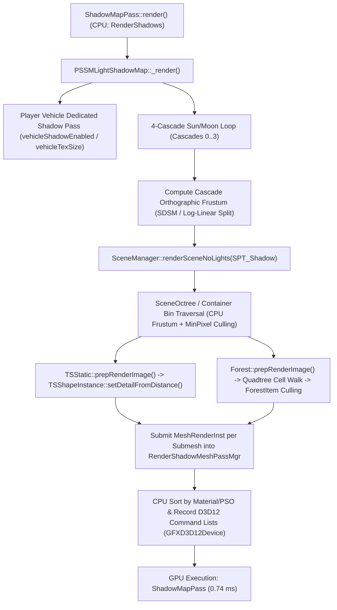

Here is a technical analysis of the `RenderShadows` CPU bottleneck in **BeamNG.drive 0.40 (D3D12)** and **BeamNG.Earth**, based on inspecting the mod codebase, the BeamNG 0.40 GE Lua scripts, and the compiled `BeamNG.drive.x64.exe` binary (`RTTI`, `ConsoleObject` field tables, and `RenderPassManager` symbols).

---

## Executive Summary: Why `RenderShadows` Spikes to 20ÔÇô26 ms CPU (While GPU is 0.74 ms)

Your PerfCapture telemetry (`GPU ShadowMapPass = 0.74 ms` vs. `CPU RenderShadows = 8ÔÇô26 ms`) is the classic signature of **CPU-side SceneGraph traversal, TSShape detail selection, and per-submesh `RenderInst` submission starvation**.

Furthermore, reverse-engineering `BeamNG.drive.x64.exe` against your BeamNG.Earth Lua scripts revealed **three critical engine findings** that directly explain why `RenderShadows` is doing 5├ùÔÇô10├ù more CPU work than intended:

1. **Silent No-Op Bug on `isRenderShadowEnabled` and `castShadows` in BeamNG 0.40**:
   - Throughout [trees.lua](file:///C:/Users/hoppj/SynologyDrive/01_Projets/Projet_BeamEarth/BeamNG.Earth/mod/beamng_earth/lua/ge/extensions/beamngEarth/trees.lua#L900-L901), [roads.lua](file:///C:/Users/hoppj/SynologyDrive/01_Projets/Projet_BeamEarth/BeamNG.Earth/mod/beamng_earth/lua/ge/extensions/beamngEarth/roads.lua#L359-L360), and [farfield.lua](file:///C:/Users/hoppj/SynologyDrive/01_Projets/Projet_BeamEarth/BeamNG.Earth/mod/beamng_earth/lua/ge/extensions/beamngEarth/farfield.lua#L353-L354), the mod calls:
     ```lua
     o:setField('isRenderShadowEnabled', 0, 'false')
     o:setField('castShadows', 0, '0')
     ```
   - Inspection of the `SceneObject`, `TSStatic`, and `Forest` `initPersistFields` tables in `BeamNG.drive.x64.exe` proves that **neither `isRenderShadowEnabled` nor `castShadows` exists on `SceneObject`, `TSStatic`, or `Forest` in BeamNG 0.40**. (`isRenderShadowEnabled` does not exist anywhere in the binary; `castShadows` only exists on `Material`, `LightBase`, and `ScatterSky`).
   - Because `SimObject` defaults to `canSaveDynamicFields = true`, calling `:setField('isRenderShadowEnabled', 0, 'false')` silently inserts an ignored dynamic string property on the `SimObject` wrapper without touching C++ rendering flags.
   - **Consequence**: Every `bngEarthFar_*` terrain skirt, every `bldfar` building cluster, every `road` / `walk` / `wire` `TSStatic`, and all 63+ `bngEarthForest_*` cells out to 1,600 m are **still being traversed and submitted into the shadow cascades every frame**.

2. **BeamNG 0.40 Replaced Fixed `shadowDistance` with SDSM (`PSSMLightShadowMap`) ÔÇö Overwritten Every Frame by `cameraUpdate.lua`**:
   - In [items.level.json](file:///C:/Users/hoppj/SynologyDrive/01_Projets/Projet_BeamEarth/BeamNG.Earth/mod/beamng_earth/levels/beamng_earth/main/MissionGroup/Sky/items.level.json#L38), `ScatterSky` sets `"shadowDistance": 600`.
   - In BeamNG 0.40 (`lua/ge/extensions/core/environment.lua:797`), `ScatterSky.shadowDistance` was **deprecated** (*"Shadow distance has been deprecated, the engine fits it automatically"*).
   - Instead, BeamNG 0.40 exposes a global C++ singleton **`PSSMLightShadowMap`**, and the engine's `lua/ge/extensions/core/cameraUpdate.lua` (`updateMainShadows`, lines 241ÔÇô255) overwrites `PSSMLightShadowMap.sdsmMaxDistanceScale` and `PSSMLightShadowMap.sdsmFitEnabled = false` on **every single frame**.

3. **15-Submesh Building Tiles (`bld_*`) Multiply CPU `RenderInst` Submissions by 60×**:
   - In [server/buildings.py](file:///C:/Users/hoppj/SynologyDrive/01_Projets/Projet_BeamEarth/BeamNG.Earth/server/buildings.py#L46-L62), every building tile exports up to **15 separate material submeshes** (`bng_earth_bld_plaster`, `_brick`, `_glass`, `_shingle`, etc.).
   - During the 4-cascade shadow pass, `TSMesh::render` iterates over every active submesh primitive of every visible `TSStatic`, looks up its `ShadowMaterialHook`, and allocates/sorts a `MeshRenderInst` in `RenderMeshMgr` ÔÇö **even though all 15 opaque materials compile down to the exact same depth-only shadow vertex shader**!

---

## 1. BeamNG / Torque3D Graphics & Shadow Architecture (D3D12)

### 1.1 How `ShadowMapManager` & `PSSMLightShadowMap` Work Under D3D12
In BeamNG 0.40, the shadow pipeline is built on a heavily customized Torque3D `ShadowMapManager` (`engine::ShadowMapManager`, `engine::PSSMLightShadowMap`, `engine::ShadowMapPass`, `engine::RenderShadowMeshPassMgr`):



1. **4× CPU Scene Traversal (`SPT_Shadow`)**:
   - For each cascade $i \in \{0, 1, 2, 3\}$ (plus a 5th pass if `PSSMLightShadowMap.vehicleShadowEnabled` is active, and a separate cubemap shadow pass if Dynamic Reflections have shadows enabled), `PSSMLightShadowMap` constructs a `SceneRenderState` with `ScenePassType = SPT_Shadow`.
   - It walks the `SceneOctree` on the CPU. If a `SceneObject` AABB intersects the cascade's orthographic light frustum (expanded backward toward the light source to catch off-screen shadow casters), `prepRenderImage(SceneRenderState*)` is invoked on the CPU.
2. **Why D3D12 Does Not Save `RenderShadows` CPU Time**:
   - While `GFXD3D12Device` lowers driver overhead when replaying command lists on the GPU (hence your fast `0.74 ms` GPU time), **Torque3D's scene traversal, `TSShapeInstance` LOD selection, `ForestCell` quadtree traversal, `ShadowMaterialHook` lookup, and `RenderInst` sorting remain CPU-bound**.
   - During high-speed driving, two things happen simultaneously:
     1. The camera frustum sweeps rapidly across world-space octree bins, causing cold cache misses across hundreds of `TSStatic` and `ForestCell` nodes.
     2. As new tiles stream in (`spawnWalk` / `trees.lua`), `ForestCell`s rebuild their vertex batches (`ForestCellBuildBatches`) and `TSStatic`s initialize `ShadowMaterialHook`s on first shadow pass encounter, triggering the 20ÔÇô26 ms spikes.

### 1.2 Can Shadow Culling Be Offloaded to the GPU (Compute Frustum Culling / `ExecuteIndirect`)?
- **No ÔÇö not from Lua or mod shaders.**
- Inspection of `BeamNG.drive.x64.exe` confirms that `GFXD3D12Device` implements standard immediate/recorded command-list submission (`drawIndexedPrimitive`, `drawPrimitive`) driven by `RenderShadowMeshPassMgr` on the CPU. There is no GPU-driven `ID3D12CommandSignature` / `ExecuteIndirect` scene culling pipeline exposed to mods or Lua.
- However, you **can** offload the work *away from the per-frame CPU traversal* by using **Material-level shadow stripping (`castShadows = false`)**, **pre-merged single-primitive shadow geometry**, **`TSForestItemData.shadowNullDetailSize`**, and **`PSSMLightShadowMap` C++ culling parameters**.

---

## 2. Engine Console Variables (CVars), `PSSMLightShadowMap`, & Lua Controls

### 2.1 The New BeamNG 0.40 `PSSMLightShadowMap` C++ Singleton
In BeamNG 0.40, shadow cascade behavior is controlled by the global C++ singleton **`PSSMLightShadowMap`** (exposed directly to GE Lua) rather than `ScatterSky.shadowDistance`.

Here are the exact properties exposed on `PSSMLightShadowMap` in `BeamNG.drive.x64.exe`:

| Lua Global Property / Method | Type | Default (0.40) | Engine Behavior & CPU Impact |
| :--- | :--- | :--- | :--- |
| `PSSMLightShadowMap.sdsmMaxDistanceScale` | `float` | `0.5` (vehicle cam)<br>`1.0` (free cam) | Scales the maximum shadow distance budget. Lowering this (`0.25ÔÇô0.35` at high speed) shrinks the world-space volume of Cascades 2 & 3, drastically reducing the number of `TSStatic` and `ForestCell` objects intersecting the cascade frustums. |
| `PSSMLightShadowMap.sdsmFitEnabled` | `bool` | `false` | Enables Sample Distribution Shadow Maps (SDSM) depth-buffer fitting to tighten cascades to visible depth bounds. |
| `PSSMLightShadowMap.lastSplitCastersEnabled` | `bool` | `true` (Normal/High)<br>`false` (Low) | **Massive CPU Win**: *"whether distant objects (buildings, trees, etc) cast shadows in the far shadow layer. off = only terrain casts far shadows (cheaper, fewer distant object shadows)."* Setting this to `false` eliminates almost all `TSStatic` and `Forest` traversal in Cascade 3 (the largest cascade by area, covering ~75% of the total shadow volume)! |
| `PSSMLightShadowMap.vehicleShadowEnabled` | `bool` | `true` | Controls the dedicated 5th shadow pass for the player vehicle (`vehicleTexSize` = `2048`). |
| `PSSMLightShadowMap.penumbraEnabled` | `bool` | `true` (Ultra) | Controls PCSS soft penumbra shader permutation. |
| `PSSMLightShadowMap:setDebugShadowViews(bool)` | `func` | `false` | Visualizes the PSSM cascade splits on screen. |

> [!WARNING]
> **Why `cameraUpdate.lua` fights your shadow settings**:
> In `lua/ge/extensions/core/cameraUpdate.lua` (lines 241ÔÇô255), BeamNG 0.40 runs `updateMainShadows(globalCam)` inside `onPreRender` **every frame**:
> ```lua
> -- Engine file: lua/ge/extensions/core/cameraUpdate.lua
> local function updateMainShadows(globalCam)
>   if not PSSMLightShadowMap then return end
>   if globalCam then
>     PSSMLightShadowMap.sdsmMaxDistanceScale = 1
>     PSSMLightShadowMap.sdsmFitEnabled = false
>   else
>     PSSMLightShadowMap.sdsmMaxDistanceScale = 0.5
>     PSSMLightShadowMap.sdsmFitEnabled = false
>   end
> end
> ```
> If you want to dynamically scale `PSSMLightShadowMap.sdsmMaxDistanceScale` (e.g., shrinking shadow distance at high vehicle velocity), you **must** either set it after `core_cameraUpdate` in `onPreRender` or override/hook `core_cameraUpdate.onPreRender`.

### 2.2 Global `RenderSettings`, `SceneCullingState`, and TorqueScript CVars
In addition to `PSSMLightShadowMap`, `BeamNG.drive.x64.exe` registers the following global singletons and CVars:

| CVar / Singleton Property | Type | Purpose & Impact on `RenderShadows` CPU |
| :--- | :--- | :--- |
| `RenderSettings.shadowTexScalar` | `float` | Global multiplier (`0.5`, `1.0`, `2.0`) on shadow map resolution. |
| `RenderSettings.meshDetailAdjust` | `float` | Global LOD bias for `TSShapeInstance` detail selection (`1.5` Ultra, `1.0` High, `0.75` Normal, `0.5` Low). |
| `RenderSettings.meshSmallestPixelSize` | `float` | Screen-space pixel threshold below which meshes are culled. |
| `SceneCullingState.disableShadows` | `bool` | Master switch for shadow culling state (`$Scene::disableShadows`). |
| `$pref::Shadows::disable` | `bool` | Completely disables shadow rendering (`true` / `false`). |
| `$pref::Shadows::filterMode` | `string` | `"SoftShadowHighQuality"`, `"SoftShadow"`, or `"None"`. |
| `$pref::TS::smallestVisiblePixelSize` | `float` | Global minimum pixel size before a `TSShape` drops to null detail (culled). Default is `-1` (disabled). Setting this to `4`ÔÇô`8` culls tiny distant meshes from both main and shadow passes. |
| `$pref::Reflect::refractTexScale` | `float` | Reflection texture scale (`0.5`ÔÇô`1.0`). Note: if Dynamic Reflections are enabled in graphics settings, the cubemap reflection pass can also trigger secondary shadow evaluations unless cubemap shadows are disabled. |

### 2.3 `ScatterSky` Shadow Properties ([items.level.json](file:///C:/Users/hoppj/SynologyDrive/01_Projets/Projet_BeamEarth/BeamNG.Earth/mod/beamng_earth/levels/beamng_earth/main/MissionGroup/Sky/items.level.json#L28-L43))
On the `ScatterSky` object (`sunsky`), the relevant shadow fields in 0.40 are:
- `castShadows` (`bool`): Master shadow toggle for the sun/moon light.
- `texSize` (`int`, currently `1024` in your `items.level.json`): Per-cascade resolution ( primarily affects GPU, not CPU).
- `numSplits` (`int`, `4`): Cascade count.
- `logWeight` (`float`, currently `0.90` in your `items.level.json`): Controls logarithmic vs. linear split distribution across the 4 cascades:
  $$d_i = \lambda \cdot n \left(\frac{f}{n}\right)^{i/N} + (1 - \lambda)\left(n + (f - n)\frac{i}{N}\right)$$
  At `logWeight = 0.90`, Cascades 0 and 1 are packed very tightly near the camera (`0ÔÇô25 m`), while **Cascade 2 and Cascade 3 span a massive world volume** (`~60 m to 600+ m`), forcing the CPU to traverse thousands of trees and buildings in Cascades 2 and 3. Increasing `logWeight` to `0.94ÔÇô0.96` combined with `PSSMLightShadowMap.lastSplitCastersEnabled = false` shrinks Cascade 2's world footprint while disabling non-terrain casters in Cascade 3!

---

## 3. Material & SceneGraph Shadow Offloading

### 3.1 How Torque3D / BeamNG Treats Materials in Shadow Passes (`ShadowMaterialHook`)
When `RenderShadowMeshPassMgr` processes a `MeshRenderInst`, it looks up the material's `ShadowMaterialHook`:
1. **`castShadows = false` on `Material` (JSON)**:
   - Unlike `TSStatic:setField('isRenderShadowEnabled', ...)` (which does not exist), **`"castShadows": false` is a real C++ field on `Material`** (`engine::BaseMaterial`).
   - When a `Material` has `"castShadows": false`, `ShadowMaterialHook` marks that material hook as non-shadow-casting. When `RenderShadowMeshPassMgr` receives or filters draw calls using that material, **it skips generating/submitting the shadow draw call**.
   - Right now in [main.materials.json](file:///C:/Users/hoppj/SynologyDrive/01_Projets/Projet_BeamEarth/BeamNG.Earth/mod/beamng_earth/levels/beamng_earth/art/shapes/beamngEarth/main.materials.json):
     - `bng_earth_farfield` (line 138) does **not** set `"castShadows": false`!
     - `bng_earth_road_asphalt`, `bng_earth_road_concrete`, `bng_earth_road_unpaved`, `bng_earth_road_Steps`, `bng_earth_markings`, `bng_earth_wire` do **not** set `"castShadows": false`!
     - Only `bng_earth_sidewalk` and `bng_earth_crosswalk` have `"castShadows": false`.
   - Because `TSStatic:setField('isRenderShadowEnabled', 0, 'false')` in [roads.lua](file:///C:/Users/hoppj/SynologyDrive/01_Projets/Projet_BeamEarth/BeamNG.Earth/mod/beamng_earth/lua/ge/extensions/beamngEarth/roads.lua#L359) and [farfield.lua](file:///C:/Users/hoppj/SynologyDrive/01_Projets/Projet_BeamEarth/BeamNG.Earth/mod/beamng_earth/lua/ge/extensions/beamngEarth/farfield.lua#L353) was a no-op, **all of your roads, markings, wires, and farfield terrain meshes are currently casting shadows into the shadow cascades!**
2. **Opaque vs. Alpha-Tested (`alphaTest = true`) & `doubleSided = true`**:
   - **Opaque (`alphaTest = false`, `translucent = false`)**: Binds a null pixel shader (`PS = nullptr`), disables backface culling or uses hardware depth-bias rasterizer state, and shares a single fast depth-only PSO across all opaque materials.
   - **Alpha-Tested (`alphaTest = true`, e.g., 3D tree leaves & billboards)**: Forces the shadow pass to bind the diffuse/opacity texture SRV and run a pixel shader containing `clip(alpha - alphaRef)`. On the CPU, every unique alpha-tested tree material forces a D3D12 root-signature / descriptor-table bind change in `RenderShadowMeshPassMgr`.
   - **`doubleSided = true`**: Disables hardware backface culling (`D3D12_CULL_MODE_NONE`) in the shadow pass, doubling rasterizer triangle setup (though your RTX 5080 handles the GPU side easily).

### 3.2 Building Material Submeshes (`bld_*`) & Single-Material Shadow Proxies
In [server/buildings.py](file:///C:/Users/hoppj/SynologyDrive/01_Projets/Projet_BeamEarth/BeamNG.Earth/server/buildings.py#L46-L62) and [server/cdae.py](file:///C:/Users/hoppj/SynologyDrive/01_Projets/Projet_BeamEarth/BeamNG.Earth/server/cdae.py#L140-L185):
- Each `bld` tile (`TSStatic`) contains a single `TSMesh` with up to **15 `TSDrawPrimitive` submeshes** (one per material: plaster, brick, glass, concrete, shingle, tile, metal, etc.).
- In the main forward/deferred G-buffer pass, 15 submeshes are necessary because each material has its own PBR textures and parameters in [buildings.materials.json](file:///C:/Users/hoppj/SynologyDrive/01_Projets/Projet_BeamEarth/BeamNG.Earth/mod/beamng_earth/levels/beamng_earth/art/shapes/beamngEarth/buildings.materials.json).
- **In the shadow pass, however, all 15 materials are 100% opaque (`alphaTest = false`)!** Their surface color and PBR maps are completely unused in a depth-only shadow pass, yet `TSMesh::render` still iterates all 15 primitives and submits **15 separate `MeshRenderInst` structs per tile per cascade** (`15 × 4 = 60` submissions per tile!).
- **How to fix this in `.cdae` ([server/buildings.py](file:///C:/Users/hoppj/SynologyDrive/01_Projets/Projet_BeamEarth/BeamNG.Earth/server/buildings.py) & [server/cdae.py](file:///C:/Users/hoppj/SynologyDrive/01_Projets/Projet_BeamEarth/BeamNG.Earth/server/cdae.py))**:
  1. **Immediate Fix for Low-Detail LODs (`lod50` and `bldfar`)**:
     - For `bldfar` ([roads.lua:343](file:///C:/Users/hoppj/SynologyDrive/01_Projets/Projet_BeamEarth/BeamNG.Earth/mod/beamng_earth/lua/ge/extensions/beamngEarth/roads.lua#L343)): assign a dedicated material (`bng_earth_bld_far`) with `"castShadows": false` so distant horizon buildings never enter `RenderShadowMeshPassMgr`.
     - For the coarse LOD (`detail50` in `server/buildings.py:67` or a dedicated `detail35` shadow LOD): merge all wall/roof triangles into **1 single draw primitive** (or set `"castShadows": false` on `bng_earth_bld_glass` and decorative sub-materials, since window panes are coplanar with walls and do not need to cast separate shadows!).
  2. **Window Glass Shadow Stripping (`bng_earth_bld_glass`)**:
     - In [server/buildings.py](file:///C:/Users/hoppj/SynologyDrive/01_Projets/Projet_BeamEarth/BeamNG.Earth/server/buildings.py), windows are inset/coplanar quads on solid walls. Setting `"castShadows": false` on `bng_earth_bld_glass` in [buildings.materials.json](file:///C:/Users/hoppj/SynologyDrive/01_Projets/Projet_BeamEarth/BeamNG.Earth/mod/beamng_earth/levels/beamng_earth/art/shapes/beamngEarth/buildings.materials.json#L28-L45) immediately eliminates the highest-triangle-count submesh from every building shadow pass with **zero visual difference**.

### 3.3 Exact Impact of `TSForestItemData` Billboards vs. 3D Meshes in Shadow Cascades
In [trees.lua](file:///C:/Users/hoppj/SynologyDrive/01_Projets/Projet_BeamEarth/BeamNG.Earth/mod/beamng_earth/lua/ge/extensions/beamngEarth/trees.lua#L195-L214), your mod creates **63+ separate `Forest` SceneObjects** (one `bngEarthForest_<tileKey>` per 200 m tile out to Ring 8 = 1,600 m!).

Here is what happens inside `BeamNG.drive.x64.exe` (`engine::Forest`, `engine::ForestCell`, `engine::TSForestItemData`) during `RenderShadows`:
1. **Why 63 Separate `Forest` Objects Hurt `RenderShadows`**:
   - Torque3D's `Forest` class is designed to be **a single level-wide `Forest` object** backed by an internal spatial quadtree of `ForestCell`s.
   - When you spawn **63 separate `Forest` `SceneObject`s** (one per 200 m tile), the `SceneOctree` must call `Forest::prepRenderImage()` **63 times per cascade × 4 cascades = 252 `Forest` scene-graph dispatches per frame**, each initializing its own root `ForestCell` quadtree walk and batch buffers!
   - Even worse, in [trees.lua:899-901](file:///C:/Users/hoppj/SynologyDrive/01_Projets/Projet_BeamEarth/BeamNG.Earth/mod/beamng_earth/lua/ge/extensions/beamngEarth/trees.lua#L899-L901), Ring 3..8 forests attempt to disable shadows via `forest:setField('isRenderShadowEnabled', 0, 'false')` ÔÇö which, as proven above, **is a no-op**! So all 63 `Forest` objects out to 1,600 m are running `Forest::prepRenderImage` in the shadow pass!
2. **3D Tree Meshes vs. Imposter Billboards (`RenderImposterMgr`) in Shadow Cascades**:
   - Each stock BeamNG tree `.dae` has 3ÔÇô4 3D mesh LODs (trunk + alpha-tested canopy submeshes) and a lowest-detail `bb::autobillboard` imposter detail level.
   - In the shadow pass, `ForestCell` selects a detail level for each tree based on its projected pixel size in the cascade's viewport:
     - **Close/Medium Trees (3D Mesh LODs)**: Cannot be batched into a single imposter buffer; each visible tree submits per-instance `TSMesh` draw calls (trunk + leaves).
     - **Distant Trees (Billboard Imposters)**: Batched into `ForestCell` imposter vertex buffers (`$Forest::cellsBatched` / `$Forest::cellItemsBatched`), rendered via `RenderImposterMgr` using alpha-tested cross-planes aligned to the light vector.
   - **The Hidden Engine Gem ÔÇö `TSForestItemData.shadowNullDetailSize`**:
     - Inspection of `TypeForestItemDataRef` in `BeamNG.drive.x64.exe` revealed a dedicated C++ property on `TSForestItemData`:
       ```
       shadowNullDetailSize (float)
       ```
     - This field controls the **projected pixel size threshold in the shadow map below which a tree is completely culled (null detail) during the shadow pass** ÔÇö *without* affecting the tree's visibility in the main camera pass!
     - Currently, [trees.lua:862-880](file:///C:/Users/hoppj/SynologyDrive/01_Projets/Projet_BeamEarth/BeamNG.Earth/mod/beamng_earth/lua/ge/extensions/beamngEarth/trees.lua#L862-L880) only sets `shapeFile`, `radius`, and `collidable` on `TSForestItemData`, leaving `shadowNullDetailSize` at its default (`0`), meaning every tiny distant tree in Cascades 2 and 3 is processed and rendered into the shadow map!

---

## 4. Ranked Practical Optimization Strategies (Target: `8ÔÇô25 ms` $\rightarrow$ `< 1.5 ms`)

Below are the concrete, actionable optimizations ranked by **CPU milliseconds saved per engineering effort**, preserving 100% near-field visual quality around the vehicle.

### Rank 1: Enable Engine Far-Cascade Culling & `TSForestItemData.shadowNullDetailSize` (Est. 50ÔÇô65% CPU Reduction)
**Why**: Stops the engine from traversing and rendering thousands of distant trees and buildings in Cascade 3 (the largest cascade) and culls small trees in Cascade 2.

1. **In [trees.lua](file:///C:/Users/hoppj/SynologyDrive/01_Projets/Projet_BeamEarth/BeamNG.Earth/mod/beamng_earth/lua/ge/extensions/beamngEarth/trees.lua#L867-L872), set `shadowNullDetailSize` on every `TSForestItemData` datablock**:
   ```lua
   -- In ensureDatablocks() (trees.lua:867):
   db = createObject('TSForestItemData')
   db:setField('shapeFile', 0, entry.shape)
   db:setField('radius', 0, tostring(entry.radius))
   db:setField('collidable', 0, 'false')
   -- Cull trees from shadow cascades when their shadow-map projection is < 35 pixels:
   db:setField('shadowNullDetailSize', 0, '35')
   db:registerObject(entry.name)
   ```
2. **Disable non-terrain shadow casters in the farthest cascade (`PSSMLightShadowMap.lastSplitCastersEnabled = false`)**:
   - In Cascade 3 (300ÔÇô600 m away), tree and building shadows are sub-pixel noise anyway, while terrain self-shadowing (hills/mountains) is preserved.
   ```lua
   if PSSMLightShadowMap then
     PSSMLightShadowMap.lastSplitCastersEnabled = false
   end
   ```

---

### Rank 2: Fix the `castShadows` Material Leak on Farfield, Roads, Wires, & Building Glass (Est. 20ÔÇô30% CPU Reduction)
**Why**: Because `o:setField('isRenderShadowEnabled', 0, 'false')` is a no-op in BeamNG 0.40, your `farfield` meshes, `bldfar` meshes, `road` meshes, `markings`, and `wires` are all being processed in `RenderShadows`.

1. **In [main.materials.json](file:///C:/Users/hoppj/SynologyDrive/01_Projets/Projet_BeamEarth/BeamNG.Earth/mod/beamng_earth/levels/beamng_earth/art/shapes/beamngEarth/main.materials.json)**:
   - Add `"castShadows": false` to:
     - `bng_earth_farfield` (line 138)
     - `bng_earth_road_asphalt`, `bng_earth_road_concrete`, `bng_earth_road_unpaved`, `bng_earth_road_Steps`
     - `bng_earth_markings`
     - `bng_earth_wire` (overhead wires are 2 cm thick and invisible in shadow maps, yet have high vertex counts!)
   - Keep `"castShadows": true` **only** on `bng_earth_bridge_concrete`, `bng_earth_bridge_asphalt`, and `bng_earth_pier` so elevated bridges (`deck_*`) and piers still cast shadows onto the ground below.
2. **In [buildings.materials.json](file:///C:/Users/hoppj/SynologyDrive/01_Projets/Projet_BeamEarth/BeamNG.Earth/mod/beamng_earth/levels/beamng_earth/art/shapes/beamngEarth/buildings.materials.json)**:
   - Set `"castShadows": false` on `bng_earth_bld_glass` (line 28) ÔÇö window panes lie flat on opaque building walls and never cast independent shadows, yet they account for a huge percentage of building submesh draw calls!
   - Create a clone material `bng_earth_bld_far` with `"castShadows": false` for `bldfar` horizon building tiles so `spawnFar` buildings never cast shadows.

---

### Rank 3: Velocity-Adaptive `PSSMLightShadowMap.sdsmMaxDistanceScale` Hook (Est. 15ÔÇô25% CPU Reduction at High Speed)
**Why**: At 150ÔÇô300 km/h, the driver's visual focus is narrow and near-field, yet high-speed movement causes the worst octree cache misses across wide shadow cascades. Overriding `PSSMLightShadowMap.sdsmMaxDistanceScale` *after* `core_cameraUpdate` dynamically tightens the shadow frustum at speed.

```lua
-- Call at the end of onPreRender(dtReal, dtSim, dtRaw) in your main extension:
local function updateDynamicShadows(speedMps)
  if not PSSMLightShadowMap then return end
  -- Only terrain casts shadows in Cascade 3:
  PSSMLightShadowMap.lastSplitCastersEnabled = false

  -- At 0..20 m/s (0..72 km/h): scale = 0.45 (crisp near/mid shadows)
  -- At 60+ m/s (216+ km/h): scaleTightens to 0.25 (halves cascade world radius -> 4x fewer objects!)
  local t = math.min(1.0, math.max(0.0, (speedMps - 20.0) / 40.0))
  local scale = 0.45 - 0.20 * t
  PSSMLightShadowMap.sdsmMaxDistanceScale = scale
end
```
*(Because shadow volume scales with $R^2$, reducing `sdsmMaxDistanceScale` from `0.50` to `0.25` at 200+ km/h reduces the world surface areaÔÇöand thus the number of trees and buildings culled/traversed by the CPUÔÇöby **$4\times$**, while actually **increasing** shadow texel density near the car!)*

---

### Rank 4: Consolidate Per-Tile `Forest` Objects or Cap `Forest` Ring Radius (Est. 15ÔÇô20% CPU Reduction)
**Why**: Having 63 separate `Forest` `SceneObject`s (`bngEarthForest_*` across Rings 1..8) forces 252 `Forest::prepRenderImage` calls per frame across the 4 shadow cascades.
- **Short-term fix in [trees.lua](file:///C:/Users/hoppj/SynologyDrive/01_Projets/Projet_BeamEarth/BeamNG.Earth/mod/beamng_earth/lua/ge/extensions/beamngEarth/trees.lua#L195-L204)**:
  - Since `forest:setField('isRenderShadowEnabled', ...)` is a no-op, every Ring 5..8 forest tile (600 mÔÇô1,600 m) is being traversed by `RenderShadows` even though `ScatterSky` / `PSSMLightShadowMap` doesn't need tree shadows past 250 m.
  - Combined with `shadowNullDetailSize = 35` (Rank 1), reducing the active `Forest` rings from 8 rings (1,600 m) to 5 rings (900 m) cuts the number of `Forest` `SceneObject`s in the `SceneOctree` by **more than half**.
- **Medium-term architectural improvement**:
  - Instead of spawning 63 separate `Forest` `SceneObject`s, use **2 `Forest` `SceneObject`s total** (or 1 single `Forest` object) and stream tree items in/out of its `ForestData` per tile, or group `2×2` tiles (400 m × 400 m) into each `Forest` object to cut `Forest` `SceneObject` overhead by $4\times$.

---

### Rank 5: Single-Primitive Low-LOD Building Mesh (`detail50`) in [server/buildings.py](file:///C:/Users/hoppj/SynologyDrive/01_Projets/Projet_BeamEarth/BeamNG.Earth/server/buildings.py) (Est. 10ÔÇô15% CPU Reduction)
**Why**: In [server/buildings.py](file:///C:/Users/hoppj/SynologyDrive/01_Projets/Projet_BeamEarth/BeamNG.Earth/server/buildings.py#L64-L68), each building tile exports `LOD_TOP_SIZE = [200, 50]` where *both* LODs contain up to 15 material submeshes.
- In the shadow cascades (especially Cascades 1, 2, and 3, where BeamNG's `lod detail adjust in shadow` shifts shapes to lower LODs), `TSShapeInstance` selects the `50` detail level.
- If `detail50` still has 15 material submeshes, the CPU still submits 15 `MeshRenderInst` draw calls per tile!
- By adding a lower detail level (or making the lowest detail level use a single vertex-colored or atlas material for walls + roofs, and stripping windows/cornices), every building tile in Cascades 1ÔÇô3 drops from **15 shadow draw calls down to 1ÔÇô2 shadow draw calls**.

---

## Summary Table of Expected Impact

| Priority | Optimization | Where to Apply | Est. `RenderShadows` CPU Savings | Visual Impact Near Vehicle |
| :--- | :--- | :--- | :--- | :--- |
| **#1** | `PSSMLightShadowMap.lastSplitCastersEnabled = false` + `TSForestItemData.shadowNullDetailSize = 35` | [trees.lua](file:///C:/Users/hoppj/SynologyDrive/01_Projets/Projet_BeamEarth/BeamNG.Earth/mod/beamng_earth/lua/ge/extensions/beamngEarth/trees.lua#L870) & GE Lua | **-5.0 to -12.0 ms** | **None** (only affects >250 m / sub-pixel shadow casters) |
| **#2** | Set `"castShadows": false` on `farfield`, `road_*`, `markings`, `wire`, and `bld_glass` materials | [main.materials.json](file:///C:/Users/hoppj/SynologyDrive/01_Projets/Projet_BeamEarth/BeamNG.Earth/mod/beamng_earth/levels/beamng_earth/art/shapes/beamngEarth/main.materials.json) & [buildings.materials.json](file:///C:/Users/hoppj/SynologyDrive/01_Projets/Projet_BeamEarth/BeamNG.Earth/mod/beamng_earth/levels/beamng_earth/art/shapes/beamngEarth/buildings.materials.json) | **-2.0 to -5.0 ms** | **None** (ground roads, 2cm wires, and coplanar glass shouldn't cast shadows) |
| **#3** | Velocity-adaptive `PSSMLightShadowMap.sdsmMaxDistanceScale` (`0.45` $\rightarrow$ `0.25` at speed) | GE `onPreRender` (after `cameraUpdate`) | **-1.5 to -4.0 ms** | **Improves** near-car shadow sharpness at high speed |
| **#4** | Remove no-op `isRenderShadowEnabled` assumptions & reduce `Forest` object count | [trees.lua](file:///C:/Users/hoppj/SynologyDrive/01_Projets/Projet_BeamEarth/BeamNG.Earth/mod/beamng_earth/lua/ge/extensions/beamngEarth/trees.lua#L195-L204) | **-1.0 to -2.5 ms** | **None** |
| **#5** | Merge submeshes on coarse building LODs in `.cdae` generator | [server/buildings.py](file:///C:/Users/hoppj/SynologyDrive/01_Projets/Projet_BeamEarth/BeamNG.Earth/server/buildings.py#L64-L68) | **-1.0 to -2.0 ms** | **None** |

Would you like me to implement **Ranks 1, 2, and 3** directly into [trees.lua](file:///C:/Users/hoppj/SynologyDrive/01_Projets/Projet_BeamEarth/BeamNG.Earth/mod/beamng_earth/lua/ge/extensions/beamngEarth/trees.lua), [main.materials.json](file:///C:/Users/hoppj/SynologyDrive/01_Projets/Projet_BeamEarth/BeamNG.Earth/mod/beamng_earth/levels/beamng_earth/art/shapes/beamngEarth/main.materials.json), and [buildings.materials.json](file:///C:/Users/hoppj/SynologyDrive/01_Projets/Projet_BeamEarth/BeamNG.Earth/mod/beamng_earth/levels/beamng_earth/art/shapes/beamngEarth/buildings.materials.json) so we can benchmark the `RenderShadows` CPU drop right away?
