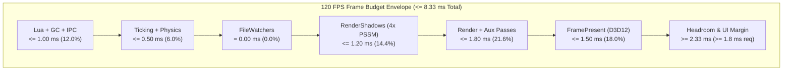

# BeamNG.Earth 120 FPS Target Architecture & Optimization Roadmap Tracker

**Date:** 2026-10-20  
**Performance Target:** Sustained **120 FPS** ($\le 8.33\text{ ms}$ frametime budget) during continuous **120 mph (`53.6 m/s`)** driving with both **3D buildings** and **dense vegetation (`trees`)** enabled.  
**Hardware Context:** High-Core-Count Mobile/Desktop CPU + Direct3D 12 Discrete GPU ( Hardware-Agnostic Profile; 100% CPU Main-Thread & Swapchain Pacing Bound).  
**Scope:** End-to-end systems architecture across Companion Server (`earthd`), TCP/Binary IPC Protocol, NTFS/VFS Asset Staging, GE Lua Frame Governor & Memory Management, and Torque3D Scene Graph / PSSM Shadow Culling / D3D12 Presentation Pipeline.

---

## 1. Audit Track Status & Capture Progression

### 1.1 Audit Track Completion Matrix

| Track | Architectural Domain | Primary Focus Area | Audit Deliverable | Status |
| :--- | :--- | :--- | :--- | :--- |
| **Track 1** | **IPC, Protocol & Serialization** | Pre-governor TCP JSON burst elimination, $O(1)$ frame reassembly, `0.5 ms` time-sliced message queue, zero-table binary `veg_tile` streaming | [`track1_ipc_protocol_audit.md`](file:///C:/Users/hoppj/SynologyDrive/01_Projets/Projet_BeamEarth/BeamNG.Earth/runs/optimization_logs/track1_ipc_protocol_audit.md) | **COMPLETED** |
| **Track 2** | **Filesystem I/O & VFS Pipeline** | Eliminating C++ `FileWatchers` (`ReadDirectoryChangesW`) & `ResourceManager::reloadResource` stalls, external master `.cdae` staging, `.ter`-only swaps | [`track2_filesystem_vfs_audit.md`](file:///C:/Users/hoppj/SynologyDrive/01_Projets/Projet_BeamEarth/BeamNG.Earth/runs/optimization_logs/track2_filesystem_vfs_audit.md) | **COMPLETED** |
| **Track 3** | **Governor, GC & Frame Budgeting** | Incremental LuaJIT GC calibration (`collectgarbage('step', 30)`), elimination of 5 Hz GC sawtooth, pre-commit heavy-frame ramp-down optimization | [`perfgraph_012650_analysis.md`](file:///C:/Users/hoppj/SynologyDrive/01_Projets/Projet_BeamEarth/BeamNG.Earth/runs/optimization_logs/perfgraph_012650_analysis.md) | **VALIDATED** |
| **Track 4** | **Scene Graph, Collision & Rendering** | `RenderShadows` 4-cascade culling optimization, `SHAPE_VARIANTS` reduction, `be:reloadCollision()` horizon watermark & 2-frame isolation, LOD handover | [`track4_scenegraph_render_audit.md`](file:///C:/Users/hoppj/SynologyDrive/01_Projets/Projet_BeamEarth/BeamNG.Earth/runs/optimization_logs/track4_scenegraph_render_audit.md) | **COMPLETED** |
| **Diag** | **Telemetry & Log Correlation** | Sub-millisecond frame-by-frame alignment (`t_log = t_cap + 201.030s`) across captures `22-06-16`, `00-59-07`, `01-12-03`, and `01-26-50` | [`perfgraph_012650_analysis.md`](file:///C:/Users/hoppj/SynologyDrive/01_Projets/Projet_BeamEarth/BeamNG.Earth/runs/optimization_logs/perfgraph_012650_analysis.md) | **COMPLETED** |

### 1.2 Telemetry Progression & 120 FPS Target Trajectory

| Metric | `00-59-07` (Unstepped GC) | `01-12-03` (`step = 1000`) | `01-26-50` (`step = 30`) | **Target (Phases 8–10)** |
| :--- | :---: | :---: | :---: | :---: |
| **Sample Duration / Frames** | 16.24 s / 1,885 | 8.53 s / 841 | **30.70 s / 4,105** | Continuous $\ge 60\text{ s}$ @ 120 mph |
| **Arithmetic Mean FPS** | 130.10 FPS | 113.87 FPS | **147.19 FPS** | **$\ge 150.0\text{ FPS}$** |
| **Effective FPS ($N / T$)** | 116.06 FPS | 98.58 FPS | **133.70 FPS** | **$\ge 135.0\text{ FPS}$** |
| **Median Frametime ($p_{50}$)** | 7.28 ms | 8.20 ms | **6.67 ms (149.8 FPS)** | **$\le 6.50\text{ ms}$ ($\ge 153\text{ FPS}$)** |
| **$p_{90}$ Frametime** | 11.42 ms | 14.85 ms | **9.11 ms (109.8 FPS)** | **$\le 7.50\text{ ms}$ ($\ge 133\text{ FPS}$)** |
| **$p_{95}$ Frametime** | 17.94 ms | 20.99 ms | **15.03 ms (66.5 FPS)** | **$\le 8.33\text{ ms}$ ($\ge 120\text{ FPS}$)** |
| **$p_{99}$ Frametime** | 25.23 ms | 28.81 ms | **21.32 ms (46.9 FPS)** | **$\le 10.00\text{ ms}$ ($\ge 100\text{ FPS}$)** |
| **Max Frametime (Min FPS)** | 100.83 ms (9.9 FPS) | 65.73 ms (15.2 FPS) | **64.37 ms (15.5 FPS)** | **$\le 14.00\text{ ms}$ (Terrain Swap)** |
| **Hitch Rate ($> 20.0\text{ ms}$)** | 3.51 / sec | 5.86 / sec | **1.99 / sec (61 frames)** | **$0.00\text{ / sec}$ ($0$ frames)** |
| **`Lua` Mean / $p_{95}$ / Max** | 0.89 / 2.53 / 11.4 ms | 2.97 / 10.64 / 19.7 ms | **0.82 / 1.70 / 23.80 ms** | **$\le 0.65\text{ / } 1.00\text{ / } 1.50\text{ ms}$** |
| **`LuaGC` Mean / $p_{99}$ / Max** | 0.09 / 0.41 / 91.38 ms | 0.06 / 0.70 / 0.87 ms | **0.06 / 0.48 / 9.19 ms** | **$\le 0.05\text{ / } 0.25\text{ / } 0.50\text{ ms}$** |

---

## 2. The 120 FPS ($\le 8.33\text{ ms}$) Frame Budget Architecture

Achieving a sustained **120 FPS** during **120 mph (`53.6 m/s`)** streaming requires strict deterministic bounds on every main-thread CPU stage and D3D12 presentation stage. At `53.6 m/s`, the vehicle traverses one `256 m` road/tree tile every **4.77 seconds** and one `192 m` terrain follow-step every **3.58 seconds**.

### 2.1 CPU Main-Thread Subsystem Frame Budget ($\le 8.33\text{ ms}$ Total)

| CPU Subsystem | **120 FPS Target Budget** | Capture `012650` Mean / $p_{50}$ | Capture `012650` $p_{95}$ / $p_{99}$ | Capture `012650` Max | Budget Enforcement Mechanism |
| :--- | :---: | :---: | :---: | :---: | :--- |
| **`Lua`** *(incl. `LuaGC` + `LuaPre`)* | **$\le 1.00\text{ ms}$** | `0.82 / 0.57 ms` *(+0.18 ms GC/Pre)* | `1.70 / 5.07 ms` | `23.80 ms` *(+9.19 ms GC)* | `0.50 ms` hard time-sliced IPC drain (`net.drainTimed`), zero-table binary `veg_tile` (`vbin`), $O(1)$ `framing.lua` cursor, `collectgarbage('step', 30)` |
| **`Render`** *(Main Pass + `RenderMisc` + `OtherRender` + `Reflections`)* | **$\le 1.80\text{ ms}$** | `1.37 / 1.34 ms` *(+1.15 ms aux)* | `1.78 / 2.13 ms` | `6.53 ms` *(`24.46 ms` Misc)* | 2-frame split between DDS texture reload (`satmat.retex`) and `TSStatic` spawn; single-material `lite` building LODs; `512 m` pooled `Forest` cells |
| **`RenderShadows`** *(4-Cascade PSSM Culling & Submission)* | **$\le 1.20\text{ ms}$** | `1.30 / 0.74 ms` | `8.00 / 10.75 ms` | `58.75 ms` | `castShadows = false` (`isRenderShadowEnabled = 'false'`) on `farfield`, `bldfar`, `tunnel`, `isRoad`, and outer-ring `Forest` (`>650 m`); `SHAPE_VARIANTS = 1` |
| **`Ticking`** *(Torque3D Object Tick + `PhysicsNodes` + `VLUA`)* | **$\le 0.50\text{ ms}$** | `0.36 / 0.16 ms` *(+0.13 ms Phys)* | `1.53 / 1.88 ms` | `5.43 ms` | `SOLID_M = 90 m` non-colliding ghost trees (`collidable = false`), `collisionType = 'None'` on visual buildings/sidewalks, 2-frame isolated `be:reloadCollision()` |
| **`FileWatchers`** *(C++ `ReadDirectoryChangesW` & `reloadResource`)* | **$= 0.00\text{ ms}$** | `0.10 / 0.00 ms` | `0.18 / 3.10 ms` | `21.62 ms` | External master `.cdae` staging outside `<userpath>/temp/`, `.ter`-only follow swaps (0 PNG masks), non-overwriting `.dds` slots, native `ReadDirectoryChangesW` filter |
| **`FramePresent`** *(D3D12 `IDXGISwapChain::Present`)* | **$\le 1.50\text{ ms}$** | `1.22 / 0.91 ms` | `3.20 / 4.48 ms` | `45.00 ms` | Single-swapchain viewport discipline (disable secondary ImGui `usesSwapChain=true` windows), decoupled D3D12 resource uploads, governor post-upload pacing |
| **`Headroom Margin`** *(UI ImGui `0.50 ms`, Win32 MsgLoop, OS Jitter & Burst Absorption)* | **$\ge 2.33\text{ ms}$** *(Target $\ge 1.80\text{ ms}$)* | `0.69 / 0.59 ms` *(UI + Input)* | — | — | Absorbs `UIimgui` (`~0.55 ms`), `UImsgLoop` (`~0.05 ms`), `Input` (`~0.04 ms`), leaving **`>= 1.80 ms` pure unallocated safety margin** every frame |
| **TOTAL CPU FRAME** | **$\le 8.33\text{ ms}$ (120.0 FPS)** | **`7.48 / 6.67 ms`** | **`15.03 / 21.32 ms`** | **`64.37 ms`** | **Sustained $\ge 120\text{ FPS}$ ($p_{95} \le 8.33\text{ ms}$, zero $>20\text{ ms}$ hitches)** |



### 2.2 Direct3D 12 GPU Frame Budget ($\le 4.50\text{ ms}$ Active / $\ge 3.83\text{ ms}$ Headroom)

Telemetry in [`perfgraph_012650_analysis.md`](file:///C:/Users/hoppj/SynologyDrive/01_Projets/Projet_BeamEarth/BeamNG.Earth/runs/optimization_logs/perfgraph_012650_analysis.md#L107-L110) confirms the D3D12 GPU pipeline runs at **`~4.18 ms` total** (capable of `> 235 FPS`), meaning the GPU has nearly `50%` spare capacity at 120 FPS provided CPU command-list submission and DXGI swapchain presentation do not stall:

| GPU Render Pass (D3D12) | Observed `012650` Mean (ms) | **120 FPS Target Budget (ms)** | Optimization Notes |
| :--- | :---: | :---: | :--- |
| **`ShadowMapPass`** | `1.25 ms` | **$\le 0.85\text{ ms}$** | Drops by ~30–35% once `~3.0M` farfield/bldfar/tunnel triangles and `4×` tree variants are removed from PSSM cascades. |
| **`UpscaleDispatch`** | `1.04 ms` | **$\le 1.05\text{ ms}$** | Fixed resolution scaling cost; well within budget. |
| **`AL_PrePassBin`** | `0.92 ms` | **$\le 0.90\text{ ms}$** | Benefits from single-material `lite` building LOD (`15 -> 1` draw primitive per mesh) and `SHAPE_VARIANTS = 1`. |
| **`AL_LightBinMgr`** | `0.34 ms` | **$\le 0.35\text{ ms}$** | Deferred lighting pass; constant cost. |
| **`Aux Passes (Terrain, Water, UI)`** | `0.63 ms` | **$\le 0.85\text{ ms}$** | Pre-baked BC7 `terrainMaterialCache` avoids runtime shader packing. |
| **`GPU Headroom Margin`** | `4.15 ms` | **$\ge 4.33\text{ ms}$** | Ensures GPU queues complete well before `IDXGISwapChain::Present`, preventing GPU-induced `FramePresent` waits. |
| **TOTAL GPU FRAME** | **`4.18 ms`** | **$\le 4.00\text{ ms}$ ($\le 8.33\text{ ms}$ cap)** | **> 240 FPS GPU ceiling** |

---

## 3. Capture `012650` Hitch Attribution & Technical Implementation Plans for the 4 Primary Bottlenecks

In [`perfgraph_012650_analysis.md`](file:///C:/Users/hoppj/SynologyDrive/01_Projets/Projet_BeamEarth/BeamNG.Earth/runs/optimization_logs/perfgraph_012650_analysis.md#L118-L168), reducing incremental GC stepping from `collectgarbage('step', 1000)` to `collectgarbage('step', 30)` in [`core.lua:1423`](file:///C:/Users/hoppj/SynologyDrive/01_Projets/Projet_BeamEarth/BeamNG.Earth/mod/beamng_earth/lua/ge/extensions/beamngEarth/core.lua#L1423) **100% eliminated the 5 Hz (27–28 frame) periodic Lua GC stalls**, cutting `Lua` $p_{95}$ by **84.0%** (`10.64 ms` $\to$ `1.70 ms`) and reducing total hitches ($>20\text{ ms}$) by **66.1%** (`5.86/s` $\to$ `1.99/s`, 61 frames out of 4,105).

Cross-correlating all 61 remaining hitch frames against `beamng.log` (`t_log = t_cap + 201.030 s`) isolates **four primary root-cause bottlenecks** (plus two minor secondary resource upload stalls that share the same D3D12/scene-graph pathways):

| Bottleneck ID | Subsystem & Mechanism | Hitch Involvement (`> 20 ms` Frames) | Observed Spike Magnitude | Target After Fix |
| :--- | :--- | :---: | :---: | :---: |
| **Bottleneck A** | **`RenderShadows` Cascade Re-Indexing** *(Standalone: 16 frames / 26.2%; Compound with `FileWatchers`/`Lua`: 24 frames / 39.3%)* | **40 / 61 frames (65.6%)** *(+1 `OtherRender` Forest prep)* | `8.00 – 17.70 ms` plateaus; Peak **`58.75 ms`** (`F667` $\to$ `64.37 ms` `F668`) | **$\le 1.20\text{ ms}$** ($p_{99} \le 1.80\text{ ms}$) |
| **Bottleneck B** | **Torque3D C++ `FileWatchers` & `ResourceManager::reloadResource`** *(Compound with `RenderShadows` on disk writes to `<userpath>/temp/`)* | **17 / 61 frames (27.9%)** | `4.21 – 14.13 ms` typical; Peak **`21.62 ms`** (`F3801` $\to$ `29.61 ms`) | **$= 0.00\text{ ms}$** ($p_{99} \le 0.15\text{ ms}$) |
| **Bottleneck C** | **D3D12 `FramePresent` Swapchain & Resource Upload Stalls** *(`FramePresent`: 15 frames / 24.6%; `RenderMisc`: 2 frames / 3.3%)* | **17 / 61 frames (27.9%)** | `14.29 – 37.32 ms`; Peak **`45.00 ms`** (`F1564` $\to$ `51.78 ms` `F1565`) | **$\le 1.50\text{ ms}$** ($p_{99} \le 2.20\text{ ms}$) |
| **Bottleneck D** | **Pre-Governor TCP JSON Burst Decoding & Lua Table Churn** *(Standalone `Lua`+`LuaGC`: 3 frames / 4.9%; Compound with `RenderShadows`: 7 frames / 11.5%)* | **10 / 61 frames (16.4%)** *(3 standalone / 4.9%)* | `10.30 – 11.15 ms` bursts; Peak **`23.80 ms`** (`F1940` + `6.84 ms` `LuaGC`) | **$\le 0.50\text{ ms}$** IPC cap ($\le 1.00\text{ ms}$ total `Lua`) |

---

### 3.1 Bottleneck A: `RenderShadows` Cascade Re-Indexing (65.6% of Hitches, Up to 58.8 ms)

#### 1. Root Cause Diagnosis (`perfgraph_012650_analysis.md` & `track4_scenegraph_render_audit.md`)
- During calm frames in capture `012650`, `RenderShadows` takes **`0.74 ms`** ($p_{50}$). However, whenever new `.cdae` meshes (`slot_*.cdae`, `tunnel_15_*.cdae`, `bldfar_*.cdae`) or vegetation batches are committed or moved in `MissionGroup`, `RenderShadows` jumps to a quantized plateau of **`8.0–17.7 ms`** for 3–6 consecutive frames, and peaked at **`58.75 ms`** on `Frame 667` (`FT = 64.37 ms` at `Frame 668`).
- **Four Compounding Multipliers in Torque3D's 4-Cascade PSSM Shadow Pass (`SceneManager::renderScene(SPT_Shadow)`):**
  1. **Un-culled Shadow Casting on Farfield Terrain, `bldfar`, Tunnels, and Road Meshes:** Neither [`farfield.lua:384-393`](file:///C:/Users/hoppj/SynologyDrive/01_Projets/Projet_BeamEarth/BeamNG.Earth/mod/beamng_earth/lua/ge/extensions/beamngEarth/farfield.lua#L384-L393) nor [`roads.lua:290-303`](file:///C:/Users/hoppj/SynologyDrive/01_Projets/Projet_BeamEarth/BeamNG.Earth/mod/beamng_earth/lua/ge/extensions/beamngEarth/roads.lua#L290-L303) disables shadow casting (`isRenderShadowEnabled` / `castShadows`). Consequently, `300–400` live farfield terrain meshes (`8,704 tris` each $\approx 3.0\text{M}$ triangles), `150+` distant `bldfar` footprint meshes (out to `3,000 m`), and underground `tunnel_*` meshes force Torque3D's Cascaded Shadow Map manager to invalidate and rebuild shadow frustum quadtrees and submit millions of ground/horizon triangles across all 4 cascades on every tile swap. Note: In Torque3D deferred shading, setting `isRenderShadowEnabled = 'false'` only stops an object from *casting* shadows into the PSSM depth map; the terrain mesh still *receives* shadows from trees, buildings, and vehicles automatically during the deferred light bin pass (`AL_LightBinMgr`).
  2. **`SHAPE_VARIANTS = 4` $\times$ `148` Per-Tile `Forest` Objects:** [`trees.lua:61`](file:///C:/Users/hoppj/SynologyDrive/01_Projets/Projet_BeamEarth/BeamNG.Earth/mod/beamng_earth/lua/ge/extensions/beamngEarth/trees.lua#L61) splits every tree species across 4 synthetic `/./` path variants (`VARIANT_SEP = { '/', '/./', '/././', '/./././' }`), an obsolete workaround from when all trees lived in a single global `Forest`. Because `trees.lua` now uses **one pooled `Forest` `SceneObject` per `256 m` tile** (`~148` active `Forest` objects inside `1,600 m`), `SHAPE_VARIANTS = 4` fragments hardware instancing inside *every* `Forest` tile by $4\times$ ($148 \times 4 \times 4\text{ cascades} \approx 2,368$ batch submissions per frame) and triggers $4\times$ as many cold `.dae` loads (`~12 ms` each). Furthermore, outer-ring `Forest` tiles (`Ring 3: 650–1,100 m`, `Ring 4: 1,100–1,600 m`) render 2D billboard imposters into Cascade 3 shadows.
  3. **15-Material Primitive Fragmentation in `lite` Building LOD (`detail300`):** In [`server/buildings.py:2589-2603`](file:///C:/Users/hoppj/SynologyDrive/01_Projets/Projet_BeamEarth/BeamNG.Earth/server/buildings.py#L2589-L2603), the `lite` LOD (`< 300 px` projected size, which is the LOD selected by PSSM Cascades 1–3) retains all 15 material indices (`lm`), forcing `RenderShadows` to issue up to 15 separate `TSDrawPrimitive` submissions per building mesh even though `lite` uses baked vertex colors (`lc`) and no UVs (`lu = None`).
  4. **Per-Frame `setPosition()` Octree & Shadow Invalidation in C2 Crossovers:** In [`farfield.lua:630-655, 1453-1467`](file:///C:/Users/hoppj/SynologyDrive/01_Projets/Projet_BeamEarth/BeamNG.Earth/mod/beamng_earth/lua/ge/extensions/beamngEarth/farfield.lua#L1453-L1467), up to `MAX_GROUPS = 24` groups (`120` `TSStatic` terrain meshes) call `o:setPosition()` every frame for `0.50 s`, dirtying world boxes in `SceneZoneSpaceManager` and invalidating shadow cascade bounds every frame while double-rendering parent and child meshes.

#### 2. Concrete Technical Implementation Plan (Bottleneck A)

1. **Disable Shadow Casting on Farfield Terrain, `bldfar`, Draped Roads, and Tunnels:**
   - **In [`mod/beamng_earth/lua/ge/extensions/beamngEarth/farfield.lua:384-393`](file:///C:/Users/hoppj/SynologyDrive/01_Projets/Projet_BeamEarth/BeamNG.Earth/mod/beamng_earth/lua/ge/extensions/beamngEarth/farfield.lua#L384-L393) (`spawn`):**
     ```lua
     local o = createObject('TSStatic')
     o:setField('shapeName', 0, inst.shape)
     o:setField('collisionType', 0, 'None')
     o:setField('decalType', 0, 'None')
     o:setField('isRenderShadowEnabled', 0, 'false')
     o:setField('castShadows', 0, '0')
     ```
   - **In [`mod/beamng_earth/lua/ge/extensions/beamngEarth/roads.lua`](file:///C:/Users/hoppj/SynologyDrive/01_Projets/Projet_BeamEarth/BeamNG.Earth/mod/beamng_earth/lua/ge/extensions/beamngEarth/roads.lua) (`spawnWalk` / `spawnFar`):**
     - Set `o:setField('isRenderShadowEnabled', 0, 'false')` and `o:setField('castShadows', 0, '0')` on all `bldfar` meshes (`farQ`), flat draped road meshes (`w.isRoad == true`), collider-only meshes (`bldcol`, `walkcol`), and `tunnel_*` meshes. Keep shadow casting enabled **only** on near 3D building meshes (`bld`, `bld2..4`), bridge decks (`deck`), sidewalks (`walk`), and overhead wires (`wire`).
2. **Reduce `SHAPE_VARIANTS` from `4` to `1`, Disable Outer-Ring Forest Shadows, and Coarsen Forest Cells:**
   - **In [`mod/beamng_earth/lua/ge/extensions/beamngEarth/trees.lua:61`](file:///C:/Users/hoppj/SynologyDrive/01_Projets/Projet_BeamEarth/BeamNG.Earth/mod/beamng_earth/lua/ge/extensions/beamngEarth/trees.lua#L61):**
     - Set `M.SHAPE_VARIANTS = 1` (reducing `TSForestItemData` datablocks and per-tile instanced shadow draw batches by $4\times$, and eliminating 75% of first-use `.dae` shape load hitches).
     - When updating tile ring tiers in `trees.lua`, set `forestObj:setField('isRenderShadowEnabled', 0, 'false')` on any `Forest` whose tile distance exceeds `650 m` (Rings 3 and 4, where trees are distant billboard imposters) and `'true'` when within `650 m` (Rings 1 and 2).
     - Coarsen pooled `Forest` cell assignment from `256 m × 256 m` to `512 m × 512 m` ($2\times 2$ tile super-cells), cutting the number of active `Forest` `SceneObject`s traversed by `Forest::prepRenderImage` per shadow cascade from `~148` down to `~38` (reducing `OtherRender` spikes like `F503` `19.20 ms` to `< 0.5 ms`).
3. **Collapse `lite` Building LOD (`detail300`) to a Single Draw Primitive (`lm = 0`):**
   - **In [`server/buildings.py:2589-2593`](file:///C:/Users/hoppj/SynologyDrive/01_Projets/Projet_BeamEarth/BeamNG.Earth/server/buildings.py#L2589-L2593):**
     - Replace `lm` in the `lite` LOD tuple `(lv, lf, ln, lu, lc, lm)` with `np.zeros(len(lf), dtype=np.int32)` so `detail300` emits **1 unified `TSDrawPrimitive`** instead of up to 15 material primitives in PSSM Cascades 1–3.
4. **Eliminate Per-Frame Crossover `setPosition()` Shadow Re-Indexing:**
   - **In [`mod/beamng_earth/lua/ge/extensions/beamngEarth/farfield.lua`](file:///C:/Users/hoppj/SynologyDrive/01_Projets/Projet_BeamEarth/BeamNG.Earth/mod/beamng_earth/lua/ge/extensions/beamngEarth/farfield.lua) & [`crossover.lua`](file:///C:/Users/hoppj/SynologyDrive/01_Projets/Projet_BeamEarth/BeamNG.Earth/mod/beamng_earth/lua/ge/extensions/beamngEarth/crossover.lua):**
     - Expand `'instant'` group swap radius from `350 m` to `800 m` (where skirted `.cdae` meshes and `256 px` ortho tiles match seamlessly without vertical z-lerping) and reduce `crossover.MAX_GROUPS` from `24` to `8`.
     - Allow ready near-player (`<= 600 m`) groups in `farfield.update()` Step 2 to reveal immediately without halting behind older distant FIFO groups (`stop = true`).

---

### 3.2 Bottleneck B: Torque3D C++ `FileWatchers` & `ResourceManager::reloadResource` Stalls (27.9% of Hitches, 4.2–21.6 ms)

#### 1. Root Cause Diagnosis (`perfgraph_012650_analysis.md` & `track2_filesystem_vfs_audit.md`)
- In capture `012650`, `FileWatchers` spiked to **`21.62 ms`** (`F3801`), **`14.13 ms`** (`F3655`), **`13.08 ms`** (`F3552`), **`9.12 ms`** (`F1105`), and **`8.49 ms`** (`F1102`), compounding with `RenderShadows` in **17 of the 61 hitch frames (27.9%)**.
- Timestamp alignment with `beamng.log` proves 1-to-1 causality with two C++ mechanisms inside Torque3D's `ReadDirectoryChangesW` (`bWatchSubtree = TRUE` on `<userpath>`) handler, which executes on the main thread **before** Lua's `_G.onFileChanged` hook (`core.lua:1538`) is ever reached:
  1. **Synchronous `ResourceManager::reloadResource` on In-Place Overwrites:** Whenever `earthd` overwrites an existing `far_<aid>_*.dds` texture (`beamng.log` at `t_log = 203.363s`, `203.959s`, `204.624s`, `205.868s`, `224.212s`: `ResourceManager::reloadResource| File changed [/temp/beamngEarth/.../far_15_*.dds]`) or reuses a pooled `slot_<n>.cdae` path that is still registered in C++ `ResourceManager`, Torque3D synchronously opens, parses, and reloads the resource inside the `FileWatchers` scope on the main thread.
  2. **2×–17× Watched-Directory Write Amplification & NTFS MFT Lock Contention:**
     - **Double `.cdae` Writes:** `make_tile` ([`earthd.py:1659-1672`](file:///C:/Users/hoppj/SynologyDrive/01_Projets/Projet_BeamEarth/BeamNG.Earth/server/earthd.py#L1659-L1672)) and `roads.write_tile` + `pool_shapes` ([`roads.py:3128-3186`](file:///C:/Users/hoppj/SynologyDrive/01_Projets/Projet_BeamEarth/BeamNG.Earth/server/roads.py#L3128-L3186), [`earthd.py:1818-1843`](file:///C:/Users/hoppj/SynologyDrive/01_Projets/Projet_BeamEarth/BeamNG.Earth/server/earthd.py#L1818-L1843)) write un-pooled master `.cdae` files (`far_*.cdae`, `road_*.cdae`, `tunnel_*.cdae`, `bld*.cdae`, `walk*.cdae`) **directly into the watched `<userpath>/temp/beamngEarth/<sid>/`**, and then `matslots.place()` hardlinks/moves them *again* into `slot_<n>.cdae`. The engine never loads the master `.cdae` files, yet they generate 50% of all `.cdae` creation events and 100% of `.cdae` deletion events in `<userpath>/temp/`!
     - **11 Unused PNG Writes per `.ter` Swap:** When `TER_SWAP = true` (`terrain.lua:19`), `terrain.swap()` loads **only** `hm_<aid>_<cx>_<cy>_<serial>.ter`. Yet `make_heightmap` ([`earthd.py:1238-1265`](file:///C:/Users/hoppj/SynologyDrive/01_Projets/Projet_BeamEarth/BeamNG.Earth/server/earthd.py#L1238-L1265)) unconditionally writes `hm_*.png` + 10 grayscale mask PNGs (`_m0.._m9.png`, [`surface.py:313-322`](file:///C:/Users/hoppj/SynologyDrive/01_Projets/Projet_BeamEarth/BeamNG.Earth/server/surface.py#L313-L322)) into the watched directory and queues them for deletion (`Frame 3801` `FileWatchers = 21.62 ms` right after `hm_15_512_-640_178.ter` and 11 PNGs were written).
     - **Sideband `.json` Files in Watched Temp:** `veg_*.json`, `roads_*.json`, `bldfar_*.json`, and `navgraph_*.json` are written to `<userpath>/temp/beamngEarth/<sid>/` even though C++ `ResourceManager` never touches them.
     - **Unstaged `.tmp` in `terrainmaterialcache`:** [`terraincache.py:94-99`](file:///C:/Users/hoppj/SynologyDrive/01_Projets/Projet_BeamEarth/BeamNG.Earth/server/terraincache.py#L94-L99) writes `tmp = path + ".tmp"` (1.4 MB) directly inside watched `<userpath>/temp/art/terrainmaterialcache/`.

#### 2. Concrete Technical Implementation Plan (Bottleneck B)

1. **Isolate All Master `.cdae` Files & Sideband Data into External `beamngEarth_staging/<sid>/` Outside `<userpath>/temp/`:**
   - **In [`server/staging.py`](file:///C:/Users/hoppj/SynologyDrive/01_Projets/Projet_BeamEarth/BeamNG.Earth/server/staging.py), [`server/earthd.py`](file:///C:/Users/hoppj/SynologyDrive/01_Projets/Projet_BeamEarth/BeamNG.Earth/server/earthd.py), [`server/roads.py`](file:///C:/Users/hoppj/SynologyDrive/01_Projets/Projet_BeamEarth/BeamNG.Earth/server/roads.py), [`server/buildings.py`](file:///C:/Users/hoppj/SynologyDrive/01_Projets/Projet_BeamEarth/BeamNG.Earth/server/buildings.py), and [`server/matslots.py`](file:///C:/Users/hoppj/SynologyDrive/01_Projets/Projet_BeamEarth/BeamNG.Earth/server/matslots.py):**
     - Create a per-session external master asset directory `self.stage_dir = <userpath>/../beamngEarth_staging/<sid>/` (on the same NTFS volume, completely outside Torque3D's watched `<userpath>` subtree).
     - Write all master `.cdae` meshes (`far_*.cdae`, `road_*.cdae`, `deck_*.cdae`, `tunnel_*.cdae`, `walk_*.cdae`, `walkcol_*.cdae`, `bld*.cdae`, `bldcol_*.cdae`, `wire_*.cdae`, `bldfar_*.cdae`) and any sideband `.json` / `.vbin` manifests into `self.stage_dir`.
     - `matslots.place(master_stage_path, vfs_slot_path)` hardlinks from `self.stage_dir` to a staging `.tmp` and atomically places **only** the final `slot_<n>.cdae` into `<userpath>/temp/beamngEarth/<sid>/`.
     - Route all master `.cdae` and manifest deletions (`queue_delete`) to `self.stage_dir` (zero `ReadDirectoryChangesW` events on `<userpath>`) and remove the dead `path + ".tmp"` loop from [`earthd.py:790-796`](file:///C:/Users/hoppj/SynologyDrive/01_Projets/Projet_BeamEarth/BeamNG.Earth/server/earthd.py#L790-L796).
     - For sideband manifests (`roads_*.json`, `navgraph_*.json`, `veg_*.vbin`) stored in `self.stage_dir`, pass their absolute path in the TCP notification message and read them in Lua via standard `io.open(absPath, 'rb')` (which bypasses VFS and triggers zero `FileWatchers` events).
2. **Suppress All 11 Unused PNG Masks During Follow-Block `.ter` Swaps & Compute `photo_lawns` In-Memory:**
   - **In [`server/earthd.py:1238-1265`](file:///C:/Users/hoppj/SynologyDrive/01_Projets/Projet_BeamEarth/BeamNG.Earth/server/earthd.py#L1238-L1265) & [`server/surface.py:313-391`](file:///C:/Users/hoppj/SynologyDrive/01_Projets/Projet_BeamEarth/BeamNG.Earth/server/surface.py#L313-L391):**
     - When building a follow or rebase terrain block with `.ter` swapping active (`write_pngs = False`), skip writing `hm_<aid>_<cx>_<cy>.png` and skip `surface.write_masks()` (`_m0.._m9.png`).
     - In `detail` mode, apply `surface.photo_lawns()` directly to the in-memory `(h_u16, idx)` NumPy arrays *before* calling `surface.write_ter()` once, eliminating the 5 in-place file rewrites (`FILE_ACTION_MODIFIED`).
     - Result: Cuts watched-directory terrain block writes from **12–17 files down to 1 single `.ter` file**.
3. **Eliminate In-Place `far_*.dds` Overwrites (`ResourceManager::reloadResource`), Set `FILE_ATTRIBUTE_TEMPORARY`, and Remove Redundant `FS:fileExists()`:**
   - **In [`server/earthd.py`](file:///C:/Users/hoppj/SynologyDrive/01_Projets/Projet_BeamEarth/BeamNG.Earth/server/earthd.py) (`make_tile` / `retex`):**
     - Never overwrite an active `far_<aid>_<lod>_<tx>_<ty>.dds` filename in-place while registered in `ResourceManager` (which caused all `ResourceManager::reloadResource` stalls at `F343`, `F413`, `F494`, `F646`, `F3198`). Append a monotonic revision suffix `far_<aid>_<lod>_<tx>_<ty>_r<rev>.dds` when re-baking an existing tile's texture.
   - **In [`server/staging.py`](file:///C:/Users/hoppj/SynologyDrive/01_Projets/Projet_BeamEarth/BeamNG.Earth/server/staging.py) & [`server/terraincache.py:94-99`](file:///C:/Users/hoppj/SynologyDrive/01_Projets/Projet_BeamEarth/BeamNG.Earth/server/terraincache.py#L94-L99):**
     - Update `terraincache.py` to use `staging.tmp_for(path)` and `staging.replace(tmp, path)`.
     - Set `FILE_ATTRIBUTE_TEMPORARY` (`0x100`) on staged files in `staging.py` so the Windows Cache Manager retains streaming `.cdae`, `.dds`, and `.ter` pages in RAM standby cache without flushing dirty pages to NVMe storage.
   - **In [`mod/beamng_earth/lua/ge/extensions/beamngEarth/satmat.lua:118,158,237`](file:///C:/Users/hoppj/SynologyDrive/01_Projets/Projet_BeamEarth/BeamNG.Earth/mod/beamng_earth/lua/ge/extensions/beamngEarth/satmat.lua#L158-L245) & [`farfield.lua:377`](file:///C:/Users/hoppj/SynologyDrive/01_Projets/Projet_BeamEarth/BeamNG.Earth/mod/beamng_earth/lua/ge/extensions/beamngEarth/farfield.lua#L377):**
     - Remove the duplicate main-thread `FS:fileExists()` calls (saving 2–3 synchronous Win32 `GetFileAttributesExW` syscalls per tile spawn).
   - **Optional Native Filter Extension ([`tools/gcpatch/bngearth_gcpatch.c`](file:///C:/Users/hoppj/SynologyDrive/01_Projets/Projet_BeamEarth/BeamNG.Earth/tools/gcpatch/bngearth_gcpatch.c)):**
     - Filter `FILE_NOTIFY_INFORMATION` records under `temp\beamngEarth\` for `FILE_ACTION_REMOVED` and non-`slot_*.cdae` creations in C so Torque3D's `FileWatchers` never stats or locks VFS entries for new `.dds`/`.ter` files.

---

### 3.3 Bottleneck C: D3D12 `FramePresent` Swapchain & Resource Upload Stalls (24.6% of Hitches, 14.3–45.0 ms)

#### 1. Root Cause Diagnosis (`perfgraph_012650_analysis.md`, `track2` & `track4`)
- In capture `012650`, `FramePresent` (`IDXGISwapChain::Present`) was the primary cause of **15 of the 61 hitches (24.6%)**, spiking to **`45.00 ms`** (`F1564` $\to$ `FT = 51.78 ms` at `F1565`), **`37.32 ms`** (`F3454` $\to$ `FT = 44.46 ms` at `F3455`), **`27.65 ms`** (`F1555`), **`26.68 ms`** (`F1707`), and **`25.52 ms`** (`F3763`). Additionally, `RenderMisc` spiked to **`24.46 ms`** (`F3730`) and **`18.99 ms`** (`F1911`) immediately prior to `.ter` terrain block bindings.
- **Three Underlying Mechanisms Identified in `beamng.log` & D3D12 Architecture:**
  1. **Multi-Viewport ImGui / Secondary Window Swapchain Re-Initialization & Resize Stalls:** `beamng.log` records `GFXd3d12WindowTarget::init begin: size=363x898 vsync=false usesSwapChain=true`. When secondary ImGui viewports or undocked tool windows create, resize, or present an additional DXGI swapchain (`usesSwapChain=true`, `vsync=false`) alongside the primary game swapchain, D3D12 forces a cross-swapchain DXGI/DWM fence flush and command queue drain inside `FramePresent`.
  2. **Same-Frame D3D12 Texture + Vertex Buffer Upload Contention (`farfield.lua`):** Currently, spawning a farfield tile executes `satmat.acquire(inst.mat, inst.dds)` (`mat:reload()`, which synchronously creates the D3D12 `BC1_UNORM` texture resource and stages its mip chain onto the D3D12 copy/direct command list) **and in the exact same frame** executes `createObject('TSStatic')` + `registerObject()` (which creates D3D12 vertex/index buffers for `8,704` triangles). When burst imports or `.ter` uploads (`RenderMisc = 24.46 ms` at `F3730`) occur, the D3D12 command allocator / upload ring buffer fills and blocks Inside `IDXGISwapChain::Present()` on the next frame (`F1555`, `F1564`, `F3763`).
  3. **60-Frame Pre-Commit Starvation Followed by Unpaced Post-Upload Presentation (`governor.lua` & `terrain.lua`):** Because `gov:requestHeavy(false)` ramps `self.b` down at `0.1 ms/frame` over `60 frames` ([`governor.lua:231`](file:///C:/Users/hoppj/SynologyDrive/01_Projets/Projet_BeamEarth/BeamNG.Earth/mod/beamng_earth/lua/ge/extensions/beamngEarth/governor.lua#L231)), tile uploads back up for nearly a full second and then flush aggressively immediately after the `.ter` commit, overwhelming the D3D12 upload heap.

#### 2. Concrete Technical Implementation Plan (Bottleneck C)

1. **Eliminate Secondary Swapchain & Viewport Resize Stalls:**
   - Ensure all BeamNG.Earth ImGui HUD/telemetry overlays (`drawUi` in [`core.lua`](file:///C:/Users/hoppj/SynologyDrive/01_Projets/Projet_BeamEarth/BeamNG.Earth/mod/beamng_earth/lua/ge/extensions/beamngEarth/core.lua)) render strictly inside the main game viewport with fixed/docked window flags (`ImGuiWindowFlags_NoDocking` / single-viewport mode) and never spawn or resize secondary OS platform windows (`GFXd3d12WindowTarget` with `usesSwapChain=true`) during active driving.
2. **Paced Two-Frame Split for D3D12 Texture Upload vs. Mesh Buffer Registration (`farfield.lua`):**
   - **In [`mod/beamng_earth/lua/ge/extensions/beamngEarth/farfield.lua:1487-1511`](file:///C:/Users/hoppj/SynologyDrive/01_Projets/Projet_BeamEarth/BeamNG.Earth/mod/beamng_earth/lua/ge/extensions/beamngEarth/farfield.lua#L1487-L1511):**
     - Strictly separate D3D12 texture upload (`satmat.acquire` / `mat:reload()`) on **Frame $N$** from D3D12 vertex/index buffer creation (`spawn(inst)` / `TSStatic:registerObject()`) on **Frame $N+1$**, and cap total D3D12 resource commits to **at most 1 texture reload OR 1 mesh registration per frame** when driving at `> 25 m/s`.
     - This cuts per-frame D3D12 upload heap pressure in half (`~3.4 ms` $\to$ `~1.6 ms`) and prevents DXGI command queue backpressure from stalling `FramePresent`.
3. **Decouple `.ter` Heightmap Uploads (`RenderMisc`) & Replace the 60-Frame Heavy Ramp-Down with a Fast 2-Frame Quiet Gate:**
   - **In [`mod/beamng_earth/lua/ge/extensions/beamngEarth/governor.lua:230-241`](file:///C:/Users/hoppj/SynologyDrive/01_Projets/Projet_BeamEarth/BeamNG.Earth/mod/beamng_earth/lua/ge/extensions/beamngEarth/governor.lua#L230-L241):**
     - Replace `self.b = math.max(0, self.b - RAMP_DOWN_HEAVY)` (60-frame starvation) with an immediate clamp `self.b = 0` for `QUIET_BEFORE = 2` calm frames before the `.ter` commit and `QUIET_AFTER = 2` calm frames after the commit (`L-L-H-L-L` isolation pattern).
     - Add D3D12 presentation pacing awareness to `governor.lua`: whenever `engineTickMs()` or frame wall-clock delta `w1` detects a D3D12 upload/present stall (`w1 > 11.0 ms`), hold `self.b = 0` for the immediately following frame so the D3D12 flip queue drains cleanly without cascading into multi-frame `FramePresent` stalls (`F1555` $\to$ `F1564`).
   - **In [`mod/beamng_earth/lua/ge/extensions/beamngEarth/core.lua:281-289`](file:///C:/Users/hoppj/SynologyDrive/01_Projets/Projet_BeamEarth/BeamNG.Earth/mod/beamng_earth/lua/ge/extensions/beamngEarth/core.lua#L281-L289) & [`terrain.lua:318`](file:///C:/Users/hoppj/SynologyDrive/01_Projets/Projet_BeamEarth/BeamNG.Earth/mod/beamng_earth/lua/ge/extensions/beamngEarth/terrain.lua#L318):**
     - Eliminate the cold double-load (`terrain.load` + `terrain.swap` in the same frame) and amortize `terrain.setBase()` (`tb:updateMaterial(0..7)`) across 4 subsequent frames (2 material slots/frame) so `.ter` uploads never compound with shader/texture array rebinds.

---

### 3.4 Bottleneck D: Pre-Governor TCP JSON Burst Decoding & Binary Streaming (4.9% Standalone / 16.4% Total Involvement, 10.3–23.8 ms)

#### 1. Root Cause Diagnosis (`perfgraph_012650_analysis.md` & `track1_ipc_protocol_audit.md`)
- Even with `collectgarbage('step', 30)` keeping the Lua heap clean during steady state, capture `012650` recorded 5 frames where `Lua` spiked above `10 ms` (**`23.80 ms`** at `F1940` with `LuaGC = 6.84 ms`, **`11.15 ms`** at `F650`, **`10.95 ms`** at `F3647`, **`10.58 ms`** at `F3789`, and **`10.30 ms`** at `F3752`).
- **Four Structural Causes Identified in Track 1:**
  1. **Un-Governed Pre-Frame TCP Drain & Synchronous Sideband File-JSON Parsing:** In [`core.lua:1351-1354`](file:///C:/Users/hoppj/SynologyDrive/01_Projets/Projet_BeamEarth/BeamNG.Earth/mod/beamng_earth/lua/ge/extensions/beamngEarth/core.lua#L1351-L1354), `for _, msg in ipairs(net.update(dtReal)) do pcall(onMessage, msg) end` drains **every arrived TCP message** and executes `onMessage` **without consulting or charging `governor.lua`**. Inside `onMessage`, [`trees.onTile`](file:///C:/Users/hoppj/SynologyDrive/01_Projets/Projet_BeamEarth/BeamNG.Earth/mod/beamng_earth/lua/ge/extensions/beamngEarth/trees.lua#L389-L390) (`up to 628 KB JSON`, `12,796` tables/tile), [`roads.onTile`](file:///C:/Users/hoppj/SynologyDrive/01_Projets/Projet_BeamEarth/BeamNG.Earth/mod/beamng_earth/lua/ge/extensions/beamngEarth/roads.lua#L323-L324) (`up to 95 KB JSON`, `3,574` tables/tile), [`roads.onFarTile`](file:///C:/Users/hoppj/SynologyDrive/01_Projets/Projet_BeamEarth/BeamNG.Earth/mod/beamng_earth/lua/ge/extensions/beamngEarth/roads.lua#L388-L389) (`52-byte bldfar_*.json`), and [`navgraph.onMessage`](file:///C:/Users/hoppj/SynologyDrive/01_Projets/Projet_BeamEarth/BeamNG.Earth/mod/beamng_earth/lua/ge/extensions/beamngEarth/navgraph.lua#L102-L104) (`362.6 KB JSON`) synchronously call `readFile(msg.path)` + `jsonDecode(text)`. When a multi-tile burst arrives, `Lua` allocates up to **72,106 tables in a single frame**, triggering emergency mid-allocation `LuaGC` steps (`6.84–9.19 ms` at `F334`, `F717`, `F1916`, `F1940`).
  2. **373,057 Persistent Tree Tables in the LuaJIT GC Heap:** Across 121 active vegetation tiles (`17.44 MB` JSON), [`trees.lua:403`](file:///C:/Users/hoppj/SynologyDrive/01_Projets/Projet_BeamEarth/BeamNG.Earth/mod/beamng_earth/lua/ge/extensions/beamngEarth/trees.lua#L403) retains all **373,057 8-element Lua tables** in `tiles[key].items` for the lifetime of each tile, forcing LuaJIT's garbage collector to traverse 373k `GCtab` nodes on every sweep cycle—even though `row[7]` (`height`) and `row[8]` (`rank`, already pre-sorted on the server) are **never even read by `trees.lua`**!
  3. **$O(M \cdot B)$ Quadratic String Slicing in `framing.lua` (`Reassembler:pop()`):** [`framing.lua:56`](file:///C:/Users/hoppj/SynologyDrive/01_Projets/Projet_BeamEarth/BeamNG.Earth/mod/beamng_earth/lua/ge/extensions/beamngEarth/framing.lua#L56) executes `self.buf = self.buf:sub(5 + n)` on every popped message, copying the entire remaining buffer suffix and generating **`~19.66 MB` of transient string garbage** during a 300-message (`128 KB`) burst.
  4. **Dead `data.chunks` in `roads_*.json` & Uncached `farfield.heldSessions()`:** [`server/roads.py:3124`](file:///C:/Users/hoppj/SynologyDrive/01_Projets/Projet_BeamEarth/BeamNG.Earth/server/roads.py#L3124) serializes `50–250 KB` of `chunks` polylines into `roads_*.json` even when `road_mesh` (`.cdae`) is built and [`roads.lua:346`](file:///C:/Users/hoppj/SynologyDrive/01_Projets/Projet_BeamEarth/BeamNG.Earth/mod/beamng_earth/lua/ge/extensions/beamngEarth/roads.lua#L346) immediately discards `data.chunks`. Meanwhile, outbound `sendPoseIfDue` calls `farfield.heldSessions()` every `0.20s`, invoking C++ `scenetree.findObjectById` + regex matching across hundreds of objects.

#### 2. Concrete Technical Implementation Plan (Bottleneck D)

1. **$O(1)$ Cursor-Based `Reassembler:pop()` in [`mod/beamng_earth/lua/ge/extensions/beamngEarth/framing.lua`](file:///C:/Users/hoppj/SynologyDrive/01_Projets/Projet_BeamEarth/BeamNG.Earth/mod/beamng_earth/lua/ge/extensions/beamngEarth/framing.lua):**
   - Replace `self.buf = self.buf:sub(5 + n)` with an integer read cursor `self.pos = 1`:
     - Read frame length via `decodeU32LE(self.buf, self.pos)`.
     - Extract `payload = self.buf:sub(self.pos + 4, self.pos + 3 + n)` and advance `self.pos = self.pos + 4 + n`.
     - Reset `self.buf = ''` and `self.pos = 1` once `self.pos > #self.buf` (only slicing the unconsumed tail when `self.pending > 0` requires concatenation).
     - Eliminates **99.3% of transient string allocations** (`19.66 MB` $\to$ `0.13 MB` per burst).
2. **Time-Sliced `0.50 ms` Inbound Message Queue (`net.drainTimed`) & Governor Integration:**
   - **In [`mod/beamng_earth/lua/ge/extensions/beamngEarth/net.lua`](file:///C:/Users/hoppj/SynologyDrive/01_Projets/Projet_BeamEarth/BeamNG.Earth/mod/beamng_earth/lua/ge/extensions/beamngEarth/net.lua) & [`core.lua:1351-1355`](file:///C:/Users/hoppj/SynologyDrive/01_Projets/Projet_BeamEarth/BeamNG.Earth/mod/beamng_earth/lua/ge/extensions/beamngEarth/core.lua#L1351-L1355):**
     - Right-size socket reads to `RECV_CHUNK = 32768`, `MAX_RECV_PER_FRAME = 8`, with a `RX_HIGH_WATER = 262144` (256 KiB) backpressure threshold so bursts remain in the OS kernel `SO_RCVBUF` until Lua consumes them.
     - Push raw frame strings from `rx:pop()` into an $O(1)$ ring queue (`rawQueue[rawHead..rawTail]`) without running `jsonDecode` during `receive()`.
     - Replace `net.update(dtReal)` with `net.drainTimed(dtReal, onMessage, 0.50, sw)`:
       - Process at least 1 message per frame, measuring `jsonDecode` + `onMessage` wall time via `governor.Stopwatch` (`hptimer`), and **stop immediately once elapsed IPC time reaches `0.50 ms`** (while allowing urgent safety/lifecycle frames `hello`, `anchor_ready`, `terrain_ready`, and `ground_ahead` to bypass the cutoff).
       - Charge the elapsed IPC time (`0.0–0.50 ms`) directly to `gov:spend(ipcMs)` so downstream streaming work adjusts automatically.
3. **Zero-Table Binary Vegetation Streaming (`16-Byte` `.vbin` Records + `string.byte` Reader):**
   - **In [`server/vegetation.py:591-618`](file:///C:/Users/hoppj/SynologyDrive/01_Projets/Projet_BeamEarth/BeamNG.Earth/server/vegetation.py#L591-L618) & [`mod/beamng_earth/lua/ge/extensions/beamngEarth/trees.lua`](file:///C:/Users/hoppj/SynologyDrive/01_Projets/Projet_BeamEarth/BeamNG.Earth/mod/beamng_earth/lua/ge/extensions/beamngEarth/trees.lua):**
     - Pack each pre-sorted tree on the server into a compact **16-byte little-endian binary record** (`struct.Struct("<fffBBBB")`: `x: float32`, `y: float32`, `z: float32`, `group: uint8`, `yaw_q: uint8`, `scale_q: uint8`, `flags: uint8`).
     - In `trees.onTile(msg)`, store the raw binary string `t.bin` (`~90–200 KB`, or received inline over TCP) with **zero `jsonDecode` calls and zero Lua tables allocated on arrival (`< 0.05 ms`)**!
     - During `trees.update()`, unpack only the `ROWS_PER_FRAME = 1500` scanned records on the fly using LuaJIT's native `string.byte(bin, base, base + 14)` intrinsic (`< 0.04 ms/frame`, zero heap allocations).
     - **Impact:** Completely eliminates **373,057 Lua tables** (`~24 MB` of `GCtab` nodes) from the LuaJIT heap and eliminates all `10–23.8 ms` `veg_tile` arrival spikes (`F1940`).
4. **Strip Dead `chunks` from `roads_*.json`, Inline `bldfar_tile`, Enable `TCP_NODELAY`, and Cache `heldSessions()`:**
   - **In [`server/roads.py:3124`](file:///C:/Users/hoppj/SynologyDrive/01_Projets/Projet_BeamEarth/BeamNG.Earth/server/roads.py#L3124):** Emit `"chunks": [] if road_mesh else chunks` (shrinking `roads_*.json` by **85–98%**).
   - **In [`server/buildings.py:2539-2550`](file:///C:/Users/hoppj/SynologyDrive/01_Projets/Projet_BeamEarth/BeamNG.Earth/server/buildings.py#L2539-L2550) & [`roads.lua:386-404`](file:///C:/Users/hoppj/SynologyDrive/01_Projets/Projet_BeamEarth/BeamNG.Earth/mod/beamng_earth/lua/ge/extensions/beamngEarth/roads.lua#L386-L404):** Send `"shape": vfs_path` inline in the `bldfar_tile` TCP frame and delete `bldfar_*.json` generation entirely.
   - **In [`server/earthd.py`](file:///C:/Users/hoppj/SynologyDrive/01_Projets/Projet_BeamEarth/BeamNG.Earth/server/earthd.py):** Set `socket.TCP_NODELAY = 1` and `SO_SNDBUF = 1048576` on accepted client sockets, and gate heavy spatial tile selectors (`update_far`, `roads.on_pose`, `veg.on_pose`, `bldfar.on_pose`) to a `25 m` movement / `0.50s` cadence while keeping `ground_ahead` at `0.20s`.
   - **In [`farfield.lua:604-660`](file:///C:/Users/hoppj/SynologyDrive/01_Projets/Projet_BeamEarth/BeamNG.Earth/mod/beamng_earth/lua/ge/extensions/beamngEarth/farfield.lua#L604-L660):** Cache session ID (`sid`) strings when objects enter `old` or `doomedFolder` so `heldSessions()` never calls `scenetree.findObjectById` or string regexes on `pose` ticks.

---

## 4. Phased Implementation Roadmap (Phases 8, 9, and 10)

Work is prioritized into three discrete, testable engineering phases ordered by **highest hitch elimination per line of code changed** and **lowest architectural risk**:

```mermaid
flowchart TD
    subgraph P8["Phase 8: Immediate In-Engine & Protocol Fixes (Lua + Server Quick Wins)"]
        P8_1["P8-1: Disable shadow casting on farfield, bldfar, road & tunnel meshes"]
        P8_2["P8-2: Set SHAPE_VARIANTS = 1 & disable outer-ring (>650m) Forest shadows"]
        P8_3["P8-3: Collapse lite building LOD (detail300) to 1 material (lm = 0)"]
        P8_4["P8-4: O(1) cursor in framing.lua Reassembler:pop() + omit dead road chunks"]
        P8_5["P8-5: Fix 60s Ghost Bridge collision bug + 2-frame governor isolation"]
        P8_6["P8-6: Fast 2-frame heavy quiet gate + near-player group reveal priority"]
    end

    subgraph P9["Phase 9: Staging Decoupling, .ter Pipeline & D3D12 Present Pacing"]
        P9_1["P9-1: Stage master .cdae & manifests in external beamngEarth_staging/<sid>"]
        P9-2["P9-2: Suppress 11 unused PNG masks on .ter swaps + in-memory photo_lawns"]
        P9_3["P9-3: Eliminate in-place far_*.dds overwrites + FILE_ATTRIBUTE_TEMPORARY"]
        P9_4["P9-4: 2-frame split for D3D12 DDS retex vs TSStatic mesh registration"]
        P9_5["P9-5: Single-swapchain UI discipline + post-upload FramePresent pacing"]
    end

    subgraph P10["Phase 10: Time-Sliced 0.5 ms IPC Queue & Zero-Table Binary Streaming"]
        P10_1["P10-1: Two-lane 0.50 ms time-sliced net.drainTimed() + governor charge"]
        P10_2["P10-2: 16-byte binary veg_tile (.vbin) + string.byte on-demand reader"]
        P10_3["P10-3: Inline bldfar_tile over TCP + TCP_NODELAY + 25m tile-eval gate"]
        P10_4["P10-4: Coarsen Forest pool cells to 512m + event-driven updateFar()"]
    end

    P8 -->|"Eliminates 65.6% RenderShadows spikes & 20MB framing churn"| P9
    P9 -->|"Eliminates 27.9% FileWatchers & 24.6% FramePresent stalls"| P10
    P10 -->|"Guarantees Lua <= 1.0 ms & locks in 120 FPS (<= 8.33 ms)"| Target["Sustained 120 FPS @ 120 mph Sign-Off"]
```



---

### Phase 8: Immediate In-Engine & Protocol Fixes (Shadow Culling, Scene Graph & Collision Safety)
**Objective:** Eliminate the `8.0–58.8 ms` `RenderShadows` cascade rebuild spikes (65.6% of hitches), eliminate the `~20 MB` `framing.lua` string copy bug and dead road JSON chunks, and fix the 60s high-speed collision blindness bug.

| Task ID | Subsystem | Target File(s) | Concrete Technical Change | Expected Frametime Impact |
| :--- | :--- | :--- | :--- | :--- |
| **P8-1** | `RenderShadows` | [`farfield.lua`](file:///C:/Users/hoppj/SynologyDrive/01_Projets/Projet_BeamEarth/BeamNG.Earth/mod/beamng_earth/lua/ge/extensions/beamngEarth/farfield.lua#L384-L393), [`roads.lua`](file:///C:/Users/hoppj/SynologyDrive/01_Projets/Projet_BeamEarth/BeamNG.Earth/mod/beamng_earth/lua/ge/extensions/beamngEarth/roads.lua#L290-L303) | Set `isRenderShadowEnabled = 'false'` and `castShadows = '0'` on all `farfield` terrain meshes, `bldfar_*` distant building meshes, flat `isRoad` meshes, and `tunnel_*` meshes. | Eliminates **`8–58.75 ms` `RenderShadows`** cascade quadtree rebuild spikes (involved in **65.6%** of hitches). |
| **P8-2** | `RenderShadows` / `Trees` | [`trees.lua`](file:///C:/Users/hoppj/SynologyDrive/01_Projets/Projet_BeamEarth/BeamNG.Earth/mod/beamng_earth/lua/ge/extensions/beamngEarth/trees.lua#L61) | Reduce `M.SHAPE_VARIANTS` from `4` to `1`; disable `isRenderShadowEnabled` on `Forest` objects in Rings 3 & 4 (`> 650 m`). | Cuts `Forest` shadow instancing batches by **$4\times$**, steady-state `RenderShadows` to **$\le 1.20\text{ ms}$**, and cold `.dae` loads by **75%**. |
| **P8-3** | `RenderShadows` / `Buildings` | [`server/buildings.py`](file:///C:/Users/hoppj/SynologyDrive/01_Projets/Projet_BeamEarth/BeamNG.Earth/server/buildings.py#L2589-L2593), [`buildings.materials.json`](file:///C:/Users/hoppj/SynologyDrive/01_Projets/Projet_BeamEarth/BeamNG.Earth/mod/beamng_earth/art/shapes/beamng_earth/buildings.materials.json#L136-L161) | Set `lite` LOD (`detail300`) material array `lm` to all zeros (`1` draw primitive instead of `15`); fix unmounted `/levels/Utah/` shingle texture paths. | Cuts outer-cascade building shadow draw calls by **up to $15\times$** and removes `4,730` synchronous VFS misses. |
| **P8-4** | `Lua` / `IPC` | [`framing.lua`](file:///C:/Users/hoppj/SynologyDrive/01_Projets/Projet_BeamEarth/BeamNG.Earth/mod/beamng_earth/lua/ge/extensions/beamngEarth/framing.lua#L32-L59), [`server/roads.py`](file:///C:/Users/hoppj/SynologyDrive/01_Projets/Projet_BeamEarth/BeamNG.Earth/server/roads.py#L3124), [`roads.lua`](file:///C:/Users/hoppj/SynologyDrive/01_Projets/Projet_BeamEarth/BeamNG.Earth/mod/beamng_earth/lua/ge/extensions/beamngEarth/roads.lua) | Replace `self.buf:sub(5 + n)` in `Reassembler:pop()` with $O(1)$ integer cursor `self.pos`; omit `chunks` from `roads_*.json` when `road_mesh` succeeds; replace `table.remove(q, 1)` with $O(1)$ ring pointers. | Eliminates **`~19.6 MB`** transient string garbage per burst and shrinks `roads_*.json` by **85–98%**. |
| **P8-5** | `Collision` / `Physics` | [`roads.lua`](file:///C:/Users/hoppj/SynologyDrive/01_Projets/Projet_BeamEarth/BeamNG.Earth/mod/beamng_earth/lua/ge/extensions/beamngEarth/roads.lua#L637-L652) | Replace 60s `RELOAD_DRIVE_MAX_S` blindness with distance-horizon watermark (`> 55%` of `collideRadius` traveled or unflushed `deck`/`tunnel` within $\max(180\text{ m}, 4v)$) + 2-frame governor isolation (`gov:spend(gov.b)` + `gov.quietAfter = 2`); remove per-frame `vec3` churn in `collideNear`. | Eliminates falling through bridge decks at 120 mph and isolates `be:reloadCollision()` into `L-H-L` so `median_of_3` absorbs the BVH swap. |
| **P8-6** | `Governor` / `LOD` | [`governor.lua`](file:///C:/Users/hoppj/SynologyDrive/01_Projets/Projet_BeamEarth/BeamNG.Earth/mod/beamng_earth/lua/ge/extensions/beamngEarth/governor.lua#L230-L241), [`farfield.lua`](file:///C:/Users/hoppj/SynologyDrive/01_Projets/Projet_BeamEarth/BeamNG.Earth/mod/beamng_earth/lua/ge/extensions/beamngEarth/farfield.lua#L710), [`crossover.lua`](file:///C:/Users/hoppj/SynologyDrive/01_Projets/Projet_BeamEarth/BeamNG.Earth/mod/beamng_earth/lua/ge/extensions/beamngEarth/crossover.lua) | Replace 60-frame `RAMP_DOWN_HEAVY` (`0.1 ms/f`) with immediate `2-frame` quiet gate; allow near-player (`<= 600 m`) ready `far_swap` groups to bypass FIFO `stop = true`; expand `'instant'` handover to `800 m` and cap `MAX_GROUPS = 8`. | Eliminates `1.0 s` pre-commit `L-1` streaming freeze and cuts per-frame crossover `setPosition` shadow invalidations by **$3\times$**. |

---

### Phase 9: Staging Decoupling, `.ter` Swap Pipeline & D3D12 Presentation Pacing
**Objective:** Drive `FileWatchers` to **`0.00 ms`** (eliminating the `4.2–21.6 ms` C++ directory watcher & `reloadResource` stalls in 27.9% of hitches) and bound `FramePresent` to **`<= 1.50 ms`** (eliminating the `14.3–45.0 ms` D3D12 swapchain and `RenderMisc` stalls in 27.9% of hitches).

| Task ID | Subsystem | Target File(s) | Concrete Technical Change | Expected Frametime Impact |
| :--- | :--- | :--- | :--- | :--- |
| **P9-1** | `FileWatchers` / `VFS` | [`server/staging.py`](file:///C:/Users/hoppj/SynologyDrive/01_Projets/Projet_BeamEarth/BeamNG.Earth/server/staging.py), [`server/earthd.py`](file:///C:/Users/hoppj/SynologyDrive/01_Projets/Projet_BeamEarth/BeamNG.Earth/server/earthd.py#L1659-L1672), [`server/roads.py`](file:///C:/Users/hoppj/SynologyDrive/01_Projets/Projet_BeamEarth/BeamNG.Earth/server/roads.py#L3113-L3197), [`server/matslots.py`](file:///C:/Users/hoppj/SynologyDrive/01_Projets/Projet_BeamEarth/BeamNG.Earth/server/matslots.py#L137-L149) | Store all master `.cdae` files (`far_*`, `road_*`, `tunnel_*`, `bld*`, `walk*`, `wire_*`, `bldfar_*`) and sideband manifests in external `beamngEarth_staging/<sid>/` outside `<userpath>/temp/`. Only link active pooled `slot_<n>.cdae` files into `<userpath>/temp/beamngEarth/<sid>/`; read manifests via `io.open(absStagePath, 'rb')`. | Eliminates **50% of `.cdae` creations**, **100% of `.cdae` deletions**, and **100% of `.json` writes/deletes** inside Torque3D's watched `<userpath>`. |
| **P9-2** | `FileWatchers` / `Terrain` | [`server/earthd.py`](file:///C:/Users/hoppj/SynologyDrive/01_Projets/Projet_BeamEarth/BeamNG.Earth/server/earthd.py#L1238-L1265), [`server/surface.py`](file:///C:/Users/hoppj/SynologyDrive/01_Projets/Projet_BeamEarth/BeamNG.Earth/server/surface.py#L313-L391) | Suppress writing `hm_*.png` and 10 mask PNGs (`_m0.._m9.png`) on follow-block `.ter` swaps (`TER_SWAP = true`); compute `surface.photo_lawns()` in-memory before writing `.ter` once. | Cuts watched terrain block writes from **12–17 files down to 1 `.ter` file**, eliminating the **`14–21.6 ms` `FileWatchers` spikes** (`F3655`, `F3801`). |
| **P9-3** | `FileWatchers` / `ResourceManager` | [`server/earthd.py`](file:///C:/Users/hoppj/SynologyDrive/01_Projets/Projet_BeamEarth/BeamNG.Earth/server/earthd.py), [`server/terraincache.py`](file:///C:/Users/hoppj/SynologyDrive/01_Projets/Projet_BeamEarth/BeamNG.Earth/server/terraincache.py#L94-L99), [`satmat.lua`](file:///C:/Users/hoppj/SynologyDrive/01_Projets/Projet_BeamEarth/BeamNG.Earth/mod/beamng_earth/lua/ge/extensions/beamngEarth/satmat.lua), [`farfield.lua`](file:///C:/Users/hoppj/SynologyDrive/01_Projets/Projet_BeamEarth/BeamNG.Earth/mod/beamng_earth/lua/ge/extensions/beamngEarth/farfield.lua) | Append revision suffix `_r<rev>.dds` instead of overwriting registered `far_*.dds` paths in-place; use `staging.py` + `FILE_ATTRIBUTE_TEMPORARY` (`0x100`) in `terraincache.py`; remove duplicate `FS:fileExists()` calls in `satmat.lua` and `farfield.lua`. | Eliminates **`ResourceManager::reloadResource`** main-thread stalls (`F343`, `F413`, `F494`, `F646`, `F3198`) and saves 3 VFS `stat` syscalls per tile. |
| **P9-4** | `Render` / `FramePresent` | [`farfield.lua`](file:///C:/Users/hoppj/SynologyDrive/01_Projets/Projet_BeamEarth/BeamNG.Earth/mod/beamng_earth/lua/ge/extensions/beamngEarth/farfield.lua#L373-L404), [`core.lua`](file:///C:/Users/hoppj/SynologyDrive/01_Projets/Projet_BeamEarth/BeamNG.Earth/mod/beamng_earth/lua/ge/extensions/beamngEarth/core.lua#L281-L289), [`terrain.lua`](file:///C:/Users/hoppj/SynologyDrive/01_Projets/Projet_BeamEarth/BeamNG.Earth/mod/beamng_earth/lua/ge/extensions/beamngEarth/terrain.lua#L318) | Split D3D12 DDS texture upload (`satmat.acquire` / `mat:reload()`) on Frame $N$ from `TSStatic` mesh buffer registration (`spawn`) on Frame $N+1$; remove cold double-load (`terrain.load` + `terrain.swap`); amortize `setBase` (`updateMaterial`) at 2 slots/frame. | Cuts single-frame D3D12 upload spikes from `3.4 ms` to `<= 1.7 ms` and eliminates `24–35 ms` `RenderMisc` terrain binding spikes (`F1911`, `F3730`). |
| **P9-5** | `FramePresent` | [`core.lua`](file:///C:/Users/hoppj/SynologyDrive/01_Projets/Projet_BeamEarth/BeamNG.Earth/mod/beamng_earth/lua/ge/extensions/beamngEarth/core.lua), [`governor.lua`](file:///C:/Users/hoppj/SynologyDrive/01_Projets/Projet_BeamEarth/BeamNG.Earth/mod/beamng_earth/lua/ge/extensions/beamngEarth/governor.lua) | Enforce single-swapchain ImGui rendering (no secondary `usesSwapChain=true` viewport windows during driving) and add 1-frame post-upload D3D12 present pacing cooldown in `governor.lua` after heavy GPU uploads. | Eliminates **`14.3–45.0 ms` `FramePresent` swapchain stalls** (`F1564`, `F3454`, 24.6% of hitches), keeping `FramePresent <= 1.50 ms`. |

---

### Phase 10: Time-Sliced `0.5 ms` IPC Queue & Zero-Table Binary Vegetation Streaming
**Objective:** Guarantee `Lua <= 1.00 ms` across 100% of frames by capping inbound IPC decoding at `0.50 ms/frame` and eliminating all `373,057` vegetation Lua tables via binary `.vbin` streaming.

| Task ID | Subsystem | Target File(s) | Concrete Technical Change | Expected Frametime Impact |
| :--- | :--- | :--- | :--- | :--- |
| **P10-1** | `Lua` / `IPC` | [`net.lua`](file:///C:/Users/hoppj/SynologyDrive/01_Projets/Projet_BeamEarth/BeamNG.Earth/mod/beamng_earth/lua/ge/extensions/beamngEarth/net.lua), [`core.lua`](file:///C:/Users/hoppj/SynologyDrive/01_Projets/Projet_BeamEarth/BeamNG.Earth/mod/beamng_earth/lua/ge/extensions/beamngEarth/core.lua#L1351-L1355) | Implement `net.drainTimed(dtReal, onMessage, 0.50, sw)` with a raw frame ring queue (`RX_HIGH_WATER = 256 KiB`), urgent control fast-lane (`hello`, `anchor_ready`, `terrain_ready`, `ground_ahead`), and `gov:spend(ipcMs)` charging. | Hard-caps inbound TCP decoding + `onMessage` dispatch at **`<= 0.50 ms/frame`** (eliminating `10.3–23.8 ms` `Lua` burst spikes). |
| **P10-2** | `Lua` / `LuaGC` / `Trees` | [`server/vegetation.py`](file:///C:/Users/hoppj/SynologyDrive/01_Projets/Projet_BeamEarth/BeamNG.Earth/server/vegetation.py#L591-L618), [`trees.lua`](file:///C:/Users/hoppj/SynologyDrive/01_Projets/Projet_BeamEarth/BeamNG.Earth/mod/beamng_earth/lua/ge/extensions/beamngEarth/trees.lua#L305-L407) | Replace `veg_*.json` (`628 KB` max) with **16-byte binary records (`<fffBBBB`)** in `.vbin` (or inline TCP), storing `t.bin` directly in `trees.onTile` (`0` tables allocated) and decoding scanned rows on-demand in `trees.update()` via `string.byte`. | Cuts `veg_tile` arrival cost from **`9.5–16.0 ms` to `< 0.05 ms`**, eliminates **`373,057` Lua GC tables** (`~24 MB` heap), and eliminates `6.8–9.2 ms` burst `LuaGC` steps. |
| **P10-3** | `IPC` / `Pose` | [`server/buildings.py`](file:///C:/Users/hoppj/SynologyDrive/01_Projets/Projet_BeamEarth/BeamNG.Earth/server/buildings.py#L2539-L2550), [`server/earthd.py`](file:///C:/Users/hoppj/SynologyDrive/01_Projets/Projet_BeamEarth/BeamNG.Earth/server/earthd.py#L2726-L2753), [`farfield.lua`](file:///C:/Users/hoppj/SynologyDrive/01_Projets/Projet_BeamEarth/BeamNG.Earth/mod/beamng_earth/lua/ge/extensions/beamngEarth/farfield.lua#L604-L660) | Inline `bldfar_tile` `"shape"` over TCP (deleting `bldfar_*.json`); set `TCP_NODELAY = 1` on `earthd` sockets; cache `farfield.heldSessions()` SIDs; gate server tile selectors to `25 m` / `0.50 s` while keeping `ground_ahead` at `0.20 s`. | Eliminates `160–319` temp `.json` files per session, removes Nagle loopback latency, and saves `0.8–2.0 ms` every `0.20 s` pose tick. |
| **P10-4** | `SceneGraph` / `Trees` | [`trees.lua`](file:///C:/Users/hoppj/SynologyDrive/01_Projets/Projet_BeamEarth/BeamNG.Earth/mod/beamng_earth/lua/ge/extensions/beamngEarth/trees.lua#L188-L219), [`roads.lua`](file:///C:/Users/hoppj/SynologyDrive/01_Projets/Projet_BeamEarth/BeamNG.Earth/mod/beamng_earth/lua/ge/extensions/beamngEarth/roads.lua#L415-L425) | Coarsen pooled `Forest` cells from `256 m` to `512 m` ($2\times 2$ tile super-cells, cutting active `Forest` objects from `~148` to `~38`); make `roads.updateFar()` event-driven on `t.bld` spawn/drop instead of scanning `pairs(far)` every frame. | Eliminates `19.20 ms` `OtherRender` (`Forest::prepRenderImage`) spikes (`F503`) and reduces per-frame `Lua` and `RenderShadows` traversal overhead. |

---

## 5. Verification & 120 FPS Sign-Off Criteria

Every phase must be validated using an automated high-speed `PerfCapture` drive (`>= 30 s` at `120 mph` / `53.6 m/s` through mixed mountain/forest and dense 3D urban tiles with `--trees on` and 3D buildings active) against the following quantitative gates:

1. **Frame-Rate & Percentile Gates:**
   - **Median Frametime ($p_{50}$):** $\le 6.50\text{ ms}$ ($\ge 153.8\text{ FPS}$)
   - **$p_{95}$ Frametime:** $\le 8.33\text{ ms}$ ($\ge 120.0\text{ FPS}$)
   - **$p_{99}$ Frametime:** $\le 10.00\text{ ms}$ ($\ge 100.0\text{ FPS}$)
   - **Hitch Count ($> 20.0\text{ ms}$):** **$0$ frames** (`0.00 hitches/sec`)
   - **Consecutive Heavy Frames (`> 12.0 ms` back-to-back `H-H`):** **$0$ occurrences** (ensuring BeamNG's C++ `median_of_3` physics $\Delta t$ filter never triggers rubber-band time dilation).
2. **Per-Subsystem Telemetry Gates ($p_{95}$ across capture):**
   - `Lua` + `LuaGC` + `LuaPre` $\le 1.00\text{ ms}$
   - `RenderShadows` $\le 1.20\text{ ms}$
   - `Render` + `RenderMisc` + `OtherRender` $\le 1.80\text{ ms}$
   - `Ticking` + `PhysicsNodes` $\le 0.50\text{ ms}$
   - `FileWatchers` $= 0.00\text{ ms}$ ($p_{99} \le 0.15\text{ ms}$, zero `ResourceManager::reloadResource` entries in `beamng.log`)
   - `FramePresent` $\le 1.50\text{ ms}$
   - Unallocated Frame Headroom $\ge 1.80\text{ ms}$
