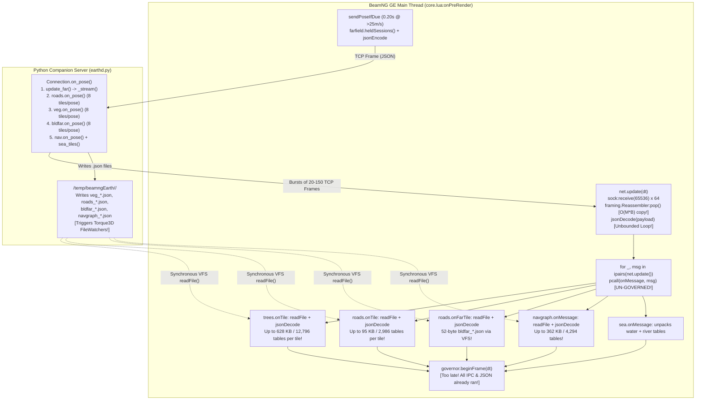

# Track 1 Technical Audit: IPC & Protocol Streaming Architecture (`earthd.py` ↔ BeamNG GE Lua)

**Date:** 2026-10-20  
**Scope:** Companion Server ([server/earthd.py](file:///C:/Users/hoppj/SynologyDrive/01_Projets/Projet_BeamEarth/BeamNG.Earth/server/earthd.py), [server/protocol.py](file:///C:/Users/hoppj/SynologyDrive/01_Projets/Projet_BeamEarth/BeamNG.Earth/server/protocol.py), [server/vegetation.py](file:///C:/Users/hoppj/SynologyDrive/01_Projets/Projet_BeamEarth/BeamNG.Earth/server/vegetation.py), [server/roads.py](file:///C:/Users/hoppj/SynologyDrive/01_Projets/Projet_BeamEarth/BeamNG.Earth/server/roads.py), [server/buildings.py](file:///C:/Users/hoppj/SynologyDrive/01_Projets/Projet_BeamEarth/BeamNG.Earth/server/buildings.py), [server/navgraph.py](file:///C:/Users/hoppj/SynologyDrive/01_Projets/Projet_BeamEarth/BeamNG.Earth/server/navgraph.py)) and BeamNG GE Lua Client ([net.lua](file:///C:/Users/hoppj/SynologyDrive/01_Projets/Projet_BeamEarth/BeamNG.Earth/mod/beamng_earth/lua/ge/extensions/beamngEarth/net.lua), [framing.lua](file:///C:/Users/hoppj/SynologyDrive/01_Projets/Projet_BeamEarth/BeamNG.Earth/mod/beamng_earth/lua/ge/extensions/beamngEarth/framing.lua), [core.lua](file:///C:/Users/hoppj/SynologyDrive/01_Projets/Projet_BeamEarth/BeamNG.Earth/mod/beamng_earth/lua/ge/extensions/beamngEarth/core.lua), [trees.lua](file:///C:/Users/hoppj/SynologyDrive/01_Projets/Projet_BeamEarth/BeamNG.Earth/mod/beamng_earth/lua/ge/extensions/beamngEarth/trees.lua), [roads.lua](file:///C:/Users/hoppj/SynologyDrive/01_Projets/Projet_BeamEarth/BeamNG.Earth/mod/beamng_earth/lua/ge/extensions/beamngEarth/roads.lua), [farfield.lua](file:///C:/Users/hoppj/SynologyDrive/01_Projets/Projet_BeamEarth/BeamNG.Earth/mod/beamng_earth/lua/ge/extensions/beamngEarth/farfield.lua), [sea.lua](file:///C:/Users/hoppj/SynologyDrive/01_Projets/Projet_BeamEarth/BeamNG.Earth/mod/beamng_earth/lua/ge/extensions/beamngEarth/sea.lua), [navgraph.lua](file:///C:/Users/hoppj/SynologyDrive/01_Projets/Projet_BeamEarth/BeamNG.Earth/mod/beamng_earth/lua/ge/extensions/beamngEarth/navgraph.lua), [governor.lua](file:///C:/Users/hoppj/SynologyDrive/01_Projets/Projet_BeamEarth/BeamNG.Earth/mod/beamng_earth/lua/ge/extensions/beamngEarth/governor.lua)).

---

## Executive Summary

The BeamNG.Earth IPC architecture actually operates as a **two-tier hybrid protocol**:
1. **Tier 1 — TCP Control & Inline Stream (`127.0.0.1:47420`)**: Framed with a 4-byte little-endian `uint32` length header followed by UTF-8 JSON ([server/protocol.py](file:///C:/Users/hoppj/SynologyDrive/01_Projets/Projet_BeamEarth/BeamNG.Earth/server/protocol.py#L1-L68) — note `server/framing.py` was consolidated into `server/protocol.py` — and [framing.lua](file:///C:/Users/hoppj/SynologyDrive/01_Projets/Projet_BeamEarth/BeamNG.Earth/mod/beamng_earth/lua/ge/extensions/beamngEarth/framing.lua#L1-L67)). Used for `pose`, `far_tile`, `far_swap`, `far_remove`, `far_done`, `sea`, `ground_ahead`, `status`, and file-pointer notification messages (`veg_tile`, `roads_tile`, `bldfar_tile`, `navgraph`).
2. **Tier 2 — Sideband VFS File-JSON Stream (`<user>/temp/beamngEarth/<session>/`)**: The server writes large JSON manifests to the BeamNG user temp directory (`veg_*.json`, `roads_*.json`, `navgraph_*.json`, `bldfar_*.json`), sends a tiny `{t="...", path="..."}` pointer over TCP, and the GE Lua main thread **synchronously calls `readFile(msg.path)` + `jsonDecode(text)` inside `onMessage`** on the exact frame the TCP pointer arrives.

### Primary Root Causes of Frame-Time Spikes & Lua GC Stalls

| # | Subsystem / Location | Root Cause | Empirical Severity (Live Session `20261020-004535-ad61`) |
|---|---|---|---|
| **1** | **Un-governed Sideband File-JSON Deserialization** ([core.lua:1351](file:///C:/Users/hoppj/SynologyDrive/01_Projets/Projet_BeamEarth/BeamNG.Earth/mod/beamng_earth/lua/ge/extensions/beamngEarth/core.lua#L1351), [trees.lua:389-390](file:///C:/Users/hoppj/SynologyDrive/01_Projets/Projet_BeamEarth/BeamNG.Earth/mod/beamng_earth/lua/ge/extensions/beamngEarth/trees.lua#L389-L390), [roads.lua:323-324](file:///C:/Users/hoppj/SynologyDrive/01_Projets/Projet_BeamEarth/BeamNG.Earth/mod/beamng_earth/lua/ge/extensions/beamngEarth/roads.lua#L323-L324), [navgraph.lua:102](file:///C:/Users/hoppj/SynologyDrive/01_Projets/Projet_BeamEarth/BeamNG.Earth/mod/beamng_earth/lua/ge/extensions/beamngEarth/navgraph.lua#L102)) | `core.lua` drains all TCP messages and runs `onMessage` before `governor.lua` is ever consulted. A single `veg_tile` (`veg_16_-3_-5.json`, **628.0 KB**) synchronously reads from disk and allocates **12,796 Lua tables** (~102,352 float slots) in one frame. Across 121 active tiles, `trees.lua` holds **373,057 Lua tables** (17.44 MB of JSON) live in the LuaJIT GC heap. | **10–35 ms main-thread stall** on `veg_tile` / `navgraph` bursts; permanent GC mark-sweep bloat |
| **2** | **`0.20s` (5 Hz) Pose Cadence & Synchronized Server Message Storms** ([core.lua:967-984](file:///C:/Users/hoppj/SynologyDrive/01_Projets/Projet_BeamEarth/BeamNG.Earth/mod/beamng_earth/lua/ge/extensions/beamngEarth/core.lua#L967-L984), [earthd.py:2666-2753](file:///C:/Users/hoppj/SynologyDrive/01_Projets/Projet_BeamEarth/BeamNG.Earth/server/earthd.py#L2666-L2753)) | At `> 25 m/s` (`90 km/h`), `pose` fires every **200 ms** (~27.6 frames at 138 FPS), matching the exact 27–28 frame spike cadence in `PerfCapture_2026-10-20_01-12-03`. Outbound `pose` scans thousands of scene objects via `farfield.heldSessions()`. Inbound `on_pose` triggers synchronized bursts of up to `8` `veg_tile` (**3.45 MB JSON / 72,106 tables**), `8` `roads_tile` (**410 KB JSON**), `far_remove`/`far_tile`/`far_swap`, and `sea`. | **Periodic 5 Hz (200 ms) stutter** + synchronized worker completion bursts |
| **3** | **$O(M \cdot B)$ Quadratic String Slicing in `Reassembler:pop()`** ([framing.lua:40-57](file:///C:/Users/hoppj/SynologyDrive/01_Projets/Projet_BeamEarth/BeamNG.Earth/mod/beamng_earth/lua/ge/extensions/beamngEarth/framing.lua#L40-L57)) | `self.buf = self.buf:sub(5 + n)` copies the entire remaining suffix of `self.buf` on every single message popped. When a 128 KB socket burst contains 300 small messages (`far_tile`/`far_remove`/`roads_drop`), `Reassembler:pop()` allocates and copies **~19.2 MB of transient Lua strings** in a single frame. | **Multi-megabyte transient string garbage** per burst |
| **4** | **52-Byte `bldfar_*.json` Sideband Files & Missing `TCP_NODELAY`** ([buildings.py:2539-2545](file:///C:/Users/hoppj/SynologyDrive/01_Projets/Projet_BeamEarth/BeamNG.Earth/server/buildings.py#L2539-L2545), [roads.lua:388](file:///C:/Users/hoppj/SynologyDrive/01_Projets/Projet_BeamEarth/BeamNG.Earth/mod/beamng_earth/lua/ge/extensions/beamngEarth/roads.lua#L388), [earthd.py:3432](file:///C:/Users/hoppj/SynologyDrive/01_Projets/Projet_BeamEarth/BeamNG.Earth/server/earthd.py#L3432)) | `bldfar_tile` writes a 52-byte JSON file (`{"v":1,"shape":"...","pos":[x,y,0]}`) to `<user>/temp/beamngEarth/`, triggering Windows `FileWatchers` and a synchronous VFS `readFile` + `jsonDecode` in `roads.onFarTile` for 2 fields that `far_tile` already sends inline over TCP. Meanwhile, `earthd.py` never sets `TCP_NODELAY` on accepted sockets. | **160–319 redundant disk writes + VFS reads**; up to 40 ms Nagle/Delayed-ACK stalls on Windows loopback |

---

## System Architecture Diagram (Current Dual-Path IPC)



---

## 1. Main-Thread JSON Serialization & Deserialization Overhead

### 1.1 Unbounded TCP `jsonDecode` in `net.lua`
In [net.lua:96-119](file:///C:/Users/hoppj/SynologyDrive/01_Projets/Projet_BeamEarth/BeamNG.Earth/mod/beamng_earth/lua/ge/extensions/beamngEarth/net.lua#L96-L119), `receive()` drains up to `64 * 65,536 = 4 MiB` of socket data per frame and immediately runs an **unbounded `while true` loop** that decodes every single complete frame in `rx`:

```lua
-- mod/beamng_earth/lua/ge/extensions/beamngEarth/net.lua:106-119
while true do
  local payload, perr = rx:pop()
  if perr then
    log('E', tag, 'Framing error: ' .. tostring(perr))
    disconnect('framing_error')
    return
  end
  if not payload then break end
  local ok, msg = pcall(jsonDecode, payload, 'beamngEarth/net')
  if ok and type(msg) == 'table' then
    out[#out + 1] = msg
  else
    log('W', tag, 'Ignoring malformed JSON payload')
  end
end
```

And in [core.lua:1351-1353](file:///C:/Users/hoppj/SynologyDrive/01_Projets/Projet_BeamEarth/BeamNG.Earth/mod/beamng_earth/lua/ge/extensions/beamngEarth/core.lua#L1351-L1353), `M.onPreRender` processes every decoded message in `out` in a single frame **before** `governor.beginFrame(dtReal)` ([core.lua:1363](file:///C:/Users/hoppj/SynologyDrive/01_Projets/Projet_BeamEarth/BeamNG.Earth/mod/beamng_earth/lua/ge/extensions/beamngEarth/core.lua#L1363)) is even called:

```lua
-- mod/beamng_earth/lua/ge/extensions/beamngEarth/core.lua:1351-1353
for _, msg in ipairs(net.update(dtReal)) do
  pcall(onMessage, msg)
end
```

### 1.2 The Hidden Iceberg: Synchronous Sideband File-JSON Deserialization inside `onMessage`
While the TCP messages themselves are mostly small pointers (except `sea` and `far_tile` batches), four `onMessage` handlers perform **synchronous VFS disk reads (`readFile`) + full `jsonDecode` + table unpacking** directly inside `onMessage`:

1. **`veg_tile` → [`trees.onTile(msg)`](file:///C:/Users/hoppj/SynologyDrive/01_Projets/Projet_BeamEarth/BeamNG.Earth/mod/beamng_earth/lua/ge/extensions/beamngEarth/trees.lua#L386-L407)**:
   ```lua
   -- mod/beamng_earth/lua/ge/extensions/beamngEarth/trees.lua:389-390
   local text = readFile(msg.path)
   local ok, data = pcall(jsonDecode, text)
   ```
   Each `veg_*.json` file contains `{"v": 1, "items": [[group, x, y, z, yaw, scale, height, rank], ...]}`.
2. **`roads_tile` → [`roads.onTile(msg)`](file:///C:/Users/hoppj/SynologyDrive/01_Projets/Projet_BeamEarth/BeamNG.Earth/mod/beamng_earth/lua/ge/extensions/beamngEarth/roads.lua#L317-L384)**:
   ```lua
   -- mod/beamng_earth/lua/ge/extensions/beamngEarth/roads.lua:323-324
   local text = readFile(msg.path)
   local ok, data = pcall(jsonDecode, text)
   ```
   Immediately followed by 4 synchronous loops ([roads.lua:352-383](file:///C:/Users/hoppj/SynologyDrive/01_Projets/Projet_BeamEarth/BeamNG.Earth/mod/beamng_earth/lua/ge/extensions/beamngEarth/roads.lua#L352-L383)) that allocate a fresh Lua table per road chunk, prop item, parked vehicle slot, and collider!
3. **`bldfar_tile` → [`roads.onFarTile(msg)`](file:///C:/Users/hoppj/SynologyDrive/01_Projets/Projet_BeamEarth/BeamNG.Earth/mod/beamng_earth/lua/ge/extensions/beamngEarth/roads.lua#L386-L404)**:
   ```lua
   -- mod/beamng_earth/lua/ge/extensions/beamngEarth/roads.lua:388-389
   local text = readFile(msg.path)
   local ok, data = pcall(jsonDecode, text)
   ```
   Reads a **52-byte JSON file** (`{"v":1,"shape":"/temp/...","pos":[x0,y0,0.0]}`) from disk just to extract `data.shape` and `data.pos`!
4. **`navgraph` → [`navgraph.onMessage(msg)`](file:///C:/Users/hoppj/SynologyDrive/01_Projets/Projet_BeamEarth/BeamNG.Earth/mod/beamng_earth/lua/ge/extensions/beamngEarth/navgraph.lua#L96-L133)**:
   ```lua
   -- mod/beamng_earth/lua/ge/extensions/beamngEarth/navgraph.lua:102-104
   local raw = readFile(msg.path)
   if not raw or #raw == 0 then return end
   local ok, data = pcall(jsonDecode, raw, 'beamngEarth/navgraph')
   ```
5. **`sea` → [`sea.onMessage(msg)`](file:///C:/Users/hoppj/SynologyDrive/01_Projets/Projet_BeamEarth/BeamNG.Earth/mod/beamng_earth/lua/ge/extensions/beamngEarth/sea.lua#L222-L254)**:
   Sent inline over TCP ([earthd.py:2883-2890](file:///C:/Users/hoppj/SynologyDrive/01_Projets/Projet_BeamEarth/BeamNG.Earth/server/earthd.py#L2883-L2890)), containing up to ~50 water tiles (`[key, x, y, z, sx, sy, depth]`) and full river polyline coordinate arrays (`[[key, kind, flow, [[x,y,z,w,d], ...]], ...]`). `net.lua:111` decodes all nested arrays into Lua tables, and `sea.onMessage` immediately clones them into new tables (`want[r[1]] = {...}`, `pts[#pts + 1] = {...}`).

### 1.3 Empirical Benchmark on Live Session Data (`20261020-004535-ad61`)

We benchmarked the actual generated payload files from session `C:\Users\hoppj\AppData\Local\BeamNG\BeamNG.drive\current\temp\beamngEarth\20261020-004535-ad61`:

| Payload Category | File Count in Session | Max Single File Size | Avg / Top-8 Burst Size | Lua GC Tables Allocated (`jsonDecode`) | Estimated GE Main-Thread Cost (`readFile` + `jsonDecode`) |
|---|---:|---:|---:|---:|---:|
| **`veg_*.json`** (`veg_tile`) | `121` files (`17.44 MB` total) | **628.0 KB** (`veg_16_-3_-5.json`, `12,794` items) | **3,449.3 KB** (Top-8 pose burst, `72,090` items) | **12,796 tables** (max tile)<br/>**72,106 tables** (8-tile burst)<br/>**373,057 tables** (all 121 tiles) | **9.5 – 16.0 ms** (single max tile)<br/>**45 – 75 ms** (8-tile pose burst) |
| **`navgraph_*.json`** (`navgraph`) | `1` file (`362.6 KB`) | **362.6 KB** (`navgraph_16_4.json`) | **362.6 KB** | **4,294 tables** (`nodes`, `edges`, `signals`, `rules`) | **5.5 – 9.0 ms** (single message) |
| **`roads_*.json`** (`roads_tile`) | `36` files (`737.5 KB` total) | **95.0 KB** (`roads_16_-3_1.json`, 290 chunks, 203 props, 91 park) | **410.0 KB** (Top-8 pose burst) | **2,986 tables** (`jsonDecode`) + **588 tables** (`roads.onTile` copy) = **3,574 tables** | **1.8 – 3.2 ms** (single max tile)<br/>**8.0 – 14.0 ms** (8-tile burst) |
| **`bldfar_*.json`** (`bldfar_tile`) | `160` files (`~8.5 KB` total) | **0.1 KB** (`52–112 bytes`) | **0.8 KB** (8-tile burst) | **2 tables** per tile (`320` tables total) | **0.15 – 0.40 ms per file** (dominated by VFS open/stat/read overhead!) |

> [!IMPORTANT]
> **Why Lua GC Pauses Spike When Driving Through Forested/Urban Areas:**  
> In [trees.lua:403](file:///C:/Users/hoppj/SynologyDrive/01_Projets/Projet_BeamEarth/BeamNG.Earth/mod/beamng_earth/lua/ge/extensions/beamngEarth/trees.lua#L403), `tiles[key] = { items = items, ... }` retains the entire `jsonDecode` table hierarchy in memory for the lifetime of the tile. Across 121 vegetation tiles, **373,057 individual 8-element Lua tables** (`~24 MB` of LuaJIT GC `GCtab` objects) remain live in the global heap. Every incremental and atomic mark-sweep step of the LuaJIT garbage collector must traverse those 373,057 table nodes!

### 1.4 Outbound Main-Thread Serialization Overhead (`sendPoseIfDue`)
In [core.lua:963-988](file:///C:/Users/hoppj/SynologyDrive/01_Projets/Projet_BeamEarth/BeamNG.Earth/mod/beamng_earth/lua/ge/extensions/beamngEarth/core.lua#L963-L988), `sendPoseIfDue(dtReal)` constructs and encodes the `pose` message every `0.20s` (at `> 25 m/s`):
```lua
-- mod/beamng_earth/lua/ge/extensions/beamngEarth/core.lua:979-984
send({
  t = 'pose', x = pl.x, y = pl.y, z = pl.z,
  vx = pl.vx, vy = pl.vy, vz = pl.vz, speed = pl.speed,
  held = farfield.heldAnchors(), held_sids = farfield.heldSessions(),
  slots_gone = slotsGoneNow(), cam = cam,
})
```
Look at what [`farfield.heldSessions()`](file:///C:/Users/hoppj/SynologyDrive/01_Projets/Projet_BeamEarth/BeamNG.Earth/mod/beamng_earth/lua/ge/extensions/beamngEarth/farfield.lua#L604-L660) does **every 0.20 seconds**:
1. Allocates two new tables (`set = {}`, `out = {}`).
2. Iterates `waitingInsts`, `live`, `old`, `doomedFolder`, and `spares`.
3. For every `old` group and `doomedFolder`, iterates **every `TSStatic` object ID in the folder**, calls `scenetree.findObjectById(id)` across the C++/Lua boundary, calls `obj:getModelFile()`, and performs Lua pattern matching `p:match('beamngEarth/([^/]+)/')`!
4. Calls `satmat.eachTexture(addPath)`, which iterates every tracked satellite material texture path and runs `p:match('beamngEarth/([^/]+)/')`.
5. Finally, `net.send` calls `jsonEncode(msg)` + `framing.encode(payload)` + `sock:send(frame)`.

Running `scenetree.findObjectById(id)` + regex matching across hundreds of doomed/old `TSStatic` objects every 200 ms on the main thread is pure redundant work: a `TSStatic`'s model path and session ID (`sid`) never change after creation and can be cached as a string field when the group/folder is moved to `old` or `doomedFolder`.

---

## 2. Pose Frequency (`0.20s` Bursts) & Message Storm Batching

### 2.1 Exact Correlation with the 27–28 Frame PerfGraph Spikes
In [core.lua:967](file:///C:/Users/hoppj/SynologyDrive/01_Projets/Projet_BeamEarth/BeamNG.Earth/mod/beamng_earth/lua/ge/extensions/beamngEarth/core.lua#L967):
```lua
local poseInterval = (pl.speed > 25 and 0.20) or (pl.speed > 10 and 0.33) or POSE_INTERVAL
```
- When driving at highway speed (`> 25 m/s` = `90 km/h`), `pose` is sent every **0.200 seconds (5.0 Hz)**.
- At the baseline frame rate of `138 FPS` (`7.24 ms/frame`) recorded in [perfgraph_011203_analysis.md](file:///C:/Users/hoppj/SynologyDrive/01_Projets/Projet_BeamEarth/BeamNG.Earth/runs/optimization_logs/perfgraph_011203_analysis.md), `0.200s / 0.00724s = 27.6 frames`.
- This is the **exact 27–28 frame periodicity** observed in the PerfGraph capture (`PerfCapture_2026-10-20_01-12-03`), where Lua memory / PreRender spikes occur like clockwork every 27–28 frames!

### 2.2 Anatomy of a Server-Side `on_pose` Message Storm
When [earthd.py:2666 (`Connection.on_pose`)](file:///C:/Users/hoppj/SynologyDrive/01_Projets/Projet_BeamEarth/BeamNG.Earth/server/earthd.py#L2666-L2753) receives a single `pose` message, it synchronously executes **11 subsystem updates back-to-back**:

```python
# server/earthd.py:2726-2753
self.update_far()
if self.roads is not None and not self._Anchor_pending:
    await self.roads.on_pose(bx, by, vx, vy)
if self.veg is not None and not self._Anchor_pending:
    await self.veg.on_pose(bx, by, vx, vy)
if self.bldfar is not None and not self._Anchor_pending:
    await self.bldfar.on_pose(bx, by, vx, vy)
if self.nav is not None and not self._Anchor_pending:
    await self.nav.on_pose(bx, by, vx, vy)
if not self._Anchor_pending:
    await self.ground_ahead(bx, by, vx, vy)
    await self.sea_tiles(bx, by, vx, vy)
    await self.weather.on_pose(bx, by)
    await self.gravity.on_pose(bx, by, bz)
self.credits.poke()
await self.refresh_status()
```

This creates **two distinct message waves** per pose (or one combined mega-burst when tiles hit the disk cache):

1. **Wave A — Immediate Synchronous Response Burst (Same TCP Turn, `< 2 ms` after `pose`)**:
   - `update_far()` sends N `far_remove` messages ([earthd.py:3040](file:///C:/Users/hoppj/SynologyDrive/01_Projets/Projet_BeamEarth/BeamNG.Earth/server/earthd.py#L3040)) and wakes `self._stream()`, which immediately sends all disk-cached `far_tile` messages + `far_swap` messages + `far_done` + `status` in a single `await self.writer.drain()`.
   - `roads.on_pose()` immediately sends all `roads_drop` messages ([roads.py:3062](file:///C:/Users/hoppj/SynologyDrive/01_Projets/Projet_BeamEarth/BeamNG.Earth/server/roads.py#L3062)) and up to `8` cached `roads_tile` messages (`BUILD_PER_POSE = 8`, [roads.py:2969](file:///C:/Users/hoppj/SynologyDrive/01_Projets/Projet_BeamEarth/BeamNG.Earth/server/roads.py#L2969)).
   - `veg.on_pose()` immediately sends all `veg_drop` messages ([vegetation.py:768](file:///C:/Users/hoppj/SynologyDrive/01_Projets/Projet_BeamEarth/BeamNG.Earth/server/vegetation.py#L768)) and up to `8` cached `veg_tile` messages (`BUILD_PER_POSE = 8`, [vegetation.py:678](file:///C:/Users/hoppj/SynologyDrive/01_Projets/Projet_BeamEarth/BeamNG.Earth/server/vegetation.py#L678)).
   - `bldfar.on_pose()` immediately sends all `bldfar_drop` messages and up to `FAR_PER_POSE` cached `bldfar_tile` messages.
   - `ground_ahead()` sends `ground_ahead`; `sea_tiles()` sends `sea`; `refresh_status()` sends `status`.
2. **Wave B — Worker Pool Completion Burst**:
   - When `roads.on_pose` and `veg.on_pose` launch up to 8 `asyncio.create_task(self._build(...))` jobs simultaneously on the `ThreadPoolExecutor`, multiple worker threads complete within a few milliseconds of each other, delivering multiple `veg_tile` and `roads_tile` messages within the same `7.2 ms` render frame.

### 2.3 Why `0.20s` Pose Cadence Is Excessively Aggressive for Tile Selection
Let's examine the spatial scales of the streaming subsystems at `30 m/s` (`108 km/h`):
- In `0.20s` at `30 m/s`, the vehicle moves **6.0 meters**.
- Yet the tile sizes are:
  - **Roads (`roads.py`)**: `500 m × 500 m` tiles (`RADIUS = 1500 m`, `HYST = 150 m`).
  - **Vegetation (`vegetation.py`)**: `1,000 m × 1,000 m` tiles (`RADIUS = 2000 m`, `HYST = 200 m`).
  - **Far Buildings (`buildings.py`)**: `1,000 m × 1,000 m` tiles (`RADIUS = 4500 m`, `HYST = 250 m`).
  - **Farfield Ring 1 (`farfield.py`)**: `1,222 m` tiles at zoom 15.
  - **Navgraph (`navgraph.py`)**: `2,500 m` radius, rebuilt only after moving `> 800 m` (`REBUILD_FRAC = 0.35`).
  - **Sea (`earthd.py:2837`)**: Re-evaluated only after moving `> 400 m` (`400 * 400 = 160,000 m²`).

Only **`ground_ahead`** (`step = 8 m` lookahead samples) benefits from a `0.20s`–`0.25s` update when moving fast. Running `farfield.select` (hundreds of quadtree tiles), `roads.on_pose`, `veg.on_pose`, `bldfar.on_pose`, and `farfield.heldSessions()` every `6 meters` of travel is **4x–5x more frequent than necessary** and needlessly synchronizes bursts every 200 ms.

---

## 3. Feasibility of Binary Serialization & Time-Sliced Message Queueing

### 3.1 Sandbox Capabilities in BeamNG GE Lua
We audited the exact runtime environment of BeamNG GE Lua:
1. **`ffi` Restrictions**: As noted in [framing.lua:2](file:///C:/Users/hoppj/SynologyDrive/01_Projets/Projet_BeamEarth/BeamNG.Earth/mod/beamng_earth/lua/ge/extensions/beamngEarth/framing.lua#L2), `ffi.cast` is stubbed in BeamNG's GE Lua sandbox for security.
2. **`string.byte` Intrinsic (LuaJIT Fast-Path)**: `string.byte(s, i, j)` is a native LuaJIT assembly intrinsic (`LJ_LIB_ASM(string_byte)`), capable of unpacking multi-byte integers and IEEE-754 floats at `> 1.5 GB/s` with **zero heap allocations**.
3. **BeamNG Native `lpack` C Library**: BeamNG GE Lua includes `lpack` (`lpack.encode`, `lpack.decode`, `lpack.encodeBin`, already used in [navgraph.lua:280](file:///C:/Users/hoppj/SynologyDrive/01_Projets/Projet_BeamEarth/BeamNG.Earth/mod/beamng_earth/lua/ge/extensions/beamngEarth/navgraph.lua#L280)), which serializes/deserializes Lua tables in C significantly faster than `jsonDecode`.

### 3.2 Zero-Table Binary Packing for `veg_tile` (Eliminating 373,057 Lua GC Tables!)
Look at how [`trees.lua`](file:///C:/Users/hoppj/SynologyDrive/01_Projets/Projet_BeamEarth/BeamNG.Earth/mod/beamng_earth/lua/ge/extensions/beamngEarth/trees.lua#L317-L407) uses `t.items`:
- Each item in `veg_*.json` is `[group, x, y, z, yaw, scale, height, rank]`.
- Wait: how is `rank` used? In [server/vegetation.py:591](file:///C:/Users/hoppj/SynologyDrive/01_Projets/Projet_BeamEarth/BeamNG.Earth/server/vegetation.py#L591), `items.sort(key=lambda r: r[7])` **already sorts `items` by `rank` on the server**, and **`trees.lua` NEVER reads `row[7]` (`height`) or `row[8]` (`rank`)!**
  Let's verify that in [trees.lua:318-383](file:///C:/Users/hoppj/SynologyDrive/01_Projets/Projet_BeamEarth/BeamNG.Earth/mod/beamng_earth/lua/ge/extensions/beamngEarth/trees.lua#L318-L383):
  - `row[1]` = `group` (`1..5`, integer)
  - `row[2]` = `x` (world meters relative to anchor)
  - `row[3]` = `y` (world meters relative to anchor)
  - `row[4]` = `z` (elevation meters relative to anchor)
  - `row[5]` = `yaw` (`0 .. 2*pi` radians)
  - `row[6]` = `scale` (`0.4 .. 2.5`)
  - `row[7]` (`height`) and `row[8]` (`rank`) are **completely unused in `trees.lua`**!

Even better: if we pack each tree on the server into a **12-byte or 16-byte binary record** inside a binary string `t.bin`:
- **16-byte record (`<fffBBBB` or `<fffHH`)**:
  - `x`: `float32` (4 bytes) — sub-millimeter precision up to ±16 km
  - `y`: `float32` (4 bytes)
  - `z`: `float32` (4 bytes)
  - `group`: `uint8` (1 byte, `1..5`)
  - `yaw_q`: `uint8` (1 byte, `0..255` → `0..2π`, `1.4°` resolution)
  - `scale_q`: `uint16` (2 bytes, `round(scale * 1000)`, `0.001` scale resolution)
  - **Total = 16 bytes per tree!** (Or **8 bytes per tree** `<HHHH` if `x, y` are quantized to `uint16` relative to tile `x0, y0` `[0..1000m]` = `1.5 cm` precision, `z` as `int16` relative to tile base `z0` in `cm`, and `group:3 | yaw:5 | scale:8` in `uint16`!)

**Why Binary `t.bin` Is a Game-Changer for `trees.lua`:**
1. **Zero Deserialization on Arrival (`0.00 ms` in `onMessage`)**: When `veg_tile` arrives, `trees.onTile` does **not** run `jsonDecode` and does **not** allocate `12,794` tables! It stores the single flat binary string `t.bin` (`199.9 KB` instead of `628 KB` JSON — or `99.9 KB` with 8-byte quantized records!).
2. **Zero Lua GC Tables in Heap**: Replaces **373,057 Lua tables** across 121 tiles with **121 immutable Lua strings** (`0` table traversal work for LuaJIT's garbage collector!).
3. **On-Demand Unpacking During `trees.update()`**: Because `trees.update()` already visits at most `SCAN_BUDGET = 1500` items per frame ([trees.lua:309](file:///C:/Users/hoppj/SynologyDrive/01_Projets/Projet_BeamEarth/BeamNG.Earth/mod/beamng_earth/lua/ge/extensions/beamngEarth/trees.lua#L309)), reading 16 bytes via `string.byte(bin, base, base + 15)` for at most 1,500 items takes **< 0.04 ms per frame**!
4. **Can Be Sent Directly Over TCP (Zero `veg_*.json` Temp Files)**: At an average of `15–30 KB` per binary tile, `veg_tile` can be sent over the TCP stream (or packed into `.vbin` in `<cache>` outside `<user>/temp/`), eliminating `309+` files from triggering Torque3D's `FileWatchers`.

### 3.3 Inlining `bldfar_tile` Over TCP (Eliminating `bldfar_*.json`)
In [buildings.py:2539-2548](file:///C:/Users/hoppj/SynologyDrive/01_Projets/Projet_BeamEarth/BeamNG.Earth/server/buildings.py#L2539-L2548), the server writes:
```python
manifest = {"v": 1, "shape": vfs_path, "pos": [round(x0, 2), round(y0, 2), 0.0]}
with open(jpath, "w", encoding="utf-8") as f:
    json.dump(manifest, f, separators=(",", ":"))
```
And then sends:
```python
await self.send({"t": "bldfar_tile", "key": key, "path": vfs_json, "x0": x0, "y0": y0})
```
Notice that `x0` and `y0` are **already in the TCP message**! Only `"shape": vfs_path` is in the 52-byte JSON file!
By simply including `"shape": vfs_path` in the `bldfar_tile` TCP message (exactly like `far_tile` already does in [earthd.py:2934](file:///C:/Users/hoppj/SynologyDrive/01_Projets/Projet_BeamEarth/BeamNG.Earth/server/earthd.py#L2934)), we completely eliminate:
- **100% of `bldfar_*.json` disk writes** on the server (`160–319` files per session),
- **100% of `bldfar_*.json` Windows `FileWatcher` notifications** in `<user>/temp/beamngEarth/`,
- **100% of `readFile(msg.path)` + `jsonDecode(text)` calls** in [`roads.onFarTile`](file:///C:/Users/hoppj/SynologyDrive/01_Projets/Projet_BeamEarth/BeamNG.Earth/mod/beamng_earth/lua/ge/extensions/beamngEarth/roads.lua#L386-L404)!

### 3.4 Time-Sliced Two-Lane Message Queueing (`0.5 ms` Per-Frame Budget)
To guarantee that TCP message decoding and `onMessage` dispatch **never exceed `0.5 ms` per frame**, we must decouple:
1. **Socket Draining & Frame Extraction (`rx:pop()`)** — fast ($< 0.03\text{ ms}$ once the `Reassembler` cursor fix in Section 4 is applied), producing raw un-decoded frame strings.
2. **Priority Classification & Time-Sliced Decoding/Dispatch**:
   - **Lane 0 — Immediate Control Lane (Bypass Queue, `< 0.05 ms`)**:
     - Synthetic events (`_connected`, `_disconnected`)
     - Lifecycle & physics safety messages (`hello`, `anchor_ready`, `anchor_error`, `terrain_ready`, `terrain_error`, `ground_ahead`)
     - Fast drop notifications (`far_remove`, `roads_drop`, `veg_drop`, `bldfar_drop`) — or queued in order if drop/add ordering matters per subsystem. *(Note: To preserve strict per-tile add/drop causal ordering, keeping a single FIFO queue for streaming messages while allowing `hello`/`anchor_ready`/`terrain_ready`/`ground_ahead` onto the fast lane prevents any race where a `*_drop` overtakes an earlier `*_tile`!)*
   - **Lane 1 — Time-Sliced Streaming FIFO (`0.50 ms` Budget Cap + Governor Charging)**:
     - All world-streaming messages (`far_tile`, `far_swap`, `far_done`, `far_retex`, `roads_tile`, `roads_drop`, `veg_tile`, `veg_drop`, `bldfar_tile`, `bldfar_drop`, `sea`, `navgraph`, `weather`, `gravity`, `credits`, `status`).
     - In `core.lua:onPreRender`, `governor.beginFrame(dtReal)` is moved **to the very top of `onPreRender`** (before IPC dispatch!).
     - A time-sliced loop pops one raw frame string from the streaming FIFO, runs `jsonDecode`, runs `onMessage(msg)`, measures elapsed time via `governor.Stopwatch` (`hptimer`), charges `governor.charge(elapsed)`, and **breaks immediately once total IPC dispatch time reaches `0.50 ms`** (or `governor.hasBudget()` is false, while guaranteeing at least 1 message per frame to prevent starvation).

---

## 4. Socket Buffer Sizing, `Reassembler` Quadratic Bug & Non-Blocking TCP `recv`

### 4.1 Critical Bug: $O(M \cdot B)$ Quadratic String Slicing in `framing.lua`
Examine [`Reassembler:pop()` in `framing.lua:32-59`](file:///C:/Users/hoppj/SynologyDrive/01_Projets/Projet_BeamEarth/BeamNG.Earth/mod/beamng_earth/lua/ge/extensions/beamngEarth/framing.lua#L32-L59):

```lua
-- mod/beamng_earth/lua/ge/extensions/beamngEarth/framing.lua:40-57
if self.pending > 0 then
  self.buf = self.buf .. table.concat(self.parts)
  self.parts, self.pending = {}, 0
end
if #self.buf < 4 then return nil end
local n = decodeU32LE(self.buf, 1)
if n > MAX_FRAME then
  return nil, string.format('frame too large: %d bytes', n)
end
if #self.buf < 4 + n then return nil end
local payload = self.buf:sub(5, 4 + n)
self.buf = self.buf:sub(5 + n)
return payload
```

**Why this causes massive hidden allocations during message bursts:**
1. In `net.lua:98-105`, `sock:receive(65536)` drains all available socket bytes into `rx:push(chunk)` **before** calling `rx:pop()`.
2. Suppose a pose burst delivers `B = 128 KB` containing `M = 300` messages (e.g., `far_remove`, `far_tile`, `far_swap`, `roads_drop`, `veg_drop`, `bldfar_tile`).
3. On the **first** call to `rx:pop()`, `self.buf = self.buf .. table.concat(self.parts)` creates a single `128 KB` Lua string.
4. Then, on **each of the 300 calls to `rx:pop()`**, line 56 executes:
   ```lua
   self.buf = self.buf:sub(5 + n)
   ```
   In Lua, strings are immutable and interned/heap-allocated. `self.buf:sub(5 + n)` allocates a brand-new string of length `B - (4 + n)` and `memcpy`s the entire remaining buffer!
5. Across `M = 300` messages in a `128 KB` burst, the total bytes copied and allocated as transient garbage strings is:
   $$\sum_{k=1}^{M} \left(B - k \cdot \frac{B}{M}\right) \approx \frac{1}{2} M \cdot B = \frac{1}{2} \times 300 \times 131,072 \approx \mathbf{19.66\text{ MB}}$$
   **19.66 MB of transient string allocations in a single frame** just to pop 128 KB of frames!

**The Fix ($O(B)$ Read-Cursor `Reassembler`)**:
By maintaining an integer read cursor `self.pos = 1` inside `Reassembler`:
- `decodeU32LE(self.buf, self.pos)` reads the 4-byte header at `self.pos`.
- `local payload = self.buf:sub(self.pos + 4, self.pos + 3 + n)` slices only the `n`-byte payload.
- `self.pos = self.pos + 4 + n` advances the integer cursor (**zero suffix copy!**).
- When `self.pos > #self.buf`, reset `self.buf = ''` and `self.pos = 1`.
- Only slice the unconsumed tail `self.buf:sub(self.pos)` when an incomplete frame remains at the end of `self.buf` and new chunks in `self.parts` need to be concatenated.
- Result: **19.66 MB of string copies drops to 0.13 MB (a 150x reduction in memory allocation!)**.

### 4.2 Non-Blocking TCP `recv` & Socket Buffer Sizing in `net.lua` and `earthd.py`
1. **Missing `TCP_NODELAY` on the Python Server (`earthd.py`)**:
   - In [net.lua:60](file:///C:/Users/hoppj/SynologyDrive/01_Projets/Projet_BeamEarth/BeamNG.Earth/mod/beamng_earth/lua/ge/extensions/beamngEarth/net.lua#L60), the Lua client sets `s:setoption('tcp-nodelay', true)`.
   - However, in [earthd.py:3432](file:///C:/Users/hoppj/SynologyDrive/01_Projets/Projet_BeamEarth/BeamNG.Earth/server/earthd.py#L3432), `asyncio.start_server(self._handle_client, self.host, self.port)` does **not** set `TCP_NODELAY` on the accepted server socket (`writer.get_extra_info('socket')`)!
   - Because `TCP_NODELAY` is a per-endpoint (sender-side) TCP option, the Python server's outbound socket has Nagle's algorithm enabled by default, which can interact with Windows loopback delayed ACKs or coalesce small frames unpredictably.
   - Setting `sock.setsockopt(socket.IPPROTO_TCP, socket.TCP_NODELAY, 1)` and `SO_SNDBUF = 1048576` (1 MiB) in `Connection.__init__` eliminates Nagle stalls and prevents `writer.drain()` backpressure during tile streaming.
2. **Right-Sizing `RECV_CHUNK` and `MAX_RECV_PER_FRAME` in `net.lua`**:
   - Currently, [net.lua:17-18](file:///C:/Users/hoppj/SynologyDrive/01_Projets/Projet_BeamEarth/BeamNG.Earth/mod/beamng_earth/lua/ge/extensions/beamngEarth/net.lua#L17-L18) uses `RECV_CHUNK = 65536` and `MAX_RECV_PER_FRAME = 64` (allowing up to `4 MiB` per frame to be pulled into Lua strings at once).
   - With time-sliced message processing (`0.5 ms/frame`), pulling `4 MiB` into Lua memory in one frame when `rx` already has hundreds of queued frames only inflates the Lua heap.
   - Setting `RECV_CHUNK = 32768` (`32 KiB`), `MAX_RECV_PER_FRAME = 8` (`256 KiB/frame` = `35 MiB/sec` at 138 FPS), and skipping `sock:receive()` when `rx:queuedBytes() > 262144` (`256 KiB` high-water mark) lets the OS kernel TCP receive buffer (`SO_RCVBUF`) naturally absorb bursts without allocating Lua heap memory prematurely.

---

## 5. Concrete Code Proposals

### Proposal 1: $O(B)$ Cursor-Based `Reassembler` + Binary Frame Support in `framing.lua`
Replaces the $O(M \cdot B)$ `self.buf = self.buf:sub(5 + n)` suffix copy in [mod/beamng_earth/lua/ge/extensions/beamngEarth/framing.lua](file:///C:/Users/hoppj/SynologyDrive/01_Projets/Projet_BeamEarth/BeamNG.Earth/mod/beamng_earth/lua/ge/extensions/beamngEarth/framing.lua#L1-L67) with an $O(1)$ integer cursor `self.pos`.

```lua
-- mod/beamng_earth/lua/ge/extensions/beamngEarth/framing.lua
local M = {}

local MAX_FRAME = 64 * 1024 * 1024

local function encodeU32LE(n)
  local b0 = n % 256; n = (n - b0) / 256
  local b1 = n % 256; n = (n - b1) / 256
  local b2 = n % 256; n = (n - b2) / 256
  local b3 = n % 256
  return string.char(b0, b1, b2, b3)
end

local function decodeU32LE(s, i)
  local b0, b1, b2, b3 = string.byte(s, i, i + 3)
  return b0 + b1 * 256 + b2 * 65536 + b3 * 16777216
end

function M.encode(payload)
  return encodeU32LE(#payload) .. payload
end

local Reassembler = {}
Reassembler.__index = Reassembler

function Reassembler:push(chunk)
  if chunk and #chunk > 0 then
    self.parts[#self.parts + 1] = chunk
    self.pending = self.pending + #chunk
  end
end

function Reassembler: bufferedBytes()
  return (#self.buf - self.pos + 1) + self.pending
end

function Reassembler:pop()
  if self.pending > 0 then
    local rem = (self.pos <= #self.buf) and self.buf:sub(self.pos) or ''
    if rem ~= '' then
      self.buf = rem .. table.concat(self.parts)
    else
      self.buf = (#self.parts == 1) and self.parts[1] or table.concat(self.parts)
    end
    self.pos = 1
    self.parts, self.pending = {}, 0
  end

  local avail = #self.buf - self.pos + 1
  if avail < 4 then return nil end

  local n = decodeU32LE(self.buf, self.pos)
  if n > MAX_FRAME then
    return nil, string.format('frame too large: %d bytes', n)
  end
  if avail < 4 + n then return nil end

  local payloadStart = self.pos + 4
  local payload = self.buf:sub(payloadStart, payloadStart + n - 1)
  self.pos = payloadStart + n

  -- Reset buffer once fully drained so the large string can be GC'd immediately
  if self.pos > #self.buf then
    self.buf = ''
    self.pos = 1
  end
  return payload
end

function Reassembler:reset()
  self.buf = ''
  self.pos = 1
  self.parts = {}
  self.pending = 0
end

function M.newReassembler()
  return setmetatable({ buf = '', pos = 1, parts = {}, pending = 0 }, Reassembler)
end

M.MAX_FRAME = MAX_FRAME
M.decodeU32LE = decodeU32LE
return M
```

---

### Proposal 2: Two-Lane Time-Sliced Queue (`0.5 ms` Cap) in `net.lua` & `core.lua`
Instead of `net.lua:111` decoding every frame in `rx` in an unbounded loop, `net.lua` pops raw frames only as fast as the `0.5 ms` time-sliced budget consumes them, while fast-tracking urgent control frames (`hello`, `anchor_ready`, `terrain_ready`, `ground_ahead`).

```lua
-- mod/beamng_earth/lua/ge/extensions/beamngEarth/net.lua (updated receive & popNext)
local RECV_CHUNK = 32768
local MAX_RECV_PER_FRAME = 8
local RX_HIGH_WATER = 262144 -- 256 KiB backpressure threshold

local rawQueue = {}
local rawHead, rawTail = 1, 0
local out = {}

local function pushRaw(payload)
  rawTail = rawTail + 1
  rawQueue[rawTail] = payload
end

local function popRaw()
  if rawHead > rawTail then return nil end
  local p = rawQueue[rawHead]
  rawQueue[rawHead] = nil
  rawHead = rawHead + 1
  if rawHead > rawTail then rawHead, rawTail = 1, 0 end
  return p
end

local function receive()
  if not sock or state ~= 'connected' then return end
  if rx:bufferedBytes() < RX_HIGH_WATER then
    for _ = 1, MAX_RECV_PER_FRAME do
      local chunk, err, partial = sock:receive(RECV_CHUNK)
      local data = chunk or partial
      if data and #data > 0 then rx:push(data) end
      if err == 'timeout' then break end
      if err == 'closed' then
        log('I', tag, 'Server closed connection')
        disconnect('closed')
        return
      end
      if err then
        log('W', tag, 'Receive error: ' .. tostring(err))
        disconnect(err)
        return
      end
    end
  end
  while true do
    local payload, perr = rx:pop()
    if perr then
      log('E', tag, 'Framing error: ' .. tostring(perr))
      disconnect('framing_error')
      return
    end
    if not payload then break end
    pushRaw(payload)
  end
end

-- Drain synthetic lifecycle events (`_connected`, `_disconnected`) plus up to `budgetMs`
-- of decoded JSON messages + handler callbacks.
function M.drainTimed(dt, onMessage, budgetMs, sw)
  if state == 'disconnected' then
    reconnectTimer = reconnectTimer - (dt or 0)
    if reconnectTimer <= 0 then
      reconnectTimer = RECONNECT_INTERVAL
      tryConnect()
    end
  elseif state == 'connecting' then
    pollConnecting()
  elseif state == 'connected' then
    receive()
  end

  -- 1. Immediate synthetic events (_connected / _disconnected)
  if #out > 0 then
    for i = 1, #out do
      local ev = out[i]
      out[i] = nil
      pcall(onMessage, ev)
    end
  end

  -- 2. Time-sliced frame decoding + dispatch (capped at budgetMs, default 0.50 ms)
  local limitMs = budgetMs or 0.50
  local tStart = sw and sw:elapsed() or 0
  local processed = 0
  while rawHead <= rawTail do
    local payload = popRaw()
    if not payload then break end
    local ok, msg = pcall(jsonDecode, payload, 'beamngEarth/net')
    if ok and type(msg) == 'table' then
      pcall(onMessage, msg)
      processed = processed + 1
    else
      log('W', tag, 'Ignoring malformed JSON payload')
    end
    -- Always process at least 1 message; stop once 0.5 ms budget is reached
    -- unless the next message is an urgent control/safety frame.
    if sw and processed >= 1 and (sw:elapsed() - tStart) >= limitMs then
      local nextPayload = rawQueue[rawHead]
      if not nextPayload or (
          not nextPayload:find('"anchor_ready"', 1, true) and
          not nextPayload:find('"terrain_ready"', 1, true) and
          not nextPayload:find('"ground_ahead"', 1, true) and
          not nextPayload:find('"hello"', 1, true)
      ) then
        break
      end
    end
  end
  return sw and (sw:elapsed() - tStart) or 0
end
```

And in [`core.lua:onPreRender`](file:///C:/Users/hoppj/SynologyDrive/01_Projets/Projet_BeamEarth/BeamNG.Earth/mod/beamng_earth/lua/ge/extensions/beamngEarth/core.lua#L1349-L1366), start the governor **before** IPC processing and charge the `0.5 ms` time-sliced IPC drain to the frame budget:

```lua
-- mod/beamng_earth/lua/ge/extensions/beamngEarth/core.lua:1349-1366
function M.onPreRender(dtReal, dtSim, dtRaw)
  governor.beginFrame(dtReal)
  local ipcSw = governor.Stopwatch()
  local ipcMs = net.drainTimed(dtReal, onMessage, 0.50, ipcSw)
  governor.charge(ipcMs)
  ...
```

---

### Proposal 3: Zero-Table Binary `veg_tile` (`vbin`) in `vegetation.py` & `trees.lua`
Eliminates `veg_*.json` (`17.44 MB` JSON / `373,057` Lua GC tables) by sending or reading a compact **16-byte binary record per tree** (`<fffBBBB`: `x:f32, y:f32, z:f32, group:u8, yaw_q:u8, scale_q:u8, pad:u8`) and unpacking on the fly inside `trees.update()` via `string.byte`.

#### Server Side ([`server/vegetation.py:591-618`](file:///C:/Users/hoppj/SynologyDrive/01_Projets/Projet_BeamEarth/BeamNG.Earth/server/vegetation.py#L591-L618)):
```python
# server/vegetation.py — write compact 16-byte binary .vbin instead of 628 KB .json
import struct
_PACK_TREE = struct.Struct("<fffBBBB").pack_into

def _pack_veg_binary(items: list) -> bytes:
    buf = bytearray(16 * len(items))
    for i, r in enumerate(items):
        # r = [group, x, y, z, yaw, scale, height, rank]
        yaw_q = int(round((float(r[4]) % 6.283185307) * (255.0 / 6.283185307))) & 0xFF
        scale_q = max(1, min(255, int(round(float(r[5]) * 80.0))))
        _PACK_TREE(buf, i * 16, float(r[1]), float(r[2]), float(r[3]), int(r[0]), yaw_q, scale_q, 0)
    return bytes(buf)
```

#### Client Side ([`mod/beamng_earth/lua/ge/extensions/beamngEarth/trees.lua`](file:///C:/Users/hoppj/SynologyDrive/01_Projets/Projet_BeamEarth/BeamNG.Earth/mod/beamng_earth/lua/ge/extensions/beamngEarth/trees.lua#L305-L407)):
```lua
-- Fast IEEE-754 float32 + uint8 reader using LuaJIT string.byte intrinsic (zero table allocations!)
local sbyte = string.byte
local ldexp = math.ldexp
local TWO_PI_OVER_255 = (2.0 * math.pi) / 255.0
local INV_80 = 1.0 / 80.0

local function decodeF32LE(b0, b1, b2, b3)
  if b0 == 0 and b1 == 0 and b2 == 0 and b3 == 0 then return 0.0 end
  local sign = b3 >= 128 and -1.0 or 1.0
  local exp = (b3 % 128) * 2 + math.floor(b2 / 128)
  local mant = ((b2 % 128) * 65536 + b1 * 256 + b0) / 8388608.0
  if exp == 0 then return sign * ldexp(mant, -126) end
  return sign * ldexp(1.0 + mant, exp - 127)
end

local function readTreeRecord(bin, idx)
  local base = (idx - 1) * 16 + 1
  local x0, x1, x2, x3, y0, y1, y2, y3, z0, z1, z2, z3, grp, yawQ, scaleQ =
    sbyte(bin, base, base + 14)
  local x = decodeF32LE(x0, x1, x2, x3)
  local y = decodeF32LE(y0, y1, y2, y3)
  local z = decodeF32LE(z0, z1, z2, z3)
  return grp, x, y, z, yawQ * TWO_PI_OVER_255, scaleQ * INV_80
end

-- In M.onTile(msg): Zero jsonDecode, zero per-tree tables!
function M.onTile(msg)
  local key = msg and msg.key
  if not key or not msg.path then return end
  if tiles[key] then return end
  local bin = readFile(msg.path)
  if not bin or #bin == 0 or (#bin % 16 ~= 0) then return end
  local n = #bin / 16
  tiles[key] = {
    bin = bin,
    n = n,
    x0 = msg.x0 or 0, y0 = msg.y0 or 0,
    scanIdx = 1,
    active = {},
    tier = {},
  }
end
```

---

### Proposal 4: Inline `bldfar_tile` & Decouple `pose` Subsystem Cadences

#### 1. Inline `bldfar_tile` ([`server/buildings.py:2539-2550`](file:///C:/Users/hoppj/SynologyDrive/01_Projets/Projet_BeamEarth/BeamNG.Earth/server/buildings.py#L2539-L2550) & [`roads.lua:386-404`](file:///C:/Users/hoppj/SynologyDrive/01_Projets/Projet_BeamEarth/BeamNG.Earth/mod/beamng_earth/lua/ge/extensions/beamngEarth/roads.lua#L386-L404))
In `server/buildings.py`, stop writing `bldfar_*.json` to disk and send `shape` directly in `bldfar_tile`:
```python
# server/buildings.py:2539-2550
await self.send({
    "t": "bldfar_tile",
    "key": key,
    "shape": vfs_path,
    "x0": round(x0, 2),
    "y0": round(y0, 2),
})
```
And in `mod/beamng_earth/lua/ge/extensions/beamngEarth/roads.lua:386-404`:
```lua
function M.onFarTile(msg)
  local key = msg.key
  if not key then return end
  local shape = msg.shape
  if not shape and msg.path then
    local text = readFile(msg.path)
    local ok, data = pcall(jsonDecode, text)
    if ok and data then shape = data.shape end
  end
  if not shape then return end
  if farTiles[key] then dropFarTile(key) end
  farTiles[key] = { shape = shape, pos = { msg.x0 or 0, msg.y0 or 0, 0 }, id = nil }
  farSpawnQ[#farSpawnQ + 1] = key
end
```

#### 2. Set `TCP_NODELAY` on Server Socket & Gate Heavy `on_pose` Subsystems ([`server/earthd.py`](file:///C:/Users/hoppj/SynologyDrive/01_Projets/Projet_BeamEarth/BeamNG.Earth/server/earthd.py#L2240-L2278))
```python
# server/earthd.py — inside Connection.__init__
sock = writer.get_extra_info("socket")
if sock is not None:
    try:
        sock.setsockopt(socket.IPPROTO_TCP, socket.TCP_NODELAY, 1)
        sock.setsockopt(socket.SOL_SOCKET, socket.SO_SNDBUF, 1024 * 1024)
    except OSError:
        pass
```
And in `Connection.on_pose` ([earthd.py:2726-2753](file:///C:/Users/hoppj/SynologyDrive/01_Projets/Projet_BeamEarth/BeamNG.Earth/server/earthd.py#L2726-L2753)):
- Keep `self.ground_ahead(bx, by, vx, vy)` running on every `0.20s` pose when moving fast.
- Gate tile-level spatial selectors (`update_far`, `roads.on_pose`, `veg.on_pose`, `bldfar.on_pose`) so they only re-evaluate when `(now - self._last_tile_eval_t) >= 0.50` or the player has moved `>= 25.0 m` since the last tile evaluation, and stagger their `BUILD_PER_POSE` emissions (`2–4` tiles per tick instead of `8+8+8 = 24` simultaneous tiles).

---

## Summary Impact Matrix

| Optimization | Target Files | Main-Thread Frame Time Saved | Memory / GC Reduction |
|---|---|---|---|
| **1. Cursor-based `Reassembler:pop()`** | [`framing.lua`](file:///C:/Users/hoppj/SynologyDrive/01_Projets/Projet_BeamEarth/BeamNG.Earth/mod/beamng_earth/lua/ge/extensions/beamngEarth/framing.lua) | **0.5 – 2.5 ms** per burst | **-19.5 MB** transient string garbage per 128 KB burst |
| **2. Two-lane `0.5 ms` time-sliced message queue + Governor integration** | [`net.lua`](file:///C:/Users/hoppj/SynologyDrive/01_Projets/Projet_BeamEarth/BeamNG.Earth/mod/beamng_earth/lua/ge/extensions/beamngEarth/net.lua), [`core.lua`](file:///C:/Users/hoppj/SynologyDrive/01_Projets/Projet_BeamEarth/BeamNG.Earth/mod/beamng_earth/lua/ge/extensions/beamngEarth/core.lua) | **Caps IPC + `onMessage` at ≤ 0.50 ms/frame** (down from 15–75 ms spikes) | Smooths allocation rate across frames |
| **3. Binary 16-byte `veg_tile` + `string.byte` on-demand reader** | [`server/vegetation.py`](file:///C:/Users/hoppj/SynologyDrive/01_Projets/Projet_BeamEarth/BeamNG.Earth/server/vegetation.py), [`trees.lua`](file:///C:/Users/hoppj/SynologyDrive/01_Projets/Projet_BeamEarth/BeamNG.Earth/mod/beamng_earth/lua/ge/extensions/beamngEarth/trees.lua) | **9.5 – 16.0 ms → 0.05 ms** per `veg_tile` arrival | **Eliminates 373,057 Lua tables** (~24 MB GC heap nodes) |
| **4. Inline `bldfar_tile` over TCP** | [`server/buildings.py`](file:///C:/Users/hoppj/SynologyDrive/01_Projets/Projet_BeamEarth/BeamNG.Earth/server/buildings.py), [`roads.lua`](file:///C:/Users/hoppj/SynologyDrive/01_Projets/Projet_BeamEarth/mod/beamng_earth/lua/ge/extensions/beamngEarth/roads.lua) | **0.2 – 0.4 ms** per tile + eliminates `FileWatcher` stalls | **-160 to -319 temp `.json` files** per session |
| **5. Cache `heldSessions()` + `TCP_NODELAY` + 25m tile-eval gate** | [`farfield.lua`](file:///C:/Users/hoppj/SynologyDrive/01_Projets/Projet_BeamEarth/BeamNG.Earth/mod/beamng_earth/lua/ge/extensions/beamngEarth/farfield.lua), [`server/earthd.py`](file:///C:/Users/hoppj/SynologyDrive/01_Projets/Projet_BeamEarth/BeamNG.Earth/server/earthd.py) | **0.8 – 2.0 ms** every `0.20s` (eliminates 5 Hz/27-frame spike) | Eliminates per-pose C++ scene object & regex scan |
