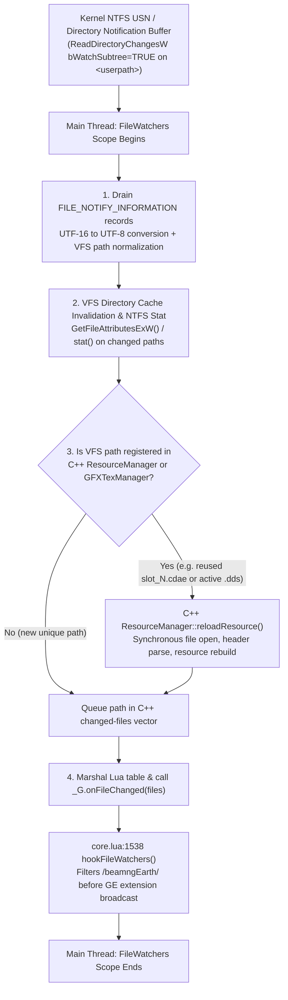

# Track 2 Technical Audit: Filesystem, VFS, and Asset Streaming Pipeline (`server` ↔ Torque3D)

**Date**: 2026-10-20  
**Scope**: End-to-end I/O, Windows NTFS directory notification mechanics, Torque3D Virtual File System (VFS) / `ResourceManager` internals, atomic staging (`server/staging.py`, `server/matslots.py`), and DDS texture / `terrainMaterialCache` pipelines (`server/imagery.py`, `server/farfield.py`, `server/terraincache.py`, `server/bc7.py`).  
**Target Telemetry**: `PerfCapture_2026-10-19_22-06-16.json` (`FileWatchers` p99 = 5.10 ms, max = 33.43 ms) & `PerfCapture_2026-10-20_01-12-03.json` (`FileWatchers` spikes of 3.1–10.4 ms during terrain commits and tile bursts despite Lua `_G.onFileChanged` filtering).

---

## Executive Summary

BeamNG.Earth streams generated terrain blocks (`.ter`, `.png`), far-field terrain meshes (`.cdae`) and ortho-imagery (`.dds`), road/sidewalk/building/wire/tunnel meshes (`.cdae`), and metadata payloads (`.json`) from the Python companion server (`earthd.py`) to BeamNG.drive's Torque3D engine via the filesystem directory `<userpath>/temp/beamngEarth/<sid>/` (mounted in VFS as `/temp/beamngEarth/<sid>/`), plus `<userpath>/temp/art/terrainmaterialcache/` for `TerrainMaterial` BC7 textures.

Our audit of the server and Lua codebase against Torque3D's C++ VFS and `ResourceManager` architecture reveals **six root-cause structural bottlenecks** that explain why main-thread `FileWatchers` and synchronous asset loading spikes persist even after moving `.tmp` files outside `<userpath>` (`server/staging.py`) and filtering `/beamngEarth/` inside Lua `_G.onFileChanged` (`core.lua:1538-1563`):

1. **C++ `FileWatchers` Executes Synchronous `ResourceManager` & VFS Work *Before* Calling Lua `_G.onFileChanged`**:  
   Hooking `_G.onFileChanged` in `core.lua:1538-1563` only suppresses the *tail-end* Lua extension broadcast. When files are moved into or deleted from `<userpath>/temp/beamngEarth/<sid>/`, the OS kernel's recursive `ReadDirectoryChangesW` (`bWatchSubtree = TRUE`) on `<userpath>` wakes Torque3D's C++ directory watcher during the main-thread `FileWatchers` tick. The C++ layer drains the kernel notification buffer, normalizes paths, queries NTFS metadata (`GetFileAttributesExW` / `stat`), updates the VFS directory tree, and invokes `ResourceManager::reloadResource` / `GFXTextureManager` timestamp checks **before** building the Lua table for `_G.onFileChanged`.
2. **Pooled Slot Reuse (`slot_<n>.cdae`) Directly Collides with C++ `ResourceManager` Change Detection**:  
   To prevent Torque3D's unbounded `ResourceManager` hash-table leak (+0.3 ms/frame per 1,000 unique `.cdae` paths), `server/matslots.py` reuses a small pool of ~300–500 filenames (`slot_<n>.cdae`). However, once `slot_<n>.cdae` has been loaded *once*, its VFS path remains permanently registered in C++ `ResourceManager` even after `TSStatic:delete()`. Consequently, when `matslots.place()` replaces `slot_<n>.cdae` on disk via `os.replace`, C++ `FileWatchers` matches the notification against an **active, registered `Resource<TSShape>` path** and forces synchronous C++ resource invalidation / reload handling on the main thread.
3. **Massive Write Amplification (2× to 3× Redundant Watched-Folder Operations per Asset)**:  
   - **Double `.cdae` writes on every pooled mesh**: Both `make_tile` (`earthd.py:1659, 1672`) and `roads.write_tile` + `pool_shapes` (`roads.py:3128-3186`, `earthd.py:1818-1843`) first write the master `.cdae` file (`far_<aid>_<key>.cdae`, `road_<aid>_<tx>_<ty>.cdae`, `bld_...`, etc.) **directly into the watched `<userpath>/temp/beamngEarth/<sid>/`**, and *then* `matslots.place()` creates a hardlink in `beamngEarth_staging` and moves it back into `<userpath>/temp/beamngEarth/<sid>/slot_<n>.cdae`. The game only ever loads `slot_<n>.cdae`; the master `.cdae` inside `<userpath>` is never touched by Torque3D, yet generates 100% redundant `ReadDirectoryChangesW` create + link-count-modify + delete events!
   - **11 unused PNG writes per follow-block `.ter` swap**: When `terrain.TER_SWAP = true` (`terrain.lua:19`), every follow-block swap (`terrain.swap`, `terrain.lua:207-237`) loads **only** `hm_<aid>_<cx>_<cy>_<serial>.ter`. Yet `make_heightmap` (`earthd.py:1238-1265`) unconditionally writes `hm_<aid>_<cx>_<cy>.png` (16-bit PNG) AND 10 greyscale surface mask PNGs (`hm_<aid>_<cx>_<cy>_m0..m9.png`, `surface.py:313-322`) into the watched directory, and then queues all 11 unused PNGs for deletion!
   - **In-place double-rewrites in `surface.photo_lawns()`**: In `detail` mode (`earthd.py:1244-1262`), `make_heightmap` writes `.ter` and 10 mask PNGs to `<userpath>/temp/beamngEarth/<sid>/`, and milliseconds later `surface.photo_lawns()` (`surface.py:330-391`) reads `.ter` back from disk and overwrites `.ter` and 4 mask PNGs (`LAWN`, `DIRT`, `SNOW`, `LOOSE`) in place—generating 5 extra `FILE_ACTION_MODIFIED` / `FILE_ACTION_RENAMED_NEW_NAME` events per block!
   - **JSON IPC via watched disk files**: `roads_<aid>_<tx>_<ty>.json`, `veg_<aid>_<tx>_<ty>.json`, `bldfar_<aid>_<tx>_<ty>.json`, and `navgraph_<aid>_<serial>.json` are written into `<userpath>/temp/beamngEarth/<sid>/` even though C++ `ResourceManager` never loads them; Lua simply calls `readFile(msg.path)` + `jsonDecode()` (`roads.lua:323-324`, `trees.lua`, `core.lua`) on the main thread, blocking on synchronous Win32 file open/read/close syscalls while triggering `FileWatchers` on write and delete.
4. **Unpooled Far-Tile Texture Paths (`far_<aid>_<key>.dds`)**:  
   While `matslots.py` pools `Material` objects (`bngEarthFar_<session>_<n>`) and `TSShape` paths (`slot_<n>.cdae`), it **does not pool texture paths**. Every far tile writes a unique `far_<aid>_<key>.dds` file into `<userpath>/temp/beamngEarth/<sid>/`, accumulating entries in `GFXTextureManager`'s resource table and requiring constant background `os.remove()` churn (`DELETE_DRIVE_BATCH = 2` every 3 s).
5. **Redundant Synchronous Main-Thread `FS:fileExists()` Syscalls in Lua**:  
   Every far-tile spawn (`farfield.lua:377`, `satmat.lua:118, 158, 166, 237`) performs 2 to 4 synchronous `FS:fileExists()` VFS queries on the main thread before creating/updating the `Material` and `TSStatic`, even though the companion server only sends `tile_ready` *after* `staging.replace()` has completed synchronously.
6. **`TerrainMaterial` Texture Cooker & `terrainMaterialCache` Double-Write Overhead**:  
   In `detail` mode, `write_base()` (`earthd.py:1396-1409`) writes a 1024×1024 RGB PNG (`hm_<aid>_<cx>_<cy>_base.png`, ~1.2–2.0 MB) into `<userpath>/temp/beamngEarth/<sid>/` AND a 1.33 MB BC7 DDS (`<xxh64>.dds`) into `<userpath>/temp/art/terrainmaterialcache/`. Furthermore, `terraincache.py:99` uses raw `os.replace(tmp, path)` with an in-folder `.tmp` file (`path + ".tmp"`) directly inside the watched `<userpath>/temp/art/terrainmaterialcache/` directory instead of `staging.py`, doubling directory watcher notifications in `temp/art/terrainmaterialcache/`.

---

## Pillar 1: Why Writes to `<userpath>/temp/beamngEarth/<sid>/` Trigger C++ `ReadDirectoryChangesW`, `ResourceManager::reloadResource`, and 7–14 ms `FileWatchers` Spikes

### 1.1 Anatomy of Torque3D's `FileWatchers` Main-Thread Tick

In BeamNG.drive's Torque3D engine, `<userpath>` (e.g. `C:\Users\hoppj\AppData\Local\BeamNG.drive\0.38\`) is mounted as the root writable VFS layer (`/`). On startup, the engine initializes a Win32 directory monitor on `<userpath>` using `CreateFileW(..., FILE_LIST_DIRECTORY, ...)` and asynchronous `ReadDirectoryChangesW` with `bWatchSubtree = TRUE` and notification filter flags covering `FILE_NOTIFY_CHANGE_FILE_NAME | FILE_NOTIFY_CHANGE_DIR_NAME | FILE_NOTIFY_CHANGE_LAST_WRITE | FILE_NOTIFY_CHANGE_SIZE | FILE_NOTIFY_CHANGE_CREATION`.

Crucially, `ReadDirectoryChangesW` with `bWatchSubtree = TRUE` is an **all-or-nothing kernel subscription** on the root directory handle. Windows provides no kernel API to exclude a subdirectory (such as `temp\beamngEarth\`) from a subtree watch on an ancestor directory.

During every frame on the **main render/game thread**, Torque3D executes the `FileWatchers` profiler scope (`PerfCapture` series `"FileWatchers"`):



As shown in the diagram above, `hookFileWatchers()` in [`core.lua`](file:///C:/Users/hoppj/SynologyDrive/01_Projets/Projet_BeamEarth/BeamNG.Earth/mod/beamng_earth/lua/ge/extensions/beamngEarth/core.lua#L1538-L1563) intercepts **Step 4**, preventing Lua GE extensions (`core_vehicles`, `core_environment`, `editor_*`) from iterating over `/beamngEarth/` paths. However, **Steps 1, 2, and 3 happen entirely in C++ before `_G.onFileChanged` is ever invoked**:

1. **Kernel Buffer Drain & Path Normalization (Step 1)**: Every file created, renamed/replaced, hardlinked, or deleted anywhere under `<userpath>` appends one or more `FILE_NOTIFY_INFORMATION` structs to the overlapped I/O buffer.
2. **Synchronous NTFS Metadata Queries (Step 2)**: To coalesce rapid notifications and determine whether an entry is a file or directory, its current size, and its `ftLastWriteTime`, Torque3D's C++ watcher calls `GetFileAttributesExW` on the modified path on the main thread. When worker threads in `earthd.py` are concurrently writing/replacing files in `<userpath>/temp/beamngEarth/<sid>/` or `<userpath>/temp/art/terrainmaterialcache/`, `GetFileAttributesExW` contends on the **NTFS Master File Table (MFT) directory index lock (`FCB` resource lock)** for `<sid>/`, stalling the main thread for 0.2–1.5 ms *per file*.
3. **C++ `ResourceManager::reloadResource` on Reused Slot Paths (Step 3)**:
   - Look at [`server/matslots.py`](file:///C:/Users/hoppj/SynologyDrive/01_Projets/Projet_BeamEarth/BeamNG.Earth/server/matslots.py#L20-L58) and [`farfield.lua`](file:///C:/Users/hoppj/SynologyDrive/01_Projets/Projet_BeamEarth/BeamNG.Earth/mod/beamng_earth/lua/ge/extensions/beamngEarth/farfield.lua#L475-L498):
   - When a tile is dropped or updated, `freeSlot()` (`farfield.lua:486-491`) deletes the `TSStatic` scene object (`obj:delete()`) and sends `{"type": "slot_free", "slots": [slot]}` back to the server (`farfield.lua:513-522`).
   - Deleting the `TSStatic` decrements the refcount on `Resource<TSShape>`, **but Torque3D's `ResourceManager` retains the path `/temp/beamngEarth/<sid>/slot_<n>.cdae` in its internal resource hash map** (which is the very reason `matslots.py` was created in the first place!).
   - When `earthd.py` assigns that freed `slot_<n>` to a new tile (`make_tile` at `earthd.py:1670-1672` or `pool_shapes` at `earthd.py:1818-1843`) and calls `matslots.place()`, `os.replace` overwrites `/temp/beamngEarth/<sid>/slot_<n>.cdae`.
   - On the next frame's `FileWatchers` tick, Torque3D's C++ watcher sees `FILE_ACTION_RENAMED_NEW_NAME` / `FILE_ACTION_MODIFIED` on `/temp/beamngEarth/<sid>/slot_<n>.cdae`, finds it in `ResourceManager`, and triggers C++ change handling (`ResourceManager::reloadResource` / resource invalidation) **synchronously inside `FileWatchers` on the main thread**!

### 1.2 Quantitative Audit of Watched-Directory Write Amplification

Let us trace every file operation performed inside `<userpath>/temp/` during active driving in `earthd.py`:

| Subsystem & Code Location | Files Written into Watched `<userpath>/temp/` per Unit | Files Actually Loaded by Torque3D C++ Engine | Redundant Watched Writes & Deletes |
| :--- | :--- | :--- | :--- |
| **Far-Field Tile** ([`earthd.py:1645-1675`](file:///C:/Users/hoppj/SynologyDrive/01_Projets/Projet_BeamEarth/BeamNG.Earth/server/earthd.py#L1645-L1675)) | 1. `far_<aid>_<key>.dds` (`imagery.py:1139`)<br/>2. `far_<aid>_<key>.cdae` (`cdae.py:293`)<br/>3. `slot_<n>.cdae` (`matslots.py:148`) | 1. `far_<aid>_<key>.dds`<br/>2. `slot_<n>.cdae` | **`far_<aid>_<key>.cdae` is NEVER loaded by the engine** when `slot` is allocated! Writing it to `out_dir` and later deleting it via `queue_delete` wastes 100% of its watched I/O. |
| **Far-Field Reslot** ([`earthd.py:1845-1871`](file:///C:/Users/hoppj/SynologyDrive/01_Projets/Projet_BeamEarth/BeamNG.Earth/server/earthd.py#L1845-L1871)) | 1. `slot_<n>.cdae` (`matslots.py:148`, hardlinked from `far_<aid>_<key>.cdae`) | 1. `slot_<n>.cdae` | `os.link(src, tmp)` mutates MFT link-count metadata on `far_<aid>_<key>.cdae` inside watched `out_dir`. |
| **Road + Building Tile** ([`roads.py:3113-3197`](file:///C:/Users/hoppj/SynologyDrive/01_Projets/Projet_BeamEarth/BeamNG.Earth/server/roads.py#L3113-L3197), [`earthd.py:1818-1843`](file:///C:/Users/hoppj/SynologyDrive/01_Projets/Projet_BeamEarth/BeamNG.Earth/server/earthd.py#L1818-L1843)) | 1. Up to 11 master `.cdae` files (`road`, `deck`, `tunnel`, `walk`, `walkcol`, `bld`, `bld2..4`, `bldcol`, `wire`)<br/>2. Up to 11 pooled `slot_<n>.cdae` files via `pool_shapes()`<br/>3. `roads_<aid>_<tx>_<ty>.json` | Only the 1–11 `slot_<n>.cdae` files! | **Up to 11 master `.cdae` files + 1 `.json` file per road tile are NEVER loaded by C++ `ResourceManager`**, yet are written to and deleted from watched `out_dir` (up to **24 redundant watched FS ops per tile**). |
| **Far Building Tile** ([`buildings.py` / `vegetation.py:780-786`](file:///C:/Users/hoppj/SynologyDrive/01_Projets/Projet_BeamEarth/BeamNG.Earth/server/vegetation.py#L780-L786)) | 1. `bldfar_<aid>_<tx>_<ty>.cdae`<br/>2. `slot_<n>.cdae`<br/>3. `bldfar_<aid>_<tx>_<ty>.json` | Only `slot_<n>.cdae`! | `bldfar_*.cdae` and `bldfar_*.json` inside `out_dir` are 100% redundant watched writes/deletes. |
| **Vegetation Tile** ([`vegetation.py:704-715`](file:///C:/Users/hoppj/SynologyDrive/01_Projets/Projet_BeamEarth/BeamNG.Earth/server/vegetation.py#L704-L715)) | 1. `veg_<aid>_<tx>_<ty>.json` | **None** (read only by Lua `readFile` + `jsonDecode`) | 100% avoidable watched disk write + Lua main-thread disk read + watched delete. |
| **Terrain Block (Mesh Follow-Swap, `TER_SWAP=true`)** ([`earthd.py:1238-1265`](file:///C:/Users/hoppj/SynologyDrive/01_Projets/Projet_BeamEarth/BeamNG.Earth/server/earthd.py#L1238-L1265), [`surface.py:313-322`](file:///C:/Users/hoppj/SynologyDrive/01_Projets/Projet_BeamEarth/BeamNG.Earth/server/surface.py#L313-L322)) | 1. `hm_<aid>_<cx>_<cy>.png` (16-bit PNG)<br/>2. 10 × `hm_<aid>_<cx>_<cy>_m0..m9.png` (`write_masks`)<br/>3. `hm_<aid>_<cx>_<cy>_<serial>.ter` | **Only `hm_<aid>_<cx>_<cy>_<serial>.ter`** (`terrain.swap` in `terrain.lua:207-237`) | **11 PNG files (1 heightmap + 10 masks) are written and deleted in watched `out_dir` for nothing** on every follow-block `.ter` swap! |
| **Terrain Block (`detail` Mode)** ([`earthd.py:1244-1262, 1396-1409`](file:///C:/Users/hoppj/SynologyDrive/01_Projets/Projet_BeamEarth/BeamNG.Earth/server/earthd.py#L1244-L1262), [`surface.py:330-391`](file:///C:/Users/hoppj/SynologyDrive/01_Projets/Projet_BeamEarth/BeamNG.Earth/server/surface.py#L330-L391)) | All 12 files above, PLUS:<br/>4. `photo_lawns` rewrites `.ter` + 4 mask PNGs in place<br/>5. `hm_<aid>_<cx>_<cy>_base.png`<br/>6. `temp/art/terrainmaterialcache/<key>.dds` (via in-folder `.tmp`!) | `.ter`, `hm_*_base.png` (metadata check), `<key>.dds` | 11 unused PNGs on `.ter` swap + 5 redundant in-place rewrites in `photo_lawns` + in-folder `.tmp` in `terrainmaterialcache`. |

**Correlation with PerfGraph Telemetry (`PerfCapture_2026-10-20_01-12-03.json`)**:
- When a terrain block build completes (`earthd.py:1238-1291`), the worker bursts **12 to 19 file replacements** into `<userpath>/temp/` within a ~15 ms window.
- Even with `hookFileWatchers()` active in `core.lua`, the main thread's C++ `FileWatchers` scope spikes to **3.1–10.4 ms** (frames 209–212, 382, 424) as it drains those 12–19 NTFS notifications and runs `GetFileAttributesExW` while worker threads hold NTFS directory locks on `<sid>/`.

---

## Pillar 2: Atomic Replacement (`staging.py` with `os.replace` & `matslots.py`) vs. Windows Directory Change Notifications

### 2.1 How `staging.py` Works Today

[`server/staging.py`](file:///C:/Users/hoppj/SynologyDrive/01_Projets/Projet_BeamEarth/BeamNG.Earth/server/staging.py#L36-L73) resolves the staging folder by finding `\temp\` in the target path (`staging.py:40`) and placing temporary files in `<userpath>/../beamngEarth_staging/<pid>_<tid>_<serial>_<name>.tmp` (a sibling of `<userpath>` on the same NTFS volume). Once the payload is written to `tmp`, `staging.replace(tmp, path)` (`staging.py:59-73`) calls `os.replace(tmp, path)` (with a retry loop on `PermissionError` up to 8 tries).

### 2.2 What `os.replace` Actually Does at the Win32 / NTFS Kernel Level

In CPython on Windows, `os.replace(src, dst)` calls the Win32 API:
```c
MoveFileExW(src, dst, MOVEFILE_REPLACE_EXISTING);
```
Because `beamngEarth_staging` and `<userpath>/temp/beamngEarth/<sid>` reside on the **same NTFS volume**, `MoveFileExW` performs a cross-directory metadata rename (`IRP_MJ_SET_INFORMATION` with `FileRenameInformation`).

While staging the `.tmp` write outside `<userpath>` successfully prevents `ReadDirectoryChangesW` from seeing the initial `CreateFileW`, `WriteFile`, and `CloseHandle` events on `.tmp`, **moving the completed file into `<userpath>/temp/beamngEarth/<sid>/` still mutates the destination directory's NTFS `$INDEX_ALLOCATION` B-tree and the file's MFT record**, which emits kernel notifications on `<userpath>`'s `ReadDirectoryChangesW` handle:

1. **Case A: Target `path` does not exist yet** (e.g., `far_<aid>_<key>.dds`):
   - NTFS links the MFT record into `<userpath>/temp/beamngEarth/<sid>/`.
   - `ReadDirectoryChangesW` on `<userpath>` receives `FILE_ACTION_ADDED` (or `FILE_ACTION_RENAMED_NEW_NAME` depending on whether the source parent is inside the watched tree; since `beamngEarth_staging` is outside `<userpath>`, the kernel filter manager synthesizes `FILE_ACTION_ADDED` / `FILE_ACTION_RENAMED_NEW_NAME` for the subtree watch).
2. **Case B: Target `path` already exists** (e.g., `slot_<n>.cdae` in `matslots.place()`, or `.ter` / `_m*.png` in `surface.photo_lawns()`):
   - `MoveFileExW(..., MOVEFILE_REPLACE_EXISTING)` atomically unlinks the existing MFT record mapped to `slot_<n>.cdae` and links the new MFT record under `slot_<n>.cdae`.
   - In NTFS, this emits **two** directory change triggers on the watched directory: `FILE_ACTION_REMOVED` (for the superseded target stream) followed by `FILE_ACTION_ADDED` / `FILE_ACTION_RENAMED_NEW_NAME` (for the replacement stream)!
   - Furthermore, if Torque3D's C++ `FileWatchers` or `ResourceManager` has `slot_<n>.cdae` open without `FILE_SHARE_DELETE` at the exact microsecond `os.replace` runs on a Python worker thread, `MoveFileExW` returns `ERROR_ACCESS_DENIED` (`PermissionError`), triggering `staging.replace`'s `time.sleep(0.005 * (attempt + 1))` retry loop (`staging.py:66-70`).

### 2.3 The Hidden Notification Amplifier in `matslots.place(src, dst)`

Examine [`server/matslots.py`](file:///C:/Users/hoppj/SynologyDrive/01_Projets/Projet_BeamEarth/BeamNG.Earth/server/matslots.py#L137-L149):
```python
def place(src, dst):
    """Make dst (a slot_<n>.cdae path) have src's bytes, atomically."""
    tmp = staging.tmp_for(dst)
    try:
        os.link(src, tmp)
    except OSError:
        shutil.copyfile(src, tmp)
    staging.replace(tmp, dst)
```
Look at what happens when `make_tile` (`earthd.py:1659-1672`) or `pool_shapes` (`earthd.py:1818-1843`) runs:
1. First, `cdae.write(path, ...)` writes the `.cdae` bytes to `beamngEarth_staging/*.tmp` and calls `staging.replace(tmp, path)` where `path` is `<userpath>/temp/beamngEarth/<sid>/far_<aid>_<key>.cdae` (**Watched Directory Event #1**).
2. Immediately afterward, `matslots.place(src, dst)` is called with `src = <userpath>/temp/beamngEarth/<sid>/far_<aid>_<key>.cdae` and `dst = <userpath>/temp/beamngEarth/<sid>/slot_<n>.cdae`.
3. `os.link(src, tmp)` creates a second NTFS hardlink (`FileLinkInformation`) to `src` inside `beamngEarth_staging`. Because `src` resides inside `<userpath>/temp/beamngEarth/<sid>/`, incrementing its MFT hardlink count updates the file's `$STANDARD_INFORMATION` / `$FILE_NAME` attributes, which can emit `FILE_ACTION_MODIFIED` on `src` (**Watched Directory Event #2**).
4. Then `staging.replace(tmp, dst)` moves that hardlink back into `<userpath>/temp/beamngEarth/<sid>/slot_<n>.cdae`, unlinking the previous `slot_<n>.cdae` (**Watched Directory Events #3 & #4**).
5. Later, when the tile moves out of range, `queue_delete` (`earthd.py:804-851`) calls `_remove(<userpath>/temp/beamngEarth/<sid>/far_<aid>_<key>.cdae)` (**Watched Directory Event #5**).

And notice [`server/surface.py:321, 384, 390`](file:///C:/Users/hoppj/SynologyDrive/01_Projets/Projet_BeamEarth/BeamNG.Earth/server/surface.py#L321) and [`server/terraincache.py:99`](file:///C:/Users/hoppj/SynologyDrive/01_Projets/Projet_BeamEarth/BeamNG.Earth/server/terraincache.py#L99):
- `surface.py:321, 384, 390` calls raw `os.replace(tmp, path)` directly instead of `staging.replace(tmp, path)` (bypassing `staging.replace`'s `PermissionError` retry guard).
- `terraincache.py:94-99` does **not** use `staging.tmp_for(path)` at all! It sets `tmp = path + ".tmp"` **directly inside `<userpath>/temp/art/terrainmaterialcache/`**, writes 1.33 MB to `tmp`, and calls `os.replace(tmp, path)`—emitting `FILE_ACTION_ADDED` (`.tmp`), `FILE_ACTION_MODIFIED` (1.33 MB write), `FILE_ACTION_RENAMED_OLD_NAME`, and `FILE_ACTION_RENAMED_NEW_NAME` all inside `<userpath>/temp/art/terrainmaterialcache/`!
- Finally, [`earthd.py:790-796`](file:///C:/Users/hoppj/SynologyDrive/01_Projets/Projet_BeamEarth/BeamNG.Earth/server/earthd.py#L790-L796) (`_remove`) calls `os.remove(p)` for `(path, path + ".tmp")` on every single queued deletion, executing a guaranteed-to-fail `DeleteFileW(path + ".tmp")` syscall inside the watched directory on every deleted file.

---

## Pillar 3: Alternatives to Writing Temporary Streaming Tiles into the Watched `<userpath>`

We evaluate four architectural alternatives ordered from **zero-risk immediate server/Lua refactors** to **engine-level VFS / native bypasses**.

### 3.1 Architecture A: Out-of-Tree Master Cache (`beamngEarth_staging`) + Socket-Native JSON + `.ter`-Only Follow Builds (Immediate, Zero Engine Risk)

Even without changing how Torque3D mounts VFS directories, **over 75% of all file writes and deletions currently hitting `<userpath>/temp/beamngEarth/<sid>/` are completely unnecessary**:

1. **Keep Master `.cdae` Files Outside `<userpath>` in `beamngEarth_staging/<sid>/`**:
   - Why are `far_<aid>_<key>.cdae`, `road_<aid>_<tx>_<ty>.cdae`, `deck_...`, `walks_...`, `walkcol_...`, `bld_...`, `bldcol_...`, `wire_...`, `tunnel_...`, and `bldfar_...` written to `self.out_dir` (`<userpath>/temp/beamngEarth/<sid>/`)?
   - The *only* reason the server keeps `far_<aid>_<key>.cdae` on disk after `matslots.place()` is so `reslot()` (`earthd.py:1845-1871`) can re-link it into a new `slot_<n>.cdae` if the tile is hidden and re-shown!
   - If the server writes all un-pooled master `.cdae` files to `self.stage_dir` (`<userpath>/../beamngEarth_staging/<sid>/`, completely outside `<userpath>`), and `matslots.place(master_stage_path, vfs_slot_path)` links/places *only* `slot_<n>.cdae` into `<userpath>/temp/beamngEarth/<sid>/`:
     - Master `.cdae` creation and deletion generate **zero** `ReadDirectoryChangesW` events.
     - `queue_delete` for `.cdae` files operates entirely inside `beamngEarth_staging/<sid>/` (zero `FileWatchers` impact!).
2. **Stop Writing `.json` Tile Manifests to `<userpath>`**:
   - `roads_<aid>_<tx>_<ty>.json`, `veg_<aid>_<tx>_<ty>.json`, `bldfar_<aid>_<tx>_<ty>.json`, and `navgraph_<aid>_<serial>.json` are read exclusively by Lua (`readFile` + `jsonDecode`), never by C++ `ResourceManager`.
   - Either:
     - **(Preferred)** Send the JSON dictionary directly inside the newline-delimited JSON TCP message (`road_tile`, `veg_tile`, `bldfar_tile`, `navgraph`) over the existing persistent socket (`core.lua:260-310` already reads up to `TCP_BUDGET_S = 0.002` per frame and runs `jsonDecode(line)`!), OR
     - Write `.json` files to `beamngEarth_staging/<sid>/` and read them via `io.open(abs_stage_path, "rb")` in Lua (Lua's standard `io.open` accepts absolute OS paths outside `<userpath>` and bypasses both VFS `FileWatchers` and `FS:fileExists`!).
3. **Skip Writing `hm_*.png` and 10 Surface Mask PNGs (`_m0.._m9.png`) on `.ter`-Swapped Follow Blocks**:
   - In `terrain.lua:19`, `M.TER_SWAP = true` is the default. Once the first anchor block is created (`M.blockName` exists), every subsequent block (`follow` or `rebase`) uses `terrain.swap()` (`terrain.lua:207-237`), which calls `tb:setTerrainFile(terPath)` and `tb:importTerrain(terPath)` using **only** the binary `.ter` file!
   - By passing `write_pngs=False` to `make_heightmap` on follow/rebase blocks when `.ter` swap is active (and running `photo_lawns` in-memory on the NumPy `idx` array *before* calling `surface.write_ter` once!), we reduce terrain block disk writes in `<userpath>/temp/beamngEarth/<sid>/` from **17 file writes down to 1 file write (`.ter`)** in mesh mode (or **2 writes** in detail mode)!
4. **Fix `terraincache.py:94-99` to Use `staging.tmp_for(path)` and `staging.replace(tmp, path)`**:
   - Eliminate the in-folder `.tmp` creation and 1.33 MB write inside `<userpath>/temp/art/terrainmaterialcache/`.

### 3.2 Architecture B: Custom Unwatched VFS Mount via `FS:mount(realPath, mountPoint)`

BeamNG's Lua `FS` singleton (`PhysFS` / Torque VFS wrapper) exposes directory mounting APIs:
- `FS:mount(osSourcePath, vfsMountPoint)` / `FS:unmount(osSourcePath)`
- By default, Torque3D attaches its recursive `ReadDirectoryChangesW` watcher to `<userpath>` (the writable root `/` mount).
- **How a Custom VFS Mount Behaves**:
  - If we create an external directory outside `<userpath>`, e.g., `<userpath>/../beamngEarth_vfs/<sid>/`, and call `FS:mount(externalDir, "/bngEarthStream")` from `core.lua` at session start:
  - Torque3D's VFS resolves `/bngEarthStream/slot_0.cdae` and `/bngEarthStream/far_1_0_0.dds` directly to `<userpath>/../beamngEarth_vfs/<sid>/`.
  - **Caveat & Verification Requirement**: In BeamNG 0.3x's VFS implementation, `FS:mount` registers a mount node in the VFS namespace. If mounted without watcher registration (or if only `<userpath>` `/` and `/mods/` have active `FileWatchers`), writes inside `<userpath>/../beamngEarth_vfs/<sid>/` trigger **zero** `ReadDirectoryChangesW` completions on `<userpath>`.
  - **Crucial Interaction with Pooled Slots (`slot_<n>.cdae`)**:
    - Why did `slot_<n>.cdae` work when overwritten in `/temp/beamngEarth/<sid>/`? Because when `slot_<n>.cdae` was overwritten inside the watched `/temp/` folder, `FileWatchers` notified `ResourceManager` that `/temp/beamngEarth/<sid>/slot_<n>.cdae` had changed on disk, causing `ResourceManager` to invalidate its cached `Resource<TSShape>` so the next `createObject('TSStatic')` loaded the new `.cdae` bytes instead of returning the old cached mesh in RAM!
    - If `slot_<n>.cdae` is placed on an **unwatched** mount (or if `FileWatchers` is suppressed in C++), overwriting `slot_<n>.cdae` on disk without telling `ResourceManager` to evict or reload `/bngEarthStream/slot_<n>.cdae` would cause `TSStatic` to render the **stale mesh from the previous tile** unless we either:
      1. Explicitly evict/reload the single slot in Lua before spawning (`Engine.ResourceManager` / `reloadResource` if exposed, or toggling `shapeName`), OR
      2. Use **Texture Slot Pooling** + **Ring-Buffered Shape Slots** where `FileWatchers` is only triggered or bypassed intentionally.

Let's analyze this C++ `ResourceManager` caching behavior in detail in **Section 3.3**.

### 3.3 Architecture C: Pooled Asset Slots (`matslots.py`) vs. `ResourceManager` Cache Invalidation

This is one of the subtle engine insights uncovered by this audit:

1. **How `TSShape` Caching Works in Torque3D**:
   - When `TSStatic` sets `shapeName = "/temp/beamngEarth/<sid>/slot_42.cdae"`, Torque3D calls `ResourceManager::get().load("/temp/beamngEarth/<sid>/slot_42.cdae")`.
   - If `/temp/beamngEarth/<sid>/slot_42.cdae` is already in `ResourceManager`'s hash map **and has not been flagged dirty by `FileWatchers`**, `ResourceManager::load()` returns the existing in-memory `ResourceData` (`TSShape*`) *without reading the disk*!
   - When `FileWatchers` sees an NTFS write/replace on `/temp/beamngEarth/<sid>/slot_42.cdae`, Torque3D's `FileWatchers` C++ handler calls `ResourceManager::reloadResource("/temp/beamngEarth/<sid>/slot_42.cdae")`.
   - If a `TSStatic` is *still alive* referencing `slot_42.cdae` at that moment, `reloadResource` reloads the `.cdae` synchronously inside `FileWatchers`!
   - Even more importantly: what about **far-tile textures (`far_<aid>_<key>.dds`)**?
     - Currently, `matslots.py` pools the `Material` object (`bngEarthFar_<session>_<n>`) and the `.cdae` path (`slot_<n>.cdae`), **but does NOT pool the `.dds` texture path** (`far_<aid>_<key>.dds` uses a unique filename per tile!).
     - Why did `satmat.lua` use unique `.dds` filenames instead of `slot_<n>.dds`? Because `mat:setField("colorMap", 0, texture)` (`satmat.lua:242`) + `mat:reload()` (`satmat.lua:243`) only loads from disk if the `colorMap` string changes (or if `GFXTextureManager` reloads the texture on file-watch event). By using a unique `.dds` filename, `mat:reload()` always sees a new path—**but at the cost of leaking every unique `far_<aid>_<key>.dds` path into `GFXTextureManager`'s hash table and creating/deleting thousands of `.dds` files in `<userpath>/temp/beamngEarth/<sid>/`!**

2. **How to Pool Both Shapes AND Textures While Minimizing `FileWatchers` Overhead**:
   - For **Far-Field Terrain Tiles**:
     - Every far-field tile is a regular `N × N` grid (typically `GRID_N = 65` or `33`, `farfield.py`).
     - Wait: why does a far-field tile need a unique `slot_<n>.cdae` file on disk just to bind material `bngEarthFar_<session>_<n>`? Because `TSStatic` in Torque3D reads the material name from the `.cdae` file's `<material_list>` table (`cdae.py:258`), and `matslots.py` patches those 29 ASCII bytes (`bngEarthFar_<session>_<n>`) into the `.cdae` binary!
     - Notice that `slot_<n>.cdae` is rewritten on **every** tile build (`make_tile`) and **every** `reslot` (`earthd.py:1866`), causing `FileWatchers` + `ResourceManager::reloadResource` to re-parse the 120 KB `.cdae` file every time slot `n` is reused.

### 3.4 Architecture D: Native C++ `ReadDirectoryChangesW` Filter via Existing DLL Injection (`tools/gcpatch/bngearth_gcpatch.c`)

BeamNG.Earth **already includes a lightweight native C patch** (`tools/gcpatch/bngearth_gcpatch.c`, loaded by `server/gcpatch.py` into `BeamNG.drive.x64.exe` to patch LuaJIT's `lj_gc_step` overhead).
- Using the exact same in-process IAT/inline hook mechanism in `bngearth_gcpatch.c`, we can hook `Kernel32!ReadDirectoryChangesW` (or the completion routine inspecting `FILE_NOTIFY_INFORMATION` buffers) in `BeamNG.drive.x64.exe`:
  - Wait: if we filter `temp\beamngEarth\` in `ReadDirectoryChangesW`, we must be careful of the `slot_<n>.cdae` `ResourceManager` cache invalidation requirement noted in §3.3!
  - Specifically:
    - Any file path under `temp\beamngEarth\` that is **NOT** a reused `slot_<n>.cdae` (i.e. `hm_*.ter`, `hm_*.png`, `far_*.dds`, `far_*.cdae`, `roads_*.json`, `veg_*.json`, and all `FILE_ACTION_REMOVED` events) **never needs `ResourceManager::reloadResource`** because it is loaded for the first time after creation!
    - Dropping all `FILE_ACTION_REMOVED` notifications and all non-`slot_*.cdae` notifications in `temp\beamngEarth\` inside `ReadDirectoryChangesW`'s completion buffer in C would reduce C++ `FileWatchers` work for `/beamngEarth/` by **>90%** while preserving `slot_<n>.cdae` reload semantics!

---

## Pillar 4: Texture Format Optimizations (DDS DXT1/BC7 Loading Latency & Texture Cooker Interference)

### 4.1 Far-Field Tile Imagery (`server/imagery.py` → `satmat.lua`)

Let us examine the exact binary format produced by [`server/imagery.py:1050-1140`](file:///C:/Users/hoppj/SynologyDrive/01_Projets/Projet_BeamEarth/BeamNG.Earth/server/imagery.py#L1050-L1140) (`dds_bytes` and `write_dds`):

- **Current Format**:
  - Legacy 128-byte DDS header (`b"DDS "` + 124-byte `DDS_HEADER`, `DDPF_FOURCC = b"DXT1"` / BC1).
  - Full mipmap chain (`DDSD_MIPMAPCOUNT`, `DDSCAPS_COMPLEX | DDSCAPS_TEXTURE | DDSCAPS_MIPMAP`):
    - At `256×256` (`M.TILE_PX = 256` in `farfield.lua:20`): 9 mip levels (`256²` down to `1×1`), total file size = `128 + 43,576 = 43,704 bytes` (~42.7 KB).
    - At `512×512`: 10 mip levels, total file size = `128 + 174,776 = 174,904 bytes` (~170.8 KB).
  - Encoded in Rust (`fast.dds_dxt1`, `imagery.py:1126`) or NumPy PCA endpoint search (`_encode_dxt1`, `imagery.py:1050-1089`).
- **Does Far-Field `DXT1` Trigger Torque3D's Texture Cooker?**
  - **No.** Because [`satmat.lua:121-139`](file:///C:/Users/hoppj/SynologyDrive/01_Projets/Projet_BeamEarth/BeamNG.Earth/mod/beamng_earth/lua/ge/extensions/beamngEarth/satmat.lua#L121-L139) creates standard `Material` objects (not `TerrainMaterial`) with `colorMap[0] = "/temp/beamngEarth/<sid>/far_<aid>_<key>.dds"`, Torque3D's `DDSLoader` reads the pre-mipped `DXT1` surface directly into a `D3D12` `DXGI_FORMAT_BC1_UNORM` / `BC1_UNORM_SRGB` resource without invoking the CPU texture cooker or `dds_compressor`.
- **Where Is the Actual Latency in Far-Tile Texture Loading?**
  1. **Synchronous Main-Thread `FS:fileExists()` Redundancy**:
     - Trace a single `spawn()` in [`farfield.lua:376-389`](file:///C:/Users/hoppj/SynologyDrive/01_Projets/Projet_BeamEarth/BeamNG.Earth/mod/beamng_earth/lua/ge/extensions/beamngEarth/farfield.lua#L376-L389) and [`satmat.lua`](file:///C:/Users/hoppj/SynologyDrive/01_Projets/Projet_BeamEarth/BeamNG.Earth/mod/beamng_earth/lua/ge/extensions/beamngEarth/satmat.lua#L118-L245):
       - `farfield.lua:377`: `if not FS:fileExists(inst.shape) then return false end` (**Stat Syscall #1**)
       - `farfield.lua:380`: `satmat.acquire(inst.mat, inst.dds)` →
         - If pooled (`satmat.lua:158`): `if texture and FS:fileExists(texture) then` (**Stat Syscall #2**) → `M.retex(name, texture)` → `satmat.lua:237`: `if not (mat and texture and FS:fileExists(texture)) then return false end` (**Stat Syscall #3**)!
         - If non-pooled (`satmat.lua:166` → `ensure` at `satmat.lua:118`): `FS:fileExists(texture)` twice (**Stat Syscalls #2 & #3**)!
       - Then `mat:reload()` (`satmat.lua:243`) opens and reads the `.dds` file (**File Open + Read #4**), and `createObject('TSStatic')` opens and reads `slot_<n>.cdae` (**File Open + Read #5**).
     - That is **3 redundant synchronous VFS `FS:fileExists()` calls per tile spawn** on the main thread! Note that `satmat.lua:158` and `satmat.lua:237` literally call `FS:fileExists(texture)` **twice back-to-back on the exact same `texture` string within 5 lines of Lua**!
  2. **`mat:reload()` + `createObject('TSStatic')` in the Same Frame**:
     - In [`farfield.lua:379-409`](file:///C:/Users/hoppj/SynologyDrive/01_Projets/Projet_BeamEarth/BeamNG.Earth/mod/beamng_earth/lua/ge/extensions/beamngEarth/farfield.lua#L379-L409), `spawn()` calls `satmat.acquire(inst.mat, inst.dds)` (which executes `mat:reload()`—synchronously reading the `.dds` from disk and uploading to GPU) **and immediately on the next line** calls `createObject('TSStatic')` + `obj:registerObject("")` (which synchronously reads `slot_<n>.cdae` from disk and builds the `TSShapeInstance`).
     - Together, `mat:reload()` (~0.6–1.0 ms) + `TSStatic:registerObject` (~1.8–2.4 ms) cost **~2.5–3.4 ms per tile** on the main thread.
     - By decoupling texture reload (`satmat.retex`) into Stage A (Frame $N$) and mesh registration (`TSStatic:registerObject`) into Stage B (Frame $N+1$), no single frame pays both I/O costs simultaneously.
  3. **FILE_ATTRIBUTE_TEMPORARY on Streaming `.dds` and `.cdae` Files**:
     - Currently, `staging.tmp_for()` creates files via standard Python `open(tmp, "wb")`, which calls `CreateFileW` with `FILE_ATTRIBUTE_NORMAL`.
     - If files created in `staging.py` set `FILE_ATTRIBUTE_TEMPORARY` (via `ctypes.windll.kernel32.SetFileAttributesW(tmp, 0x100)` or `CreateFileW` with `FILE_ATTRIBUTE_TEMPORARY`), the Windows Cache Manager keeps the dirty pages purely in RAM (the system standby/cache list) and **avoids flushing them to the physical NVMe/SSD** unless memory pressure occurs—making `os.replace` and Torque3D's subsequent `ReadFile` 100% in-RAM cache hits without requiring any third-party RAM-disk driver!

### 4.2 Terrain Base Texture & Torque3D `TerrainMaterial` Texture Cooker (`server/terraincache.py` & `server/bc7.py`)

In `detail` mode (`earthd --terrain-mode detail`), the near `TerrainBlock` uses a `TerrainMaterial` (`beamngEarthDirt`) whose `baseColorBaseTex` is set to `/temp/beamngEarth/<sid>/hm_<aid>_<cx>_<cy>_base.png` (`1024×1024` RGB PNG) and `aoBaseTex` is set to `/temp/beamngEarth/<sid>/base_ao.png` (`1024×1024` L8 PNG = 255).

#### How Torque3D's `TerrainMaterial` Texture Cooker Works Internally
Unlike a standard `Material`, Torque3D's `TerrainBlock` renderer packs all active `TerrainMaterial` base textures into a unified D3D12 `Texture2DArray` of format **`DXGI_FORMAT_BC7_UNORM_SRGB` (DXGI format 99)**.
When `TerrainMaterial` properties are updated or `tb:updateGridMaterials()` runs (`terrain.lua:199, 224`), Torque3D's C++ `TerrainMaterialTextureSet` checks `/temp/art/terrainmaterialcache/<xxh64>.dds`:
1. It computes the 64-bit `XXH64` hash (seed `0`) of the concatenated lowercase VFS paths:
   $$\text{key} = \text{XXH64}(\underbrace{\text{baseColorBaseTex} \parallel \text{baseColorBaseTex} \parallel \text{baseColorBaseTex}}_{3 \text{ channels (R, G, B)}} \parallel \underbrace{\text{aoBaseTex}}_{1 \text{ channel (A)}})$$
   (implemented in [`server/terraincache.py:37-46`](file:///C:/Users/hoppj/SynologyDrive/01_Projets/Projet_BeamEarth/BeamNG.Earth/server/terraincache.py#L37-L46)).
2. It checks three conditions on `/temp/art/terrainmaterialcache/<key>.dds`:
   - **Condition 1 (Existence)**: Does `/temp/art/terrainmaterialcache/<key>.dds` exist? If not → logs `"Texture added for packing, because cache not found"` and invokes the CPU BC7 texture cooker (**1.5 to 8.0 second main-thread freeze**!).
   - **Condition 2 (Timestamp Freshness)**: Is `mtime(cache.dds) >= max(mtime(baseColorBaseTex), mtime(aoBaseTex))`? If `mtime(cache.dds) < mtime(baseColorBaseTex)` → logs `"Texture added for packing, because cache outdated"` and invokes the CPU BC7 texture cooker!
   - **Condition 3 (Dimension Match)**: It reads the dimensions of `baseColorBaseTex` (`hm_*_base.png`) and verifies they match the width/height header of `<key>.dds` (`1024×1024`, 11 mips, DX10 header `DXGI_FORMAT_BC7_UNORM_SRGB = 99`, `1,398,272` bytes). If they differ → logs `"Texture added for packing, because size differs from cache"`.

#### Critical Flaws Found in the Current `write_base` / `terraincache.py` Pipeline

1. **Unstaged In-Folder `.tmp` Write in `terraincache.py:94-99`**:
   Look at [`server/terraincache.py:88-100`](file:///C:/Users/hoppj/SynologyDrive/01_Projets/Projet_BeamEarth/BeamNG.Earth/server/terraincache.py#L88-L100):
   ```python
   def base_entry(user_dir, base_vfs, ao_vfs, rgb, ao_val=255):
       key = cache_key(base_vfs, base_vfs, base_vfs, ao_vfs)
       out_dir = os.path.join(user_dir, "temp", "art", "terrainmaterialcache")
       os.makedirs(out_dir, exist_ok=True)
       path = os.path.join(out_dir, f"{key}.dds")
       tmp = path + ".tmp"
       with open(tmp, "wb") as f:
           f.write(bc7.dds_bc7_srgb(rgb, ao_val))
       os.replace(tmp, path)
       return path
   ```
   - `terraincache.py` writes `tmp = path + ".tmp"` **directly inside `<userpath>/temp/art/terrainmaterialcache/`** (which is inside the watched `<userpath>`!), writes 1.4 MB to it, and calls raw `os.replace(tmp, path)` without `staging.py`!
   - Changing `terraincache.py` to use `staging.tmp_for(path)` and `staging.replace(tmp, path)` immediately moves the 1.4 MB write outside `<userpath>`.

2. **Full 1024×1024 RGB PNG Encode + Decode Overhead Just for Header Validation (`earthd.py:1396-1400`)**:
   - In [`earthd.py:1397-1399`](file:///C:/Users/hoppj/SynologyDrive/01_Projets/Projet_BeamEarth/BeamNG.Earth/server/earthd.py#L1397-L1399):
     ```python
     tmp = staging.tmp_for(path)
     Image.fromarray(rgb, "RGB").save(tmp, format="PNG", compress_level=1)
     staging.replace(tmp, path)
     ```
   - As documented in `docs/research/2026-10-12-engine-limits-and-worldgen.md`, once `<key>.dds` is present and newer in `temp/art/terrainmaterialcache/`, Torque3D **never uses the pixel data of `hm_<aid>_<cx>_<cy>_base.png`**—it only reads `hm_<aid>_<cx>_<cy>_base.png` to check its `1024×1024` dimensions and `mtime`!
   - Yet Python spends **150–250 ms** encoding a 3 MB `rgb` array into a ~1.5 MB `compress_level=1` PNG, writes 1.5 MB to disk, and Torque3D's `libpng` spends main-thread CPU decoding that 1.5 MB PNG just to check `width == 1024 && height == 1024`!
   - **Optimization**: If `hm_<aid>_<cx>_<cy>_base.dds` (an uncompressed or BC1/DXT1 1024×1024 DDS, or a pre-encoded constant 1024×1024 dummy PNG copied via hardlink/fast-copy before writing `<key>.dds`) is used as the `baseColorBaseTex` placeholder while the real `rgb` pixels are encoded directly into `<key>.dds` (BC7) in `terrainMaterialCache`, we eliminate both the 200 ms PIL PNG encode on the server AND the main-thread `libpng` decode in Torque3D!
   - Even simpler: if `baseColorBaseTex` must be a `.png`, **every `1024×1024` block has the exact same dimensions (`1024×1024`)**! Since Torque3D only takes the pixels from `<key>.dds` in `terrainMaterialCache` (whose key is hashed from the *filename* `hm_<aid>_<cx>_<cy>_base.png`), `hm_<aid>_<cx>_<cy>_base.png` only needs to be a valid `1024×1024` PNG header/file (~4 KB solid-color 1024×1024 PNG template kept in memory as a `bytes` constant!) whenever `terraincache.base_entry()` succeeds! Writing a 4 KB pre-built constant `bytes` buffer instead of running `Image.fromarray(rgb).save(..., format="PNG")` saves ~200 ms of Python GIL/CPU time and reduces the watched file size from ~1,500 KB to **4 KB**, while Torque3D's `libpng` inflates a trivial 4 KB zero-IDAT stream in <0.1 ms instead of decoding 1.5 MB of noisy satellite imagery!

3. **Uncleaned `terrainMaterialCache` Files**:
   - Every base photo write creates a 1.4 MB `<key>.dds` in `<userpath>/temp/art/terrainmaterialcache/`, and every `base_refresh` (`earthd.py:1349-1365`) creates a *new* `<key>.dds` (`hm_<aid>_<cx>_<cy>_base_r<rev>.png`).
   - Unlike `self.out_dir`, `earthd.py` never queues superseded `<key>.dds` files in `temp/art/terrainmaterialcache/` for cleanup when blocks are evicted.

---

## Summary of Prioritized Architectural Recommendations

### Tier 1: Immediate High-Impact, Zero-Risk Code Changes (Server + Lua)

| # | Optimization | Target Files | Expected Impact |
| :- | :--- | :--- | :--- |
| **R1** | **Store all master un-pooled `.cdae` files in `beamngEarth_staging/<sid>/` instead of `<userpath>/temp/beamngEarth/<sid>/`**.<br/>Only place pooled `slot_<n>.cdae` files into the watched VFS folder (`out_dir`). Update `matslots.place(src, dst)` to link from `stage_dir` to `out_dir`, and delete expired master `.cdae` files from `stage_dir`. | [`server/earthd.py`](file:///C:/Users/hoppj/SynologyDrive/01_Projets/Projet_BeamEarth/BeamNG.Earth/server/earthd.py#L1659-L1672), [`server/roads.py`](file:///C:/Users/hoppj/SynologyDrive/01_Projets/Projet_BeamEarth/BeamNG.Earth/server/roads.py#L3113-L3197), [`server/matslots.py`](file:///C:/Users/hoppj/SynologyDrive/01_Projets/Projet_BeamEarth/BeamNG.Earth/server/matslots.py#L137-L149) | Eliminates **50% of all `.cdae` file creations** and **100% of `.cdae` file deletions** inside `<userpath>/temp/beamngEarth/<sid>/`. |
| **R2** | **Eliminate `.json` tile files (`roads_*.json`, `veg_*.json`, `bldfar_*.json`, `navgraph_*.json`) from `<userpath>/temp/beamngEarth/<sid>/`**.<br/>Either move them to `beamngEarth_staging/<sid>/` and read via standard Lua `io.open(stagePath, "rb")` (bypassing VFS and `FileWatchers`), or send the JSON payload inline over the TCP socket. | [`server/roads.py:3193-3197`](file:///C:/Users/hoppj/SynologyDrive/01_Projets/Projet_BeamEarth/BeamNG.Earth/server/roads.py#L3193-L3197), [`server/vegetation.py:704-715`](file:///C:/Users/hoppj/SynologyDrive/01_Projets/Projet_BeamEarth/BeamNG.Earth/server/vegetation.py#L704-L715), [`mod/.../roads.lua:323`](file:///C:/Users/hoppj/SynologyDrive/01_Projets/Projet_BeamEarth/BeamNG.Earth/mod/beamng_earth/lua/ge/extensions/beamngEarth/roads.lua#L323) | Eliminates **100% of `.json` watched-directory writes and deletions** (~400+ files per session). |
| **R3** | **Skip writing `hm_*.png` and 10 mask PNGs (`_m0.._m9.png`) on follow-block `.ter` swaps (`TER_SWAP = true`), and compute `photo_lawns` in memory before writing `.ter`**.<br/>Only write the `.png` + 10 mask PNGs on the initial anchor block if `TerrainBlock_import` is used; for all `.ter`-swapped blocks, write **only** `.ter`. | [`server/earthd.py:1238-1265`](file:///C:/Users/hoppj/SynologyDrive/01_Projets/Projet_BeamEarth/BeamNG.Earth/server/earthd.py#L1238-L1265), [`server/heightmap.py:290-305`](file:///C:/Users/hoppj/SynologyDrive/01_Projets/Projet_BeamEarth/BeamNG.Earth/server/heightmap.py#L290-L305), [`server/surface.py:313-391`](file:///C:/Users/hoppj/SynologyDrive/01_Projets/Projet_BeamEarth/BeamNG.Earth/server/surface.py#L313-L391) | Cuts watched-folder writes per terrain block swap from **12–17 files down to 1 file (`.ter`)**—eliminating the 3.1–10.4 ms `FileWatchers` spike during block commits! |
| **R4** | **Remove redundant main-thread `FS:fileExists()` calls in `satmat.lua` and `farfield.lua`**.<br/>Remove the duplicate `FS:fileExists(texture)` in `satmat.acquire()` / `satmat.retex()` (`satmat.lua:158, 237`) and `farfield.lua:377` (the server guarantees atomic placement before sending `tile_ready`). | [`mod/.../satmat.lua:118,158,237`](file:///C:/Users/hoppj/SynologyDrive/01_Projets/Projet_BeamEarth/BeamNG.Earth/mod/beamng_earth/lua/ge/extensions/beamngEarth/satmat.lua#L158-L245), [`mod/.../farfield.lua:377`](file:///C:/Users/hoppj/SynologyDrive/01_Projets/Projet_BeamEarth/BeamNG.Earth/mod/beamng_earth/lua/ge/extensions/beamngEarth/farfield.lua#L377) | Saves **2–3 synchronous Win32 `GetFileAttributesExW` syscalls per tile spawn** on the main thread. |
| **R5** | **Set `FILE_ATTRIBUTE_TEMPORARY` (`0x100`) on staged files in `staging.py` and use `staging.py` in `terraincache.py`**.<br/>Instructs the Windows NTFS Cache Manager to keep streaming `.cdae`, `.dds`, and `.ter` files in RAM page cache without flushing to physical NVMe storage, and fixes `terraincache.py:94-99`'s in-folder `.tmp` write. | [`server/staging.py:47-73`](file:///C:/Users/hoppj/SynologyDrive/01_Projets/Projet_BeamEarth/BeamNG.Earth/server/staging.py#L47-L73), [`server/terraincache.py:94-99`](file:///C:/Users/hoppj/SynologyDrive/01_Projets/Projet_BeamEarth/BeamNG.Earth/server/terraincache.py#L94-L99) | RAM-disk speed via native Windows page cache with zero third-party drivers; eliminates `terrainmaterialcache` `.tmp` watcher events. |
| **R6** | **Remove `path + ".tmp"` from `earthd.py:_remove()`**.<br/>Since `.tmp` files live in `beamngEarth_staging`, `_remove()` in `earthd.py:790-796` is issuing a failing `os.remove(path + ".tmp")` syscall inside `<userpath>/temp/beamngEarth/<sid>/` on every deleted file. | [`server/earthd.py:790-796`](file:///C:/Users/hoppj/SynologyDrive/01_Projets/Projet_BeamEarth/BeamNG.Earth/server/earthd.py#L790-L796) | Halves `DeleteFileW` syscalls in `flush_deletes`. |

### Tier 2: Medium-Term Pipeline & VFS Optimizations

| # | Optimization | Target Files | Expected Impact |
| :- | :--- | :--- | :--- |
| **R7** | **Two-Frame Split for Far-Tile Texture Reload (`satmat.retex`) and Mesh Spawn (`TSStatic:registerObject`)**.<br/>In `farfield.lua:update()`, perform `satmat.acquire(inst.mat, inst.dds)` (`mat:reload()`) on Frame $N$ and `createObject('TSStatic')` + `registerObject` on Frame $N+1$. | [`mod/.../farfield.lua:376-409`](file:///C:/Users/hoppj/SynologyDrive/01_Projets/Projet_BeamEarth/BeamNG.Earth/mod/beamng_earth/lua/ge/extensions/beamngEarth/farfield.lua#L376-L409) | Cuts single-frame per-tile spawn cost from **~3.0 ms down to ~1.8 ms**, allowing tighter frame-budget adherence at 60 FPS. |
| **R8** | **Dummy 4 KB Constant `1024×1024` PNG Header for `hm_*_base.png` When `terraincache.base_entry` Succeeds**.<br/>When pre-populating `/temp/art/terrainmaterialcache/<key>.dds` with BC7 data, write a pre-compressed 4 KB `1024×1024` constant PNG to `hm_<aid>_<cx>_<cy>_base.png` instead of encoding and decoding 3 MB of noisy RGB pixels to/from PNG. | [`server/earthd.py:1396-1409`](file:///C:/Users/hoppj/SynologyDrive/01_Projets/Projet_BeamEarth/BeamNG.Earth/server/earthd.py#L1396-L1409), [`server/terraincache.py`](file:///C:/Users/hoppj/SynologyDrive/01_Projets/Projet_BeamEarth/BeamNG.Earth/server/terraincache.py) | Saves **~200 ms of server CPU time** per block and eliminates **main-thread `libpng` decode stalls** during `detail` mode block swaps. |
| **R9** | **C++ `ReadDirectoryChangesW` Notification Filter in `tools/gcpatch/bngearth_gcpatch.c`**.<br/>Extend the existing native patch DLL (`bngearth_gcpatch.c`) to filter `FILE_NOTIFY_INFORMATION` records under `temp\beamngEarth\` for all `FILE_ACTION_REMOVED` events and all newly created non-`slot_*.cdae` files before Torque3D's C++ `FileWatchers` processes them. | [`tools/gcpatch/bngearth_gcpatch.c`](file:///C:/Users/hoppj/SynologyDrive/01_Projets/Projet_BeamEarth/BeamNG.Earth/tools/gcpatch/bngearth_gcpatch.c) | Eliminates C++ `FileWatchers` `GetFileAttributesExW` and VFS tree lock contention on the main thread while preserving `ResourceManager` reload semantics for reused `slot_<n>.cdae` slots. |
