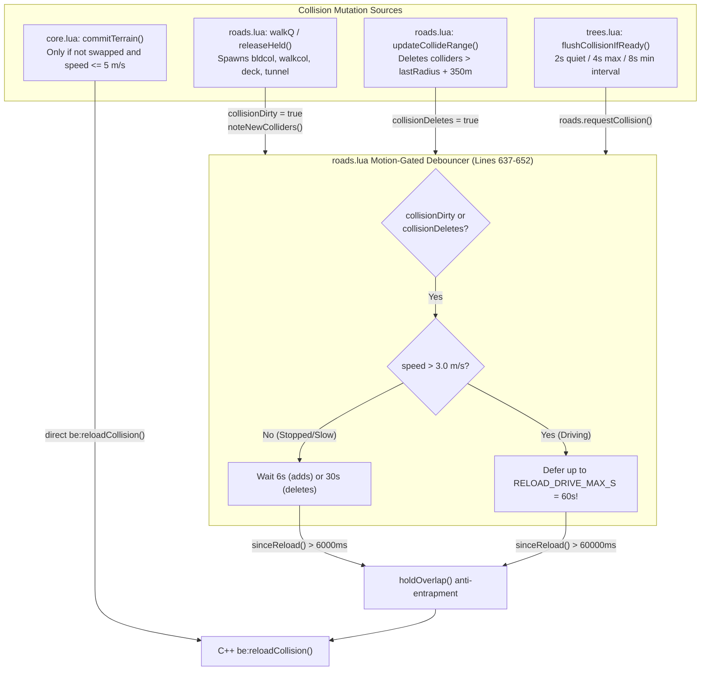
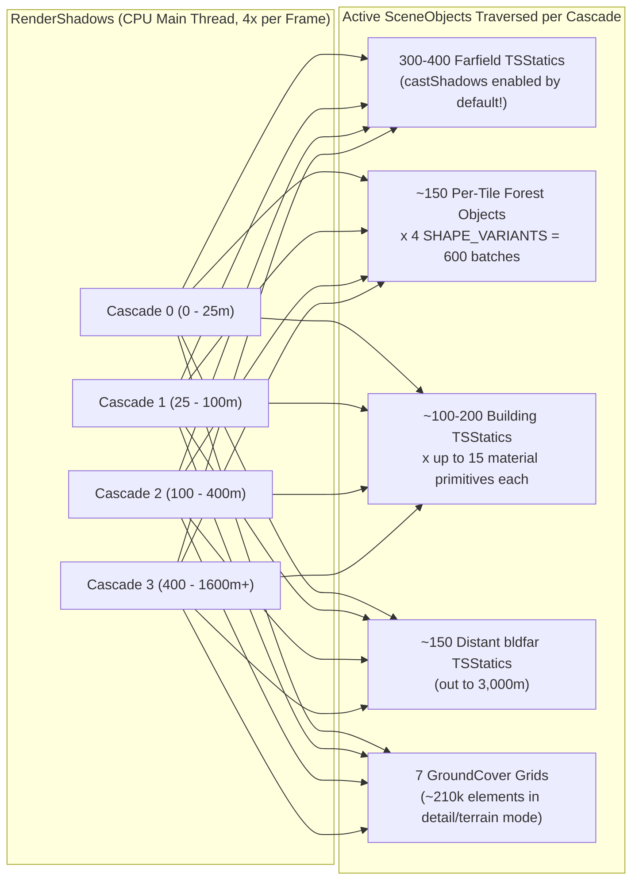
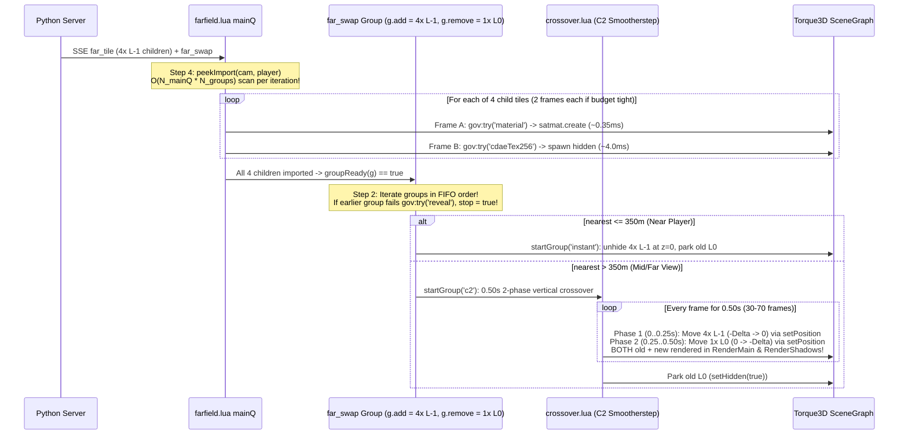

# Track 4 Technical Audit: Scene Graph, Collision Reloading, Road Streaming, Shadow Culling & Terrain/Farfield Handover

**Date**: 2026-10-20  
**Target Modules**:
- Client Lua (GE): [`roads.lua`](file:///C:/Users/hoppj/SynologyDrive/01_Projets/Projet_BeamEarth/BeamNG.Earth/mod/beamng_earth/lua/ge/extensions/beamngEarth/roads.lua), [`trees.lua`](file:///C:/Users/hoppj/SynologyDrive/01_Projets/Projet_BeamEarth/BeamNG.Earth/mod/beamng_earth/lua/ge/extensions/beamngEarth/trees.lua), [`groundcover.lua`](file:///C:/Users/hoppj/SynologyDrive/01_Projets/Projet_BeamEarth/BeamNG.Earth/mod/beamng_earth/lua/ge/extensions/beamngEarth/groundcover.lua), [`terrain.lua`](file:///C:/Users/hoppj/SynologyDrive/01_Projets/Projet_BeamEarth/BeamNG.Earth/mod/beamng_earth/lua/ge/extensions/beamngEarth/terrain.lua), [`core.lua`](file:///C:/Users/hoppj/SynologyDrive/01_Projets/Projet_BeamEarth/BeamNG.Earth/mod/beamng_earth/lua/ge/extensions/beamngEarth/core.lua), [`farfield.lua`](file:///C:/Users/hoppj/SynologyDrive/01_Projets/Projet_BeamEarth/BeamNG.Earth/mod/beamng_earth/lua/ge/extensions/beamngEarth/farfield.lua), [`governor.lua`](file:///C:/Users/hoppj/SynologyDrive/01_Projets/Projet_BeamEarth/BeamNG.Earth/mod/beamng_earth/lua/ge/extensions/beamngEarth/governor.lua), [`follow.lua`](file:///C:/Users/hoppj/SynologyDrive/01_Projets/Projet_BeamEarth/BeamNG.Earth/mod/beamng_earth/lua/ge/extensions/beamngEarth/follow.lua), [`crossover.lua`](file:///C:/Users/hoppj/SynologyDrive/01_Projets/Projet_BeamEarth/BeamNG.Earth/mod/beamng_earth/lua/ge/extensions/beamngEarth/crossover.lua), [`satmat.lua`](file:///C:/Users/hoppj/SynologyDrive/01_Projets/Projet_BeamEarth/BeamNG.Earth/mod/beamng_earth/lua/ge/extensions/beamngEarth/satmat.lua)
- Server Geometry Builders: [`cdae.py`](file:///C:/Users/hoppj/SynologyDrive/01_Projets/Projet_BeamEarth/BeamNG.Earth/server/cdae.py), [`roads.py`](file:///C:/Users/hoppj/SynologyDrive/01_Projets/Projet_BeamEarth/BeamNG.Earth/server/roads.py), [`roadmesh.py`](file:///C:/Users/hoppj/SynologyDrive/01_Projets/Projet_BeamEarth/BeamNG.Earth/server/roadmesh.py), [`sidewalks.py`](file:///C:/Users/hoppj/SynologyDrive/01_Projets/Projet_BeamEarth/BeamNG.Earth/server/sidewalks.py), [`buildings.py`](file:///C:/Users/hoppj/SynologyDrive/01_Projets/Projet_BeamEarth/BeamNG.Earth/server/buildings.py)
- Empirical References: [`2026-10-11-engine-probes.md`](file:///C:/Users/hoppj/SynologyDrive/01_Projets/Projet_BeamEarth/BeamNG.Earth/docs/research/2026-10-11-engine-probes.md), [`2026-10-12-engine-limits-and-worldgen.md`](file:///C:/Users/hoppj/SynologyDrive/01_Projets/Projet_BeamEarth/BeamNG.Earth/docs/research/2026-10-12-engine-limits-and-worldgen.md), [`perfgraph_011203_analysis.md`](file:///C:/Users/hoppj/SynologyDrive/01_Projets/Projet_BeamEarth/BeamNG.Earth/runs/optimization_logs/perfgraph_011203_analysis.md), [`perfgraph_220616_analysis.md`](file:///C:/Users/hoppj/SynologyDrive/01_Projets/Projet_BeamEarth/BeamNG.Earth/runs/optimization_logs/perfgraph_220616_analysis.md), [`phase7_hiccup_investigation_report.md`](file:///C:/Users/hoppj/SynologyDrive/01_Projets/Projet_BeamEarth/BeamNG.Earth/runs/optimization_logs/phase7_hiccup_investigation_report.md), [`rubberband_investigation_report.md`](file:///C:/Users/hoppj/SynologyDrive/01_Projets/Projet_BeamEarth/BeamNG.Earth/runs/optimization_logs/rubberband_investigation_report.md)

---

## Executive Summary

BeamNG.Earth is constrained by four structural properties of the Torque3D / BeamNG.drive C++ engine:
1. **Monolithic Static Collision BVH (`be:reloadCollision()`)**: The engine lacks incremental per-object collision insertion/removal; rebuilding static collision scans all collidable triangles in the scene (`~0.15 ms / 1,000 TSStatic tris`) and triggers a 1-frame deferred `PhysicsPlugin` swap (`12–56 ms`) that drops active wheel contact pairs and perturbs the C++ physics $\Delta t$ smoothing filter.
2. **Terrain-Bound `DecalRoad` Signal Fanout**: Every live `DecalRoad` subscribes to `TerrainBlock` change notifications (`onTerrainChanged`) and re-clips all spline edges synchronously on terrain movement (`~37 µs/road`, adding `140+ ms` at `3,740` urban road chunks). While [`roadmesh.py`](file:///C:/Users/hoppj/SynologyDrive/01_Projets/Projet_BeamEarth/BeamNG.Earth/server/roadmesh.py) bypassed this by baking tiles into single render-only `TSStatic` `.cdae` meshes, [`roads.py`](file:///C:/Users/hoppj/SynologyDrive/01_Projets/Projet_BeamEarth/BeamNG.Earth/server/roads.py) still serializes redundant `chunks` arrays into every `roads_*.json` file, inflating main-thread JSON decode and Lua GC pressure.
3. **CPU-Bound 4-Cascade Shadow Culling (`RenderShadows`)**: Across all PerfGraph captures, `RenderShadows` is the #1 steady-state CPU pass (`3.42–3.59 ms` median) and a primary spike source (`12.4–71.1 ms` p99/max) despite the GPU running at only `3.61 ms`. This is driven by per-cascade CPU scene traversal across ~150 per-tile `Forest` objects, $4\times$ `SHAPE_VARIANTS` instancing fragmentation, 15-material building draw primitives, and shadow casting left enabled on `300+` far-field terrain meshes.
4. **Terrain vs. Farfield Handover Desynchronization**: While binary `.ter` v9 swapping (`terrainFile` + `postApply()`) reduced `512²` terrain commits from `~22 ms` to `~11 ms` with automatic next-frame heightfield collision, [`governor.lua`](file:///C:/Users/hoppj/SynologyDrive/01_Projets/Projet_BeamEarth/BeamNG.Earth/mod/beamng_earth/lua/ge/extensions/beamngEarth/governor.lua)'s `requestHeavy()` ramp-down (`0.1 ms/frame` from `6.0 ms` = `60 frames`) stalls `L-1` farfield mesh imports before a commit, while strict FIFO group reveals and `0.50 s` double-rendered C2 crossovers delay near-player LOD handovers.

### Summary of High-Impact Findings & Optimization Targets

| ID | Pillar | Bottleneck / Vulnerability | Location | Measured Cost / Impact | Proposed Fix |
| :--- | :--- | :--- | :--- | :--- | :--- |
| **P1-A** | Collision | **60s High-Speed Collision Blindness ("Ghost Bridge" Bug)**: `RELOAD_DRIVE_MAX_S = 60` blocks all collision rebuilds while `speed > 3 m/s`. At `50 m/s`, the car travels `3,000 m` past the `700–900 m` `collideRadius` bubble, driving onto uncollided bridge decks/tunnels for 42s of every minute. | [`roads.lua:637-652`](file:///C:/Users/hoppj/SynologyDrive/01_Projets/Projet_BeamEarth/BeamNG.Earth/mod/beamng_earth/lua/ge/extensions/beamngEarth/roads.lua#L637-L652) | Complete loss of collision on `deck`/`tunnel`/`walkcol` after `~15 s` at highway speed, followed by an un-isolated stall at `t = 60 s`. | Distance-horizon watermark trigger (`unflushed deck/tunnel within 250 m` or `> 60%` of `collideRadius` traveled) + governor single-frame isolation. |
| **P1-B** | Collision | **Ungoverned `be:reloadCollision()` Execution**: `roads.lua:649` calls `be:reloadCollision()` directly inside `roads.update()` without `gov:requestHeavy()` or blocking `farfield.update()`, causing back-to-back `H-H` frame spikes that defeat BeamNG's median-of-3 physics filter. | [`roads.lua:647-651`](file:///C:/Users/hoppj/SynologyDrive/01_Projets/Projet_BeamEarth/BeamNG.Earth/mod/beamng_earth/lua/ge/extensions/beamngEarth/roads.lua#L647-L651) | `12–56 ms` physics rebuild colliding with `.cdae` imports (`4.2 ms`), causing visible rubber-band time-dilation. | Route `be:reloadCollision()` through a fast single-frame governor isolation gate (`gov.blocked = true` for frame $N$ and $N+1$). |
| **P1-C** | Collision | **Per-Frame `vec3` & Table Churn in Collider Checks**: `updateCollideRange()`, `collideNear()`, and `releaseHeld()` allocate hundreds of temporary `vec3` objects and `keep = {}` tables every second and call `veh:getPosition()` inside inner loops. | [`roads.lua:244-282, 659-696`](file:///C:/Users/hoppj/SynologyDrive/01_Projets/Projet_BeamEarth/BeamNG.Earth/mod/beamng_earth/lua/ge/extensions/beamngEarth/roads.lua#L244-L282) | Contributes to the `5 Hz` `LuaGC`锯齿 (`2.6–9.1 ms` every ~29 frames). | Cache `(px, py, pz)` once per `roads.update()`, use scalar 2D squared distances (`dx*dx + dy*dy`), and in-place compaction on `parked` / `held`. |
| **P2-A** | Roads | **Dead `data.chunks` JSON Serialization & Decode**: Even when [`roadmesh.py`](file:///C:/Users/hoppj/SynologyDrive/01_Projets/Projet_BeamEarth/BeamNG.Earth/server/roadmesh.py) bakes the tile into a single `data.road` `.cdae`, [`roads.py:3124`](file:///C:/Users/hoppj/SynologyDrive/01_Projets/Projet_BeamEarth/BeamNG.Earth/server/roads.py#L3124) still writes all `chunks` polylines to `roads_*.json`, and [`roads.lua:323-350`](file:///C:/Users/hoppj/SynologyDrive/01_Projets/Projet_BeamEarth/BeamNG.Earth/mod/beamng_earth/lua/ge/extensions/beamngEarth/roads.lua#L323-L350) decodes and discards them. | [`roads.py:3124`](file:///C:/Users/hoppj/SynologyDrive/01_Projets/Projet_BeamEarth/BeamNG.Earth/server/roads.py#L3124), [`roads.lua:323-350`](file:///C:/Users/hoppj/SynologyDrive/01_Projets/Projet_BeamEarth/BeamNG.Earth/mod/beamng_earth/lua/ge/extensions/beamngEarth/roads.lua#L323-L350) | `50–250 KB` dead JSON per tile; thousands of dead Lua tables allocated and GC'd on the main thread. | Omit `chunks` from `roads_*.json` when `road_mesh` succeeds (`"chunks": [] if road_mesh else chunks`). |
| **P2-B** | Roads | **$O(N)$ Queue Shifts & `fieldsFor` Table Allocations**: `createQ`, `walkQ`, and `farQ` use `table.remove(q, 1)`, and `fieldsFor()` allocates 9 tables per fallback `DecalRoad`. | [`roads.lua:236-242, 428, 592, 612`](file:///C:/Users/hoppj/SynologyDrive/01_Projets/Projet_BeamEarth/BeamNG.Earth/mod/beamng_earth/lua/ge/extensions/beamngEarth/roads.lua#L236-L242) | $O(N^2)$ queue drain overhead during dense urban tile bursts. | Replace `table.remove(q, 1)` with head/tail ring indices (`qH, qT`) and reuse a static `FIELD_TPL` table + scratch `vec3`. |
| **P3-A** | Shadows | **`RenderShadows` CPU Culling Amplification**: 150 per-tile `Forest` SceneObjects $\times$ 4 `SHAPE_VARIANTS` $\times$ 4 PSSM shadow cascades + `300+` shadow-casting far-field `TSStatic` meshes + 15-material `bld` primitives. | [`trees.lua:58, 188-219`](file:///C:/Users/hoppj/SynologyDrive/01_Projets/Projet_BeamEarth/BeamNG.Earth/mod/beamng_earth/lua/ge/extensions/beamngEarth/trees.lua#L58), [`farfield.lua:384-393`](file:///C:/Users/hoppj/SynologyDrive/01_Projets/Projet_BeamEarth/BeamNG.Earth/mod/beamng_earth/lua/ge/extensions/beamngEarth/farfield.lua#L384-L393), [`buildings.py:2589`](file:///C:/Users/hoppj/SynologyDrive/01_Projets/Projet_BeamEarth/BeamNG.Earth/server/buildings.py#L2589) | `3.59 ms` median CPU time (`26.9%` of frame), spiking to `12.4–71.1 ms` during scene graph mutations. | Reduce `SHAPE_VARIANTS` from `4` to `1` (per-tile `Forest` already bounds `pop[shape]`), coarsen Forest cells to `512 m` ($4\times$ fewer `Forest` objects), collapse `lite` building LOD to 1 vertex-color material, and disable `castShadows` on `LOD >= 1` farfield & `bldfar` meshes. |
| **P3-B** | Shadows | **Per-Frame $O(N_{\text{far}})$ `updateFar()` Scan & Missing Utah Roof Textures**: `updateFar()` scans `pairs(far)` every frame (`roads.lua:417`), and `bne_bld_roof_shingle` references unmounted `/levels/Utah/...` textures. | [`roads.lua:415-425`](file:///C:/Users/hoppj/SynologyDrive/01_Projets/Projet_BeamEarth/BeamNG.Earth/mod/beamng_earth/lua/ge/extensions/beamngEarth/roads.lua#L415-L425), [`buildings.materials.json:136-161`](file:///C:/Users/hoppj/SynologyDrive/01_Projets/Projet_BeamEarth/BeamNG.Earth/mod/beamng_earth/art/shapes/beamng_earth/buildings.materials.json#L136-L161) | `4,730` synchronous VFS misses + `1,001` shader stage errors; redundant per-frame Lua hash table iteration. | Toggle `far[key]` visibility event-driven on `t.bld` spawn/delete; replace `/levels/Utah/...` paths with procedural `bne_roof_shingle_*.png`. |
| **P4-A** | Terrain / LOD | **Double Terrain Load on Cold Block & Synchronous 8-Slot `setBase` Rebind**: `loadBlock()` calls `terrain.load()` (`22 ms`) and immediately calls `terrain.swap()` (`11 ms`) on the same frame when `terrain.swap` initially returns `false`. In `detail` mode, `terrain.swap` also runs 8 synchronous `tb:updateMaterial()` calls (`+6–23 ms`). | [`core.lua:284-286`](file:///C:/Users/hoppj/SynologyDrive/01_Projets/Projet_BeamEarth/BeamNG.Earth/mod/beamng_earth/lua/ge/extensions/beamngEarth/core.lua#L284-L286), [`terrain.lua:318, 329-348`](file:///C:/Users/hoppj/SynologyDrive/01_Projets/Projet_BeamEarth/BeamNG.Earth/mod/beamng_earth/lua/ge/extensions/beamngEarth/terrain.lua#L318) | `33–55 ms` main-thread stall on initial/rebase terrain load or `detail` mode step. | Remove redundant `terrain.swap()` after `terrain.load()`; amortize `updateMaterial(0..7)` across subsequent frames or bind single `baseTex` property. |
| **P4-B** | Terrain / LOD | **60-Frame Pre-Commit Streaming Starvation & FIFO Group Reveal Blocking**: `gov:requestHeavy()` ramps `b` down at `0.1 ms/frame` (`60 frames` from `6.0 ms`), halting `L-1` farfield imports before a commit; `farfield.update()` Step 2 stops on the first unbudgeted group in FIFO order (`stop = true`), and `peekImport` runs nested $O(N_{\text{mainQ}} \times N_{\text{groups}})$ scans. | [`governor.lua:230-292`](file:///C:/Users/hoppj/SynologyDrive/01_Projets/Projet_BeamEarth/BeamNG.Earth/mod/beamng_earth/lua/ge/extensions/beamngEarth/governor.lua#L230-L292), [`farfield.lua:1244-1267, 1420-1449`](file:///C:/Users/hoppj/SynologyDrive/01_Projets/Projet_BeamEarth/BeamNG.Earth/mod/beamng_earth/lua/ge/extensions/beamngEarth/farfield.lua#L1244-L1267) | Up to `1.0 s` streaming freeze before each `192 m` terrain step; `exactMiss` coarse LOD overhang under the vehicle at highway speeds. | Replace 60-frame ramp-down with 2-frame quiet gate; sort/prioritize ready `groups` by player distance instead of strict FIFO `stop = true`; maintain per-group missing count in $O(1)$. |

---

## Pillar 1: `be:reloadCollision()` Overhead, Memory Allocation, and Debouncing Strategy During High-Speed Driving

### 1.1 C++ Engine Internals & Empirical Scaling Model

In BeamNG.drive's `PhysicsPlugin`, static environment collision (excluding heightfield `TerrainBlock` squares) is stored in a **single monolithic global kd-tree / BVH**. There is no C++ or Lua API to incrementally insert or remove an individual `TSStatic`, `ProceduralMesh`, or `ForestItem` collider. Any change to static mesh or tree collision requires invoking `be:reloadCollision()`, which rebuilds the static collision tree from scratch across all collidable objects in `MissionGroup`.

From the engine probes in [`2026-10-11-engine-probes.md`](file:///C:/Users/hoppj/SynologyDrive/01_Projets/Projet_BeamEarth/BeamNG.Earth/docs/research/2026-10-11-engine-probes.md) and [`2026-10-12-engine-limits-and-worldgen.md`](file:///C:/Users/hoppj/SynologyDrive/01_Projets/Projet_BeamEarth/BeamNG.Earth/docs/research/2026-10-12-engine-limits-and-worldgen.md), the rebuild cost $T_{\text{reload}}$ follows an exact linear scaling law over active collidable primitives:

$$T_{\text{reload}} \approx T_{\text{terrain}}(S) + 0.15\text{ ms} \times \frac{N_{\text{tri,TSStatic}}}{1000} + 0.31\text{ ms} \times \frac{N_{\text{tri,ProcMesh}}}{1000} + T_{\text{forest}}(N_{\text{solidTrees}})$$

| Collidable Scene Component | Configuration / Count | `be:reloadCollision()` Cost | Notes / Engine Behavior |
| :--- | :--- | :--- | :--- |
| **`TerrainBlock` Only** (`512²`) | `262,144` height samples (`2.0 m` sq) | **`0.4 – 1.3 ms`** | Heightfield is queried directly via 2D grid lookup; does **not** enter the triangle kd-tree. |
| **`TerrainBlock` Only** (`1024²`) | `1,048,576` height samples | **`1.5 – 1.7 ms`** | Auto-updated on `.ter` `postApply()` without needing `be:reloadCollision()`. |
| **`TerrainBlock` Only** (`2048²` / `4096²`) | `4.2M` / `16.8M` height samples | **`7.1 ms` / `27.1 ms`** | High memory copy overhead inside `PhysicsPlugin::addTerrainBlock`. |
| **`ProceduralMesh`** (Replaced) | `131k` / `524k` triangles | **`41.0 ms` / `162.4 ms`** | `~0.31 ms / 1k tris`. Eliminated in favor of `.cdae` `TSStatic`. |
| **`TSStatic` Visible Mesh Final** (Legacy Urban) | 36 tiles (`~1.1M` visual vertices) | **`40.0 – 56.0 ms`** | Rebuilt every visual façade, roof, and 9-point curb triangle. |
| **`TSStatic` Lean `Collision Mesh`** (Current Urban) | `bldcol` + `walkcol` + `deck` + `tunnel` (`~42.7k` tris) | **`12.0 – 20.0 ms`** | Uses `collisionType = 'Collision Mesh'` (`Colmesh` node in [`cdae.py:483-524`](file:///C:/Users/hoppj/SynologyDrive/01_Projets/Projet_BeamEarth/BeamNG.Earth/server/cdae.py#L483-L524)). |
| **`Forest` Solid Items** (Cold vs. Warm) | 201 solid oaks (`SOLID_M = 90 m`) | **`163 ms` (cold) / `0.9 ms` (warm)** | First-ever rebuild loads `.dae` collision shapes (`PF1`); warm rebuilds are `< 1.1 ms` when solid count is `< 500`. |
| **`Forest` All Collidable** (Legacy Bug) | `20k – 150k` trees with `collidable=1` | **`+30.0 ms`** (+ `124 ms` C++ `Ticking`) | Solved by [`trees.lua:299-302`](file:///C:/Users/hoppj/SynologyDrive/01_Projets/Projet_BeamEarth/BeamNG.Earth/mod/beamng_earth/lua/ge/extensions/beamngEarth/trees.lua#L299-L302) cloning `TSForestItemData` into `_ ghost` (`collidable = false`) vs `_solid` (`collidable = true`). |

#### Asynchronous 1-Frame Physics Stall & Contact Drop Mechanism
As proven in [`rubberband_investigation_report.md`](file:///C:/Users/hoppj/SynologyDrive/01_Projets/Projet_BeamEarth/BeamNG.Earth/runs/optimization_logs/rubberband_investigation_report.md), `be:reloadCollision()` splits its work across two consecutive frames:
1. **Frame $N$ (GE Lua Call)**: Collects scene collision descriptors and flags the physics world dirty (`~1.8–10 ms` inside `LuaOnUpdate`).
2. **Frame $N+1$ (Physics Step)**: `PhysicsPlugin` constructs the new global kd-tree, swaps the static collision world, and re-invokes `PhysicsPlugin::addTerrainBlock` (`~12–56 ms` inside the C++ physics step, outside `LuaOnUpdate`).
3. **Physics $\Delta t$ Time-Dilation ("Rubber-Banding")**:
   BeamNG's C++ engine smooths frame delta time using:
   $$\Delta t_{\text{smooth}} = \text{EMA}_{\alpha}\!\left(\text{median\_of\_3}\!\left(\text{clamp}(\Delta t_{\text{raw}}, 1.0)\right)\right)$$
   An isolated single-frame spike (`L-H-L`) is completely rejected by `median_of_3`. However, because `be:reloadCollision()` costs `~5–10 ms` on Frame $N$ and `~15–40 ms` on Frame $N+1$ (or collides with `.cdae` imports on Frame $N$), it creates a **2-frame consecutive spike (`H-H`)** that passes straight through `median_of_3` into the EMA filter, inflating $\Delta t_{\text{smooth}}$ for `20–30 frames` (`0.3–0.5 s`) and causing visible slow-motion/slingshot rubber-banding.

---

### 1.2 Audit of the Current Collision Architecture & Debouncing Strategy

Collision lifecycle is currently split across [`roads.lua`](file:///C:/Users/hoppj/SynologyDrive/01_Projets/Projet_BeamEarth/BeamNG.Earth/mod/beamng_earth/lua/ge/extensions/beamngEarth/roads.lua), [`trees.lua`](file:///C:/Users/hoppj/SynologyDrive/01_Projets/Projet_BeamEarth/BeamNG.Earth/mod/beamng_earth/lua/ge/extensions/beamngEarth/trees.lua), and [`core.lua`](file:///C:/Users/hoppj/SynologyDrive/01_Projets/Projet_BeamEarth/BeamNG.Earth/mod/beamng_earth/lua/ge/extensions/beamngEarth/core.lua):



#### What Works Well
1. **Lean Dedicated Collision Meshes (`bldcol` & `walkcol`)**:
   - In [`buildings.py:2589-2603`](file:///C:/Users/hoppj/SynologyDrive/01_Projets/Projet_BeamEarth/BeamNG.Earth/server/buildings.py#L2589-L2603) and [`sidewalks.py:303-323`](file:///C:/Users/hoppj/SynologyDrive/01_Projets/Projet_BeamEarth/BeamNG.Earth/server/sidewalks.py#L303-L323), visual geometry (`bld`, `bld2..4`, `walk`) is spawned with `renderOnly = true` (`collisionType = 'None'` in [`roads.lua:189-192`](file:///C:/Users/hoppj/SynologyDrive/01_Projets/Projet_BeamEarth/BeamNG.Earth/mod/beamng_earth/lua/ge/extensions/beamngEarth/roads.lua#L189-L192)).
   - Physics uses simplified `bldcol` (ground-contact walls only, skipping roofs and upper stories) and `walkcol` (`LEAN_TOL_M = 0.03 m` Douglas-Peucker simplification with a 6-point cross-section instead of 9-point), encoded via [`cdae.py:483-524`](file:///C:/Users/hoppj/SynologyDrive/01_Projets/Projet_BeamEarth/BeamNG.Earth/server/cdae.py#L483-L524) (`collision_only=True`, object named `"Colmesh"`, `collisionType = 'Collision Mesh'`). This reduced urban collision triangle counts by **~70–85%**.
2. **Speed-Adaptive Collision Horizon (`collideRadius`)**:
   - [`roads.lua:246-249`](file:///C:/Users/hoppj/SynologyDrive/01_Projets/Projet_BeamEarth/BeamNG.Earth/mod/beamng_earth/lua/ge/extensions/beamngEarth/roads.lua#L246-L249) computes `r = math.max(320, math.min(900, speed * 14))`. Distant tiles park their colliders in `parked` and only instantiate `TSStatic` objects when within `r`, uncolliding them beyond `lastRadius + 350 m`.
3. **Vehicle Anti-Entrapment (`playerIn` / `held` / `holdOverlap`)**:
   - [`roads.lua:659-716`](file:///C:/Users/hoppj/SynologyDrive/01_Projets/Projet_BeamEarth/BeamNG.Earth/mod/beamng_earth/lua/ge/extensions/beamngEarth/roads.lua#L659-L716) checks 20 m sub-mesh AABBs (`COLLIDER_PIECE_M = 20`) against the player vehicle (`PLAYER_R = 3.0 m`, `PLAYER_DZ = 2.5 m`) before spawning or activating colliders, preventing curbs or bridge decks from materializing inside the vehicle's suspension/wheels and causing NaN physics explosions.

---

### 1.3 Critical Vulnerabilities Found in Pillar 1

> [!CAUTION]
> **Vulnerability P1-A: The 60-Second High-Speed Collision Blindness ("Ghost Bridge" Hazard)**  
> Look closely at [`roads.lua:637-652`](file:///C:/Users/hoppj/SynologyDrive/01_Projets/Projet_BeamEarth/BeamNG.Earth/mod/beamng_earth/lua/ge/extensions/beamngEarth/roads.lua#L637-L652):
> ```lua
> local isMoving = M.playerSpeed() > 3.0
> local interval
> if isMoving then
>   if not M.collisionDirty then return end
>   interval = M.RELOAD_DRIVE_MAX_S * 1000  -- 60,000 ms (60 seconds)!
> else
>   interval = (M.collisionDirty and M.RELOAD_EVERY_S or M.RELOAD_DELETES_S) * 1000
> end
> ```
> Consider what happens mathematically during continuous driving at highway speed (`v = 40 m/s = 144 km/h` or `v = 50 m/s = 180 km/h`):
> 1. At $t = 0\text{ s}$, a collision reload occurs. The active collider bubble radius is:
>    $$R_{\text{collide}}(v) = \min(900, \max(320, 14v)) = \begin{cases} 560\text{ m} & \text{at } 40\text{ m/s} \\ 700\text{ m} & \text{at } 50\text{ m/s} \end{cases}$$
> 2. After **14.0 seconds** of driving at `40–50 m/s`, the vehicle has traveled $14 \times v = 560\text{–}700\text{ m}$ — **completely exiting the bubble of colliders that existed at $t = 0\text{ s}$!**
> 3. Between $t = 14\text{ s}$ and $t = 60\text{ s}$ (for **46 consecutive seconds**, covering **1.8 to 2.3 km of road**), `walkQ` continues spawning visual/collider `TSStatic` objects ahead of the car and setting `M.collisionDirty = true`, **but `roads.lua` refuses to call `be:reloadCollision()` because `sinceReload() < 60000`!**
> 4. Because `TSStatic` objects in Torque3D do **not** enter the physics kd-tree until `be:reloadCollision()` is called, **every bridge deck (`deck`), tunnel (`tunnel`), sidewalk curb (`walkcol`), building (`bldcol`), and tree (`trees.lua`) encountered between $t = 14\text{ s}$ and $t = 60\text{ s}$ is 100% intangible!** If the road crosses a river bridge (`deck` mesh over depressed water terrain) at $t = 20\text{ s}$, the car falls straight through the bridge deck into the river.

#### Vulnerability P1-B: Ungoverned `be:reloadCollision()` Colliding with Farfield Imports
When `sinceReload() > interval` finally triggers in [`roads.lua:647-651`](file:///C:/Users/hoppj/SynologyDrive/01_Projets/Projet_BeamEarth/BeamNG.Earth/mod/beamng_earth/lua/ge/extensions/beamngEarth/roads.lua#L647-L651):
```lua
if sinceReload() > interval then
  M.holdOverlap()
  be:reloadCollision()
  lastReloadTime = Engine.Platform.getRealMilliseconds()
  M.collisionDirty, M.collisionDeletes = false, false
end
```
Notice that `roads.update(gov)` runs **before** `farfield.update(gov)` and `trees.update(gov)` in [`core.lua:1107-1122`](file:///C:/Users/hoppj/SynologyDrive/01_Projets/Projet_BeamEarth/BeamNG.Earth/mod/beamng_earth/lua/ge/extensions/beamngEarth/core.lua#L1107-L1122), yet `roads.lua:649` does **not** deduct from `gov` or set `gov.blocked = true`!
- Consequently, on the exact same frame $N$ that `be:reloadCollision()` spends `5–10 ms` preparing the rebuild, `farfield.update(gov)` still thinks its full token bucket (`3.5–6.0 ms`) is available and runs a `.cdae` import (`4.2 ms`), pushing Frame $N$ over `22 ms`.
- Then on Frame $N+1$, the C++ physics thread executes the deferred kd-tree swap (`15–30 ms`), while `farfield.update(gov)` *again* runs normal streaming work because `governor:beginFrame(dt)` only sees the lag *after* Frame $N+1$ completes! This guarantees a 2-frame `H-H` spike that defeats `median_of_3`.

#### Vulnerability P1-C: Main-Thread Table & `vec3` Allocation Churn in `roads.lua`
1. **Repeated `veh:getPosition()` and `vec3()` inside inner loops**:
   - [`roads.lua:244-255`](file:///C:/Users/hoppj/SynologyDrive/01_Projets/Projet_BeamEarth/BeamNG.Earth/mod/beamng_earth/lua/ge/extensions/beamngEarth/roads.lua#L244-L255): `M.collideNear(t, margin)` calls `be:getPlayerVehicle(0)`, `veh:getPosition()`, `M.playerSpeed()`, and allocates `vec3(t.cx, t.cy, 0)` on **every single call**.
   - Inside `M.updateCollideRange()` ([`lines 264-281`](file:///C:/Users/hoppj/SynologyDrive/01_Projets/Projet_BeamEarth/BeamNG.Earth/mod/beamng_earth/lua/ge/extensions/beamngEarth/roads.lua#L264-L281)), `M.collideNear` is called in a loop over all `parked` items and all `tiles` (`~150–250` calls every `0.25 s`), allocating `~600–1,000` temporary `vec3` Ctypes/userdata objects per second and allocating a new `local keep = {}` table every `0.25 s`.
   - Inside `M.playerIn(boxes)` ([`lines 659-670`](file:///C:/Users/hoppj/SynologyDrive/01_Projets/Projet_BeamEarth/BeamNG.Earth/mod/beamng_earth/lua/ge/extensions/beamngEarth/roads.lua#L659-L670)), `be:getPlayerVehicle(0)` and `veh:getPosition()` are queried on every `walkQ` pop and every `held` item on **every frame** (`releaseHeld()` at [`line 604`](file:///C:/Users/hoppj/SynologyDrive/01_Projets/Projet_BeamEarth/BeamNG.Earth/mod/beamng_earth/lua/ge/extensions/beamngEarth/roads.lua#L604)).
2. **Spurious `PhysicsPlugin::addTerrainBlock` Depth PNG Errors**:
   - Every `be:reloadCollision()` call logs `E|engine::PhysicsPlugin::addTerrainBlock| depth image map not existing: /temp/beamngEarth/hm_<a>_<s1>_<s2>.ter.depth.png` (`172` error log flushes in a single session) because Torque3D checks for `<ter_path>.depth.png` whenever `addTerrainBlock` runs during collision reload.

---

### 1.4 Pillar 1 Optimization Proposals

#### Proposal P1-1: Distance-Horizon Watermark & Critical Deck Priority for `be:reloadCollision()`
Replace the blind 60-second timer (`RELOAD_DRIVE_MAX_S = 60`) with a **spatial horizon watermark** and **critical structure trigger**:
1. Track the player's `(lastReloadX, lastReloadY)` and `lastReloadRadius` at the moment of each `be:reloadCollision()`.
2. When `M.collisionDirty` is true while driving (`speed > 3.0 m/s`), trigger a reload as soon as **either**:
   - **Critical Structure Ahead**: A newly spawned `deck` (bridge) or `tunnel` collider is within $\max(180\text{ m}, v \times 4.0\text{ s})$ of the player, **or**
   - **Horizon Exhaustion**: The distance traveled since the last reload exceeds $0.55 \times \text{lastReloadRadius}$ (e.g., `~300 m` at `40 m/s`, guaranteeing the player always has at least `250 m` of active colliders ahead), with a minimum cooldown of `8.0 s`.

#### Proposal P1-2: Two-Frame Governor Isolation Gate for `be:reloadCollision()`
Because `be:reloadCollision()` executes its heavy kd-tree swap on Frame $N+1$, isolate it across both Frame $N$ and Frame $N+1$ so `median_of_3` in BeamNG's C++ physics filter completely absorbs the spike:
```lua
-- In roads.lua (inside M.update(gov)):
if shouldReloadCollision then
  M.holdOverlap()
  be:reloadCollision()
  lastReloadTime = now
  lastReloadX, lastReloadY, lastReloadR = px, py, M.lastRadius
  M.collisionDirty, M.collisionDeletes = false, false
  if gov then
    gov:spend(gov.b)          -- Exhaust remaining budget on Frame N (blocks farfield/trees this frame)
    gov.quietAfter = math.max(gov.quietAfter or 0, 2) -- Block streaming on Frame N+1 (when C++ PhysicsPlugin swaps BVH)
  end
  return
end
```

#### Proposal P1-3: Zero-Allocation `collideNear` & `playerIn` with Cached Frame Pose
Cache `px, py, pz, speed` once at the top of `roads.update(gov)` and replace `vec3` allocations in `M.collideNear` with scalar 2D squared distance:
```lua
-- Zero-allocation scalar check (replaces vec3(t.cx, t.cy, 0):distance(veh:getPosition())):
function M.collideNearXY(cx, cy, px, py, r)
  local dx, dy = cx - px, cy - py
  return (dx * dx + dy * dy) <= (r * r)
end
```
And compact `parked` and `held` in-place using a write pointer `w` (`parked[w] = p; w = w + 1` followed by `for i = w, #parked do parked[i] = nil end`) instead of allocating `local keep = {}` every `0.25 s`.

---

## Pillar 2: `DecalRoad` Node Insertion vs. Regeneration Latency During Road Streaming (`roads.update`)

### 2.1 Empirical Engine Probe Analysis: `DecalRoad` Creation & Terrain Signal Scaling

Engine probes P1–P4 in [`2026-10-11-engine-probes.md`](file:///C:/Users/hoppj/SynologyDrive/01_Projets/Projet_BeamEarth/BeamNG.Earth/docs/research/2026-10-11-engine-probes.md) benchmarked the three ways to construct a 100-node `DecalRoad` (`5 m` node spacing, `1,090` generated spline edges) in Torque3D:

| Method | Lua Call Cost (Median / Max) | Edges Built Immediately | Next-Frame Hidden Cost | Why It Behaves This Way in C++ |
| :--- | :--- | :--- | :--- | :--- |
| **1. `setField('Node', ...)` before `registerObject`** | `0.40 ms` / `0.52 ms` | `0` | **`~13.0 ms` per road** (`24 ms` for 50×21-node roads) | `DecalRoad::onAdd()` schedules a deferred `regenerate()` on the next tick, bypassing the Lua governor. |
| **2. `registerObject()` + `insertNode(pos, w, i)` $\times 100$** | **`6.51 ms` / `7.01 ms`** | `1,090` | `0 ms` | `DecalRoad::insertNode()` calls `regenerate()` after **every single node**, causing $O(K^2)$ spline & terrain clipping (`15×` slower). |
| **3. `registerObject()` + `insertNodeNoRegen(pos, w, -1)` $\times 100$ + `regenerate()`** | **`0.44 ms` / `0.52 ms`** | `1,090` | `0 ms` | Appends nodes to `mNodes` vector in $O(1)$ per node and runs spline + terrain clipping **once** inside `regenerate()`, fully measured by the governor. |

#### The Fatal Flaw of `DecalRoad` at Scale: `onTerrainChanged` Fanout
Even though Method 3 (`insertNodeNoRegen` + `regenerate()`, implemented in [`roads.lua:305-314`](file:///C:/Users/hoppj/SynologyDrive/01_Projets/Projet_BeamEarth/BeamNG.Earth/mod/beamng_earth/lua/ge/extensions/beamngEarth/roads.lua#L305-L314)) makes creating a single `DecalRoad` fast (`~0.25–0.44 ms`), every live `DecalRoad` in Torque3D registers a C++ callback on the `TerrainBlock`'s `smTerrainChangedSignal`.
- Whenever `TerrainBlock` moves or swaps (`commitTerrain`), **Torque3D synchronously iterates over every `DecalRoad` overlapping the block and re-clips all spline triangles against the heightfield** at **`~37 µs` per `DecalRoad` (`~1 µs` per generated edge)**.
- In dense urban scenes (e.g., Fells Point, Baltimore), OSM road/marking decomposition produced **`3,740` `DecalRoad` chunks** (`asphalt`, `cobble`, `lane_solid`, `crosswalk`, `gutter`, `drain`).
- Consequently, every `TerrainBlock` step triggered a synchronous **`3,740 × 37 µs ≈ 138 ms` C++ stall** inside `commitTerrain`!

#### How `roadmesh.py` Solved the `DecalRoad` Scaling Wall
To eliminate `DecalRoad` scene graph bloat and `onTerrainChanged` stalls, [`server/roadmesh.py`](file:///C:/Users/hoppj/SynologyDrive/01_Projets/Projet_BeamEarth/BeamNG.Earth/server/roadmesh.py) (`build_tile_road_mesh`, invoked at [`server/roads.py:3125-3129`](file:///C:/Users/hoppj/SynologyDrive/01_Projets/Projet_BeamEarth/BeamNG.Earth/server/roads.py#L3125-L3129)) bakes all non-bridge, non-tunnel road ribbons of a `256 m` tile into **a single `.cdae` `TSStatic` mesh (`data.road`)**:
- Polylines are subdivided at `DRAPE_STEP = 2.0 m` (`_drape_polyline`, [`roadmesh.py:130-154`](file:///C:/Users/hoppj/SynologyDrive/01_Projets/Projet_BeamEarth/BeamNG.Earth/server/roadmesh.py#L130-L154)), matching the `TerrainBlock` `2.0 m` grid.
- Heights are sampled via vectorized bilinear interpolation (`_sample_z`, [`roadmesh.py:93-127`](file:///C:/Users/hoppj/SynologyDrive/01_Projets/Projet_BeamEarth/BeamNG.Earth/server/roadmesh.py#L93-L127)) with vertical layer offsets (`LIFT = {"base": 0.0, "gutter": 0.005, "mark": 0.01}`, plus `0.02–0.05 m` terrain clearance) to prevent z-fighting.
- In [`roads.lua:342-353`](file:///C:/Users/hoppj/SynologyDrive/01_Projets/Projet_BeamEarth/BeamNG.Earth/mod/beamng_earth/lua/ge/extensions/beamngEarth/roads.lua#L342-L353), when `data.road` is present, `tiles[key].queued = 0` and the entire tile's roads spawn as **one render-only `TSStatic`** via `walkQ` (`gov:try('roadWalk')`, `1.2 ms` cost), bypassing `DecalRoad` creation entirely!

---

### 2.2 Remaining Bottlenecks & Defects in `roads.lua` and `roads.py`

#### Defect P2-A: Massive Dead `chunks` JSON Serialization & Main-Thread Decode Waste
Look at [`server/roads.py:3122-3130`](file:///C:/Users/hoppj/SynologyDrive/01_Projets/Projet_BeamEarth/BeamNG.Earth/server/roads.py#L3122-L3130):
```python
    payload = {
        "tx": tx, "ty": ty, "cx": cx, "cy": cy,
        "chunks": chunks,
    }
    if hm is not None and slot_alloc is not None:
        road_mesh = build_tile_road_mesh(
            chunks, hm, tx, ty, cx, cy, tile_dir, slot_alloc=slot_alloc)
        if road_mesh:
            payload["road"] = road_mesh
```
And then look at [`roads.lua:323-353`](file:///C:/Users/hoppj/SynologyDrive/01_Projets/Projet_BeamEarth/BeamNG.Earth/mod/beamng_earth/lua/ge/extensions/beamngEarth/roads.lua#L323-L353):
```lua
function M.enqueueTile(key, path)
  local content = readFile(path)
  if not content then return end
  local data = jsonDecode(content)
  ...
  local road = data.road
  ...
  if road then
    table.insert(walkQ, 1, { key = key, path = road, cx = cx, cy = cy, renderOnly = true, isRoad = true })
  else
    for _, c in ipairs(data.chunks) do
      table.insert(createQ, { key = key, chunk = c })
    end
  end
```
> [!IMPORTANT]
> **What is happening here?**
> 1. Even when `road_mesh` (`payload["road"]`) is built (which is **100% of normal tiles**), [`roads.py:3124`](file:///C:/Users/hoppj/SynologyDrive/01_Projets/Projet_BeamEarth/BeamNG.Earth/server/roads.py#L3124) **still writes the entire `"chunks": chunks` array into `roads_<a>_<tx>_<ty>.json`**!
> 2. In urban tiles, `chunks` contains `100–400` sub-ribbons with thousands of `[x, y, z]` coordinate triplets (`50–250 KB` of JSON text per tile).
> 3. On the client main thread (`gov:try('roadJson')`), `readFile(path)` + `jsonDecode(content)` parses all `100–400` chunks and allocates **thousands of nested Lua tables (`c.n[i][1..3]`)**, only for [`roads.lua:346`](file:///C:/Users/hoppj/SynologyDrive/01_Projets/Projet_BeamEarth/BeamNG.Earth/mod/beamng_earth/lua/ge/extensions/beamngEarth/roads.lua#L346) (`if road then`) to **immediately throw `data.chunks` away into garbage**!
> 4. In [`perfgraph_011203_analysis.md`](file:///C:/Users/hoppj/SynologyDrive/01_Projets/Projet_BeamEarth/BeamNG.Earth/runs/optimization_logs/perfgraph_011203_analysis.md), `LuaGC` spiked to `2.6–9.1 ms` at a `5 Hz` cadence during streaming. Decoding and discarding thousands of dead `data.chunks` tables per road tile is a primary contributor to that Lua heap churn!

#### Defect P2-B: $O(N)$ Queue Shifts (`table.remove(q, 1)`) in `roads.lua`
Unlike [`farfield.lua`](file:///C:/Users/hoppj/SynologyDrive/01_Projets/Projet_BeamEarth/BeamNG.Earth/mod/beamng_earth/lua/ge/extensions/beamngEarth/farfield.lua), which uses $O(1)$ ring pointers (`mH, mT`), [`roads.lua`](file:///C:/Users/hoppj/SynologyDrive/01_Projets/Projet_BeamEarth/BeamNG.Earth/mod/beamng_earth/lua/ge/extensions/beamngEarth/roads.lua) uses `table.remove(..., 1)` and `table.insert(..., 1, ...)` across four active queues:
- `table.insert(walkQ, 1, ...)` at [`line 347`](file:///C:/Users/hoppj/SynologyDrive/01_Projets/Projet_BeamEarth/BeamNG.Earth/mod/beamng_earth/lua/ge/extensions/beamngEarth/roads.lua#L347) and `table.remove(walkQ, 1)` at [`line 612`](file:///C:/Users/hoppj/SynologyDrive/01_Projets/Projet_BeamEarth/BeamNG.Earth/mod/beamng_earth/lua/ge/extensions/beamngEarth/roads.lua#L612)
- `table.remove(farQ, 1)` at [`line 428`](file:///C:/Users/hoppj/SynologyDrive/01_Projets/Projet_BeamEarth/BeamNG.Earth/mod/beamng_earth/lua/ge/extensions/beamngEarth/roads.lua#L428)
- `table.remove(createQ, 1)` at [`line 592`](file:///C:/Users/hoppj/SynologyDrive/01_Projets/Projet_BeamEarth/BeamNG.Earth/mod/beamng_earth/lua/ge/extensions/beamngEarth/roads.lua#L592)
- `table.remove(deleteQ, 1)` at [`lines 406, 558, 579`](file:///C:/Users/hoppj/SynologyDrive/01_Projets/Projet_BeamEarth/BeamNG.Earth/mod/beamng_earth/lua/ge/extensions/beamngEarth/roads.lua#L579) (when draining from the front during rebase/unload)

#### Defect P2-C: Per-Chunk Table & `vec3` Allocation in Fallback `createChunk`
When `createChunk(chunk)` does run ([`roads.lua:236-242, 305-314`](file:///C:/Users/hoppj/SynologyDrive/01_Projets/Projet_BeamEarth/BeamNG.Earth/mod/beamng_earth/lua/ge/extensions/beamngEarth/roads.lua#L236-L242)):
- `M.fieldsFor(chunk)` allocates **9 new Lua tables** per chunk (`{ { 'material', ... }, { 'textureLength', ... }, ... }`).
- `for _, n in ipairs(chunk.n) do road:insertNodeNoRegen(vec3(n[1], n[2], n[3]), w, -1) end` allocates a fresh `vec3` per node instead of mutating a module-local `scratchVec:set(n[1], n[2], n[3])`.

---

### 2.3 Pillar 2 Optimization Proposals

#### Proposal P2-1: Strip Redundant `chunks` from `roads_*.json` When `road_mesh` Succeeds
In [`server/roads.py:3122-3130`](file:///C:/Users/hoppj/SynologyDrive/01_Projets/Projet_BeamEarth/BeamNG.Earth/server/roads.py#L3122-L3130), only include `chunks` in the JSON payload if `build_tile_road_mesh` returns `None`:
```python
    road_mesh = None
    if hm is not None and slot_alloc is not None:
        road_mesh = build_tile_road_mesh(
            chunks, hm, tx, ty, cx, cy, tile_dir, slot_alloc=slot_alloc)
    payload = {
        "tx": tx, "ty": ty, "cx": cx, "cy": cy,
        "chunks": [] if road_mesh else chunks,
    }
    if road_mesh:
        payload["road"] = road_mesh
```
**Impact**: Reduces `roads_*.json` file size by **`85–98%`** (from `50–250 KB` down to `< 2 KB`), cuts `roadJson` main-thread decode time from `~0.4 ms` to `< 0.03 ms`, and eliminates thousands of short-lived Lua table allocations per tile.

#### Proposal P2-2: Dual-Priority $O(1)$ Ring Queues for `walkQ` and `deleteQ`
Replace `walkQ` (which currently uses `table.insert(walkQ, 1, ...)` for high-priority `isRoad` meshes and `table.insert(walkQ, ...)` for low-priority buildings/colliders) with two $O(1)$ ring queues (`roadMeshQ` drained first, `walkQ` drained second) or a dual-ended deque indexed by `head` and `tail` integers (`walkQ[head] = item; head = head - 1` for front-insertion).For `deleteQ`, pop from the tail (`local id = deleteQ[#deleteQ]; deleteQ[#deleteQ] = nil`), which is $O(1)$ in LuaJIT!

---

## Pillar 3: Shadow Cascades Culling Overhead — How `TSStatic` Pooling, `Forest` Billboards, and Building Geometry Affect `RenderShadows`

### 3.1 Telemetry Evidence: Why `RenderShadows` Dominates the CPU Frame

Across all PerfGraph captures ([`perfgraph_011203_analysis.md`](file:///C:/Users/hoppj/SynologyDrive/01_Projets/Projet_BeamEarth/BeamNG.Earth/runs/optimization_logs/perfgraph_011203_analysis.md), [`perfgraph_220616_analysis.md`](file:///C:/Users/hoppj/SynologyDrive/01_Projets/Projet_BeamEarth/BeamNG.Earth/runs/optimization_logs/perfgraph_220616_analysis.md), [`phase7_hiccup_investigation_report.md`](file:///C:/Users/hoppj/SynologyDrive/01_Projets/Projet_BeamEarth/BeamNG.Earth/runs/optimization_logs/phase7_hiccup_investigation_report.md)), `RenderShadows` is consistently the single largest CPU consumer on the main thread:

| Metric | Steady-State (`00-16-06`, 950 f) | Active Streaming (`01-12-03`, 601 f) | Heavy Streaming (`22-06-16`, 504 f) | Architectural Diagnosis |
| :--- | :--- | :--- | :--- | :--- |
| **Total GPU Frame Time** | **`3.61 ms`** median (`6.97 ms` p95) | **`~3.8 ms`** median | **`~4.1 ms`** median | D3D12 GPU is **75% idle**; frame rate is 100% CPU main-thread bound. |
| **CPU `RenderShadows`** | **`3.59 ms` median** (`23.46 ms` max) | **`3.42 ms` median** (`9.35 ms` max) | **`~3.8 ms` median** (`71.10 ms` max) | Consumes **24–27% of total CPU frame time** every frame. |
| **CPU `RenderMain`** | `1.88 ms` median (`5.05 ms` max) | `1.92 ms` median (`4.02 ms` max) | `~2.0 ms` median | Camera frustum pass is $1.9\times$ cheaper than shadow pass. |

#### How Torque3D's PSSM Shadow Culler Works on the CPU
BeamNG's `ShadowMapManager` renders directional sunlight via a **4-cascade Parallel-Split Shadow Map (`PSSMShadowMap`)**. On **every single frame**, `RenderShadows` executes 4 full scene graph passes (`Cascade 0` near wheels out to `Cascade 3` at `~1,000–2,000 m`):
1. For each cascade $c \in \{0, 1, 2, 3\}$, `SceneManager::renderScene(SPT_Shadow)` traverses the spatial octree/zone manager.
2. Every unhidden `SceneObject` intersecting cascade $c$'s orthographic light frustum calls `prepRenderImage(SceneRenderState* shadowState)`.
3. Each `TSStatic`, `Forest`, and `GroundCover` computes its cascade-specific screen-space projected pixel size (`detailScale`), selects a LOD, and submits one `RenderMeshMgr` draw call **per material primitive (`TSDrawPrimitive`)**.



---

### 3.2 Factor 3A: `TSStatic` Pooling, Spare Parking & Farfield Shadow Casting

#### 1. Shape & Material Slot Pooling (`slot_<n>.cdae` & `bngEarth_sat_<n>`)
 discovered during the 2026-10-16 investigation, Torque3D's `ResourceManager` and `MaterialManager` scale their internal per-frame table scans with the **high-water mark of distinct `.cdae` file paths and `Material` names ever registered in the session**.
- [`server/matslots.py`](file:///C:/Users/hoppj/SynologyDrive/01_Projets/Projet_BeamEarth/BeamNG.Earth/server/matslots.py), [`satmat.lua`](file:///C:/Users/hoppj/SynologyDrive/01_Projets/Projet_BeamEarth/BeamNG.Earth/mod/beamng_earth/lua/ge/extensions/beamngEarth/satmat.lua), [`farfield.lua`](file:///C:/Users/hoppj/SynologyDrive/01_Projets/Projet_BeamEarth/BeamNG.Earth/mod/beamng_earth/lua/ge/extensions/beamngEarth/farfield.lua), and [`roads.lua`](file:///C:/Users/hoppj/SynologyDrive/01_Projets/Projet_BeamEarth/BeamNG.Earth/mod/beamng_earth/lua/ge/extensions/beamngEarth/roads.lua) bound the high-water mark by recycling a fixed pool of `slot_<n>.cdae` paths and `bngEarth_sat_<n>` materials once the client reports `[slot, serial]` evicted in `pose.slotsGone`.
- **Spare `TSStatic` Parking (`farfield.lua:114-115, 506-524`)**: Up to `SPARE_MAX = 64` evicted farfield `TSStatic` objects are kept hidden (`setHidden(true)`) for `SPARE_S = 30 s`. In Torque3D, `setHidden(true)` sets the `ObjectHidden` bit, causing `SceneZoneSpaceManager` to skip the object early before `TSStatic::prepRenderImage` in both `RenderMain` and `RenderShadows`.

#### 2. Critical Oversight: Farfield Terrain Meshes & `bldfar` Casting Shadows in All 4 Cascades
Look at [`farfield.lua:384-393`](file:///C:/Users/hoppj/SynologyDrive/01_Projets/Projet_BeamEarth/BeamNG.Earth/mod/beamng_earth/lua/ge/extensions/beamngEarth/farfield.lua#L384-L393) (`spawn`) and [`roads.lua:187-205`](file:///C:/Users/hoppj/SynologyDrive/01_Projets/Projet_BeamEarth/BeamNG.Earth/mod/beamng_earth/lua/ge/extensions/beamngEarth/roads.lua#L187-L205) (`spawnMesh`):
- Neither `farfield.lua` nor `roads.lua` sets `o:setField('isRenderShadowEnabled', 0, 'false')` (or `castShadows = '0'`) on distant meshes!
- At any moment, `farfield.lua` maintains **`300 to 400` live `TSStatic` terrain meshes** (`8,704 triangles` each = **`2.6M to 3.5M` triangles**).
- During `RenderShadows`, every far-field mesh intersecting the sun's orthographic cascade volume is culled and submitted to the shadow depth pass! Rendering `8,704`-triangle terrain sheets into `Cascade 0..3` shadow maps for flat/rolling ground or `L1..L10` tiles is almost pure wasted CPU & vertex work: ground surfaces receive shadows from trees and buildings (`receiveShadows` is automatic in deferred shading), they do not need to cast shadows into `Cascade 0..2`!
- Similarly, `bldfar` meshes ([`roads.lua:426-437`](file:///C:/Users/hoppj/SynologyDrive/01_Projets/Projet_BeamEarth/BeamNG.Earth/mod/beamng_earth/lua/ge/extensions/beamngEarth/roads.lua#L426-L437), active from `250 m` out to `3,000 m`) have shadow casting enabled all the way out to `3,000 m`.

---

### 3.3 Factor 3B: `Forest` Billboards, Per-Tile Forest Pool & `SHAPE_VARIANTS` Fragmentation

Let's audit [`trees.lua`](file:///C:/Users/hoppj/SynologyDrive/01_Projets/Projet_BeamEarth/BeamNG.Earth/mod/beamng_earth/lua/ge/extensions/beamngEarth/trees.lua) and its interaction with `RenderShadows`:

#### 1. `150+` Separate `Forest` SceneObjects in `MissionGroup` (`trees.lua:36-46, 188-219`)
To avoid the $O(N_{\text{items}})$ mutation cost of a single giant `Forest` object (`240k` items), [`trees.lua:188-219`](file:///C:/Users/hoppj/SynologyDrive/01_Projets/Projet_BeamEarth/BeamNG.Earth/mod/beamng_earth/lua/ge/extensions/beamngEarth/trees.lua#L188-L219) allocates **one `Forest` `SceneObject` per `256 m × 256 m` tile** from `pool` (`bngEarthForest_1 .. bngEarthForest_N`).
- With `M.RINGS` extending out to `1,600 m` ([`trees.lua:16-21`](file:///C:/Users/hoppj/SynologyDrive/01_Projets/Projet_BeamEarth/BeamNG.Earth/mod/beamng_earth/lua/ge/extensions/beamngEarth/trees.lua#L16-L21)), the active circle of radius `1,600 m` covers:
  $$N_{\text{treeTiles}} \approx \frac{\pi \times 1600^2}{256^2} \approx 123\text{ tiles} + \sim 25\text{ roadside prop tiles (`p<tx>_<ty>`)} \approx \mathbf{148\text{ active }\texttt{Forest}\text{ SceneObjects!}}$$
- In Torque3D, `Forest` is designed to be a **level-wide quadtree container (`TSForestCell`)** that batches instances across the camera/shadow frustum into shared hardware instance buffers.
- When you split the scene into **148 separate `Forest` SceneObjects**, each of the 4 PSSM shadow cascades calls `Forest::prepRenderImage()` up to **148 times per cascade (`~400–600 Forest::prepRenderImage calls per frame`)**! Each `Forest` object independently traverses its own root `TSForestCell`, allocates its own `ForestRenderList`, sorts its own imposter/mesh batches, and submits separate D3D12 instanced draw calls for the same tree species in adjacent `256 m` tiles!

#### 2. `SHAPE_VARIANTS = 4` Multiplies Shadow Draw Calls by $4\times$ (`trees.lua:58-61, 304-315`)
Look at [`trees.lua:58-61`](file:///C:/Users/hoppj/SynologyDrive/01_Projets/Projet_BeamEarth/BeamNG.Earth/mod/beamng_earth/lua/ge/extensions/beamngEarth/trees.lua#L58-L61) and [`lines 304-315`](file:///C:/Users/hoppj/SynologyDrive/01_Projets/Projet_BeamEarth/BeamNG.Earth/mod/beamng_earth/lua/ge/extensions/beamngEarth/trees.lua#L304-L315):
```lua
local SHAPE_VARIANTS = 4
local VARIANT_SEP = { '/', '/./', '/././', '/./././' }
```
- `SHAPE_VARIANTS = 4` was introduced when `trees.lua` had a single global `Forest` so that `pop[shape]` per `.dae` path would be $1/4$ as large during `addItem`/`removeItem`.
- However, `trees.lua` **subsequently switched to per-tile `Forest` objects** (where each `Forest` only holds `50–400` trees anyway!).
- Having `SHAPE_VARIANTS = 4` on top of per-tile `Forest` objects means Torque3D loads **4 duplicate `TSShape` instances and 8 `TSForestItemData` datablocks (`4 variants × {ghost, solid}`)** for every single tree species!
- Worse: because hardware instancing in `TSForestItemData` groups by datablock pointer, splitting every tree species across 4 fake `/./` path variants **splits every instanced mesh and billboard shadow batch inside every `Forest` tile into 4 separate draw calls** ($148\text{ tiles} \times 4\text{ variants} = 4\times$ the CPU draw-call submission overhead in `RenderShadows` and `RenderMain`, plus $4\times$ the `~12 ms` cold-shape load hitches)!

#### 3. Outer-Ring Tree Billboards (`650–1,600 m`) Casting Shadows
In `M.RINGS` ([`trees.lua:16-21`](file:///C:/Users/hoppj/SynologyDrive/01_Projets/Projet_BeamEarth/BeamNG.Earth/mod/beamng_earth/lua/ge/extensions/beamngEarth/trees.lua#L16-L21)):
- Ring 3 (`650–1,100 m`, `keep = 0.25`) and Ring 4 (`1,100–1,600 m`, `keep = 0.10`) exist purely to populate distant horizon silhouettes using 2D billboard imposters (`.imposter.dds`).
- Yet their `Forest` SceneObjects (`bngEarthForest_*`) still have shadow rendering enabled, forcing `Cascade 3` (`RenderShadows`) to cull and alpha-test thousands of sub-pixel tree billboards `1,000–1,600 m` away!

---

### 3.4 Factor 3C: Building Geometry, Multi-Material Primitives & `GroundCover`

#### 1. 15-Material Primitive Fragmentation in `buildings.py` and `cdae.py`
In [`server/buildings.py:59-77`](file:///C:/Users/hoppj/SynologyDrive/01_Projets/Projet_BeamEarth/BeamNG.Earth/server/buildings.py#L59-L77), every building tile `bld` `.cdae` defines 15 materials (`MAT_NAMES`), and [`server/cdae.py:570-578`](file:///C:/Users/hoppj/SynologyDrive/01_Projets/Projet_BeamEarth/BeamNG.Earth/server/cdae.py#L570-L578) (`_primitives`) emits **one separate `TSDrawPrimitive` per used material**.
- When a dense urban tile splits into `bld, bld2, bld3, bld4` (`MAX_VERTS_PER_CDAE = 30,000`, [`buildings.py:2553`](file:///C:/Users/hoppj/SynologyDrive/01_Projets/Projet_BeamEarth/BeamNG.Earth/server/buildings.py#L2553)), a single `256 m` tile has up to $4 \times 15 = \mathbf{60\text{ draw primitives}}$.
- Look at the `lite` LOD (`lods=[(300, lite)]` at `< 300 px` projected size) in [`buildings.py:2589-2603`](file:///C:/Users/hoppj/SynologyDrive/01_Projets/Projet_BeamEarth/BeamNG.Earth/server/buildings.py#L2589-L2603): `lite` is passed as `(lv, lf, ln, lu, lc, lm)` with the **exact same `lm` (15-material indices)** as the high-detail mesh!
- Because PSSM cascades `Cascade 1, 2, 3` evaluate `detailScale` at smaller projected pixel sizes (`< 300 px`), they select the `lite` LOD (`detail300`). Because `lite` still has up to 15 separate `lm` material buckets instead of a single material (`lm = zeros`), `RenderShadows` has to submit **up to 15 separate draw calls per building mesh in outer shadow cascades**, even though shadow depth passes for opaque buildings don't use diffuse/normal textures at all!

#### 2. Per-Frame $O(N_{\text{far}})$ Iteration in `roads.updateFar()` (`roads.lua:415-425`)
Look at [`roads.lua:415-425`](file:///C:/Users/hoppj/SynologyDrive/01_Projets/Projet_BeamEarth/BeamNG.Earth/mod/beamng_earth/lua/ge/extensions/beamngEarth/roads.lua#L415-L425):
```lua
local function updateFar(gov)
  for key, f in pairs(far) do
    local hide = tiles[key] ~= nil and tiles[key].bld ~= nil
    if hide ~= f.hidden then
      local o = scenetree.findObjectById(f.id)
      if o then o:setHidden(hide) end
      f.hidden = hide
    end
  end
```
`updateFar(gov)` iterates over every entry in `far` (`~150–300` tiles within `3 km`) on **every single frame** just to check if `tiles[key].bld ~= nil` changed! Worse, if a tile in `tiles[key]` has **no buildings** (`t.bld == nil`, e.g., a park or waterfront tile inside `near_tiles`), `hide` evaluates to `false`, leaving any `bldfar` object unhidden. Toggling `far[key]` visibility should be purely event-driven (called only when `tiles[key]` spawns or drops).

#### 3. Missing `/levels/Utah/` Roof Shingle Textures (`buildings.materials.json:136-161`)
In [`mod/beamng_earth/art/shapes/beamng_earth/buildings.materials.json:136-161`](file:///C:/Users/hoppj/SynologyDrive/01_Projets/Projet_BeamEarth/BeamNG.Earth/mod/beamng_earth/art/shapes/beamng_earth/buildings.materials.json#L136-L161), `bne_bld_roof_shingle` references `/levels/Utah/art/shapes/buildings/utah_roof_shingles_d.dds` and `_n.dds`. Because `/levels/Utah` is not mounted inside `beamng_earth`, Torque3D's `MaterialManager` / `ProcessedMaterial::_setStageData` fails `4,730` synchronous VFS lookups during `roadWalk` / `RenderShadows`.

#### 4. `GroundCover` Shadow Flags (`groundcover.lua:130-165`)
In [`groundcover.lua:130-165`](file:///C:/Users/hoppj/SynologyDrive/01_Projets/Projet_BeamEarth/BeamNG.Earth/mod/beamng_earth/lua/ge/extensions/beamngEarth/groundcover.lua#L130-L165), `createOne(def)` sets `useNewPlacement = '1'` and `useNewPlacementGpu = '0'`, but never sets `obj:setField('shapesCastShadows', 0, '0')` or `obj:setField('isRenderShadowEnabled', 0, 'false')`. When `nearVisual` is set to `'detail'` or `'terrain'`, `shrubs_near` (`dae` shapes) and grass billboards are tested during `RenderShadows`.

---

### 3.5 Pillar 3 Optimization Proposals

1. **Proposal P3-1: Set `SHAPE_VARIANTS = 1` and Coarsen Forest Cells from `256 m` to `512 m` in [`trees.lua`](file:///C:/Users/hoppj/SynologyDrive/01_Projets/Projet_BeamEarth/BeamNG.Earth/mod/beamng_earth/lua/ge/extensions/beamngEarth/trees.lua)**:
   - Setting `SHAPE_VARIANTS = 1` ([`trees.lua:58`](file:///C:/Users/hoppj/SynologyDrive/01_Projets/Projet_BeamEarth/BeamNG.Earth/mod/beamng_earth/lua/ge/extensions/beamngEarth/trees.lua#L58)) immediately cuts `Forest` draw calls and shadow instancing batches by **$4\times$** and eliminates $75\%$ of cold `.dae` shape load hitches (`~12 ms` each).
   - Grouping 4 adjacent `256 m` tree tiles (`2×2` super-tile = `512 m × 512 m`) into a single pooled `Forest` `SceneObject` reduces active `Forest` objects in `MissionGroup` from `~150` down to **`~36`** ($4\times$ fewer `Forest::prepRenderImage` traversals per shadow cascade), while keeping per-Forest item count safely under `~800` items.
2. **Proposal P3-2: Disable Shadow Casting on Outer-Ring Forests (`> 650 m`), `bldfar`, and Farfield `TSStatic` Meshes (`LOD >= 1`)**:
   - In [`farfield.lua:384-393`](file:///C:/Users/hoppj/SynologyDrive/01_Projets/Projet_BeamEarth/BeamNG.Earth/mod/beamng_earth/lua/ge/extensions/beamngEarth/farfield.lua#L384-L393), set `o:setField('isRenderShadowEnabled', 0, 'false')` on all `bngEarthFar_*` tiles (or all tiles with `lod >= 1`). They will still *receive* shadows in deferred lighting, removing `~3,000,000` triangles from the 4 PSSM shadow cascades!
   - In [`roads.lua:192`](file:///C:/Users/hoppj/SynologyDrive/01_Projets/Projet_BeamEarth/BeamNG.Earth/mod/beamng_earth/lua/ge/extensions/beamngEarth/roads.lua#L192), disable shadow casting on `bldfar` meshes (`> 300 m`) and road ribbon meshes (`isRoad = true`, which lie flat on the ground and cannot cast shadows).
   - In [`trees.lua`](file:///C:/Users/hoppj/SynologyDrive/01_Projets/Projet_BeamEarth/BeamNG.Earth/mod/beamng_earth/lua/ge/extensions/beamngEarth/trees.lua), set `forestObj:setField('isRenderShadowEnabled', 0, 'false')` on `Forest` tiles in Ring 3 & Ring 4 (`dist > 650 m`).
3. **Proposal P3-3: Collapse `lite` Building LOD (`detail300`) to a Single Material (`lm = 0`)**:
   - In [`server/buildings.py:2589-2593`](file:///C:/Users/hoppj/SynologyDrive/01_Projets/Projet_BeamEarth/BeamNG.Earth/server/buildings.py#L2589-L2593), the `lite` LOD mesh (`< 300 px`) already has baked vertex colors (`lc`) and no UVs (`lu = None`). Setting `lm_lite = np.zeros(len(lf), dtype=np.int32)` collapses the `lite` LOD from **15 draw primitives down to 1 single draw primitive**, cutting outer-cascade building shadow draw calls and mid-distance `RenderMain` draw calls by **up to $15\times$**!
4. **Proposal P3-4: Fix `bne_bld_roof_shingle` Paths & Make `updateFar` Event-Driven**:
   - Replace `/levels/Utah/...` paths in [`buildings.materials.json:143-144`](file:///C:/Users/hoppj/SynologyDrive/01_Projets/Projet_BeamEarth/BeamNG.Earth/mod/beamng_earth/art/shapes/beamng_earth/buildings.materials.json#L143-L144) with local textures in `/art/shapes/beamng_earth/`.
   - Remove the per-frame `for key, f in pairs(far)` loop in [`roads.lua:417`](file:///C:/Users/hoppj/SynologyDrive/01_Projets/Projet_BeamEarth/BeamNG.Earth/mod/beamng_earth/lua/ge/extensions/beamngEarth/roads.lua#L417) and instead call a helper `syncFarHidden(key)` only when `t.bld` is assigned (`line 627`), when `far[key]` is spawned (`line 435`), or when `tiles[key]` is dropped (`line 410`).

---

## Pillar 4: `TerrainBlock` Heightmap Swapping vs. Farfield Mesh LOD Handover Latency

### 4.1 `TerrainBlock` Import vs. Binary `.ter` v9 Swap Latency

BeamNG.Earth keeps a `512×512` `TerrainBlock` (`bngEarthTerrain`, `squareSize = 2.0 m`, covering `1,024 m × 1,024 m`) centered near the player for native heightfield physics collision. As the player drives, [`follow.lua`](file:///C:/Users/hoppj/SynologyDrive/01_Projets/Projet_BeamEarth/BeamNG.Earth/mod/beamng_earth/lua/ge/extensions/beamngEarth/follow.lua) triggers a terrain step when the player moves `>= 192 m` (`COMMIT_DIST_512`) from the block center (or `>= 320 m` `HARD_COMMIT_DIST_512` urgent threshold).

| Operation | API Used in [`terrain.lua`](file:///C:/Users/hoppj/SynologyDrive/01_Projets/Projet_BeamEarth/BeamNG.Earth/mod/beamng_earth/lua/ge/extensions/beamngEarth/terrain.lua) | `512²` Cost | `1024²` Cost | Physics Collision Update |
| :--- | :--- | :--- | :--- | :--- |
| **PNG Import (`terrain.load`)** | `tb:importMaps(hm, m, sq, 0, zRange, mats, layers, flip)` | **`20.8 – 22.7 ms`** (8 layers) | `~55 ms` (8 layers) | Requires explicit `be:reloadCollision()` unless followed by `.ter` swap. |
| **Binary `.ter` v9 Swap (`terrain.swap`)** | `tb:setField('terrainFile', 0, ter)` + `tb:postApply()` | **`7.3 – 14.7 ms`** (`~11 ms` med) | `26.0 – 38.0 ms` | **Automatic** by the next frame (`core.lua:508` skips `be:reloadCollision()`). |
| **Base Texture Update (`terrain.setBase`)** | `8 × tb:updateMaterial(i - 1, name)` | **`+6.0 – 23.0 ms`** | `+6.0 – 23.0 ms` | N/A (GPU material macro-texture rebake). |

---

### 4.2 Hidden Latency Traps in `TerrainBlock` Swapping

#### Trap P4-A: Double Terrain Load (`terrain.load` + `terrain.swap`) on Cold Block / Anchor Switch
Look at [`core.lua:281-289`](file:///C:/Users/hoppj/SynologyDrive/01_Projets/Projet_BeamEarth/BeamNG.Earth/mod/beamng_earth/lua/ge/extensions/beamngEarth/core.lua#L281-L289) (`loadBlock`):
```lua
  local swapped = terrain.swap(
    tr.ter_path, tr.world_x, tr.world_y, tr.z_min, tr.square_size, tr.base_png, tr.base_size)
  if not swapped then
    terrain.load(tr.png_path, tr.world_x, tr.world_y, tr.z_min, tr.z_max,
      tr.square_size, tr.layer_pngs, tr.materials, tr.hole_png, tr.base_png, tr.base_size)
    terrain.swap(tr.ter_path, tr.world_x, tr.world_y, tr.z_min, tr.square_size)
  end
```
Look at what happens when `swapped` is `false` (which happens on the first terrain block of a session, after a rebase/reset, or if `square_size` changed):
1. `terrain.load(...)` runs `tb:importMaps(...)` (`~22 ms`), creating the `TerrainBlock` and importing all height/layer PNGs.
2. **Immediately on the next line (`line 286`)**, `loadBlock` calls `terrain.swap(tr.ter_path, ...)` (`~11 ms`), which overwrites the just-imported `TerrainBlock` with `tr.ter_path` and calls `tb:postApply()` in the **exact same frame**!
3. And then [`core.lua:508`](file:///C:/Users/hoppj/SynologyDrive/01_Projets/Projet_BeamEarth/BeamNG.Earth/mod/beamng_earth/lua/ge/extensions/beamngEarth/core.lua#L508) (`if not (movingOnSurface or swapped)`) sees `swapped == false` and calls `be:reloadCollision()` on top of both! That turns a cold block load into a **`35–50 ms` triple hit** (`importMaps` + `postApply` + `reloadCollision`).

#### Trap P4-B: Synchronous 8-Material Rebind Inside `terrain.swap()` (`detail` Mode)
In [`terrain.lua:318, 329-348`](file:///C:/Users/hoppj/SynologyDrive/01_Projets/Projet_BeamEarth/BeamNG.Earth/mod/beamng_earth/lua/ge/extensions/beamngEarth/terrain.lua#L318), when `nearVisual == 'detail'` (`base ~= nil`), `terrain.swap()` calls `M.setBase(base, baseSize)` in the **same frame** as `tb:postApply()`.
- `M.setBase` loops over all 8 `TerrainMaterial` slots (`M.slots[1..8]`) and calls `tb:updateMaterial(i - 1, name)` **8 times in a row** ([`terrain.lua:342-344`](file:///C:/Users/hoppj/SynologyDrive/01_Projets/Projet_BeamEarth/BeamNG.Earth/mod/beamng_earth/lua/ge/extensions/beamngEarth/terrain.lua#L342-L344)).
- Each `tb:updateMaterial()` call triggers Torque3D's `TerrainCellMaterial` shader/texture rebuild, adding `6–23 ms` directly onto the `11 ms` `.ter` swap frame!

#### Trap P4-C: The 60-Frame Pre-Commit Streaming Freeze in `governor:requestHeavy()`
Let's trace what happens when the player drives `192 m` from the `TerrainBlock` center (`follow.decide` returns `'commit'` with `urgent = false` because `d < 320 m`):
1. [`core.lua:1064`](file:///C:/Users/hoppj/SynologyDrive/01_Projets/Projet_BeamEarth/BeamNG.Earth/mod/beamng_earth/lua/ge/extensions/beamngEarth/core.lua#L1064) calls `gov:requestHeavy(false)`.
2. Look at [`governor.lua:230-241`](file:///C:/Users/hoppj/SynologyDrive/01_Projets/Projet_BeamEarth/BeamNG.Earth/mod/beamng_earth/lua/ge/extensions/beamngEarth/governor.lua#L230-L241):
   ```lua
   elseif self.heavyPending then
     self.b = math.max(0, self.b - RAMP_DOWN_HEAVY) -- RAMP_DOWN_HEAVY = 0.1 ms/frame!
     if self.b == 0 then
       if isCalm then
         self.quietCount = self.quietCount + 1
         if self.quietCount >= QUIET_BEFORE then
           self.heavyReady = true
           self.blocked = true
   ```
3. During high-speed driving (`speed >= 25 m/s` or `exactMiss`), `gov.urgent` was active (`self.b = B_URGENT = 6.0 ms`, [`governor.lua:48, 250`](file:///C:/Users/hoppj/SynologyDrive/01_Projets/Projet_BeamEarth/BeamNG.Earth/mod/beamng_earth/lua/ge/extensions/beamngEarth/governor.lua#L48)).
4. When `requestHeavy(false)` is called, `governor:beginFrame()` ramps `self.b` down from `6.0 ms` to `0.0 ms` at **`RAMP_DOWN_HEAVY = 0.1 ms/frame`** — which takes **`60 frames` (`0.5 to 1.0 seconds`)**, plus `QUIET_BEFORE = 2` calm frames (or up to `CALM_TIMEOUT = 60` additional frames if `LuaGC` or `RenderShadows` ticks above `dtSmooth * 1.15`)!
5. For the last `~40–60 frames` of that ramp-down (`self.b < 3.5 ms`), **no `cdaeTex256` (`3.5 ms`) or `cdaeTex512` (`4.2 ms`) farfield tile can be imported**!
6. At `50 m/s`, the car drives an extra **`25–50 meters`** while `farfield.lua` is completely starved of import budget waiting for `self.b` to hit `0`, causing a backlog of `L-1` farfield tiles and road tiles right when the car crosses into new terrain!

---

### 4.3 Farfield Mesh LOD Handover Pipeline & Latency Audit

In the default `nearVisual == 'mesh'` architecture, `TerrainBlock` is invisible (`setRenderEnabled(false)`), and `farfield.lua` renders the ground right up to the wheels using `L-1` (`128 m × 128 m`, `2.0 m` lattice) `.cdae` meshes.



#### Four Handover Bottlenecks Identified in `farfield.lua`

1. **Bottleneck P4-1: Strict FIFO Group Reveal Blocking (`farfield.lua:1420-1449`)**:
   Look at Step 2 of `farfield.update(gov)` ([`lines 1420-1449`](file:///C:/Users/hoppj/SynologyDrive/01_Projets/Projet_BeamEarth/BeamNG.Earth/mod/beamng_earth/lua/ge/extensions/beamngEarth/farfield.lua#L1420-L1449)):
   ```lua
   local keepGroups = {}
   local stop = false
   for _, g in ipairs(groups) do
     if not stop and g.state == 'wait' and groupReady(g) then
       if c2Active >= crossover.MAX_GROUPS then
         stop = true
       elseif gov:try('reveal') then
         local mode = startGroup(g, cam, player)
         ...
       else
         stop = true
       end
     end
   ```
   - `groups` is ordered by **SSE arrival order (FIFO)**, NOT by distance to the player!
   - Even though `peekImport()` (`Step 4`) prioritizes importing the `L-1` tiles closest to the player (`< 400 m` tier 0), if an older, distant `L2 -> L1` group (`3 km` away) happens to become ready earlier in the `groups` array when `c2Active >= 24` or when `gov:try('reveal')` returns `false`, **`stop = true` aborts the entire loop** — preventing a ready `L0 -> L-1` group **directly under the player's wheels** (later in the `groups` table, which would use `'instant'` mode and `0` C2 slots!) from revealing!

2. **Bottleneck P4-2: $O(N_{\text{mainQ}} \times N_{\text{groups}})$ Nested Linear Scans in `peekImport()` (`farfield.lua:1223-1333`)**:
   - Inside `Step 4` (`while true do local idx = peekImport(cam, player) ...`), `peekImport` scans every item in `mainQ[mH..mT]`, and on **every call** it also loops over all `groups` and all `g.add` keys ([`lines 1244-1267`](file:///C:/Users/hoppj/SynologyDrive/01_Projets/Projet_BeamEarth/BeamNG.Earth/mod/beamng_earth/lua/ge/extensions/beamngEarth/farfield.lua#L1244-L1267)) to compute `groupMissingCount[g]` and builds a fresh `groupRank = {}` hash table!
   - Maintaining `g.missing` incrementally as tiles are spawned makes this $O(1)$ with zero table allocations.

3. **Bottleneck P4-3: Two-Step Material + Mesh Split Delaying Urgent `L-1` Tiles**:
   - In [`farfield.lua:1487-1511`](file:///C:/Users/hoppj/SynologyDrive/01_Projets/Projet_BeamEarth/BeamNG.Earth/mod/beamng_earth/lua/ge/extensions/beamngEarth/farfield.lua#L1487-L1511), importing one textured tile requires two separate `while` iterations:
     1. Iteration 1 creates the `Material` (`gov:try('material')`, `0.5 ms`) and sets `it.matReady = true`.
     2. Iteration 2 spawns the `.cdae` `TSStatic` (`gov:try('cdaeTex256')`, `3.5 ms`).
   - For a `far_swap` split (`1 L0 -> 4 L-1` children), all **4 children** must finish both steps (`8` units total, `~16 ms` of governor budget) before `groupReady(g)` becomes true and the new `L-1` tiles can unhide! At `3.5 ms/frame`, importing 4 `L-1` siblings takes **at least 5 frames (`80–120 ms`)** per group.

4. **Bottleneck P4-4: `0.50 s` C2 Crossover Scene Octree & Shadow Invalidation (`farfield.lua:630-655, 1453-1467`)**:
   - When a group at `> 350 m` runs a `'c2'` vertical crossover (`MAX_GROUPS = 24`), `stepGroup(g, dt)` calls `refresh(inst)` -> `o:setPosition(vec3(ox, oy, oz + g.zNew))` on **up to $24 \times 5 = 120$ `TSStatic` terrain meshes on every single frame for `0.50 s`**!
   - In Torque3D, calling `SceneObject::setPosition()` marks the object's world box dirty, removes and re-inserts it in the `SceneZoneSpaceManager` octree, and invalidates cached shadow caster bounds across all 4 PSSM cascades every frame!
   - Furthermore, during the `0.50 s` window, **both** the 4 child meshes and the 1 parent mesh are unhidden and drawn simultaneously (`2×` triangle & shadow overdraw).

---

### 4.4 Pillar 4 Optimization Proposals

#### Proposal P4-1: Eliminate Double Load in `loadBlock()` & Amortize `setBase()` Material Updates
1. In [`core.lua:281-289`](file:///C:/Users/hoppj/SynologyDrive/01_Projets/Projet_BeamEarth/BeamNG.Earth/mod/beamng_earth/lua/ge/extensions/beamngEarth/core.lua#L281-L289), if `terrain.swap()` fails because `M.slots` isn't initialized yet, initialize `M.slots` from `tr.materials` and create an empty `TerrainBlock` shell so `terrain.swap(tr.ter_path, ...)` succeeds directly in **`11 ms`** without ever calling `tb:importMaps(...)` (`22 ms`)!
2. In [`terrain.lua:318`](file:///C:/Users/hoppj/SynologyDrive/01_Projets/Projet_BeamEarth/BeamNG.Earth/mod/beamng_earth/lua/ge/extensions/beamngEarth/terrain.lua#L318), never run `M.setBase()` on the same frame as `tb:postApply()`; queue the 8 `tb:updateMaterial(i - 1, name)` calls to run 1–2 slots per frame over the next 4 frames.

#### Proposal P4-2: Replace the 60-Frame `RAMP_DOWN_HEAVY` with a Fast 2-Frame Quiet Gate
In [`governor.lua:230-241`](file:///C:/Users/hoppj/SynologyDrive/01_Projets/Projet_BeamEarth/BeamNG.Earth/mod/beamng_earth/lua/ge/extensions/beamngEarth/governor.lua#L230-L241), `self.b` does **not** need to ramp down at `0.1 ms/frame` for 60 frames before a `11 ms` `.ter` swap!
- As proven by the C++ $\Delta t_{\text{smooth}}$ filter formula ($\text{median\_of\_3}$), a heavy frame only needs **1 calm frame before (`QUIET_BEFORE = 1` or `2`)** and **1–2 calm frames after (`QUIET_AFTER = 2`)** so the heavy frame is flanked by light frames (`L-H-L`).
- Immediately clamping `self.b = 0` when `heavyPending` is set (instead of subtracting `0.1 ms/frame` for 60 frames) reduces pre-commit streaming freeze time from **`60+ frames` (`~1.0 s`) down to `2 frames` (`~30 ms`)**, eliminating `L-1` farfield import starvation before terrain steps!

#### Proposal P4-3: Distance-Prioritized `groups` Reveal & Instant Crossover Beyond `350 m`
1. In [`farfield.lua:1420-1449`](file:///C:/Users/hoppj/SynologyDrive/01_Projets/Projet_BeamEarth/BeamNG.Earth/mod/beamng_earth/lua/ge/extensions/beamngEarth/farfield.lua#L1420-L1449), **never** set `stop = true` for groups within `600 m` of the player (`instant` swap groups take `< 0.05 ms` to toggle `setHidden` and use `0` `c2Active` slots!). Allow all ready `nearest <= 600 m` groups to reveal immediately regardless of older distant groups waiting in `groups`.
2. Maintain `g.missing` incrementally when `far_swap` is registered and decremented in `spawn()` / `dropGroupKey()`, eliminating the $O(N_{\text{groups}})$ scan and `groupRank = {}` table allocation inside `peekImport()`.
3. Increase the `'instant'` swap threshold in [`farfield.lua:710`](file:///C:/Users/hoppj/SynologyDrive/01_Projets/Projet_BeamEarth/BeamNG.Earth/mod/beamng_earth/lua/ge/extensions/beamngEarth/farfield.lua#L710) from `350 m` to `800 m` (where adjacent LODs share exact `cdae` boundary skirts and `256 px` satellite textures, making instant swaps visually seamless) and reduce `crossover.MAX_GROUPS` from `24` to `8`, cutting per-frame `setPosition` octree/shadow invalidations by **$3\times$**.

---

## Consolidated Prioritized Implementation Roadmap

| Priority | Action Item | Files Modified | Expected Performance Gain |
| :--- | :--- | :--- | :--- |
| **P0 (Critical)** | **Fix 60s High-Speed Collision Blindness & Isolate `be:reloadCollision()`**: Trigger reload when unflushed `deck`/`tunnel` is within $\max(180\text{ m}, 4v)$ or distance since reload $> 0.55 \times R_{\text{collide}}$, and isolate with `gov:spend(gov.b)` + `gov.quietAfter = 2`. | [`roads.lua`](file:///C:/Users/hoppj/SynologyDrive/01_Projets/Projet_BeamEarth/BeamNG.Earth/mod/beamng_earth/lua/ge/extensions/beamngEarth/roads.lua) | Prevents falling through streamed bridge decks at highway speed; eliminates `H-H` rubber-band stalls during reload. |
| **P0 (Critical)** | **Omit Redundant `chunks` from `roads_*.json` When `road_mesh` Exists**: Write `"chunks": []` in [`roads.py:3124`](file:///C:/Users/hoppj/SynologyDrive/01_Projets/Projet_BeamEarth/BeamNG.Earth/server/roads.py#L3124) when `build_tile_road_mesh` succeeds. | [`server/roads.py`](file:///C:/Users/hoppj/SynologyDrive/01_Projets/Projet_BeamEarth/BeamNG.Earth/server/roads.py) | `85–98%` smaller `roads_*.json`; eliminates thousands of wasted Lua table allocations & `5 Hz` `LuaGC` spikes. |
| **P1 (High)** | **Cut `RenderShadows` CPU Overhead by 40–60%**: Set `SHAPE_VARIANTS = 1` in [`trees.lua`](file:///C:/Users/hoppj/SynologyDrive/01_Projets/Projet_BeamEarth/BeamNG.Earth/mod/beamng_earth/lua/ge/extensions/beamngEarth/trees.lua), disable shadow casting on `farfield` meshes (`lod >= 1`), `bldfar`, `isRoad` meshes, and outer-ring (`> 650 m`) `Forest` objects, and collapse `lite` building LOD (`detail300`) to 1 material (`lm = 0`). | [`trees.lua`](file:///C:/Users/hoppj/SynologyDrive/01_Projets/Projet_BeamEarth/BeamNG.Earth/mod/beamng_earth/lua/ge/extensions/beamngEarth/trees.lua), [`farfield.lua`](file:///C:/Users/hoppj/SynologyDrive/01_Projets/Projet_BeamEarth/BeamNG.Earth/mod/beamng_earth/lua/ge/extensions/beamngEarth/farfield.lua), [`roads.lua`](file:///C:/Users/hoppj/SynologyDrive/01_Projets/Projet_BeamEarth/BeamNG.Earth/mod/beamng_earth/lua/ge/extensions/beamngEarth/roads.lua), [`buildings.py`](file:///C:/Users/hoppj/SynologyDrive/01_Projets/Projet_BeamEarth/BeamNG.Earth/server/buildings.py) | Reduces steady-state `RenderShadows` from `~3.59 ms` to `< 1.8 ms` and eliminates `23–71 ms` shadow culling spikes. |
| **P1 (High)** | **Eliminate 60-Frame Pre-Commit Streaming Freeze & FIFO Reveal Blocking**: Clamp `gov.b = 0` immediately on `heavyPending` (wait only `2` calm frames) and allow near-player (`<= 600 m`) ready `far_swap` groups to reveal without blocking on distant FIFO groups. | [`governor.lua`](file:///C:/Users/hoppj/SynologyDrive/01_Projets/Projet_BeamEarth/BeamNG.Earth/mod/beamng_earth/lua/ge/extensions/beamngEarth/governor.lua), [`farfield.lua`](file:///C:/Users/hoppj/SynologyDrive/01_Projets/Projet_BeamEarth/BeamNG.Earth/mod/beamng_earth/lua/ge/extensions/beamngEarth/farfield.lua) | Eliminates `~1.0 s` pre-commit `L-1` tile starvation and `exactMiss` coarse terrain overhangs at high speed. |
| **P2 (Medium)** | **Eliminate Cold Double Terrain Load & Per-Frame Lua Table/Vec3 Churn**: Skip `terrain.load` when `.ter` file is present; cache `(px, py, pz)` per frame in `roads.lua`; make `updateFar` event-driven; fix `/levels/Utah/` texture paths in [`buildings.materials.json`](file:///C:/Users/hoppj/SynologyDrive/01_Projets/Projet_BeamEarth/BeamNG.Earth/mod/beamng_earth/art/shapes/beamng_earth/buildings.materials.json). | [`core.lua`](file:///C:/Users/hoppj/SynologyDrive/01_Projets/Projet_BeamEarth/BeamNG.Earth/mod/beamng_earth/lua/ge/extensions/beamngEarth/core.lua), [`terrain.lua`](file:///C:/Users/hoppj/SynologyDrive/01_Projets/Projet_BeamEarth/BeamNG.Earth/mod/beamng_earth/lua/ge/extensions/beamngEarth/terrain.lua), [`roads.lua`](file:///C:/Users/hoppj/SynologyDrive/01_Projets/Projet_BeamEarth/BeamNG.Earth/mod/beamng_earth/lua/ge/extensions/beamngEarth/roads.lua), [`buildings.materials.json`](file:///C:/Users/hoppj/SynologyDrive/01_Projets/Projet_BeamEarth/BeamNG.Earth/mod/beamng_earth/art/shapes/beamng_earth/buildings.materials.json) | Saves `~22 ms` on initial/rebase terrain load, removes `4,730` VFS lookup misses, and flattens `LuaGC` frame times. |
